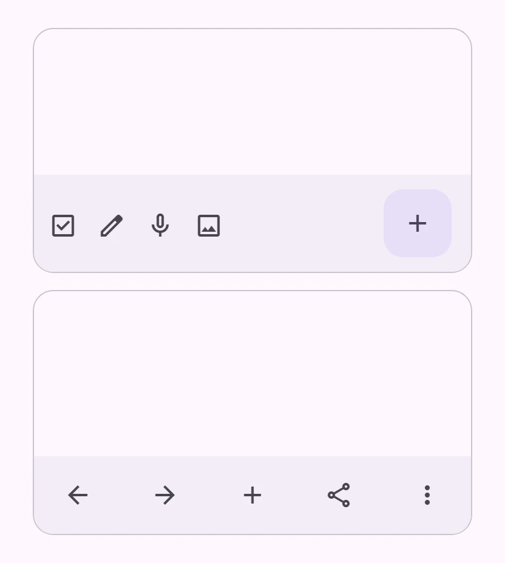
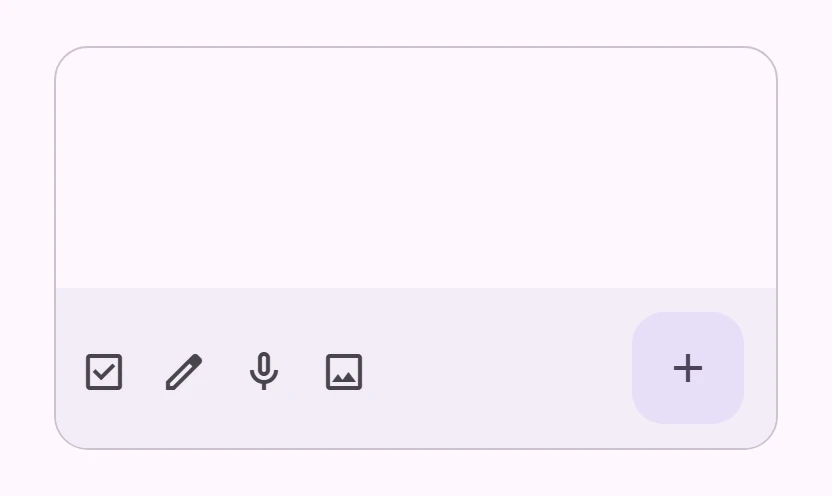
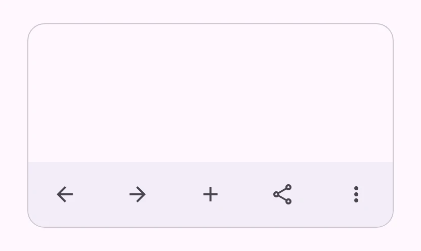

<!-- catalog-only-start --><!-- ---
name: Bottom app bar
dirname: bottomappbar
-----><!-- catalog-only-end -->

<catalog-component-header>
<catalog-component-header-title slot="title">

# Bottom app bar

<!-- no-catalog-start -->

<!-- [TOC] -->

<!-- external-only-start -->
**This documentation is fully rendered on the
[petal-elements catalog](https://petal.anontokyo.vip/catalog/components/bottom-app-bar/).**
<!-- external-only-end -->

<!-- no-catalog-end -->

[Bottom app bars](https://m3.material.io/components/bottom-app-bar)<!-- {.external} -->
show navigation and key actions at the bottom of the screen.

</catalog-component-header-title>



</catalog-component-header>

*   [Design article](https://m3.material.io/components/bottom-app-bar) <!-- {.external} -->
*   [API Documentation](#api)
*   [Source code](https://github.com/Saki340/petal-elements/tree/main/appbar)
    <!-- {.external} -->

This follows Jetpack Compose Material 3 (`BottomAppBar`,
`FlexibleBottomAppBar`, `BottomAppBarDefaults`, `BottomAppBarTokens`,
`DockedToolbarTokens`).

## Usage

Put icon buttons in `petal-bottom-app-bar` for the actions, and a floating
action button in its `fab` slot. Place the bar at the bottom of the page, for
example with `position: fixed; inset: auto 0 0`, and leave room for it under
the content.

<!-- no-catalog-start -->



<!-- no-catalog-end -->
<!-- catalog-include "figures/bottomappbar/usage.html" -->

```html
<petal-bottom-app-bar style="position: fixed; inset: auto 0 0">
  <petal-icon-button aria-label="Mark as done"><petal-icon>check_box</petal-icon></petal-icon-button>
  <petal-icon-button aria-label="Edit"><petal-icon>edit</petal-icon></petal-icon-button>
  <petal-icon-button aria-label="Record"><petal-icon>mic</petal-icon></petal-icon-button>
  <petal-icon-button aria-label="Add an image"><petal-icon>image</petal-icon></petal-icon-button>
  <petal-fab slot="fab" variant="secondary" aria-label="New note">
    <petal-icon slot="icon">add</petal-icon>
  </petal-fab>
</petal-bottom-app-bar>
```

Compose's samples use a secondary FAB; the bar takes its shadow away
(`bottomAppBarFabElevation`).

### Flexible

`flexible` is the Material 3 Expressive bottom app bar: lower, with its content
spread across it. It has no `fab` slot.

<!-- no-catalog-start -->



<!-- no-catalog-end -->
<!-- catalog-include "figures/bottomappbar/usage-flexible.html" -->

```html
<petal-bottom-app-bar flexible style="position: fixed; inset: auto 0 0">
  <petal-icon-button aria-label="Back"><petal-icon>arrow_back</petal-icon></petal-icon-button>
  <petal-icon-button aria-label="Forward"><petal-icon>arrow_forward</petal-icon></petal-icon-button>
  <petal-icon-button aria-label="New tab"><petal-icon>add</petal-icon></petal-icon-button>
  <petal-icon-button aria-label="Share"><petal-icon>share</petal-icon></petal-icon-button>
  <petal-icon-button aria-label="More"><petal-icon>more_vert</petal-icon></petal-icon-button>
</petal-bottom-app-bar>
```

### Hiding on scroll

With `hide-on-scroll`, the bar moves down out of the way as the content
scrolls down, by as much as it scrolls, and comes back as it scrolls up
(Compose's `exitAlwaysScrollBehavior`). Left part way when scrolling stops, it
slides to the closer end. A touch drag on the bar moves it too. The page
scrolls by default; set `scroll-target` to the id of another scrolling
element. `hiddenFraction` reads how far it is hidden, `hide-change` reports
changes, and `show()` brings it back.

```html
<petal-bottom-app-bar hide-on-scroll style="position: fixed; inset: auto 0 0">
  ...
</petal-bottom-app-bar>
```

## Accessibility

Name every icon button with `aria-label`. The bar has no role of its own; to
make it a landmark, wrap it in `<nav>` or give it `role="toolbar"` and an
`aria-label`.

## Compose behavior

*   The bar is 80dp high on surface-container, with no shadow. The actions sit
    4dp from the start and the top (16dp minus the icon buttons' 12dp), and the
    floating action button 12dp from the top and 16dp from the end.
*   The flexible bar is 64dp high with 16dp at the ends and its content spread
    out (`Arrangement.SpaceBetween`).
*   The bottom safe area of the page adds to the height.
*   A bar left part way hidden goes to the closer end on the fast spatial
    spring.

## Theming

Token                                   | Default value
--------------------------------------- | -----------------------------------
`--md-bottom-app-bar-container-color`   | `--md-sys-color-surface-container`
`--md-bottom-app-bar-container-height`  | `80px` (`64px` when flexible)
`--md-bottom-app-bar-container-shape`   | `--md-sys-shape-corner-none`
`--md-bottom-app-bar-content-color`     | `--md-sys-color-on-surface-variant`

<!-- auto-generated API docs start -->

## API


### PetalBottomAppBar <code>&lt;petal-bottom-app-bar&gt;</code>

#### Properties

<!-- mdformat off(autogenerated might break rendering in catalog) -->

| Property | Attribute | Type | Default | Description |
| --- | --- | --- | --- | --- |
| `flexible` | `flexible` | `boolean` | `false` | The Material 3 Expressive flexible bottom app bar: 64px high, its content spread with 16px at the ends, and no floating action button slot. |
| `hideOnScroll` | `hide-on-scroll` | `boolean` | `false` | Slides the bar away while the page scrolls down. |
| `scrollTarget` | `scroll-target` | `string` | `''` | The id of the scrolling element under the bar. Without it, the page scrolls. |
| `hiddenFraction` |  | `number` | `undefined` |  |

<!-- mdformat on(autogenerated might break rendering in catalog) -->

#### Methods

<!-- mdformat off(autogenerated might break rendering in catalog) -->

| Method | Parameters | Returns | Description |
| --- | --- | --- | --- |
| `show` | _None_ | `void` | Shows the bar again, sliding. |

<!-- mdformat on(autogenerated might break rendering in catalog) -->

#### Events

<!-- mdformat off(autogenerated might break rendering in catalog) -->

| Event | Type | [Bubbles](https://developer.mozilla.org/en-US/docs/Web/API/Event/bubbles) | [Composed](https://developer.mozilla.org/en-US/docs/Web/API/Event/composed) | Description |
| --- | --- | --- | --- | --- |
| `hide-change` | `Event` | No | No | The hidden fraction changed. |

<!-- mdformat on(autogenerated might break rendering in catalog) -->

#### Slots

<!-- mdformat off(autogenerated might break rendering in catalog) -->

| Slot | Description |
| --- | --- |
| _default_ | The actions: icon buttons, at the start (spread out when `flexible`). |
| `fab` | A floating action button at the end (not with `flexible`). |

<!-- mdformat on(autogenerated might break rendering in catalog) -->

<!-- auto-generated API docs end -->
