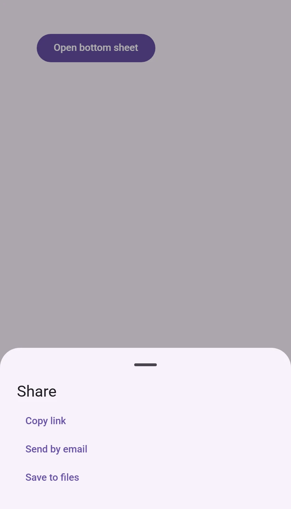
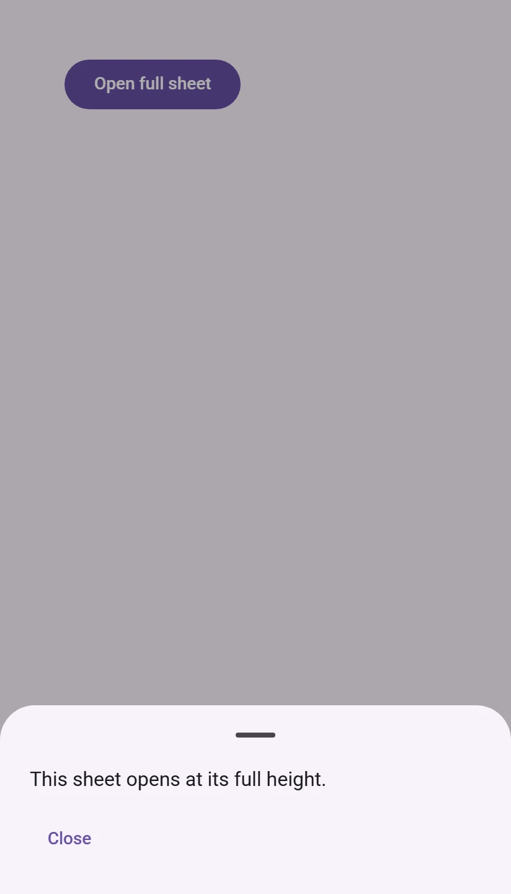
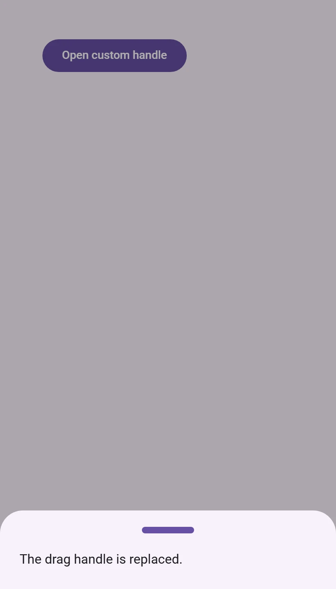
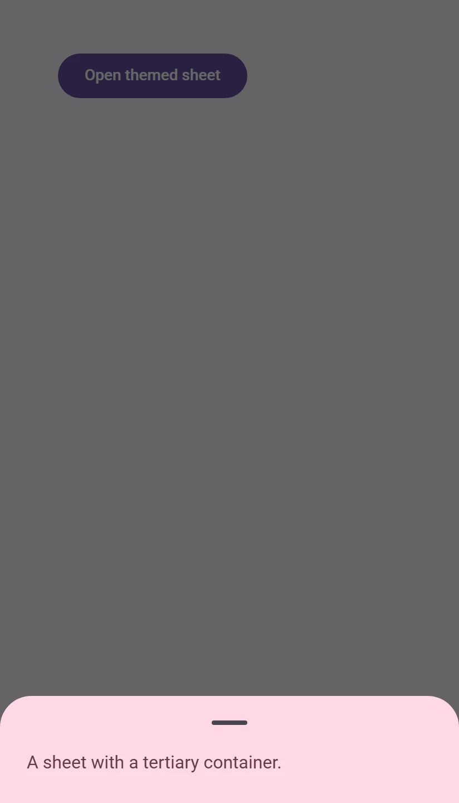

<!-- catalog-only-start --><!-- ---
name: Bottom sheet
dirname: sheet
-----><!-- catalog-only-end -->

<catalog-component-header>
<catalog-component-header-title slot="title">

# Bottom sheet

<!-- no-catalog-start -->

<!-- [TOC] -->

<!-- external-only-start -->
**This documentation is fully rendered on the
[petal-elements catalog](https://petal.anontokyo.vip/catalog/components/bottom-sheet/).**
<!-- external-only-end -->

<!-- no-catalog-end -->

[Bottom sheets](https://m3.material.io/components/bottom-sheets)<!-- {.external} -->
show secondary content anchored to the bottom of the screen, above a scrim.
This one is modal: the page behind it is inert until the sheet is dismissed.

</catalog-component-header-title>


</catalog-component-header>

*   [Design article](https://m3.material.io/components/bottom-sheets) <!-- {.external} -->
*   [API Documentation](#api)
*   [Source code](https://github.com/Saki340/petal-elements/tree/main/sheet)
    <!-- {.external} -->

The values and the behavior follow Jetpack Compose Material 3
(`ModalBottomSheet`, `BottomSheetDefaults`, `SheetState`, `SheetBottomTokens`
and `ScrimTokens`). Compose has no stable side sheet component and no side
sheet tokens, so there is no `petal-side-sheet`.

## Usage

Put the content in the sheet and call `show()`. The sheet slides up from the
bottom, over a scrim, to half of the page, or to its own height when that is
smaller. It is as wide as the page up to 640px.

<!-- no-catalog-start -->



<!-- no-catalog-end -->
<!-- catalog-include "figures/sheet/usage.html" -->

```html
<petal-bottom-sheet id="share" aria-label="Share">
  <div style="padding: 0 24px 24px">
    <h2>Share</h2>
    <petal-text-button>Copy link</petal-text-button>
    <petal-text-button>Send by email</petal-text-button>
  </div>
</petal-bottom-sheet>
<script type="module">
  import 'petal-elements/sheet/bottom-sheet.js';
  document.querySelector('#share').show();
</script>
```

`show()` and `close()` return promises that resolve when the animation is
finished. The sheet can also be opened and closed with the `open` attribute
and property.

### Moving the sheet

A sheet rests in one of three places, like Compose's `SheetValue`: `hidden`,
`partially-expanded` and `expanded`. `state` tells where it is.

*   Drag the sheet, with a finger or the mouse, from the drag handle or from
    the content. It follows the pointer and, when let go, settles on the
    closest place in the direction it was thrown: a fast fling (more than
    125px per second) goes to the next place that way, a slower drag goes
    there once it has moved 56px away from where it started. A sheet that
    settles on `hidden` closes.
*   `expand()` and `partialExpand()` move it by script.
*   The drag handle is a button: it expands a partially expanded sheet and
    dismisses an expanded one. With the keyboard, the arrow up key on it
    expands the sheet, and the arrow down key collapses it to its partial
    height, or dismisses it.
*   When the content is taller than an expanded sheet, the content scrolls.
    Drag the handle to move the sheet then.

### Dismissing

Clicking the scrim closes the sheet. Pressing Escape collapses an expanded
sheet to its partial height, as Compose's back handling does, and closes it
when it is partially expanded or has no partial height. Both fire a
cancelable `cancel` event first.

### Skipping the partial height

`skip-partially-expanded` opens the sheet at its full height, and dragging it
moves it between expanded and hidden, like Compose's
`skipPartiallyExpanded`.

<!-- no-catalog-start -->



<!-- no-catalog-end -->
<!-- catalog-include "figures/sheet/usage-skip.html" -->

```html
<petal-bottom-sheet skip-partially-expanded>...</petal-bottom-sheet>
```

### Drag handle

The default drag handle is a 32px by 4px bar. Put your own in the
`drag-handle` slot, or remove it with `no-drag-handle`. The handle's button
is named by `dismiss-label` while the sheet is expanded and by `expand-label`
while it is partially expanded.

<!-- no-catalog-start -->



<!-- no-catalog-end -->
<!-- catalog-include "figures/sheet/usage-drag-handle.html" -->

```html
<petal-bottom-sheet>
  <div slot="drag-handle" style="width: 64px; height: 8px; border-radius: 4px; background: gray"></div>
  ...
</petal-bottom-sheet>
```

### Events

`open` and `close` fire before the animation, and can be canceled. A sheet that
is dragged away and has its `close` event canceled springs back to where it
was. `opened` and `closed` fire after the animation.

```js
sheet.addEventListener('close', (event) => {
  if (hasUnsavedChanges) event.preventDefault();
});
```

### Motion

The sheet is moved by springs from the motion scheme, as in Compose: it opens
and settles on the default spatial spring, which bounces a little, and hides
on the fast effects spring. The scrim fades on the default effects spring. A
dragged sheet carries the velocity of the pointer into its spring. The
springs follow `--md-sys-motion-spring-*`, so
[`motion-standard.css`](../expressive.md) switches the sheet to the standard
scheme. `quick` and `prefers-reduced-motion` move the sheet without animation.

## Accessibility

The sheet is a modal `<dialog>` with `role="dialog"` and `aria-modal="true"`.
Set `aria-label` to name it; without one it is "Bottom Sheet", the pane title
Compose gives it. Focus moves into the sheet when it opens (to the drag
handle, or to the child with `autofocus`), stays in it while it is open, and
returns to where it was when it closes. Disable the focus trap with
`no-focus-trap` only when the sheet is more accessible without it.

The drag handle is the keyboard and screen reader route to everything dragging
does: it is a button whose name says what activating it does (expand or
dismiss), and it handles the arrow keys. Do not remove it (`no-drag-handle`)
without another way to dismiss the sheet; Escape and the scrim still work.

## Theming

Bottom sheets support [Material theming](../theming/README.md). Every token of
Compose's `SheetBottomTokens` and `ScrimTokens` used by `ModalBottomSheet` is
a `--md-bottom-sheet-*` custom property.

### Tokens

Token                                   | Default value
--------------------------------------- | -------------
`--md-bottom-sheet-container-color`     | `--md-sys-color-surface-container-low`
`--md-bottom-sheet-container-shape`     | `--md-sys-shape-corner-extra-large-top`
`--md-bottom-sheet-content-color`       | `--md-sys-color-on-surface`
`--md-bottom-sheet-drag-handle-color`   | `--md-sys-color-on-surface-variant`
`--md-bottom-sheet-drag-handle-width`   | `32px`
`--md-bottom-sheet-drag-handle-height`  | `4px`
`--md-bottom-sheet-focus-indicator-color` | `--md-sys-color-secondary`
`--md-bottom-sheet-max-width`           | `640px`
`--md-bottom-sheet-scrim-color`         | `--md-sys-color-scrim`
`--md-bottom-sheet-scrim-opacity`       | `0.32`

*   [All tokens](https://github.com/Saki340/petal-elements/blob/main/tokens/versions/compose/values/_md-comp-sheet-bottom.scss)
    <!-- {.external} -->

### Example

<!-- no-catalog-start -->



<!-- no-catalog-end -->
<!-- catalog-include "figures/sheet/theming.html" -->

```html
<style>
  petal-bottom-sheet {
    --md-bottom-sheet-container-color: var(--md-sys-color-tertiary-container);
    --md-bottom-sheet-content-color: var(--md-sys-color-on-tertiary-container);
    --md-bottom-sheet-scrim-opacity: 0.6;
  }
</style>
```

<!-- auto-generated API docs start -->

## API


### PetalBottomSheet <code>&lt;petal-bottom-sheet&gt;</code>

#### Properties

<!-- mdformat off(autogenerated might break rendering in catalog) -->

| Property | Attribute | Type | Default | Description |
| --- | --- | --- | --- | --- |
| `skipPartiallyExpanded` | `skip-partially-expanded` | `boolean` | `false` | Skips the partially expanded state: the sheet opens expanded, and dragging it moves it between expanded and hidden (Compose's `skipPartiallyExpanded`). |
| `quick` | `quick` | `boolean` | `false` | Moves the sheet without animations. |
| `noDragHandle` | `no-drag-handle` | `boolean` | `false` | Removes the drag handle (Compose's `dragHandle = null`). The sheet can still be dragged. |
| `noFocusTrap` | `no-focus-trap` | `boolean` | `false` | Disables focus trapping, which by default keeps keyboard Tab navigation within the sheet. |
| `dismissLabel` | `dismiss-label` | `string` | `'Dismiss bottom sheet'` | The accessible name of the drag handle while the sheet is expanded, where it dismisses the sheet (Compose's `BottomSheetDismissDescription`). |
| `expandLabel` | `expand-label` | `string` | `'Expand bottom sheet'` | The accessible name of the drag handle while the sheet is partially expanded, where it expands the sheet (Compose's `BottomSheetExpandDescription`). |
| `open` | `open` | `boolean` | `undefined` |  |
| `state` |  | `SheetValue` | `undefined` |  |

<!-- mdformat on(autogenerated might break rendering in catalog) -->

#### Methods

<!-- mdformat off(autogenerated might break rendering in catalog) -->

| Method | Parameters | Returns | Description |
| --- | --- | --- | --- |
| `show` | _None_ | `Promise<void>` | Opens the sheet and fires a cancelable `open` event. After the sheet's animation, an `opened` event is fired.<br>Add an `autofocus` attribute to a child of the sheet that should receive focus after opening. |
| `close` | _None_ | `Promise<void>` | Closes the sheet and fires a cancelable `close` event. After the sheet's animation, a `closed` event is fired. |
| `expand` | _None_ | `Promise<void>` | Expands the sheet to its full height (SheetState.expand()). |
| `partialExpand` | _None_ | `Promise<void>` | Collapses the sheet to its partially expanded height (SheetState.partialExpand()). |

<!-- mdformat on(autogenerated might break rendering in catalog) -->

#### Events

<!-- mdformat off(autogenerated might break rendering in catalog) -->

| Event | Type | [Bubbles](https://developer.mozilla.org/en-US/docs/Web/API/Event/bubbles) | [Composed](https://developer.mozilla.org/en-US/docs/Web/API/Event/composed) | Description |
| --- | --- | --- | --- | --- |
| `open` | `Event` | No | No | Dispatched when the sheet is opening before any animations. Cancelable. |
| `opened` | `Event` | No | No | Dispatched when the sheet has opened after any animations. |
| `close` | `Event` | No | No | Dispatched when the sheet is closing before any animations. Cancelable; a sheet dragged away springs back. |
| `closed` | `Event` | No | No | Dispatched when the sheet has closed after any animations. |
| `cancel` | `Event` | No | No | Dispatched when the user asks to dismiss the sheet with Escape or the scrim. Cancelable. |

<!-- mdformat on(autogenerated might break rendering in catalog) -->

<!-- auto-generated API docs end -->
