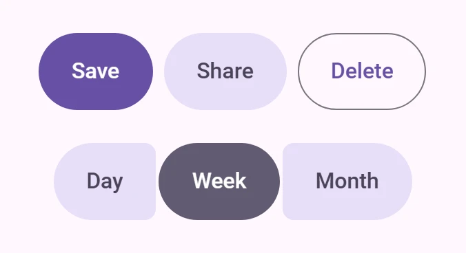

<!-- catalog-only-start --><!-- ---
name: Button group
dirname: button-group
-----><!-- catalog-only-end -->

<catalog-component-header>
<catalog-component-header-title slot="title">

# Button group

<!-- no-catalog-start -->

<!-- [TOC] -->

<!-- external-only-start -->
**This documentation is fully rendered on the
[petal-elements catalog](https://saki340.github.io/petal-elements/components/button-group/).**
<!-- external-only-end -->

<!-- no-catalog-end -->

[Button groups](https://m3.material.io/components/button-groups)<!-- {.external} -->
arrange related buttons in a row. A Material 3 Expressive component.

</catalog-component-header-title>



</catalog-component-header>

*   [Design article](https://m3.material.io/components/button-groups) <!-- {.external} -->
*   [API Documentation](#api)
*   [Source code](https://github.com/Saki340/petal-elements/tree/main/buttongroup)
    <!-- {.external} -->

## Usage

Put buttons in a `<petal-button-group>`. In a standard group the buttons are
spaced apart; a pressed button widens by 15% of its width and its neighbors
make room, while the group keeps its width.

<!-- no-catalog-start -->


<!-- no-catalog-end -->
<!-- catalog-include "figures/buttongroup/usage.html" -->

```html
<petal-button-group>
  <petal-filled-tonal-button>Day</petal-filled-tonal-button>
  <petal-filled-tonal-button>Week</petal-filled-tonal-button>
  <petal-filled-tonal-button>Month</petal-filled-tonal-button>
</petal-button-group>
```

### Connected

`connected` places the buttons 2px apart with small inner corners. The inner
corners get smaller while a button is pressed, and a selected toggle button is
fully round. With `single-select`, selecting a toggle button deselects the
others, and clicking the selected one keeps it selected.

<!-- no-catalog-start -->


<!-- no-catalog-end -->
<!-- catalog-include "figures/buttongroup/usage-connected.html" -->

```html
<petal-button-group connected single-select>
  <petal-filled-tonal-button toggle>Day</petal-filled-tonal-button>
  <petal-filled-tonal-button toggle selected>Week</petal-filled-tonal-button>
  <petal-filled-tonal-button toggle>Month</petal-filled-tonal-button>
</petal-button-group>
```

### Sizes

`size` (`xsmall` to `xlarge`, default `small`) sets the spacing and corners of
the group. Buttons without their own `size` get the group's size.

<!-- no-catalog-start -->


<!-- no-catalog-end -->
<!-- catalog-include "figures/buttongroup/usage-sizes.html" -->

```html
<div style="display: grid; gap: 16px; justify-items: center">
  <petal-button-group connected size="xsmall">
    <petal-outlined-button>One</petal-outlined-button>
    <petal-outlined-button>Two</petal-outlined-button>
    <petal-outlined-button>Three</petal-outlined-button>
  </petal-button-group>
  <petal-button-group connected size="small">
    <petal-outlined-button>One</petal-outlined-button>
    <petal-outlined-button>Two</petal-outlined-button>
    <petal-outlined-button>Three</petal-outlined-button>
  </petal-button-group>
  <petal-button-group connected size="medium">
    <petal-outlined-button>One</petal-outlined-button>
    <petal-outlined-button>Two</petal-outlined-button>
    <petal-outlined-button>Three</petal-outlined-button>
  </petal-button-group>
</div>
```

## Accessibility

The group has `role="group"`. Give it an accessible name with `aria-label` or
`aria-labelledby` when the buttons' purpose is not clear on its own.

```html
<petal-button-group aria-label="Calendar view" connected single-select>
  <petal-filled-tonal-button toggle selected>Day</petal-filled-tonal-button>
  <petal-filled-tonal-button toggle>Week</petal-filled-tonal-button>
</petal-button-group>
```

Toggle buttons set `aria-pressed`.

## Theming

A button group has no tokens of its own; its spacing and corners come from
`md.comp.button-group.*` in the Material Design tokens v34. Theme the buttons
inside it as usual. See
[Material 3 Expressive features](../expressive.md#button-group) for the values.

<!-- auto-generated API docs start -->

## API


### PetalButtonGroup <code>&lt;petal-button-group&gt;</code>

#### Properties

<!-- mdformat off(autogenerated might break rendering in catalog) -->

| Property | Attribute | Type | Default | Description |
| --- | --- | --- | --- | --- |
| `size` | `size` | `ButtonSize` | `'small'` | Size of the group and of buttons that have no size of their own. |
| `connected` | `connected` | `boolean` | `false` | Connected layout: buttons 2px apart with small inner corners. |
| `singleSelect` | `single-select` | `boolean` | `false` | Only one toggle button can be selected. Selecting one deselects the others; clicking the selected one keeps it selected. |

<!-- mdformat on(autogenerated might break rendering in catalog) -->

<!-- auto-generated API docs end -->
