<!-- catalog-only-start --><!-- ---
name: Buttons
dirname: button
-----><!-- catalog-only-end -->

<catalog-component-header>
<catalog-component-header-title slot="title">

# Buttons

<!-- no-catalog-start -->

<!-- [TOC] -->

<!-- external-only-start -->
**This documentation is fully rendered on the
[petal-elements catalog](https://petal.anontokyo.vip/catalog/components/button/).**
<!-- external-only-end -->

<!-- no-catalog-end -->

[Buttons](https://m3.material.io/components/buttons)<!-- {.external} -->
start an action, such as sending a message or saving a form.

There are five types of common buttons: elevated, filled, filled tonal,
outlined, and text.

</catalog-component-header-title>


</catalog-component-header>

*   [Design article](https://m3.material.io/components/buttons) <!-- {.external} -->
*   [API Documentation](#api)
*   [Source code](https://github.com/Saki340/petal-elements/tree/main/button)
    <!-- {.external} -->

<!-- catalog-only-start -->

<!--

## Interactive Demo



-->

<!-- catalog-only-end -->

## Types

<!-- no-catalog-start -->

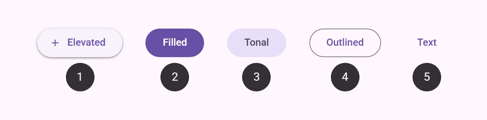

<!-- no-catalog-end -->
<!-- catalog-only-start -->

<!--

<div class="figure-wrapper">
  <figure
      class="types-image"
      style="justify-content:center;"
      title="Elevated, filled, filled tonal, outlined, and text buttons"
      aria-label="The 5 types of common buttons">
    <style>
      .types-image .wrapper,
      .types-image .wrapper > * {
        display: flex;
        padding: 8px;
        flex-wrap: wrap;
        justify-content: center;
      }
      .types-image .wrapper > * {
        flex-direction: column;
        align-items: center;
        padding-inline: 16px;
      }
      .types-image span {
        display: inline-flex;
        background-color: var(--md-sys-color-inverse-surface);
        color: var(--md-sys-color-inverse-on-surface);
        padding: 8px;
        margin-block-start: 8px;
        width: 24px;
        height: 24px;
        border-radius: 50%;
        justify-content: center;
        align-items: center;
      }
    </style>
    <div class="wrapper">
      <div>
        <petal-elevated-button has-icon>
          <petal-icon slot="icon">add</petal-icon>
          Elevated
        </petal-elevated-button>
        <span>1</span>
      </div>
      <div>
        <petal-filled-button>Filled</petal-filled-button>
        <span>2</span>
      </div>
      <div>
        <petal-filled-tonal-button>Tonal</petal-filled-tonal-button>
        <span>3</span>
      </div>
      <div>
        <petal-outlined-button>Outlined</petal-outlined-button>
        <span>4</span>
      </div>
      <div>
        <petal-text-button>Text</petal-text-button>
        <span>5</span>
      </div>
    </div>
  </figure>
</div>

-->

<!-- catalog-only-end -->

1.  [Elevated button](#elevated-button)
1.  [Filled button](#filled-button)
1.  [Filled tonal button](#filled-tonal-button)
1.  [Outlined button](#outlined-button)
1.  [Text button](#text-button)

## Usage

Buttons have label text that describes the action that will occur if a user taps
a button.

<!-- no-catalog-start -->


<!-- no-catalog-end -->
<!-- catalog-only-start -->

<!--

<div class="figure-wrapper">
  <figure
      style="justify-content:center;gap: 8px;"
      title="Outlined and filled buttons."
      aria-label="An outlined button with the text 'Back' next to a filled button with the text 'Complete'">
    <petal-outlined-button>Back</petal-outlined-button>
    <petal-filled-button>Complete</petal-filled-button>
  </figure>
</div>

-->

<!-- catalog-only-end -->

```html
<petal-outlined-button>Back</petal-outlined-button>
<petal-filled-button>Complete</petal-filled-button>
```

### Icon

An icon may optionally be added to a button to help communicate the button's
action and help draw attention.

<!-- no-catalog-start -->


<!-- no-catalog-end -->
<!-- catalog-only-start -->

<!--

<div class="figure-wrapper">
  <figure
      style="justify-content:center;gap: 8px;"
      title="Outlined and filled buttons."
      aria-label="An outlined button with the text 'Back' next to a filled button with the text 'Complete'">
    <petal-filled-tonal-button>
      Send
      <svg slot="icon" viewBox="0 0 48 48"><path d="M6 40V8l38 16Zm3-4.65L36.2 24 9 12.5v8.4L21.1 24 9 27Zm0 0V12.5 27Z"/></svg>
    </petal-filled-tonal-button>

    <petal-text-button trailing-icon>
      Open
      <svg slot="icon" viewBox="0 0 48 48"><path d="M9 42q-1.2 0-2.1-.9Q6 40.2 6 39V9q0-1.2.9-2.1Q7.8 6 9 6h13.95v3H9v30h30V25.05h3V39q0 1.2-.9 2.1-.9.9-2.1.9Zm10.1-10.95L17 28.9 36.9 9H25.95V6H42v16.05h-3v-10.9Z"/></svg>
    </petal-text-button>
  </figure>
</div>

-->

<!-- catalog-only-end -->

```html
<petal-filled-tonal-button>
  Send
  <svg slot="icon" viewBox="0 0 48 48"><path d="M6 40V8l38 16Zm3-4.65L36.2 24 9 12.5v8.4L21.1 24 9 27Zm0 0V12.5 27Z"/></svg>
</petal-filled-tonal-button>

<petal-text-button trailing-icon>
  Open
  <svg slot="icon" viewBox="0 0 48 48"><path d="M9 42q-1.2 0-2.1-.9Q6 40.2 6 39V9q0-1.2.9-2.1Q7.8 6 9 6h13.95v3H9v30h30V25.05h3V39q0 1.2-.9 2.1-.9.9-2.1.9Zm10.1-10.95L17 28.9 36.9 9H25.95V6H42v16.05h-3v-10.9Z"/></svg>
</petal-text-button>
```

### Sizes

Buttons come in five sizes from the Material 3 Expressive button tokens:
`xsmall` (32px), `small` (40px), `medium` (56px), `large` (96px) and `xlarge`
(136px). Set the `size` attribute; without it, a button keeps the original
40px look.

<!-- no-catalog-start -->


<!-- no-catalog-end -->
<!-- catalog-include "figures/button/usage-sizes.html" -->

```html
<petal-filled-button size="xsmall">Extra small</petal-filled-button>
<petal-filled-button size="small">Small</petal-filled-button>
<petal-filled-button size="medium">Medium</petal-filled-button>
<petal-filled-button size="large">Large</petal-filled-button>
<petal-filled-button size="xlarge">XL</petal-filled-button>
```

Each size reads its values from public tokens named after the size, such as
`--md-button-small-leading-space`, `--md-button-small-trailing-space`,
`--md-button-small-icon-size`, `--md-button-small-icon-label-space` and
`--md-button-small-container-height`.

A button with an icon and no label is icon only: the icon has no gap after it
and the button has no minimum width, so its padding sets its width. Use the
padding tokens for a more compact button.

```html
<petal-filled-tonal-button
    size="small"
    aria-label="Swap currencies"
    style="--md-button-small-leading-space: 8px; --md-button-small-trailing-space: 8px">
  <petal-icon slot="icon">swap_horiz</petal-icon>
</petal-filled-tonal-button>
```

### Shapes

Sized buttons are round by default. Set `shape="square"` for rounded square
corners. While pressed, the corners morph to a smaller radius with a spring
animation.

<!-- no-catalog-start -->

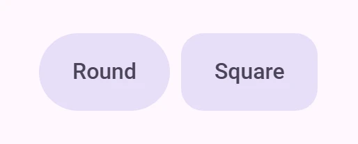

<!-- no-catalog-end -->
<!-- catalog-include "figures/button/usage-shapes.html" -->

```html
<petal-filled-tonal-button size="medium">Round</petal-filled-tonal-button>
<petal-filled-tonal-button size="medium" shape="square">Square</petal-filled-tonal-button>
```

### Toggle buttons

Add `toggle` to make a button switch between unselected and selected on
click, like Compose's `ToggleButton`. `selected` holds the state; the button
fires `input` and `change` events when the user toggles it and sets
`aria-pressed`. A selected round button becomes square and the other way
round. Text buttons cannot be toggle buttons.

Toggle colors come from public tokens for each state, named after the button,
such as `--md-filled-button-unselected-container-color`,
`--md-filled-button-selected-container-color`,
`--md-filled-button-unselected-label-text-color` and
`--md-filled-button-selected-icon-color` (also `-hover-`, `-focus-` and
`-pressed-` label, icon and state layer colors).

<!-- no-catalog-start -->


<!-- no-catalog-end -->
<!-- catalog-include "figures/button/usage-toggle.html" -->

```html
<div style="display: grid; grid-template-columns: repeat(4, auto); gap: 8px">
  <petal-filled-button size="small" toggle>Filled</petal-filled-button>
  <petal-filled-tonal-button size="small" toggle>Tonal</petal-filled-tonal-button>
  <petal-outlined-button size="small" toggle>Outlined</petal-outlined-button>
  <petal-elevated-button size="small" toggle>Elevated</petal-elevated-button>
  <petal-filled-button size="small" toggle selected>Filled</petal-filled-button>
  <petal-filled-tonal-button size="small" toggle selected>Tonal</petal-filled-tonal-button>
  <petal-outlined-button size="small" toggle selected>Outlined</petal-outlined-button>
  <petal-elevated-button size="small" toggle selected>Elevated</petal-elevated-button>
</div>
```

See [Material 3 Expressive features](../expressive.md) for the values, the
motion and where they follow Compose rather than the tokens. Several buttons
can be put in a [button group](button-group.md).

## Accessibility

Add an
[`aria-label`](https://developer.mozilla.org/en-US/docs/Web/Accessibility/ARIA/Attributes/aria-label)<!-- {.external} -->
attribute to buttons whose labels need a more descriptive label.

```html
<petal-elevated-button aria-label="Add a new contact">Add</petal-elevated-button>
```

### Focusable and disabled

By default, disabled buttons are not focusable with the keyboard, while
"soft-disabled" buttons are. Some use cases encourage focusability of disabled
toolbar items to increase their discoverability.

See the
[ARIA guidelines on focusability of disabled controls](https://www.w3.org/WAI/ARIA/apg/practices/keyboard-interface/#kbd_disabled_controls)<!-- {.external} -->
for guidance on when this is recommended.

```html
<div role="toolbar">
  <petal-text-button>Copy</petal-text-button>
  <petal-text-button>Cut</petal-text-button>
  <!--
    This button is disabled but kept focusable to improve its discoverability
    in the toolbar.
  -->
  <petal-text-button soft-disabled>Paste</petal-text-button>
</div>
```

## Elevated button

[Elevated buttons](https://m3.material.io/components/buttons/guidelines#4e89da4d-a8fa-4e20-bb8d-b8a93eff3e3e)<!-- {.external} -->
are tonal buttons with a shadow. Use them sparingly, for example when a button
sits on a busy background and needs to stand out.

<!-- no-catalog-start -->

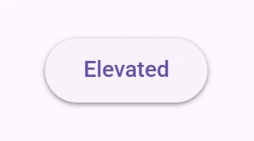

<!-- no-catalog-end -->
<!-- catalog-only-start -->

<!--

<div class="figure-wrapper">
  <figure
      style="justify-content:center;align-items:center;"
      aria-label="An elevated button.">
    <petal-elevated-button>Elevated</petal-elevated-button>
  </figure>
</div>

-->

<!-- catalog-only-end -->

```html
<petal-elevated-button>Elevated</petal-elevated-button>
```

## Filled button

[Filled buttons](https://m3.material.io/components/buttons/guidelines#9ecffdb3-ef29-47e7-8d5d-f78b404fcafe)<!-- {.external} -->
have the strongest emphasis of the common buttons. Use them for the main action
of a screen or flow, such as Save or Confirm.

<!-- no-catalog-end -->
<!-- catalog-only-start -->

<!--

<div class="figure-wrapper">
  <figure
      style="justify-content:center;align-items:center;"
      aria-label="A filled button.">
    <petal-filled-button>Filled</petal-filled-button>
  </figure>
</div>

-->

<!-- catalog-only-end -->

```html
<petal-filled-button>Filled</petal-filled-button>
```

## Filled tonal button

A
[filled tonal button](https://m3.material.io/components/buttons/guidelines#07a1577b-aaf5-4824-a698-03526421058b)<!-- {.external} -->
sits between filled and outlined buttons: more emphasis than an outline, less
than a solid fill. "Next" in a multi-step form is a typical use.

<!-- no-catalog-start -->

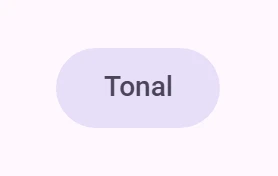

<!-- no-catalog-end -->
<!-- catalog-only-start -->

<!--

<div class="figure-wrapper">
  <figure
      style="justify-content:center;align-items:center;"
      aria-label="A tonal button.">
    <petal-filled-tonal-button>Tonal</petal-filled-tonal-button>
  </figure>
</div>

-->

<!-- catalog-only-end -->

```html
<petal-filled-tonal-button>Tonal</petal-filled-tonal-button>
```

## Outlined button

[Outlined buttons](https://m3.material.io/components/buttons/guidelines#3742b09f-c224-43e0-a83e-541bd29d0f05)<!-- {.external} -->
have medium emphasis, for actions that matter but are not the main one on the
screen.

<!-- no-catalog-start -->

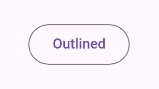

<!-- no-catalog-end -->
<!-- catalog-only-start -->

<!--

<div class="figure-wrapper">
  <figure
      style="justify-content:center;align-items:center;"
      aria-label="An outlined button.">
    <petal-outlined-button>Outlined</petal-outlined-button>
  </figure>
</div>

-->

<!-- catalog-only-end -->

```html
<petal-outlined-button>Outlined</petal-outlined-button>
```

## Text button

[Text buttons](https://m3.material.io/components/buttons/guidelines#c9bcbc0b-ee05-45ad-8e80-e814ae919fbb)<!-- {.external} -->
have the least emphasis. They suit secondary actions, especially when several
options are shown together.

<!-- no-catalog-start -->

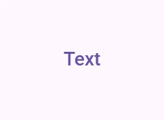

<!-- no-catalog-end -->
<!-- catalog-only-start -->

<!--

<div class="figure-wrapper">
  <figure
      style="justify-content:center;align-items:center;"
      aria-label="A text button.">
    <petal-text-button>Text</petal-text-button>
  </figure>
</div>

-->

<!-- catalog-only-end -->

```html
<petal-text-button>Text</petal-text-button>
```

## Theming

Button supports [Material theming](../theming/README.md) and can be customized
in terms of color, typography, and shape.

### Elevated button tokens

Token                                   | Default value
--------------------------------------- | -------------------------------------
`--md-elevated-button-container-color`  | `--md-sys-color-surface`
`--md-elevated-button-container-shape`  | `--md-sys-shape-corner-full`
`--md-elevated-button-label-text-color` | `--md-sys-color-on-surface`
`--md-elevated-button-label-text-font`  | `--md-sys-typescale-label-large-font`

*   [All tokens](https://github.com/Saki340/petal-elements/blob/main/tokens/_md-comp-elevated-button.scss)
    <!-- {.external} -->

### Elevated button example

<!-- no-catalog-start -->

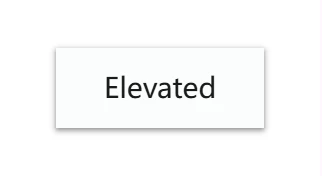

<!-- no-catalog-end -->
<!-- catalog-only-start -->

<!--

<div class="figure-wrapper">
  <figure
      style="justify-content:center;align-items:center;"
      class="styled-example"
      title="Elevated button theming example."
      aria-label="Image of an elevated button with a different theme applied">
    <style>
      .styled-example {
        background-color: white;
        --md-elevated-button-container-shape: 0px;
        --md-elevated-button-label-text-font: system-ui;
        --md-sys-color-surface-container-low: #FAFDFC;
        --md-sys-color-primary: #191C1C;
      }
    </style>

    <petal-elevated-button>Elevated</petal-elevated-button>
  </figure>
</div>

-->

<!-- catalog-only-end -->

```html
<style>
:root {
  --md-elevated-button-container-shape: 0px;
  --md-elevated-button-label-text-font: system-ui;
  --md-sys-color-surface-container-low: #FAFDFC;
  --md-sys-color-primary: #191C1C;
}
</style>

<petal-elevated-button>Elevated</petal-elevated-button>
```

### Filled button tokens

Token                                 | Default value
------------------------------------- | -------------------------------------
`--md-filled-button-container-color`  | `--md-sys-color-primary`
`--md-filled-button-container-shape`  | `--md-sys-shape-corner-full`
`--md-filled-button-label-text-color` | `--md-sys-color-on-primary`
`--md-filled-button-label-text-font`  | `--md-sys-typescale-label-large-font`

*   [All tokens](https://github.com/Saki340/petal-elements/blob/main/tokens/_md-comp-filled-button.scss)
    <!-- {.external} -->

### Filled button example

<!-- no-catalog-start -->

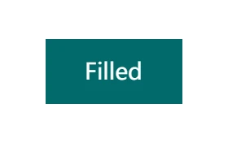

<!-- no-catalog-end -->
<!-- catalog-only-start -->

<!--

<div class="figure-wrapper">
  <figure
      style="justify-content:center;align-items:center;"
      class="styled-example"
      title="Filled button theming example."
      aria-label="Image of a filled button with a different theme applied">
    <style>
      .styled-example {
        background-color: white;
        --md-filled-button-container-shape: 0px;
        --md-filled-button-label-text-font: system-ui;
        --md-sys-color-primary: #006A6A;
        --md-sys-color-on-primary: #FFFFFF;
      }
    </style>

    <petal-filled-button>Filled</petal-filled-button>
  </figure>
</div>

-->

<!-- catalog-only-end -->

```html
<style>
:root {
  --md-filled-button-container-shape: 0px;
  --md-filled-button-label-text-font: system-ui;
  --md-sys-color-primary: #006A6A;
  --md-sys-color-on-primary: #FFFFFF;
}
</style>

<petal-filled-button>Filled</petal-filled-button>
```

### Filled tonal button tokens

Token                                       | Default value
------------------------------------------- | -------------
`--md-filled-tonal-button-container-color`  | `--md-sys-color-secondary-container`
`--md-filled-tonal-button-container-shape`  | `--md-sys-shape-corner-full`
`--md-filled-tonal-button-label-text-color` | `--md-sys-color-on-secondary-container`
`--md-filled-tonal-button-label-text-font`  | `--md-sys-typescale-label-large-font`

*   [All tokens](https://github.com/Saki340/petal-elements/blob/main/tokens/_md-comp-filled-tonal-button.scss)
    <!-- {.external} -->

### Filled tonal button example

<!-- no-catalog-start -->

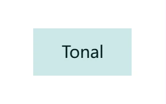

<!-- no-catalog-end -->
<!-- catalog-only-start -->

<!--

<div class="figure-wrapper">
  <figure
      style="justify-content:center;align-items:center;"
      class="styled-example"
      title="Tonal button theming example."
      aria-label="Image of a tonal button with a different theme applied">
    <style>
      .styled-example {
        background-color: white;
        --md-filled-tonal-button-container-shape: 0px;
        --md-filled-tonal-button-label-text-font: system-ui;
        --md-sys-color-secondary-container: #CCE8E7;
        --md-sys-color-on-secondary-container: #051F1F;
      }
    </style>

    <petal-filled-tonal-button>Tonal</petal-filled-tonal-button>
  </figure>
</div>

-->

<!-- catalog-only-end -->

```html
<style>
:root {
  --md-filled-tonal-button-container-shape: 0px;
  --md-filled-tonal-button-label-text-font: system-ui;
  --md-sys-color-secondary-container: #CCE8E7;
  --md-sys-color-on-secondary-container: #051F1F;
}
</style>

<petal-filled-tonal-button>Tonal</petal-filled-tonal-button>
```

### Outlined button tokens

Token                                   | Default value
--------------------------------------- | -------------------------------------
`--md-outlined-button-outline-color`    | `--md-sys-color-outline`
`--md-outlined-button-container-shape`  | `--md-sys-shape-corner-full`
`--md-outlined-button-label-text-color` | `--md-sys-color-primary`
`--md-outlined-button-label-text-font`  | `--md-sys-typescale-label-large-font`

*   [All tokens](https://github.com/Saki340/petal-elements/blob/main/tokens/_md-comp-outlined-button.scss)
    <!-- {.external} -->

### Outlined button example

<!-- no-catalog-start -->

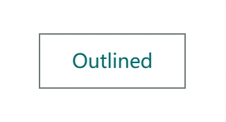

<!-- no-catalog-end -->
<!-- catalog-only-start -->

<!--

<div class="figure-wrapper">
  <figure
      style="justify-content:center;align-items:center;"
      class="styled-example"
      title="Outlined button theming example."
      aria-label="Image of a outlined button with a different theme applied">
    <style>
      .styled-example {
        background-color: white;
        --md-outlined-button-container-shape: 0px;
        --md-outlined-button-label-text-font: system-ui;
        --md-sys-color-primary: #006A6A;
        --md-sys-color-outline: #6F7979;
      }
    </style>

    <petal-outlined-button>Outlined</petal-outlined-button>
  </figure>
</div>

-->

<!-- catalog-only-end -->

```html
<style>
:root {
  --md-outlined-button-container-shape: 0px;
  --md-outlined-button-label-text-font: system-ui;
  --md-sys-color-primary: #006A6A;
  --md-sys-color-outline: #6F7979;
}
</style>

<petal-outlined-button>Outlined</petal-outlined-button>
```

### Text button tokens

Token                               | Default value
----------------------------------- | -------------------------------------
`--md-text-button-label-text-color` | `--md-sys-color-primary`
`--md-text-button-label-text-font`  | `--md-sys-typescale-label-large-font`

*   [All tokens](https://github.com/Saki340/petal-elements/blob/main/tokens/_md-comp-text-button.scss)
    <!-- {.external} -->

### Text button example

<!-- no-catalog-start -->

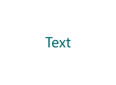

<!-- no-catalog-end -->
<!-- catalog-only-start -->

<!--

<div class="figure-wrapper">
  <figure
      style="justify-content:center;align-items:center;"
      class="styled-example"
      title="Text button theming example."
      aria-label="Image of a text button with a different theme applied">
    <style>
      .styled-example {
        background-color: white;
        --md-text-button-label-text-font: system-ui;
        --md-sys-color-primary: #006A6A;
      }
    </style>

    <petal-text-button>Text</petal-text-button>
  </figure>
</div>

-->

<!-- catalog-only-end -->

```html
<style>
:root {
  --md-text-button-label-text-font: system-ui;
  --md-sys-color-primary: #006A6A;
}
</style>

<petal-text-button>Text</petal-text-button>
```

<!-- auto-generated API docs start -->

## API


### PetalElevatedButton <code>&lt;petal-elevated-button&gt;</code>

#### Properties

<!-- mdformat off(autogenerated might break rendering in catalog) -->

| Property | Attribute | Type | Default | Description |
| --- | --- | --- | --- | --- |
| `softDisabled` | `soft-disabled` | `boolean` | `false` | Whether or not the button is "soft-disabled" (disabled but still focusable).<br>Use this when a button needs increased visibility when disabled. See https://www.w3.org/WAI/ARIA/apg/practices/keyboard-interface/#kbd_disabled_controls for more guidance on when this is needed. |
| `href` | `href` | `string` | `''` | The URL that the link button points to. |
| `download` | `download` | `string` | `''` | The filename to use when downloading the linked resource. If not specified, the browser will determine a filename. This is only applicable when the button is used as a link (`href` is set). |
| `target` | `target` | `"" \| "_blank" \| "_parent" \| "_self" \| "_top"` | `''` | Where to display the linked `href` URL for a link button. Common options include `_blank` to open in a new tab. |
| `rel` | `rel` | `string` | `''` | Sets the underlying `HTMLAnchorElement`'s `rel` attribute when `href` is set. |
| `referrerPolicy` | `referrerpolicy` | `string` | `''` | Sets the underlying `HTMLAnchorElement`'s `referrerpolicy` attribute when `href` is set. |
| `trailingIcon` | `trailing-icon` | `boolean` | `false` | Whether to render the icon at the inline end of the label rather than the inline start.<br>_Note:_ Link buttons cannot have trailing icons. |
| `hasIcon` | `has-icon` | `boolean` | `false` | Whether to display the icon or not. |
| `size` | `size` | `ButtonSize` | `undefined` | Material 3 Expressive size. Sets the height, padding, icon size, label typescale and shapes, and makes the shape morph while pressed. Without a size, the button keeps its original metrics. |
| `shape` | `shape` | `ButtonShape` | `undefined` | Container shape of a sized button: `round` (default) or `square`. |
| `toggle` | `toggle` | `boolean` | `false` | When true, the button toggles between selected and unselected on click and exposes `aria-pressed`. Not available for text buttons or links. |
| `selected` | `selected` | `boolean` | `false` | Whether a toggle button is selected. |
| `name` | `name` | `string` | `undefined` | The HTML name to use in form submission. |
| `disabled` | `disabled` | `boolean` | `undefined` | Whether or not the element is disabled. |
| `type` | `type` | `string` | `'submit'` | A string indicating the form submission behavior of the element.<br>- submit: The element submits the form. This is the default value if the attribute is not specified, or if it is dynamically changed to an empty or invalid value. - reset: The element resets the form. - button: The element does nothing. |
| `value` | `value` | `string` | `''` | The value of the button. When combined with a `name`, the submitting button's name/value will be added to the form. |
| `form` |  | `HTMLFormElement` | `undefined` | The associated form element with which this element's value will submit. |
| `labels` |  | `NodeList` | `undefined` | The labels this element is associated with. |

<!-- mdformat on(autogenerated might break rendering in catalog) -->

#### Events

<!-- mdformat off(autogenerated might break rendering in catalog) -->

| Event | Type | [Bubbles](https://developer.mozilla.org/en-US/docs/Web/API/Event/bubbles) | [Composed](https://developer.mozilla.org/en-US/docs/Web/API/Event/composed) | Description |
| --- | --- | --- | --- | --- |
| `input` | `InputEvent` | Yes | Yes | Dispatched when a toggle button toggles |
| `change` | `Event` | Yes | No | Dispatched when a toggle button toggles |

<!-- mdformat on(autogenerated might break rendering in catalog) -->

### PetalFilledButton <code>&lt;petal-filled-button&gt;</code>

#### Properties

<!-- mdformat off(autogenerated might break rendering in catalog) -->

| Property | Attribute | Type | Default | Description |
| --- | --- | --- | --- | --- |
| `softDisabled` | `soft-disabled` | `boolean` | `false` | Whether or not the button is "soft-disabled" (disabled but still focusable).<br>Use this when a button needs increased visibility when disabled. See https://www.w3.org/WAI/ARIA/apg/practices/keyboard-interface/#kbd_disabled_controls for more guidance on when this is needed. |
| `href` | `href` | `string` | `''` | The URL that the link button points to. |
| `download` | `download` | `string` | `''` | The filename to use when downloading the linked resource. If not specified, the browser will determine a filename. This is only applicable when the button is used as a link (`href` is set). |
| `target` | `target` | `"" \| "_blank" \| "_parent" \| "_self" \| "_top"` | `''` | Where to display the linked `href` URL for a link button. Common options include `_blank` to open in a new tab. |
| `rel` | `rel` | `string` | `''` | Sets the underlying `HTMLAnchorElement`'s `rel` attribute when `href` is set. |
| `referrerPolicy` | `referrerpolicy` | `string` | `''` | Sets the underlying `HTMLAnchorElement`'s `referrerpolicy` attribute when `href` is set. |
| `trailingIcon` | `trailing-icon` | `boolean` | `false` | Whether to render the icon at the inline end of the label rather than the inline start.<br>_Note:_ Link buttons cannot have trailing icons. |
| `hasIcon` | `has-icon` | `boolean` | `false` | Whether to display the icon or not. |
| `size` | `size` | `ButtonSize` | `undefined` | Material 3 Expressive size. Sets the height, padding, icon size, label typescale and shapes, and makes the shape morph while pressed. Without a size, the button keeps its original metrics. |
| `shape` | `shape` | `ButtonShape` | `undefined` | Container shape of a sized button: `round` (default) or `square`. |
| `toggle` | `toggle` | `boolean` | `false` | When true, the button toggles between selected and unselected on click and exposes `aria-pressed`. Not available for text buttons or links. |
| `selected` | `selected` | `boolean` | `false` | Whether a toggle button is selected. |
| `name` | `name` | `string` | `undefined` | The HTML name to use in form submission. |
| `disabled` | `disabled` | `boolean` | `undefined` | Whether or not the element is disabled. |
| `type` | `type` | `string` | `'submit'` | A string indicating the form submission behavior of the element.<br>- submit: The element submits the form. This is the default value if the attribute is not specified, or if it is dynamically changed to an empty or invalid value. - reset: The element resets the form. - button: The element does nothing. |
| `value` | `value` | `string` | `''` | The value of the button. When combined with a `name`, the submitting button's name/value will be added to the form. |
| `form` |  | `HTMLFormElement` | `undefined` | The associated form element with which this element's value will submit. |
| `labels` |  | `NodeList` | `undefined` | The labels this element is associated with. |

<!-- mdformat on(autogenerated might break rendering in catalog) -->

#### Events

<!-- mdformat off(autogenerated might break rendering in catalog) -->

| Event | Type | [Bubbles](https://developer.mozilla.org/en-US/docs/Web/API/Event/bubbles) | [Composed](https://developer.mozilla.org/en-US/docs/Web/API/Event/composed) | Description |
| --- | --- | --- | --- | --- |
| `input` | `InputEvent` | Yes | Yes | Dispatched when a toggle button toggles |
| `change` | `Event` | Yes | No | Dispatched when a toggle button toggles |

<!-- mdformat on(autogenerated might break rendering in catalog) -->

### PetalFilledTonalButton <code>&lt;petal-filled-tonal-button&gt;</code>

#### Properties

<!-- mdformat off(autogenerated might break rendering in catalog) -->

| Property | Attribute | Type | Default | Description |
| --- | --- | --- | --- | --- |
| `softDisabled` | `soft-disabled` | `boolean` | `false` | Whether or not the button is "soft-disabled" (disabled but still focusable).<br>Use this when a button needs increased visibility when disabled. See https://www.w3.org/WAI/ARIA/apg/practices/keyboard-interface/#kbd_disabled_controls for more guidance on when this is needed. |
| `href` | `href` | `string` | `''` | The URL that the link button points to. |
| `download` | `download` | `string` | `''` | The filename to use when downloading the linked resource. If not specified, the browser will determine a filename. This is only applicable when the button is used as a link (`href` is set). |
| `target` | `target` | `"" \| "_blank" \| "_parent" \| "_self" \| "_top"` | `''` | Where to display the linked `href` URL for a link button. Common options include `_blank` to open in a new tab. |
| `rel` | `rel` | `string` | `''` | Sets the underlying `HTMLAnchorElement`'s `rel` attribute when `href` is set. |
| `referrerPolicy` | `referrerpolicy` | `string` | `''` | Sets the underlying `HTMLAnchorElement`'s `referrerpolicy` attribute when `href` is set. |
| `trailingIcon` | `trailing-icon` | `boolean` | `false` | Whether to render the icon at the inline end of the label rather than the inline start.<br>_Note:_ Link buttons cannot have trailing icons. |
| `hasIcon` | `has-icon` | `boolean` | `false` | Whether to display the icon or not. |
| `size` | `size` | `ButtonSize` | `undefined` | Material 3 Expressive size. Sets the height, padding, icon size, label typescale and shapes, and makes the shape morph while pressed. Without a size, the button keeps its original metrics. |
| `shape` | `shape` | `ButtonShape` | `undefined` | Container shape of a sized button: `round` (default) or `square`. |
| `toggle` | `toggle` | `boolean` | `false` | When true, the button toggles between selected and unselected on click and exposes `aria-pressed`. Not available for text buttons or links. |
| `selected` | `selected` | `boolean` | `false` | Whether a toggle button is selected. |
| `name` | `name` | `string` | `undefined` | The HTML name to use in form submission. |
| `disabled` | `disabled` | `boolean` | `undefined` | Whether or not the element is disabled. |
| `type` | `type` | `string` | `'submit'` | A string indicating the form submission behavior of the element.<br>- submit: The element submits the form. This is the default value if the attribute is not specified, or if it is dynamically changed to an empty or invalid value. - reset: The element resets the form. - button: The element does nothing. |
| `value` | `value` | `string` | `''` | The value of the button. When combined with a `name`, the submitting button's name/value will be added to the form. |
| `form` |  | `HTMLFormElement` | `undefined` | The associated form element with which this element's value will submit. |
| `labels` |  | `NodeList` | `undefined` | The labels this element is associated with. |

<!-- mdformat on(autogenerated might break rendering in catalog) -->

#### Events

<!-- mdformat off(autogenerated might break rendering in catalog) -->

| Event | Type | [Bubbles](https://developer.mozilla.org/en-US/docs/Web/API/Event/bubbles) | [Composed](https://developer.mozilla.org/en-US/docs/Web/API/Event/composed) | Description |
| --- | --- | --- | --- | --- |
| `input` | `InputEvent` | Yes | Yes | Dispatched when a toggle button toggles |
| `change` | `Event` | Yes | No | Dispatched when a toggle button toggles |

<!-- mdformat on(autogenerated might break rendering in catalog) -->

### PetalOutlinedButton <code>&lt;petal-outlined-button&gt;</code>

#### Properties

<!-- mdformat off(autogenerated might break rendering in catalog) -->

| Property | Attribute | Type | Default | Description |
| --- | --- | --- | --- | --- |
| `softDisabled` | `soft-disabled` | `boolean` | `false` | Whether or not the button is "soft-disabled" (disabled but still focusable).<br>Use this when a button needs increased visibility when disabled. See https://www.w3.org/WAI/ARIA/apg/practices/keyboard-interface/#kbd_disabled_controls for more guidance on when this is needed. |
| `href` | `href` | `string` | `''` | The URL that the link button points to. |
| `download` | `download` | `string` | `''` | The filename to use when downloading the linked resource. If not specified, the browser will determine a filename. This is only applicable when the button is used as a link (`href` is set). |
| `target` | `target` | `"" \| "_blank" \| "_parent" \| "_self" \| "_top"` | `''` | Where to display the linked `href` URL for a link button. Common options include `_blank` to open in a new tab. |
| `rel` | `rel` | `string` | `''` | Sets the underlying `HTMLAnchorElement`'s `rel` attribute when `href` is set. |
| `referrerPolicy` | `referrerpolicy` | `string` | `''` | Sets the underlying `HTMLAnchorElement`'s `referrerpolicy` attribute when `href` is set. |
| `trailingIcon` | `trailing-icon` | `boolean` | `false` | Whether to render the icon at the inline end of the label rather than the inline start.<br>_Note:_ Link buttons cannot have trailing icons. |
| `hasIcon` | `has-icon` | `boolean` | `false` | Whether to display the icon or not. |
| `size` | `size` | `ButtonSize` | `undefined` | Material 3 Expressive size. Sets the height, padding, icon size, label typescale and shapes, and makes the shape morph while pressed. Without a size, the button keeps its original metrics. |
| `shape` | `shape` | `ButtonShape` | `undefined` | Container shape of a sized button: `round` (default) or `square`. |
| `toggle` | `toggle` | `boolean` | `false` | When true, the button toggles between selected and unselected on click and exposes `aria-pressed`. Not available for text buttons or links. |
| `selected` | `selected` | `boolean` | `false` | Whether a toggle button is selected. |
| `name` | `name` | `string` | `undefined` | The HTML name to use in form submission. |
| `disabled` | `disabled` | `boolean` | `undefined` | Whether or not the element is disabled. |
| `type` | `type` | `string` | `'submit'` | A string indicating the form submission behavior of the element.<br>- submit: The element submits the form. This is the default value if the attribute is not specified, or if it is dynamically changed to an empty or invalid value. - reset: The element resets the form. - button: The element does nothing. |
| `value` | `value` | `string` | `''` | The value of the button. When combined with a `name`, the submitting button's name/value will be added to the form. |
| `form` |  | `HTMLFormElement` | `undefined` | The associated form element with which this element's value will submit. |
| `labels` |  | `NodeList` | `undefined` | The labels this element is associated with. |

<!-- mdformat on(autogenerated might break rendering in catalog) -->

#### Events

<!-- mdformat off(autogenerated might break rendering in catalog) -->

| Event | Type | [Bubbles](https://developer.mozilla.org/en-US/docs/Web/API/Event/bubbles) | [Composed](https://developer.mozilla.org/en-US/docs/Web/API/Event/composed) | Description |
| --- | --- | --- | --- | --- |
| `input` | `InputEvent` | Yes | Yes | Dispatched when a toggle button toggles |
| `change` | `Event` | Yes | No | Dispatched when a toggle button toggles |

<!-- mdformat on(autogenerated might break rendering in catalog) -->

### PetalTextButton <code>&lt;petal-text-button&gt;</code>

#### Properties

<!-- mdformat off(autogenerated might break rendering in catalog) -->

| Property | Attribute | Type | Default | Description |
| --- | --- | --- | --- | --- |
| `softDisabled` | `soft-disabled` | `boolean` | `false` | Whether or not the button is "soft-disabled" (disabled but still focusable).<br>Use this when a button needs increased visibility when disabled. See https://www.w3.org/WAI/ARIA/apg/practices/keyboard-interface/#kbd_disabled_controls for more guidance on when this is needed. |
| `href` | `href` | `string` | `''` | The URL that the link button points to. |
| `download` | `download` | `string` | `''` | The filename to use when downloading the linked resource. If not specified, the browser will determine a filename. This is only applicable when the button is used as a link (`href` is set). |
| `target` | `target` | `"" \| "_blank" \| "_parent" \| "_self" \| "_top"` | `''` | Where to display the linked `href` URL for a link button. Common options include `_blank` to open in a new tab. |
| `rel` | `rel` | `string` | `''` | Sets the underlying `HTMLAnchorElement`'s `rel` attribute when `href` is set. |
| `referrerPolicy` | `referrerpolicy` | `string` | `''` | Sets the underlying `HTMLAnchorElement`'s `referrerpolicy` attribute when `href` is set. |
| `trailingIcon` | `trailing-icon` | `boolean` | `false` | Whether to render the icon at the inline end of the label rather than the inline start.<br>_Note:_ Link buttons cannot have trailing icons. |
| `hasIcon` | `has-icon` | `boolean` | `false` | Whether to display the icon or not. |
| `size` | `size` | `ButtonSize` | `undefined` | Material 3 Expressive size. Sets the height, padding, icon size, label typescale and shapes, and makes the shape morph while pressed. Without a size, the button keeps its original metrics. |
| `shape` | `shape` | `ButtonShape` | `undefined` | Container shape of a sized button: `round` (default) or `square`. |
| `toggle` | `toggle` | `boolean` | `false` | When true, the button toggles between selected and unselected on click and exposes `aria-pressed`. Not available for text buttons or links. |
| `selected` | `selected` | `boolean` | `false` | Whether a toggle button is selected. |
| `name` | `name` | `string` | `undefined` | The HTML name to use in form submission. |
| `disabled` | `disabled` | `boolean` | `undefined` | Whether or not the element is disabled. |
| `type` | `type` | `string` | `'submit'` | A string indicating the form submission behavior of the element.<br>- submit: The element submits the form. This is the default value if the attribute is not specified, or if it is dynamically changed to an empty or invalid value. - reset: The element resets the form. - button: The element does nothing. |
| `value` | `value` | `string` | `''` | The value of the button. When combined with a `name`, the submitting button's name/value will be added to the form. |
| `form` |  | `HTMLFormElement` | `undefined` | The associated form element with which this element's value will submit. |
| `labels` |  | `NodeList` | `undefined` | The labels this element is associated with. |

<!-- mdformat on(autogenerated might break rendering in catalog) -->

#### Events

<!-- mdformat off(autogenerated might break rendering in catalog) -->

| Event | Type | [Bubbles](https://developer.mozilla.org/en-US/docs/Web/API/Event/bubbles) | [Composed](https://developer.mozilla.org/en-US/docs/Web/API/Event/composed) | Description |
| --- | --- | --- | --- | --- |
| `input` | `InputEvent` | Yes | Yes | Dispatched when a toggle button toggles |
| `change` | `Event` | Yes | No | Dispatched when a toggle button toggles |

<!-- mdformat on(autogenerated might break rendering in catalog) -->

<!-- auto-generated API docs end -->
