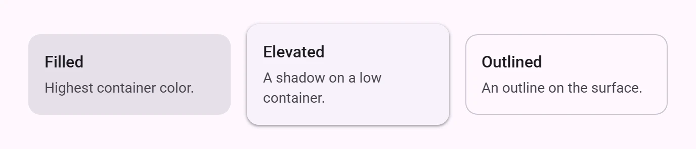
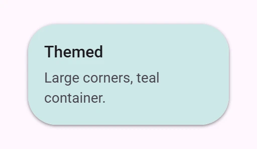

<!-- catalog-only-start --><!-- ---
name: Card
dirname: card
-----><!-- catalog-only-end -->

<catalog-component-header>
<catalog-component-header-title slot="title">

# Card

<!-- no-catalog-start -->

<!-- [TOC] -->

<!-- external-only-start -->
**This documentation is fully rendered on the
[petal-elements catalog](https://petal.anontokyo.vip/catalog/components/card/).**
<!-- external-only-end -->

<!-- no-catalog-end -->

[Cards](https://m3.material.io/components/cards)<!-- {.external} --> hold
content and actions about one subject.

</catalog-component-header-title>



</catalog-component-header>

*   [Design article](https://m3.material.io/components/cards) <!-- {.external} -->
*   [API Documentation](#api)
*   [Source code](https://github.com/Saki340/petal-elements/tree/main/card)
    <!-- {.external} -->

The values follow Jetpack Compose Material 3 (`FilledCardTokens`,
`ElevatedCardTokens`, `OutlinedCardTokens` and `CardDefaults`).

## Types

There are three cards: filled, elevated and outlined. Content goes in the
default slot; the card is a column and does not add padding.

<!-- no-catalog-start -->


<!-- no-catalog-end -->
<!-- catalog-include "figures/card/usage.html" -->

```html
<petal-filled-card>...</petal-filled-card>
<petal-elevated-card>...</petal-elevated-card>
<petal-outlined-card>...</petal-outlined-card>
```

## Clickable cards

With `href`, the whole card is a link; with `clickable`, a button (listen for
`click`). It gets a state layer, a focus ring and Compose's elevation for
hover, focus and press. Outlined cards keep their elevation, as in
`CardDefaults.outlinedCardElevation`. Give clickable cards an `aria-label`.

`disabled` uses the disabled container and content colors. `dragged` shows the
dragged elevation, for drag and drop.

<!-- no-catalog-start -->


<!-- no-catalog-end -->
<!-- catalog-include "figures/card/usage-clickable.html" -->

```html
<petal-elevated-card href="/articles/1" aria-label="Open article">
  ...
</petal-elevated-card>
<petal-filled-card clickable disabled aria-label="Unavailable">
  ...
</petal-filled-card>
```

A clickable card is one target: links and buttons inside it cannot be
clicked. Use a plain card with its own buttons when the card has several
actions.

### Mouse hover

With a mouse or trackpad, a clickable card lifts 3px while hovered, and its
hover layer is a soft light around the pointer (10% at the pointer, 2% at
180px) instead of an even one. Its elevation follows Compose (an elevated card
goes from level 1 to 2). These are petal-elements additions; with reduced
motion, the card lights without lifting.

### Moved from labs

The cards used to be in `petal-elements/labs/card/`. Those modules now
re-export these; import from `petal-elements/card/` instead.

## Accessibility

A plain card has no role. A clickable card is a link or a button named by its
`aria-label`; the content is not read as part of the name.

## Theming

Cards support [Material theming](../theming/README.md). Every token of the
Compose card tokens is a custom property: `--md-filled-card-*`,
`--md-elevated-card-*` and `--md-outlined-card-*`.

### Tokens

Token                                   | Default value
--------------------------------------- | -------------
`--md-filled-card-container-color`      | `--md-sys-color-surface-container-highest`
`--md-elevated-card-container-color`    | `--md-sys-color-surface-container-low`
`--md-outlined-card-container-color`    | `--md-sys-color-surface`
`--md-outlined-card-outline-color`      | `--md-sys-color-outline-variant`
`--md-filled-card-container-shape`      | `--md-sys-shape-corner-medium`
`--md-elevated-card-container-elevation` | `1`

*   [All tokens](https://github.com/Saki340/petal-elements/tree/main/tokens/versions/compose/values)
    <!-- {.external} -->

### Example

<!-- no-catalog-start -->



<!-- no-catalog-end -->
<!-- catalog-include "figures/card/theming.html" -->

```html
<style>
  petal-elevated-card {
    --md-elevated-card-container-shape: 28px;
    --md-elevated-card-container-color: #cce8e7;
  }
</style>
```

<!-- auto-generated API docs start -->

## API


### PetalFilledCard <code>&lt;petal-filled-card&gt;</code>

#### Properties

<!-- mdformat off(autogenerated might break rendering in catalog) -->

| Property | Attribute | Type | Default | Description |
| --- | --- | --- | --- | --- |
| `href` | `href` | `string` | `''` | Makes the whole card a link. |
| `target` | `target` | `string` | `''` | Where to open the link, as `<a target>`. |
| `clickable` | `clickable` | `boolean` | `false` | Makes the whole card a button. |
| `disabled` | `disabled` | `boolean` | `false` | Disables a clickable card. |
| `dragged` | `dragged` | `boolean` | `false` | Shows the dragged elevation, while the card is being dragged. |

<!-- mdformat on(autogenerated might break rendering in catalog) -->

#### Slots

<!-- mdformat off(autogenerated might break rendering in catalog) -->

| Slot | Description |
| --- | --- |
| _default_ | The card's content. Put your own padding inside it. |

<!-- mdformat on(autogenerated might break rendering in catalog) -->

### PetalElevatedCard <code>&lt;petal-elevated-card&gt;</code>

#### Properties

<!-- mdformat off(autogenerated might break rendering in catalog) -->

| Property | Attribute | Type | Default | Description |
| --- | --- | --- | --- | --- |
| `href` | `href` | `string` | `''` | Makes the whole card a link. |
| `target` | `target` | `string` | `''` | Where to open the link, as `<a target>`. |
| `clickable` | `clickable` | `boolean` | `false` | Makes the whole card a button. |
| `disabled` | `disabled` | `boolean` | `false` | Disables a clickable card. |
| `dragged` | `dragged` | `boolean` | `false` | Shows the dragged elevation, while the card is being dragged. |

<!-- mdformat on(autogenerated might break rendering in catalog) -->

#### Slots

<!-- mdformat off(autogenerated might break rendering in catalog) -->

| Slot | Description |
| --- | --- |
| _default_ | The card's content. Put your own padding inside it. |

<!-- mdformat on(autogenerated might break rendering in catalog) -->

### PetalOutlinedCard <code>&lt;petal-outlined-card&gt;</code>

#### Properties

<!-- mdformat off(autogenerated might break rendering in catalog) -->

| Property | Attribute | Type | Default | Description |
| --- | --- | --- | --- | --- |
| `href` | `href` | `string` | `''` | Makes the whole card a link. |
| `target` | `target` | `string` | `''` | Where to open the link, as `<a target>`. |
| `clickable` | `clickable` | `boolean` | `false` | Makes the whole card a button. |
| `disabled` | `disabled` | `boolean` | `false` | Disables a clickable card. |
| `dragged` | `dragged` | `boolean` | `false` | Shows the dragged elevation, while the card is being dragged. |

<!-- mdformat on(autogenerated might break rendering in catalog) -->

#### Slots

<!-- mdformat off(autogenerated might break rendering in catalog) -->

| Slot | Description |
| --- | --- |
| _default_ | The card's content. Put your own padding inside it. |

<!-- mdformat on(autogenerated might break rendering in catalog) -->

<!-- auto-generated API docs end -->
