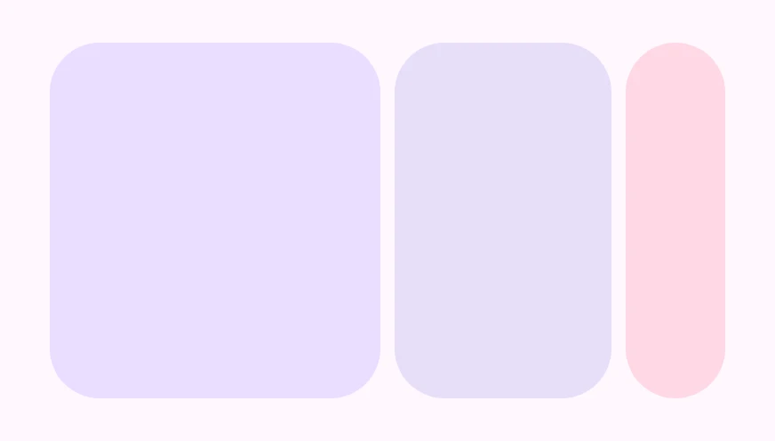
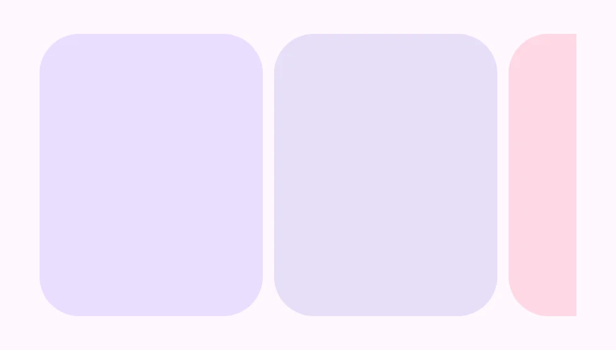

<!-- catalog-only-start --><!-- ---
name: Carousel
dirname: carousel
-----><!-- catalog-only-end -->

<catalog-component-header>
<catalog-component-header-title slot="title">

# Carousel

<!-- no-catalog-start -->

<!-- [TOC] -->

<!-- external-only-start -->
**This documentation is fully rendered on the
[petal-elements catalog](https://petal.anontokyo.vip/catalog/components/carousel/).**
<!-- external-only-end -->

<!-- no-catalog-end -->

[Carousels](https://m3.material.io/components/carousel)<!-- {.external} -->
show a collection of items that scroll on and off the screen.

</catalog-component-header-title>


</catalog-component-header>

*   [Design article](https://m3.material.io/components/carousel) <!-- {.external} -->
*   [API Documentation](#api)
*   [Source code](https://github.com/Saki340/petal-elements/tree/main/carousel)
    <!-- {.external} -->

This follows Jetpack Compose Material 3 (`HorizontalMultiBrowseCarousel`,
`HorizontalUncontainedCarousel`, `HorizontalCenteredHeroCarousel`,
`CarouselDefaults`, and the keylines, arrangements and snapping of the
carousel package).

## Usage

The children of `petal-carousel` are its items. Give the carousel a width and
a height (221px by default, the height of Compose's samples); each item fills
the height. Items are usually images, or blocks with an image background.

<!-- no-catalog-start -->



<!-- no-catalog-end -->
<!-- catalog-include "figures/carousel/usage.html" -->

```html
<petal-carousel item-width="186" item-spacing="8" style="height: 200px">
  
  
  
  ...
</petal-carousel>
```

### Multi-browse

The default `multi-browse` carousel shows large items of about `item-width`,
with medium and small ones after them, so more items are in view. As an item
scrolls toward the start it grows to the large size; leaving, it shrinks. The
large size is changed so that the items fit the width exactly, between
`min-small-item-width` (40px) and `max-small-item-width` (56px) for the small
ones. Scrolling stops at one item at a time.

### Uncontained

`uncontained` items all have one width, `item-width` plus `item-spacing` (as
in Compose), and the one at the end is cut by the edge. Scrolling does not
snap.

<!-- no-catalog-start -->



<!-- no-catalog-end -->
<!-- catalog-include "figures/carousel/usage-uncontained.html" -->

```html
<petal-carousel variant="uncontained" item-width="150" item-spacing="8">
  ...
</petal-carousel>
```

### Hero

`hero` puts one large item in the middle, with small items at its sides
(Compose's centered hero carousel). Without `item-width`, the large item fills
the width less the small items.

<!-- no-catalog-start -->


<!-- no-catalog-end -->
<!-- catalog-include "figures/carousel/usage-hero.html" -->

```html
<petal-carousel variant="hero" item-spacing="8">
  ...
</petal-carousel>
```

### Item content

Each item is as wide as the large size and is clipped to its shown width, in
the middle. Content that should follow the clip, such as a label, can use the
custom properties the carousel sets on each item:

*   `--carousel-item-mask-width`: the shown width, in px.
*   `--carousel-item-mask-fraction`: from 0 at the smallest size to 1 at the
    large size, for fading content in.

```css
petal-carousel > figure figcaption {
  opacity: calc((var(--carousel-item-mask-fraction) - 0.5) * 2);
}
```

`currentIndex` is the item at rest nearest the scroll position;
`scrollToItem(index)` scrolls an item to its resting place.

## Accessibility

The carousel is a region named "carousel" (`aria-roledescription`); give it an
`aria-label`. Items without a role become groups named "slide", labeled "1 of
5" and so on unless they have a label. The carousel can be focused and
scrolled with the arrow keys, and an item that takes focus scrolls to its
resting place. Name image items with `alt`.

## Compose behavior

*   Items scroll by the large size and spacing; each is moved to the keyline
    it is at and clipped to its size there, so the shown items fit the width
    without gaps of their own.
*   The arrangement of large, medium and small items is the lowest cost one
    Compose finds for the width (`Arrangement.findLowestCostArrangement`).
*   Near the ends, the keylines shift so that the first and last items rest
    at the edges.
*   The item nearest the current one is drawn above the others.
*   Items are clipped with the extra large corner, as in Compose's samples
    (`maskClip(MaterialTheme.shapes.extraLarge)`).

## Theming

Token                     | Default value
------------------------- | -------------------------------------
`--md-carousel-height`    | `221px`
`--md-carousel-item-shape` | `--md-sys-shape-corner-extra-large`

<!-- auto-generated API docs start -->

## API


### PetalCarousel <code>&lt;petal-carousel&gt;</code>

#### Properties

<!-- mdformat off(autogenerated might break rendering in catalog) -->

| Property | Attribute | Type | Default | Description |
| --- | --- | --- | --- | --- |
| `variant` | `variant` | `CarouselVariant` | `'multi-browse'` | `multi-browse`, `uncontained` or `hero` (centered). |
| `itemWidth` | `item-width` | `number` | `0` | The large items' width in px (`preferredItemWidth`, or `itemWidth` for `uncontained`). A hero carousel without it fills the width less its small items. |
| `itemSpacing` | `item-spacing` | `number` | `0` | The space between items in px (`itemSpacing`). |
| `minSmallItemWidth` | `min-small-item-width` | `number` | `40` | The small items' smallest width in px (CarouselDefaults.MinSmallItemSize). |
| `maxSmallItemWidth` | `max-small-item-width` | `number` | `56` | The small items' largest width in px (CarouselDefaults.MaxSmallItemSize). |
| `currentIndex` |  | `number` | `undefined` |  |

<!-- mdformat on(autogenerated might break rendering in catalog) -->

#### Methods

<!-- mdformat off(autogenerated might break rendering in catalog) -->

| Method | Parameters | Returns | Description |
| --- | --- | --- | --- |
| `scrollToItem` | `index`, `behavior` | `void` | Scrolls item `index` to its resting place. |

<!-- mdformat on(autogenerated might break rendering in catalog) -->

<!-- auto-generated API docs end -->
