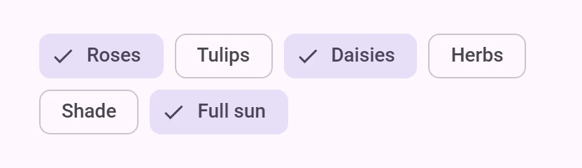

<!-- catalog-only-start --><!-- ---
name: Chips
dirname: chips
-----><!-- catalog-only-end -->

<catalog-component-header image-align="start">
<catalog-component-header-title slot="title">

# Chips

<!-- no-catalog-start -->

<!-- [TOC] -->

<!-- external-only-start -->
**This documentation is fully rendered on the
[petal-elements catalog](https://petal.anontokyo.vip/catalog/components/chip/)**
<!-- external-only-end -->

<!-- no-catalog-end -->

[Chips](https://m3.material.io/components/chips)<!-- {.external} -->
are compact elements for entering information, choosing options, filtering
content or starting actions.

While buttons are expected to appear consistently and with familiar calls to
action, chips should appear dynamically as a group of multiple interactive
elements.

</catalog-component-header-title>



</catalog-component-header>

*   [Design article](https://m3.material.io/components/chips) <!-- {.external} -->
*   [API Documentation](#api)
*   [Source code](https://github.com/Saki340/petal-elements/tree/main/chips)
    <!-- {.external} -->

## Types

1.  [Assist chip](#assist-chip)
1.  [Filter chip](#filter-chip)
1.  [Input chip](#input-chip)
1.  [Suggestion chip](#suggestion-chip)

<!-- catalog-only-start -->

<!--

## Interactive Demo



-->

<!-- catalog-only-end -->

## Usage

Choose the type of chip based on its purpose and author.

-   **Assist** chips are common actions, such as adding an event to a calendar.
-   **Filter** chips are tags used to filter content, such as shopping
    categories.
-   **Input** chips are pieces of information entered by a user, such as event
    attendees.
-   **Suggestion** chips represent dynamic suggestions for user input, such as
    text message replies.

<!-- Need to add catalog-include "figures/<component>/usage.html" -->

```html
<petal-chip-set>
  <petal-assist-chip label="Assist"></petal-assist-chip>
  <petal-filter-chip label="Filter"></petal-filter-chip>
  <petal-input-chip label="Input"></petal-input-chip>
  <petal-suggestion-chip label="Suggestion"></petal-suggestion-chip>
</petal-chip-set>
```

### Chip sets

Chips should always appear in a set. Chip sets are
[toolbars](https://developer.mozilla.org/en-US/docs/Web/Accessibility/ARIA/Roles/toolbar_role)<!-- {.external} -->
that can display any type of chip or other toolbar items.

<!-- Need to add catalog-include "figures/<component>/usage.html" -->

```html
<h3>New event</h3>
<petal-chip-set>
  <petal-filter-chip label="All day"></petal-filter-chip>
  <petal-assist-chip label="Add to calendar"></petal-assist-chip>
  <petal-assist-chip label="Set a reminder"></petal-assist-chip>
</petal-chip-set>
```

### Icons

All chips may display an optional icon. Input chips can specify if an avatar
picture is displayed.

```html
<petal-chip-set>
  <petal-assist-chip label="Add to calendar">
    <petal-icon slot="icon">event</petal-icon>
  </petal-assist-chip>

  <petal-input-chip label="Ping Qiang" avatar>
    
  </petal-input-chip>
</petal-chip-set>
```

### Elevated

Assist, filter, and suggestion chips can be elevated if the placement requires
protection, such as on top of an image.

```html
<div>
  
  <petal-chip-set>
    <petal-suggestion-chip label="Share" elevated></petal-suggestion-chip>
    <petal-suggestion-chip label="Favorite" elevated></petal-suggestion-chip>
  </petal-chip-set>
</div>
```

### Selection, removal and links

A filter chip toggles `selected` when clicked; listen for `click` and read
`selected` (calling `preventDefault()` on the click keeps the old state).
Input chips, and filter chips with `removable`, have a remove button: it fires
a cancelable `remove` event, then takes the chip out of the page. Name the
remove button with `aria-label-remove`. Assist and suggestion chips with
`href` (and `target`) are links.

```js
const chips = document.querySelector('petal-chip-set');
chips.addEventListener('click', () => {
  const filters = [...chips.querySelectorAll('petal-filter-chip[selected]')]
      .map((chip) => chip.label);
  console.log(filters);
});
chips.addEventListener('remove', (event) => {
  // event.target is the chip; preventDefault() keeps it.
});
```

## Accessibility

Add an
[`aria-label`](https://developer.mozilla.org/en-US/docs/Web/Accessibility/ARIA/Attributes/aria-label)<!-- {.external} -->
attribute to chip sets or reference a label with
[`aria-labelledby`](https://developer.mozilla.org/en-US/docs/Web/Accessibility/ARIA/Attributes/aria-labelledby)<!-- {.external} -->.
Add an `aria-label` to chips whose labels need to be more descriptive.

```html
<h3 id="dates-label">Dates</h3>
<petal-chip-set aria-labelledby="dates-label">
  <petal-filter-chip label="Mon" aria-label="Monday"></petal-filter-chip>
  <petal-filter-chip label="Tue" aria-label="Tuesday"></petal-filter-chip>
  <petal-filter-chip label="Wed" aria-label="Wednesday"></petal-filter-chip>
</petal-chip-set>
```

### Focusable and disabled

By default, disabled chips are not focusable with the keyboard, while
"soft-disabled" chips are. Some use cases encourage focusability of disabled
toolbar items to increase their discoverability.

See the
[ARIA guidelines on focusability of disabled controls](https://www.w3.org/WAI/ARIA/apg/practices/keyboard-interface/#kbd_disabled_controls)<!-- {.external} -->
for guidance on when this is recommended.

```html
<petal-chip-set aria-label="Actions">
  <!--
    Disabled until text is selected. Since both are disabled by default, keep
    them focusable so that screen readers can discover the actions available.
  -->
  <petal-assist-chip label="Copy" soft-disabled></petal-assist-chip>
  <petal-assist-chip label="Paste" soft-disabled></petal-assist-chip>
</petal-chip-set>
<petal-outlined-text-field type="textarea"></petal-outlined-text-field>
```

## Assist chip

[Assist chips](https://m3.material.io/components/chips/guidelines#5dd1928c-1476-4029-bdc5-fde66fc0dcb1)<!-- {.external} -->
offer a related action, such as adding an event to a calendar.

Assist chips function as though the user asked an assistant to complete the
action. They should appear dynamically and contextually in a UI.

```html
<h3>A restaraunt location</h3>
<petal-chip-set>
  <petal-assist-chip label="Add to my itinerary">
    <petal-icon slot="icon">calendar</petal-icon>
  </petal-assist-chip>
  <petal-assist-chip label="12 mins from hotel">
    <petal-icon slot="icon">map</petal-icon>
  </petal-assist-chip>
</petal-chip-set>
```

## Filter chip

[Filter chips](https://m3.material.io/components/chips/guidelines#8d453d50-8d8e-43aa-9ae3-87ed134d2e64)<!-- {.external} -->
narrow down content with tags or keywords. They can replace a row of toggle
buttons or checkboxes.

```html
<h3>Choose where to share</h3>
<petal-chip-set>
  <petal-filter-chip label="Docs"></petal-filter-chip>
  <petal-filter-chip label="Slides" selected></petal-filter-chip>
  <petal-filter-chip label="Sheets" selected></petal-filter-chip>
  <petal-filter-chip label="Images"></petal-filter-chip>
</petal-chip-set>
```

### Removable

Filter chips can optionally be removable from the chip set. Removable chips have
a trailing remove icon.

```html
<h3>Colors</h3>
<petal-chip-set>
  <petal-filter-chip label="Red" removable selected></petal-filter-chip>
  <petal-filter-chip label="Yellow" removable></petal-filter-chip>
  <petal-filter-chip label="Blue" removable></petal-filter-chip>
  <petal-filter-chip label="Green" removable></petal-filter-chip>
</petal-chip-set>
```

## Input chip

[Input chips](https://m3.material.io/components/chips/guidelines#4d2d5ef5-3fcd-46e9-99f2-067747b2393f)<!-- {.external} -->
show pieces of information that the user entered, such as recipients or search
terms.

Input chips whose icons are user images may add the `avatar` attribute to
display the image in a larger circle.

```html
<petal-outlined-text-field label="Attendees" type="email"></petal-outlined-text-field>

<petal-chip-set>
  <petal-input-chip label="Ping Qiang" avatar>
    
  </petal-input-chip>
  <petal-input-chip label="Thea Schröder" avatar>
    
  </petal-input-chip>
</petal-chip-set>
```

### Remove-only

All input chips are removable. If an input chip does not have an action
associated with clicking on it, it may be marked as `remove-only`.

```html
<h3>Favorite movies</h3>
<petal-chip-set>
  <petal-input-chip label="Star Wars" remove-only></petal-input-chip>
  <petal-input-chip label="Star Trek" remove-only></petal-input-chip>
</petal-chip-set>
```

## Suggestion chip

[Suggestion chips](https://m3.material.io/components/chips/guidelines#36d7bb16-a9bf-4cf6-a73d-8e05510d66a7)<!-- {.external} -->
offer generated suggestions, such as quick replies or search refinements.

```html
<h3>Suggested reply</h3>
<petal-chip-set>
  <petal-suggestion-chip label="I agree"></petal-suggestion-chip>
  <petal-suggestion-chip label="Looks good to me"></petal-suggestion-chip>
  <petal-suggestion-chip label="Thank you"></petal-suggestion-chip>
</petal-chip-set>
```

## Compose behavior

Chips follow Jetpack Compose Material 3 (`AssistChip`, `FilterChip`,
`InputChip`, `SuggestionChip`):

*   Chips are 32dp high with corner.small (8dp) corners, also input chips with
    an avatar (only the avatar is round). The label is 16dp from the sides, 8dp
    next to an icon; input chips have 12dp without an icon.
*   The ripple has the content color of the chip's surface: on-surface, or
    on-secondary-container when a filter or input chip is selected.
*   When a filter chip is selected, the checkmark takes its space from the
    start on the fast spatial spring and fades in; when it is deselected, the
    space shrinks on the default effects spring and the checkmark fades out. A
    chip with its own icon swaps the icon for the checkmark.
*   A flat filter chip rises to elevation level 1 while hovered.

### Expressive

`expressive` gives filter and input chips the expressive shapes of Compose's
`FilterChip` and `InputChip` with `shapes`: corner.medium (12dp) when not
selected, fully rounded when selected and corner.small while pressed, morphing
on the fast spatial spring. The space between an icon and the label is 4dp and
the leading icon is on-surface-variant. Assist and suggestion chips have no
expressive shapes in Compose, so mixing them with expressive chips mixes
corner sizes.

```html
<petal-chip-set>
  <petal-filter-chip expressive label="Nearby" selected></petal-filter-chip>
  <petal-filter-chip expressive label="Open now"></petal-filter-chip>
  <petal-filter-chip expressive label="Pet friendly"></petal-filter-chip>
</petal-chip-set>
```

## Theming

Chips support [Material theming](../theming/README.md) and can be customized in
terms of color, typography, and shape.

### Assist chip tokens

Token                               | Default value
----------------------------------- | -------------------------------------
`--md-assist-chip-outline-color`    | `--md-sys-color-outline`
`--md-assist-chip-container-shape`  | `--md-sys-shape-corner-small`
`--md-assist-chip-icon-size`        | `18px`
`--md-assist-chip-label-text-color` | `--md-sys-color-on-surface`
`--md-assist-chip-label-text-font`  | `--md-sys-typescale-label-large-font`

*   [All tokens](https://github.com/Saki340/petal-elements/blob/main/tokens/_md-comp-assist-chip.scss)
    <!-- {.external} -->

### Assist chip example

<!-- Need to add catalog-include "figures/<component>/theming.html" -->

```html
<style>
:root {
  --md-assist-chip-container-shape: 0px;
  --md-assist-chip-label-text-font: system-ui;
  --md-sys-color-outline: #6F7979;
  --md-sys-color-on-surface: #191C1C;
}
</style>

<petal-assist-chip label="Assist"></petal-assist-chip>
```

### Filter chip tokens

Token                                       | Default value
------------------------------------------- | -------------
`--md-filter-chip-selected-container-color` | `--md-sys-color-secondary-container`
`--md-filter-chip-outline-color`            | `--md-sys-color-outline`
`--md-filter-chip-container-shape`          | `--md-sys-shape-corner-small`
`--md-filter-chip-icon-size`                | `18px`
`--md-filter-chip-label-text-color`         | `--md-sys-color-on-surface`
`--md-filter-chip-label-text-font`          | `--md-sys-typescale-label-large-font`

*   [All tokens](https://github.com/Saki340/petal-elements/blob/main/tokens/_md-comp-filter-chip.scss)
    <!-- {.external} -->

### Filter chip example

<!-- Need to add catalog-include "figures/<component>/theming.html" -->

```html
<style>
:root {
  --md-filter-chip-container-shape: 0px;
  --md-filter-chip-label-text-font: system-ui;
  --md-sys-color-outline: #6f7979;
  --md-sys-color-on-surface: #191c1c;
  --md-sys-color-secondary-container: #cce8e7;
}
</style>

<petal-filter-chip label="Filter"></petal-filter-chip>
```

### Input chip tokens

Token                              | Default value
---------------------------------- | -------------------------------------
`--md-input-chip-outline-color`    | `--md-sys-color-outline`
`--md-input-chip-container-shape`  | `--md-sys-shape-corner-small`
`--md-input-chip-icon-size`        | `18px`
`--md-input-chip-label-text-color` | `--md-sys-color-on-surface`
`--md-input-chip-label-text-font`  | `--md-sys-typescale-label-large-font`

*   [All tokens](https://github.com/Saki340/petal-elements/blob/main/tokens/_md-comp-input-chip.scss)
    <!-- {.external} -->

### Input chip example

<!-- Need to add catalog-include "figures/<component>/theming.html" -->

```html
<style>
:root {
  --md-input-chip-container-shape: 0px;
  --md-input-chip-label-text-font: system-ui;
  --md-sys-color-outline: #6f7979;
  --md-sys-color-on-surface: #191c1c;
}
</style>

<petal-input-chip label="Input"></petal-input-chip>
```

### Suggestion chip tokens

Token                                   | Default value
--------------------------------------- | -------------------------------------
`--md-suggestion-chip-outline-color`    | `--md-sys-color-outline`
`--md-suggestion-chip-container-shape`  | `--md-sys-shape-corner-small`
`--md-suggestion-chip-icon-size`        | `18px`
`--md-suggestion-chip-label-text-color` | `--md-sys-color-on-surface`
`--md-suggestion-chip-label-text-font`  | `--md-sys-typescale-label-large-font`

*   [All tokens](https://github.com/Saki340/petal-elements/blob/main/tokens/_md-comp-suggestion-chip.scss)
    <!-- {.external} -->

### Suggestion chip example

<!-- Need to add catalog-include "figures/<component>/theming.html" -->

```html
<style>
:root {
  --md-suggestion-chip-container-shape: 0px;
  --md-suggestion-chip-label-text-font: system-ui;
  --md-sys-color-outline: #6f7979;
  --md-sys-color-on-surface: #191c1c;
}
</style>

<petal-suggestion-chip label="Suggestion"></petal-suggestion-chip>
```

<!-- auto-generated API docs start -->

## API


### PetalChipSet <code>&lt;petal-chip-set&gt;</code>

#### Properties

<!-- mdformat off(autogenerated might break rendering in catalog) -->

| Property | Attribute | Type | Default | Description |
| --- | --- | --- | --- | --- |
| `chips` |  | `Chip[]` | `undefined` |  |

<!-- mdformat on(autogenerated might break rendering in catalog) -->

#### Slots

<!-- mdformat off(autogenerated might break rendering in catalog) -->

| Slot | Description |
| --- | --- |
| _default_ | The chips. |

<!-- mdformat on(autogenerated might break rendering in catalog) -->

### PetalAssistChip <code>&lt;petal-assist-chip&gt;</code>

#### Properties

<!-- mdformat off(autogenerated might break rendering in catalog) -->

| Property | Attribute | Type | Default | Description |
| --- | --- | --- | --- | --- |
| `elevated` | `elevated` | `boolean` | `false` |  |
| `href` | `href` | `string` | `''` |  |
| `download` | `download` | `string` | `''` | The filename to use when downloading the linked resource. If not specified, the browser will determine a filename. This is only applicable when the chip is used as a link (`href` is set). |
| `target` | `target` | `"" \| "_blank" \| "_parent" \| "_self" \| "_top"` | `''` |  |
| `rel` | `rel` | `string` | `''` | Sets the underlying `HTMLAnchorElement`'s `rel` attribute when `href` is set. |
| `referrerPolicy` | `referrerpolicy` | `string` | `''` | Sets the underlying `HTMLAnchorElement`'s `referrerpolicy` attribute when `href` is set. |
| `disabled` | `disabled` | `boolean` | `false` | Whether or not the chip is disabled.<br>Disabled chips are not focusable, unless `always-focusable` is set. |
| `softDisabled` | `soft-disabled` | `boolean` | `false` | Whether or not the chip is "soft-disabled" (disabled but still focusable).<br>Use this when a chip needs increased visibility when disabled. See https://www.w3.org/WAI/ARIA/apg/practices/keyboard-interface/#kbd_disabled_controls for more guidance on when this is needed. |
| `alwaysFocusable` | `always-focusable` | `boolean` | `false` | When true, allow disabled chips to be focused with arrow keys.<br>Add this when a chip needs increased visibility when disabled. See https://www.w3.org/WAI/ARIA/apg/practices/keyboard-interface/#kbd_disabled_controls for more guidance on when this is needed. |
| `label` | `label` | `string` | `''` | The label of the chip. |
| `hasIcon` | `has-icon` | `boolean` | `false` | Only needed for SSR.<br>Add this attribute when a chip has a `slot="icon"` to avoid a Flash Of Unstyled Content. |

<!-- mdformat on(autogenerated might break rendering in catalog) -->

#### Events

<!-- mdformat off(autogenerated might break rendering in catalog) -->

| Event | Type | [Bubbles](https://developer.mozilla.org/en-US/docs/Web/API/Event/bubbles) | [Composed](https://developer.mozilla.org/en-US/docs/Web/API/Event/composed) | Description |
| --- | --- | --- | --- | --- |
| `update-focus` | `Event` | Yes | No | Dispatched when `disabled` is toggled. |

<!-- mdformat on(autogenerated might break rendering in catalog) -->

#### Slots

<!-- mdformat off(autogenerated might break rendering in catalog) -->

| Slot | Description |
| --- | --- |
| _default_ | The label text. |
| `icon` | A leading icon (`<petal-icon slot="icon">`) or, for input chips, an avatar image. |

<!-- mdformat on(autogenerated might break rendering in catalog) -->

### PetalFilterChip <code>&lt;petal-filter-chip&gt;</code>

#### Properties

<!-- mdformat off(autogenerated might break rendering in catalog) -->

| Property | Attribute | Type | Default | Description |
| --- | --- | --- | --- | --- |
| `elevated` | `elevated` | `boolean` | `false` |  |
| `removable` | `removable` | `boolean` | `false` |  |
| `selected` | `selected` | `boolean` | `false` |  |
| `expressive` | `expressive` | `boolean` | `false` | Whether the chip has the expressive shapes of Compose's FilterChip with `shapes`: rounder while not selected, fully rounded when selected and less round while pressed, morphing on a spring. The spacing next to the icons is tighter and the leading icon is on-surface-variant. |
| `hasSelectedIcon` | `has-selected-icon` | `boolean` | `false` | Only needed for SSR.<br>Add this attribute when a filter chip has a `slot="selected-icon"` to avoid a Flash Of Unstyled Content. |
| `disabled` | `disabled` | `boolean` | `false` | Whether or not the chip is disabled.<br>Disabled chips are not focusable, unless `always-focusable` is set. |
| `softDisabled` | `soft-disabled` | `boolean` | `false` | Whether or not the chip is "soft-disabled" (disabled but still focusable).<br>Use this when a chip needs increased visibility when disabled. See https://www.w3.org/WAI/ARIA/apg/practices/keyboard-interface/#kbd_disabled_controls for more guidance on when this is needed. |
| `alwaysFocusable` | `always-focusable` | `boolean` | `false` | When true, allow disabled chips to be focused with arrow keys.<br>Add this when a chip needs increased visibility when disabled. See https://www.w3.org/WAI/ARIA/apg/practices/keyboard-interface/#kbd_disabled_controls for more guidance on when this is needed. |
| `label` | `label` | `string` | `''` | The label of the chip. |
| `hasIcon` | `has-icon` | `boolean` | `false` | Only needed for SSR.<br>Add this attribute when a chip has a `slot="icon"` to avoid a Flash Of Unstyled Content. |
| `handleTrailingActionFocus` |  | `() => void` | `undefined` |  |
| `ariaLabelRemove` |  | `string` | `undefined` |  |

<!-- mdformat on(autogenerated might break rendering in catalog) -->

#### Events

<!-- mdformat off(autogenerated might break rendering in catalog) -->

| Event | Type | [Bubbles](https://developer.mozilla.org/en-US/docs/Web/API/Event/bubbles) | [Composed](https://developer.mozilla.org/en-US/docs/Web/API/Event/composed) | Description |
| --- | --- | --- | --- | --- |
| `remove` | `Event` | No | No | Dispatched when the remove button is clicked. |
| `update-focus` | `Event` | Yes | No | Dispatched when `disabled` is toggled. |

<!-- mdformat on(autogenerated might break rendering in catalog) -->

#### Slots

<!-- mdformat off(autogenerated might break rendering in catalog) -->

| Slot | Description |
| --- | --- |
| `selected-icon` | The icon shown while selected, instead of the check mark. |
| _default_ | The label text. |
| `icon` | A leading icon (`<petal-icon slot="icon">`) or, for input chips, an avatar image. |

<!-- mdformat on(autogenerated might break rendering in catalog) -->

### PetalInputChip <code>&lt;petal-input-chip&gt;</code>

#### Properties

<!-- mdformat off(autogenerated might break rendering in catalog) -->

| Property | Attribute | Type | Default | Description |
| --- | --- | --- | --- | --- |
| `avatar` | `avatar` | `boolean` | `false` |  |
| `href` | `href` | `string` | `''` |  |
| `target` | `target` | `"" \| "_blank" \| "_parent" \| "_self" \| "_top"` | `''` |  |
| `rel` | `rel` | `string` | `''` | Sets the underlying `HTMLAnchorElement`'s `rel` attribute when `href` is set. |
| `referrerPolicy` | `referrerpolicy` | `string` | `''` | Sets the underlying `HTMLAnchorElement`'s `referrerpolicy` attribute when `href` is set. |
| `removeOnly` | `remove-only` | `boolean` | `false` |  |
| `selected` | `selected` | `boolean` | `false` |  |
| `expressive` | `expressive` | `boolean` | `false` | Whether the chip has the expressive shapes of Compose's InputChip with `shapes`: rounder while not selected, fully rounded when selected and less round while pressed, morphing on a spring. The spacing next to the icons is tighter and the leading icon is on-surface-variant. |
| `disabled` | `disabled` | `boolean` | `false` | Whether or not the chip is disabled.<br>Disabled chips are not focusable, unless `always-focusable` is set. |
| `softDisabled` | `soft-disabled` | `boolean` | `false` | Whether or not the chip is "soft-disabled" (disabled but still focusable).<br>Use this when a chip needs increased visibility when disabled. See https://www.w3.org/WAI/ARIA/apg/practices/keyboard-interface/#kbd_disabled_controls for more guidance on when this is needed. |
| `alwaysFocusable` | `always-focusable` | `boolean` | `false` | When true, allow disabled chips to be focused with arrow keys.<br>Add this when a chip needs increased visibility when disabled. See https://www.w3.org/WAI/ARIA/apg/practices/keyboard-interface/#kbd_disabled_controls for more guidance on when this is needed. |
| `label` | `label` | `string` | `''` | The label of the chip. |
| `hasIcon` | `has-icon` | `boolean` | `false` | Only needed for SSR.<br>Add this attribute when a chip has a `slot="icon"` to avoid a Flash Of Unstyled Content. |
| `handleTrailingActionFocus` |  | `() => void` | `undefined` |  |
| `ariaLabelRemove` |  | `string` | `undefined` |  |

<!-- mdformat on(autogenerated might break rendering in catalog) -->

#### Events

<!-- mdformat off(autogenerated might break rendering in catalog) -->

| Event | Type | [Bubbles](https://developer.mozilla.org/en-US/docs/Web/API/Event/bubbles) | [Composed](https://developer.mozilla.org/en-US/docs/Web/API/Event/composed) | Description |
| --- | --- | --- | --- | --- |
| `remove` | `Event` | No | No | Dispatched when the remove button is clicked. |
| `update-focus` | `Event` | Yes | No | Dispatched when `disabled` is toggled. |

<!-- mdformat on(autogenerated might break rendering in catalog) -->

#### Slots

<!-- mdformat off(autogenerated might break rendering in catalog) -->

| Slot | Description |
| --- | --- |
| _default_ | The label text. |
| `icon` | A leading icon (`<petal-icon slot="icon">`) or, for input chips, an avatar image. |

<!-- mdformat on(autogenerated might break rendering in catalog) -->

### PetalSuggestionChip <code>&lt;petal-suggestion-chip&gt;</code>

#### Properties

<!-- mdformat off(autogenerated might break rendering in catalog) -->

| Property | Attribute | Type | Default | Description |
| --- | --- | --- | --- | --- |
| `elevated` | `elevated` | `boolean` | `false` |  |
| `href` | `href` | `string` | `''` |  |
| `download` | `download` | `string` | `''` | The filename to use when downloading the linked resource. If not specified, the browser will determine a filename. This is only applicable when the chip is used as a link (`href` is set). |
| `target` | `target` | `"" \| "_blank" \| "_parent" \| "_self" \| "_top"` | `''` |  |
| `rel` | `rel` | `string` | `''` | Sets the underlying `HTMLAnchorElement`'s `rel` attribute when `href` is set. |
| `referrerPolicy` | `referrerpolicy` | `string` | `''` | Sets the underlying `HTMLAnchorElement`'s `referrerpolicy` attribute when `href` is set. |
| `disabled` | `disabled` | `boolean` | `false` | Whether or not the chip is disabled.<br>Disabled chips are not focusable, unless `always-focusable` is set. |
| `softDisabled` | `soft-disabled` | `boolean` | `false` | Whether or not the chip is "soft-disabled" (disabled but still focusable).<br>Use this when a chip needs increased visibility when disabled. See https://www.w3.org/WAI/ARIA/apg/practices/keyboard-interface/#kbd_disabled_controls for more guidance on when this is needed. |
| `alwaysFocusable` | `always-focusable` | `boolean` | `false` | When true, allow disabled chips to be focused with arrow keys.<br>Add this when a chip needs increased visibility when disabled. See https://www.w3.org/WAI/ARIA/apg/practices/keyboard-interface/#kbd_disabled_controls for more guidance on when this is needed. |
| `label` | `label` | `string` | `''` | The label of the chip. |
| `hasIcon` | `has-icon` | `boolean` | `false` | Only needed for SSR.<br>Add this attribute when a chip has a `slot="icon"` to avoid a Flash Of Unstyled Content. |

<!-- mdformat on(autogenerated might break rendering in catalog) -->

#### Events

<!-- mdformat off(autogenerated might break rendering in catalog) -->

| Event | Type | [Bubbles](https://developer.mozilla.org/en-US/docs/Web/API/Event/bubbles) | [Composed](https://developer.mozilla.org/en-US/docs/Web/API/Event/composed) | Description |
| --- | --- | --- | --- | --- |
| `update-focus` | `Event` | Yes | No | Dispatched when `disabled` is toggled. |

<!-- mdformat on(autogenerated might break rendering in catalog) -->

#### Slots

<!-- mdformat off(autogenerated might break rendering in catalog) -->

| Slot | Description |
| --- | --- |
| _default_ | The label text. |
| `icon` | A leading icon (`<petal-icon slot="icon">`) or, for input chips, an avatar image. |

<!-- mdformat on(autogenerated might break rendering in catalog) -->

<!-- auto-generated API docs end -->
