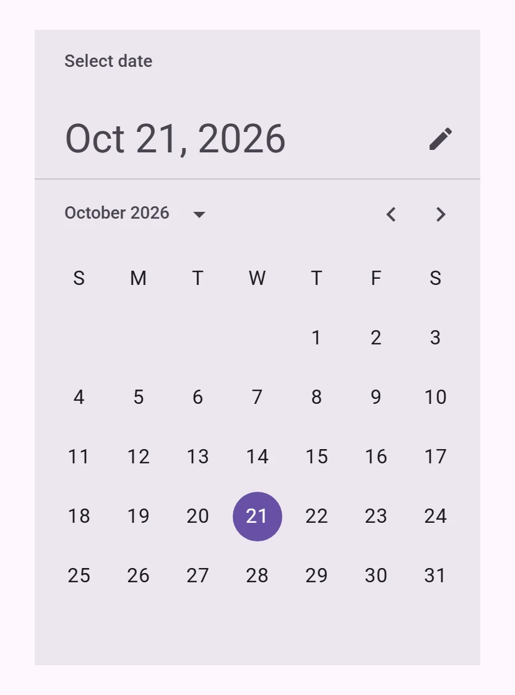
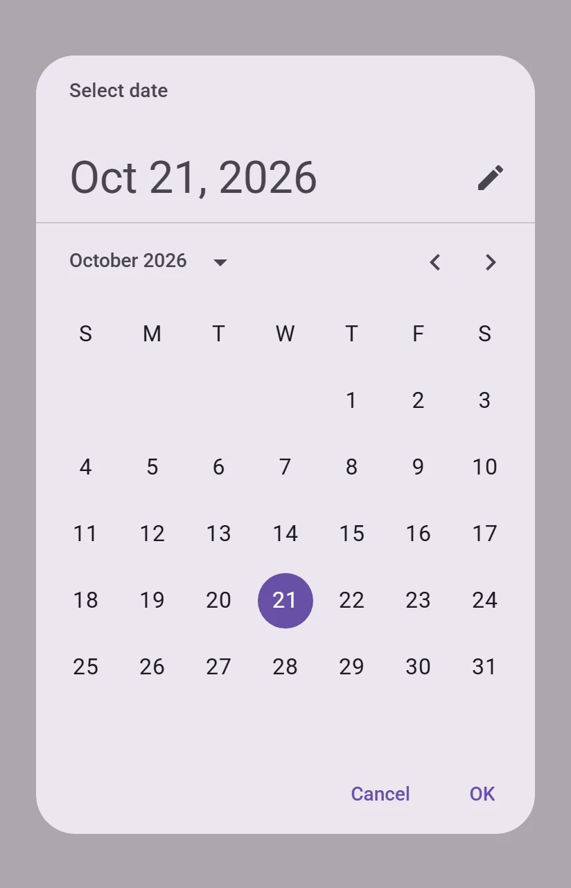
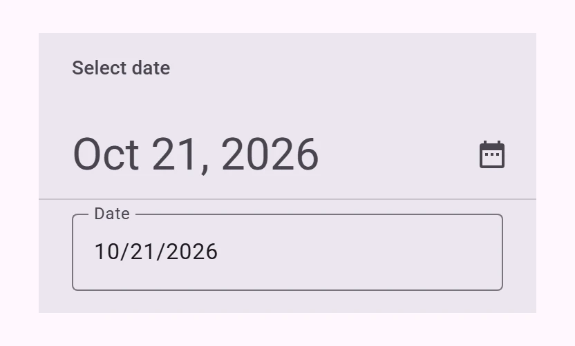
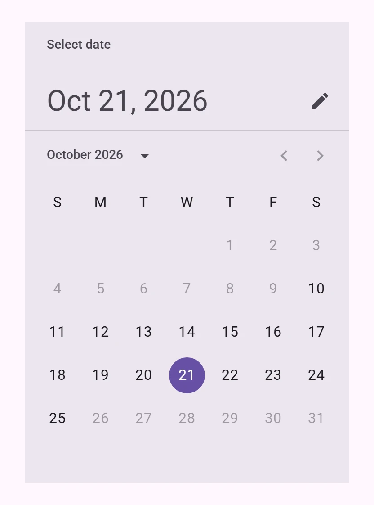

<!-- catalog-only-start --><!-- ---
name: Date picker
dirname: datepicker
-----><!-- catalog-only-end -->

<catalog-component-header>
<catalog-component-header-title slot="title">

# Date picker

<!-- no-catalog-start -->

<!-- [TOC] -->

<!-- external-only-start -->
**This documentation is fully rendered on the
[petal-elements catalog](https://petal.anontokyo.vip/catalog/components/date-picker/).**
<!-- external-only-end -->

<!-- no-catalog-end -->

[Date pickers](https://m3.material.io/components/date-pickers)<!-- {.external} -->
let people select a date.

</catalog-component-header-title>



</catalog-component-header>

*   [Design article](https://m3.material.io/components/date-pickers) <!-- {.external} -->
*   [API Documentation](#api)
*   [Source code](https://github.com/Saki340/petal-elements/tree/main/datepicker)
    <!-- {.external} -->

This follows Jetpack Compose Material 3 (`DatePicker`, `DatePickerDialog`,
`DateInput`, `DatePickerModalTokens`). Picking a range of dates
(`DateRangePicker`) is not available yet.

## Usage

`petal-date-picker` is the calendar with its header. Its `value` is an ISO
date (`2026-10-21`), like `<input type="date">`; it is `''` while nothing is
selected. Selecting a date fires `input` and `change`.

<!-- no-catalog-start -->


<!-- no-catalog-end -->
<!-- catalog-include "figures/datepicker/usage.html" -->

```html
<petal-date-picker value="2026-10-21"></petal-date-picker>
```

Swipe the calendar or use the arrows to change the month, and the month and
year button to pick a year. The picker is 360px wide; set a `width` to change
that. `no-header` leaves out the title and the headline, as passing `null`
for them in Compose.

### Dialog

`petal-date-picker-dialog` shows the picker in a modal dialog with Cancel and
OK. The date picked in the dialog is kept only when OK is pressed: then
`value` changes and `change` fires. Open it with `show()` or `open`.

<!-- no-catalog-start -->



<!-- no-catalog-end -->
<!-- catalog-include "figures/datepicker/usage-dialog.html" -->

```html
<petal-filled-tonal-button id="pick-date">Pick a date</petal-filled-tonal-button>
<petal-date-picker-dialog id="date-dialog"></petal-date-picker-dialog>

<script type="module">
  const dialog = document.querySelector('#date-dialog');
  document.querySelector('#pick-date').addEventListener('click', () => dialog.show());
  dialog.addEventListener('change', () => console.log(dialog.value));
</script>
```

To fill a text field, as Compose's samples do, open the dialog from the field
and write the confirmed date into it:

```html
<petal-outlined-text-field label="Date" readonly id="date-field">
  <petal-icon-button slot="trailing-icon" id="date-button" aria-label="Pick a date">
    <petal-icon>calendar_today</petal-icon>
  </petal-icon-button>
</petal-outlined-text-field>
<petal-date-picker-dialog id="date-dialog"></petal-date-picker-dialog>

<script type="module">
  const field = document.querySelector('#date-field');
  const dialog = document.querySelector('#date-dialog');
  document.querySelector('#date-button').addEventListener('click', () => dialog.show());
  dialog.addEventListener('change', () => {
    field.value = dialog.valueAsDate
      ? new Intl.DateTimeFormat(undefined, {dateStyle: 'medium', timeZone: 'UTC'}).format(
          dialog.valueAsDate,
        )
      : '';
  });
</script>
```

The dialog fires `change` only when OK is pressed, and `open`, `opened`,
`close`, `closed` and `cancel` like [`petal-dialog`](dialog.md); `returnValue`
is `confirm` after OK, `dismiss` after Cancel, and empty after Escape or a
click outside. `quick` opens and closes it without the
animation. Labels of the buttons are `confirm-label` and `dismiss-label`.

### Text input

The pencil button switches to a text field for typing the date, and the
calendar button switches back. Start in it with `display-mode="input"`, or
hide the button with `hide-mode-toggle`. The field takes digits only and adds
the locale's separators; it shows Compose's messages for a date that does not
exist, is outside the years, or cannot be selected.

<!-- no-catalog-start -->



<!-- no-catalog-end -->
<!-- catalog-include "figures/datepicker/usage-input.html" -->

```html
<petal-date-picker display-mode="input" value="2026-10-21"></petal-date-picker>
```

### Limits

`min` and `max` limit the dates that can be picked, and the months and years
shown; without them the years are 1900 to 2100, as in Compose. For other
rules, set `isDateSelectable` to a function that takes an ISO date, as
Compose's `SelectableDates`.

<!-- no-catalog-start -->



<!-- no-catalog-end -->
<!-- catalog-include "figures/datepicker/usage-range.html" -->

```html
<petal-date-picker value="2026-10-21" min="2026-10-10" max="2026-10-25"></petal-date-picker>

<script type="module">
  // No weekends.
  document.querySelector('petal-date-picker').isDateSelectable = (date) =>
    ![0, 6].includes(new Date(date).getUTCDay());
</script>
```

### Forms

With a `name`, the picker submits its value with its form, like other form
controls.

```html
<form>
  <petal-date-picker name="date"></petal-date-picker>
</form>
```

### Language

Month and weekday names, the headline and the typed date format come from
`Intl` for the `locale` attribute, or else the closest `lang` attribute, or
else the browser's language. The week starts on the locale's first day; set
`first-day-of-week` (0 for Sunday) to change it.

The fixed texts are English, as Compose's defaults. Replace the visible ones
with attributes (`picker-title`, `picker-headline`, `input-title`,
`input-headline`, `input-label`, and on the dialog `confirm-label` and
`dismiss-label`), and the read-out and error texts with `messages`:

```html
<petal-date-picker-dialog
    lang="zh-CN"
    picker-title="选择日期"
    picker-headline="所选日期"
    input-title="选择日期"
    input-headline="输入的日期"
    input-label="日期"
    confirm-label="确定"
    dismiss-label="取消"></petal-date-picker-dialog>

<script type="module">
  document.querySelector('petal-date-picker-dialog').messages = {
    switchToInputMode: '切换到文字输入',
    switchToCalendarMode: '切换到日历',
    previousMonth: '上个月',
    nextMonth: '下个月',
    today: '今天',
    invalidPattern: '日期格式应为 %1',
    invalidYearRange: '日期应在 %1 年至 %2 年之间',
    invalidNotAllowed: '不能选择 %1',
  };
</script>
```

## Accessibility

The calendar is a grid: one day is in the tab order, the arrow keys move by
day and week, Home and End go to the start and end of the week, Page Up and
Page Down to the previous and next month (with Shift, year), and moving past
the first or last day turns the month. Each day is read with its full date,
and today says so. The headline announces the selected date. In the year
grid, the arrow keys move between years and Escape goes back to the days.

## Compose behavior

*   The picker is 360dp wide on surface-container-high. The header is at least
    120dp: the title in LabelLarge, the headline in HeadlineLarge, and the
    mode button, over a divider.
*   The month row is 56dp high. Weekday letters and days sit in 48dp cells,
    six rows; a day is a 40dp circle in BodyLarge: primary when selected, a
    1dp primary outline and primary text for today, 38% when it cannot be
    picked.
*   The months slide: the arrows on the default spring (no bounce), a swipe on
    the default effects spring, going to the next month on a fling or past
    half the width.
*   The year grid has three 72 by 36dp years per row, 16dp apart, and unfolds
    downwards over the calendar on the default effects spring.
*   Switching to text input slides the field up from below and fades it in
    while the calendar fades out and moves 48dp up, on the default spatial
    and effects springs; the height follows.
*   The dialog is 360dp wide and at most 568dp high, with the extra large
    shape; the buttons are 8dp apart, 6dp from the end and 8dp from the
    bottom.

## Theming

Date pickers support [Material theming](../theming/README.md) and can be
customized in terms of color, typography and shape.

### Tokens

Token                                                  | Default value
------------------------------------------------------ | ---------------------------------------
`--md-date-picker-container-color`                     | `--md-sys-color-surface-container-high`
`--md-date-picker-container-shape`                     | `--md-sys-shape-corner-extra-large`
`--md-date-picker-header-headline-color`               | `--md-sys-color-on-surface-variant`
`--md-date-picker-header-supporting-text-color`        | `--md-sys-color-on-surface-variant`
`--md-date-picker-weekdays-label-text-color`           | `--md-sys-color-on-surface`
`--md-date-picker-date-unselected-label-text-color`    | `--md-sys-color-on-surface`
`--md-date-picker-date-selected-container-color`       | `--md-sys-color-primary`
`--md-date-picker-date-selected-label-text-color`      | `--md-sys-color-on-primary`
`--md-date-picker-date-today-label-text-color`         | `--md-sys-color-primary`
`--md-date-picker-date-today-container-outline-color`  | `--md-sys-color-primary`
`--md-date-picker-selection-year-selected-container-color` | `--md-sys-color-primary`
`--md-date-picker-navigation-content-color`            | `--md-sys-color-on-surface-variant`
`--md-date-picker-divider-color`                       | `--md-sys-color-outline-variant`

### Example

```html
<style>
  :root {
    --md-date-picker-date-selected-container-color: var(--md-sys-color-tertiary);
    --md-date-picker-date-selected-label-text-color: var(--md-sys-color-on-tertiary);
  }
</style>
```

<!-- auto-generated API docs start -->

## API


### PetalDatePicker <code>&lt;petal-date-picker&gt;</code>

#### Properties

<!-- mdformat off(autogenerated might break rendering in catalog) -->

| Property | Attribute | Type | Default | Description |
| --- | --- | --- | --- | --- |
| `value` | `value` | `string` | `''` | The selected date, as an ISO date (`2026-10-21`), or `''`. |
| `min` | `min` | `string` | `''` | The earliest date that can be selected, as an ISO date. |
| `max` | `max` | `string` | `''` | The latest date that can be selected, as an ISO date. |
| `locale` | `locale` | `string` | `''` | The locale for month and weekday names, the date format and the first day of the week. Defaults to the closest `lang` attribute or the browser's language. |
| `firstDayOfWeek` | `first-day-of-week` | `number` | `undefined` | The first day of the week, 0 for Sunday to 6 for Saturday. Defaults to the locale's. |
| `displayMode` | `display-mode` | `DatePickerDisplayMode` | `'picker'` | `picker` shows the calendar, `input` a text field. |
| `hideModeToggle` | `hide-mode-toggle` | `boolean` | `false` | Hides the button that switches between the calendar and the text field. |
| `pickerTitle` | `picker-title` | `string` | `'Select date'` | The title above the headline in calendar mode. |
| `inputTitle` | `input-title` | `string` | `'Select date'` | The title above the headline in text input mode. |
| `pickerHeadline` | `picker-headline` | `string` | `'Selected date'` | The headline in calendar mode while no date is selected. |
| `inputHeadline` | `input-headline` | `string` | `'Entered date'` | The headline in text input mode while no date is entered. |
| `inputLabel` | `input-label` | `string` | `'Date'` | The text field's label in text input mode. |
| `noHeader` | `no-header` | `boolean` | `false` | Hides the title and the headline, leaving only the calendar. |
| `isDateSelectable` |  | `(date: string) => boolean` | `undefined` | Whether a date can be selected, as Compose's `SelectableDates`. Called with ISO dates between `min` and `max`. |
| `messages` |  | `DatePickerMessages` | `{}` | Replaces some of the read-out and error texts. |
| `name` | `name` | `string` | `undefined` | The HTML name to use in form submission. |
| `disabled` | `disabled` | `boolean` | `undefined` | Whether or not the element is disabled. |
| `valueAsDate` |  | `Date` | `undefined` |  |
| `form` |  | `HTMLFormElement` | `undefined` | The associated form element with which this element's value will submit. |
| `labels` |  | `NodeList` | `undefined` | The labels this element is associated with. |

<!-- mdformat on(autogenerated might break rendering in catalog) -->

#### Methods

<!-- mdformat off(autogenerated might break rendering in catalog) -->

| Method | Parameters | Returns | Description |
| --- | --- | --- | --- |
| `showMonthOf` | `date` | `void` | Shows the month that has the given ISO date. |
| `formResetCallback` | _None_ | `void` |  |
| `formStateRestoreCallback` | `state` | `void` |  |

<!-- mdformat on(autogenerated might break rendering in catalog) -->

#### Events

<!-- mdformat off(autogenerated might break rendering in catalog) -->

| Event | Type | [Bubbles](https://developer.mozilla.org/en-US/docs/Web/API/Event/bubbles) | [Composed](https://developer.mozilla.org/en-US/docs/Web/API/Event/composed) | Description |
| --- | --- | --- | --- | --- |
| `input` | `Event` | Yes | Yes | The selection changed. |
| `change` | `Event` | Yes | No | The selection changed. |

<!-- mdformat on(autogenerated might break rendering in catalog) -->

### PetalDatePickerDialog <code>&lt;petal-date-picker-dialog&gt;</code>

#### Properties

<!-- mdformat off(autogenerated might break rendering in catalog) -->

| Property | Attribute | Type | Default | Description |
| --- | --- | --- | --- | --- |
| `open` | `open` | `boolean` | `false` | Opens the dialog when `true`, closes it when `false`. |
| `value` | `value` | `string` | `''` | The confirmed date, as an ISO date (`2026-10-21`), or `''`. |
| `min` | `min` | `string` | `''` | The earliest date that can be selected, as an ISO date. |
| `max` | `max` | `string` | `''` | The latest date that can be selected, as an ISO date. |
| `locale` | `locale` | `string` | `''` | The locale; see `petal-date-picker`. |
| `firstDayOfWeek` | `first-day-of-week` | `number` | `undefined` | The first day of the week, 0 for Sunday to 6 for Saturday. |
| `displayMode` | `display-mode` | `DatePickerDisplayMode` | `'picker'` | `picker` shows the calendar, `input` a text field. |
| `hideModeToggle` | `hide-mode-toggle` | `boolean` | `false` | Hides the button that switches between the calendar and the text field. |
| `pickerTitle` | `picker-title` | `string` | `'Select date'` | The title above the headline in calendar mode. |
| `inputTitle` | `input-title` | `string` | `'Select date'` | The title above the headline in text input mode. |
| `pickerHeadline` | `picker-headline` | `string` | `'Selected date'` | The headline in calendar mode while no date is selected. |
| `inputHeadline` | `input-headline` | `string` | `'Entered date'` | The headline in text input mode while no date is entered. |
| `inputLabel` | `input-label` | `string` | `'Date'` | The text field's label in text input mode. |
| `confirmLabel` | `confirm-label` | `string` | `'OK'` | The confirm button's label. |
| `dismissLabel` | `dismiss-label` | `string` | `'Cancel'` | The dismiss button's label. |
| `quick` | `quick` | `boolean` | `false` | Skips the opening and closing animations. |
| `isDateSelectable` |  | `(date: string) => boolean` | `undefined` | Whether a date can be selected; see `petal-date-picker`. |
| `messages` |  | `DatePickerMessages` | `{}` | Replaces some of the read-out and error texts. |
| `returnValue` |  | `string` | `undefined` |  |

<!-- mdformat on(autogenerated might break rendering in catalog) -->

#### Methods

<!-- mdformat off(autogenerated might break rendering in catalog) -->

| Method | Parameters | Returns | Description |
| --- | --- | --- | --- |
| `show` | _None_ | `Promise<void>` | Opens the dialog. Resolves once it has opened. |
| `close` | `returnValue` | `Promise<void>` | Closes the dialog. Resolves once it has closed. |

<!-- mdformat on(autogenerated might break rendering in catalog) -->

#### Events

<!-- mdformat off(autogenerated might break rendering in catalog) -->

| Event | Type | [Bubbles](https://developer.mozilla.org/en-US/docs/Web/API/Event/bubbles) | [Composed](https://developer.mozilla.org/en-US/docs/Web/API/Event/composed) | Description |
| --- | --- | --- | --- | --- |
| `open` | `Event` | No | No | The dialog is opening, before any animations. --cancelable |
| `opened` | `Event` | No | No | The dialog has opened, after any animations. |
| `close` | `Event` | No | No | The dialog is closing, before any animations. --cancelable |
| `closed` | `Event` | No | No | The dialog has closed, after any animations. |
| `cancel` | `Event` | No | No | The dialog was canceled with Escape or by clicking outside it. --cancelable |
| `change` | `Event` | Yes | No | A date was confirmed with OK. |

<!-- mdformat on(autogenerated might break rendering in catalog) -->

<!-- auto-generated API docs end -->
