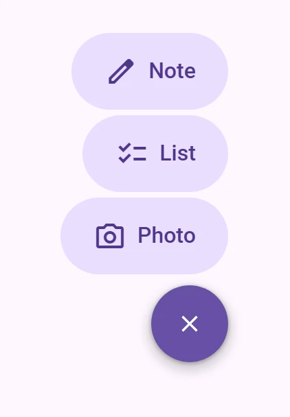

<!-- catalog-only-start --><!-- ---
name: FAB menu
dirname: fabmenu
-----><!-- catalog-only-end -->

<catalog-component-header>
<catalog-component-header-title slot="title">

# FAB menu

<!-- no-catalog-start -->

<!-- [TOC] -->

<!-- external-only-start -->
**This documentation is fully rendered on the
[petal-elements catalog](https://petal.anontokyo.vip/catalog/components/fab-menu/).**
<!-- external-only-end -->

<!-- no-catalog-end -->

[FAB menu](https://m3.material.io/components/fab-menu)<!-- {.external} -->
opens a short list of related actions from a floating action button. The
button turns into a close button while the list is open.

</catalog-component-header-title>



</catalog-component-header>

*   [Design article](https://m3.material.io/components/fab-menu) <!-- {.external} -->
*   [API Documentation](#api)
*   [Source code](https://github.com/Saki340/petal-elements/tree/main/fabmenu)
    <!-- {.external} -->

The values and the motion follow Jetpack Compose Material 3
(`FloatingActionButtonMenu`, `FloatingActionButtonMenuItem`,
`ToggleFloatingActionButton` and `FabMenuBaselineTokens`).

## Usage

`<petal-fab-menu>` holds the items in its default slot and the button in the
`button` slot, usually a `<petal-toggle-fab>`. The menu keeps the button's
`checked` in sync with its own `expanded`, so the button needs no code.
Place the menu yourself, for example `position: fixed` at the bottom end of
the window.

<!-- no-catalog-start -->


<!-- no-catalog-end -->
<!-- catalog-include "figures/fabmenu/usage.html" -->

```html
<petal-fab-menu id="menu" items-label="Create">
  <petal-fab-menu-item>
    <petal-icon slot="icon">edit</petal-icon>
    Note
  </petal-fab-menu-item>
  <petal-fab-menu-item>
    <petal-icon slot="icon">checklist</petal-icon>
    List
  </petal-fab-menu-item>
  <petal-toggle-fab slot="button" aria-label="Create"></petal-toggle-fab>
</petal-fab-menu>
<script type="module">
  import 'petal-elements/fabmenu/fab-menu.js';
  import 'petal-elements/fabmenu/fab-menu-item.js';
  import 'petal-elements/fabmenu/toggle-fab.js';
  import 'petal-elements/icon/icon.js';

  const menu = document.querySelector('#menu');
  menu.addEventListener('click', (event) => {
    if (event.target.closest('petal-fab-menu-item')) {
      // Do the action, then close the menu: choosing an item does not.
      menu.expanded = false;
    }
  });
</script>
```

The menu has 16px of padding on both sides. The items are 56px high and 4px
apart, 8px above the button's room, and the room has 16px below it.

### Alignment

`horizontal-alignment` (`end` by default, `start` or `center`) aligns the items
and the button. The toggle FAB shrinks toward its end like Compose's default
`TopEnd`; for a menu at the start set `content-alignment="start"` on the toggle
too.

### Toggle FAB

`<petal-toggle-fab>` can be used alone. Its `size` is `baseline` (56px),
`medium` (80px) or `large` (96px); checked it is always 56px, round, in the
primary color, and keeps the room of its unchecked size, with the container at
the top. The icon is an add and a close icon by default; the `icon` and
`checked-icon` slots replace them. The icon switches halfway through the
animation, and shrinks from the FAB's icon size to 20px.

### Opening and closing

The menu opens and closes when the button is clicked and when `expanded`
changes. Escape and a press outside close it. `open` and `close` fire when it
starts to. Choosing an item does not close the menu, as in Compose.

Opened with the keyboard, focus moves to the first item. With the menu open,
Tab and the down arrow on the button also go to the first item, as in Compose,
and the arrows move between the items.

## Accessibility

Compose has no menu semantics: the items are buttons in a traversal group
before the button. This follows it. The items are native buttons in a
`role="group"` named by `items-label`, not a `role="menu"` (which would need
Tab to leave the menu). The toggle reports `aria-expanded` inside a menu and
`aria-pressed` alone. Closed, the items are `inert`. Set an accessible name on
the toggle with `aria-label`; the icons are hidden from assistive technology.

## Motion

The items follow Compose's stagger: the number of visible items is the
rounded value of an animation on the slow effects spring (damping 1,
stiffness 800), so the item next to the button appears first and, when
closing, the top item goes first. Each item grows its width from 0 on the fast
spatial spring and fades in on the fast effects spring (damping 1, stiffness
3800). The toggle's container, icon and colors follow the checked progress on
the fast spatial spring of the page's [motion scheme](../theming/README.md)
(`--md-sys-motion-spring-fast-spatial-*`), so they overshoot with the expressive
scheme. With reduced motion everything jumps to its end.

## Theming

Token                                              | Default value
-------------------------------------------------- | -------------
`--md-fab-menu-list-item-container-color`          | `--md-sys-color-primary-container`
`--md-fab-menu-list-item-content-color`            | `--md-sys-color-on-primary-container`
`--md-fab-menu-list-item-container-shape`          | `--md-sys-shape-corner-full`
`--md-fab-menu-list-item-container-height`         | `56px`
`--md-fab-menu-list-item-leading-space`            | `24px`
`--md-fab-menu-list-item-trailing-space`           | `24px`
`--md-fab-menu-list-item-icon-label-space`         | `8px`
`--md-fab-menu-list-item-icon-size`                | `24px`
`--md-toggle-fab-container-color`                  | `--md-sys-color-primary-container`
`--md-toggle-fab-checked-container-color`          | `--md-sys-color-primary`
`--md-toggle-fab-icon-color`                       | `--md-sys-color-on-primary-container`
`--md-toggle-fab-checked-icon-color`               | `--md-sys-color-on-primary`
`--md-toggle-fab-container-elevation`              | `3`
`--md-fab-menu-close-button-container-height`      | `56px`
`--md-fab-menu-close-button-icon-size`             | `20px`

The items have no shadow: `ListItemContainerElevation` is level 3 in the
tokens, but Compose's code does not use it.

*   [FAB menu tokens](https://github.com/Saki340/petal-elements/blob/main/tokens/versions/compose/values/_md-comp-fab-menu-baseline.scss)
    <!-- {.external} -->

### Example

```html
<style>
  petal-fab-menu {
    --md-fab-menu-list-item-container-color: #c8ebe6;
    --md-toggle-fab-checked-container-color: #00695c;
  }
</style>
```

<!-- auto-generated API docs start -->

## API


### PetalFabMenu <code>&lt;petal-fab-menu&gt;</code>

#### Properties

<!-- mdformat off(autogenerated might break rendering in catalog) -->

| Property | Attribute | Type | Default | Description |
| --- | --- | --- | --- | --- |
| `expanded` | `expanded` | `boolean` | `false` | Whether the menu is open. A `petal-toggle-fab` in the `button` slot is kept in sync, and its `change` event sets this. |
| `horizontalAlignment` | `horizontal-alignment` | `FabMenuAlignment` | `'end'` | The horizontal alignment of the items and the button, `end` by default. |
| `itemsLabel` | `items-label` | `string` | `''` | Accessible name of the group of items. |

<!-- mdformat on(autogenerated might break rendering in catalog) -->

#### Events

<!-- mdformat off(autogenerated might break rendering in catalog) -->

| Event | Type | [Bubbles](https://developer.mozilla.org/en-US/docs/Web/API/Event/bubbles) | [Composed](https://developer.mozilla.org/en-US/docs/Web/API/Event/composed) | Description |
| --- | --- | --- | --- | --- |
| `open` | `Event` | No | No | The menu started to open. {@type Event} |
| `close` | `Event` | No | No | The menu started to close. {@type Event} |

<!-- mdformat on(autogenerated might break rendering in catalog) -->

### PetalFabMenuItem <code>&lt;petal-fab-menu-item&gt;</code>

#### Properties

<!-- mdformat off(autogenerated might break rendering in catalog) -->

| Property | Attribute | Type | Default | Description |
| --- | --- | --- | --- | --- |
| `horizontalAlignment` | `horizontal-alignment` | `FabMenuAlignment` | `'end'` | Which side of the menu the item hugs. `petal-fab-menu` sets it, like the `horizontalAlignment` of Compose's `FloatingActionButtonMenuScope`. |
| `isVisible` |  | `boolean` | `undefined` |  |
| `isAnimating` |  | `boolean` | `undefined` |  |

<!-- mdformat on(autogenerated might break rendering in catalog) -->

#### Methods

<!-- mdformat off(autogenerated might break rendering in catalog) -->

| Method | Parameters | Returns | Description |
| --- | --- | --- | --- |
| `setShown` | `shown`, `animate` | `void` | Shows or hides the item. The springs move toward the new state with the next `step()`s; without `animate` it is there at once. |
| `step` | `ms` | `void` | Moves the springs `ms` milliseconds forward and lays the item out. |

<!-- mdformat on(autogenerated might break rendering in catalog) -->

### PetalToggleFab <code>&lt;petal-toggle-fab&gt;</code>

#### Properties

<!-- mdformat off(autogenerated might break rendering in catalog) -->

| Property | Attribute | Type | Default | Description |
| --- | --- | --- | --- | --- |
| `checked` | `checked` | `boolean` | `false` | Whether the FAB is checked (a FAB menu is open). |
| `size` | `size` | `ToggleFabSize` | `'baseline'` | The size of the unchecked FAB. The container always keeps this much room and shrinks inside of it. |
| `contentAlignment` | `content-alignment` | `ToggleFabAlignment` | `'end'` | Where the container sits in its room when it is checked and smaller, like Compose's `contentAlignment` (`TopEnd` by default). |
| `popup` | `popup` | `boolean` | `false` | Whether the FAB opens a popup (a FAB menu): it then reports `checked` with `aria-expanded` instead of `aria-pressed`. `petal-fab-menu` sets it on its button. |

<!-- mdformat on(autogenerated might break rendering in catalog) -->

#### Events

<!-- mdformat off(autogenerated might break rendering in catalog) -->

| Event | Type | [Bubbles](https://developer.mozilla.org/en-US/docs/Web/API/Event/bubbles) | [Composed](https://developer.mozilla.org/en-US/docs/Web/API/Event/composed) | Description |
| --- | --- | --- | --- | --- |
| `change` | `Event` | No | No | The checked state changed because of a click. {@type Event} |

<!-- mdformat on(autogenerated might break rendering in catalog) -->

<!-- auto-generated API docs end -->
