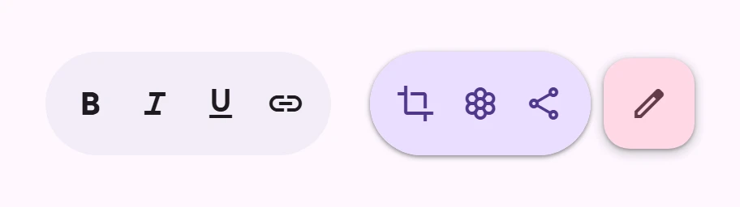
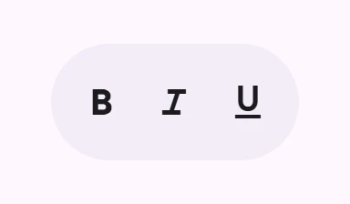

<!-- catalog-only-start --><!-- ---
name: Floating toolbar
dirname: floatingtoolbar
-----><!-- catalog-only-end -->

<catalog-component-header>
<catalog-component-header-title slot="title">

# Floating toolbar

<!-- no-catalog-start -->

<!-- [TOC] -->

<!-- external-only-start -->
**This documentation is fully rendered on the
[petal-elements catalog](https://petal.anontokyo.vip/catalog/components/floating-toolbar/).**
<!-- external-only-end -->

<!-- no-catalog-end -->

[Floating toolbars](https://m3.material.io/components/toolbars)<!-- {.external} -->
hold the actions for the current screen in a container that floats above the
content. They expand and collapse.

</catalog-component-header-title>



</catalog-component-header>

*   [Design article](https://m3.material.io/components/toolbars) <!-- {.external} -->
*   [API Documentation](#api)
*   [Source code](https://github.com/Saki340/petal-elements/tree/main/floatingtoolbar)
    <!-- {.external} -->

The values and the motion follow Jetpack Compose Material 3
(`HorizontalFloatingToolbar`, `VerticalFloatingToolbar`,
`FloatingToolbarDefaults`, `FloatingToolbarTokens`).

## Usage

`<petal-floating-toolbar>` is a row of actions. Put icon buttons (or any
elements) in the default slot.

<!-- no-catalog-start -->



<!-- no-catalog-end -->
<!-- catalog-include "figures/floatingtoolbar/usage.html" -->

```html
<petal-floating-toolbar expanded aria-label="Text formatting">
  <petal-icon-button aria-label="Bold"><petal-icon>format_bold</petal-icon></petal-icon-button>
  <petal-icon-button aria-label="Italic"><petal-icon>format_italic</petal-icon></petal-icon-button>
  <petal-icon-button aria-label="Underline"><petal-icon>format_underlined</petal-icon></petal-icon-button>
</petal-floating-toolbar>
<script type="module">
  import 'petal-elements/floatingtoolbar/floating-toolbar.js';
  import 'petal-elements/iconbutton/icon-button.js';
  import 'petal-elements/icon/icon.js';
</script>
```

The toolbar is 64px high with 8px of padding around the actions, so 48px
touch targets (icon buttons with the default touch target) fit exactly. It is
a pill, as `FloatingToolbarDefaults.ContainerShape`. The toolbar does not
position itself: place it in the page, for example with `position: fixed` and
a 16px offset from the screen edge (`FloatingToolbarDefaults.ScreenOffset`).

### Orientation and colors

`orientation="vertical"` makes `VerticalFloatingToolbar`: a column that is 64px
wide. `colors="vibrant"` is `vibrantFloatingToolbarColors()` (primary
container), `standard` (the default) is `standardFloatingToolbarColors()`
(surface container). Slotted `petal-icon-button`s take the toolbar's content
color. In the vibrant toolbar, selected toggle icon buttons use the
`VibrantButtonSelected*` colors; a selected `petal-filled-icon-button` gets a
surface container.

```html
<petal-floating-toolbar orientation="vertical" colors="vibrant" expanded>
  <petal-icon-button aria-label="Edit"><petal-icon>edit</petal-icon></petal-icon-button>
  <petal-icon-button aria-label="Share"><petal-icon>share</petal-icon></petal-icon-button>
</petal-floating-toolbar>
```

### Leading and trailing actions

Without a FAB, the `leading` and `trailing` slots are Compose's
`leadingContent` and `trailingContent`: they show only while the toolbar is
`expanded`, and the default slot is always shown. Set `expanded` to expand or
collapse the toolbar.

```html
<petal-floating-toolbar id="toolbar" expanded>
  <petal-icon-button slot="leading" aria-label="Undo"><petal-icon>undo</petal-icon></petal-icon-button>
  <petal-icon-button aria-label="Add"><petal-icon>add</petal-icon></petal-icon-button>
  <petal-icon-button slot="trailing" aria-label="Redo"><petal-icon>redo</petal-icon></petal-icon-button>
</petal-floating-toolbar>
```

### With a floating action button

An element in the `fab` slot (a `petal-fab` of the default size) makes the
toolbar with a FAB. The whole toolbar then collapses into the FAB: expanded,
the FAB is 56px and the toolbar is next to it (8px apart); collapsed, the
toolbar shrinks to nothing and the FAB grows to 80px. The size of the
component stays the same, so the page does not move. The FAB takes the
toolbar's FAB colors (primary container, or tertiary container when vibrant)
and a level 2 elevation, level 3 when hovered. The toolbar has a level 1
elevation when expanded.

`fab-position` is `end` (the default) or `start`; for a vertical toolbar, use
`bottom` (the default) or `top`. `start` and `end` work for both.

```html
<petal-floating-toolbar id="toolbar" expanded fab-position="end" aria-label="Actions">
  <petal-icon-button aria-label="Check"><petal-icon>check_box</petal-icon></petal-icon-button>
  <petal-icon-button aria-label="Draw"><petal-icon>brush</petal-icon></petal-icon-button>
  <petal-fab slot="fab" aria-label="Add"><petal-icon slot="icon">add</petal-icon></petal-fab>
</petal-floating-toolbar>
<script>
  const toolbar = document.querySelector('#toolbar');
  toolbar.querySelector('petal-fab').addEventListener('click', () => {
    toolbar.expanded = !toolbar.expanded;
  });
</script>
```

### Expanding when the page scrolls

Compose offers `Modifier.floatingToolbarVerticalNestedScroll` (collapse after
scrolling down 40dp, expand after scrolling up 40dp) and
`FloatingToolbarDefaults.exitAlwaysScrollBehavior` (the toolbar slides off the
screen). The element does not include them: `expanded` is the state. A simple
version of the first one:

```js
// Collapse after scrolling down 40px, expand after scrolling up 40px.
let last = scroller.scrollTop;
let threshold = last;
scroller.addEventListener('scroll', () => {
  const offset = scroller.scrollTop;
  if (offset > last && offset >= threshold + 40) {
    toolbar.expanded = false;
    threshold = offset;
  } else if (offset < last && offset <= threshold - 40) {
    toolbar.expanded = true;
    threshold = offset;
  }
  last = offset;
});
```

## Accessibility

The actions are a `toolbar` (the label is the host's `aria-label`) whose
`aria-orientation` follows `orientation`. The arrow keys along the toolbar,
Home and End move focus between the actions, and each action stays in the tab
order (arrow keys do nothing in text fields). The FAB is not part of the
toolbar. Actions that a collapsed toolbar hides are `inert`, so they are
out of reach until it expands. Compose expands the toolbar for touch
exploration and adds a custom action to expand and collapse it; the element
does not detect assistive technology, so keep `expanded` true for people who
cannot see the page's scroll, or give them another way to expand it. The
scroll recipe above has the same issue as Compose's scroll behavior.

## Motion

Expanding and collapsing use Compose's `FloatingToolbarDefaults.animationSpec()`,
`MotionSchemeKeyTokens.FastSpatial`, a spring of the page's
[motion scheme](../theming/README.md) (`--md-sys-motion-spring-fast-spatial-*`;
damping 0.6 and stiffness 800 for the expressive scheme). The toolbar's size, the
FAB's size and the elevation follow the same spring, so it overshoots a little
and an interrupted animation continues from where it is. With reduced motion
the toolbar changes at once.

## Differences from Compose

*   `minimumInteractiveBalancedPadding`, which balances the padding while only
    the middle content shows, is not implemented.
*   `expandedShadowElevation` and `collapsedShadowElevation` are the
    `--md-floating-toolbar-*-elevation` properties (levels).
*   The leading and trailing content grow no larger than their own size when the
    spring overshoots.

## Theming

Floating toolbars support [Material theming](../theming/README.md). The
`--md-floating-toolbar-*` custom properties are Compose's
`FloatingToolbarTokens`. Compose takes the content and FAB colors from
`ColorScheme` (`contentColorFor`), not from tokens, and the elevations and the
gap to the FAB are constants in `FloatingToolbarDefaults`; they have custom
properties here too.

### Tokens

Token                                                      | Default value
---------------------------------------------------------- | -------------
`--md-floating-toolbar-container-height`                   | `64px`
`--md-floating-toolbar-container-leading-space`            | `8px`
`--md-floating-toolbar-container-trailing-space`           | `8px`
`--md-floating-toolbar-container-shape`                    | `--md-sys-shape-corner-full`
`--md-floating-toolbar-standard-container-color`           | `--md-sys-color-surface-container`
`--md-floating-toolbar-standard-content-color`             | `--md-sys-color-on-surface`
`--md-floating-toolbar-standard-fab-container-color`       | `--md-sys-color-primary-container`
`--md-floating-toolbar-standard-fab-content-color`         | `--md-sys-color-on-primary-container`
`--md-floating-toolbar-vibrant-container-color`            | `--md-sys-color-primary-container`
`--md-floating-toolbar-vibrant-content-color`              | `--md-sys-color-on-primary-container`
`--md-floating-toolbar-vibrant-fab-container-color`        | `--md-sys-color-tertiary-container`
`--md-floating-toolbar-vibrant-fab-content-color`          | `--md-sys-color-on-tertiary-container`
`--md-floating-toolbar-vibrant-button-selected-container-color` | `--md-sys-color-surface-container`
`--md-floating-toolbar-vibrant-button-selected-icon-color` | `--md-sys-color-on-surface`
`--md-floating-toolbar-fab-expanded-size`                  | `56px`
`--md-floating-toolbar-fab-collapsed-size`                 | `80px`
`--md-floating-toolbar-fab-gap`                            | `8px`
`--md-floating-toolbar-expanded-elevation`                 | `0`
`--md-floating-toolbar-collapsed-elevation`                | `0`
`--md-floating-toolbar-expanded-elevation-with-fab`        | `1`
`--md-floating-toolbar-collapsed-elevation-with-fab`       | `0`

*   [Floating toolbar tokens](https://github.com/Saki340/petal-elements/blob/main/tokens/versions/compose/values/_md-comp-floating-toolbar.scss)
    <!-- {.external} -->

### Example

```html
<style>
  petal-floating-toolbar {
    --md-floating-toolbar-standard-container-color: #c8ebe6;
    --md-floating-toolbar-container-shape: 16px;
  }
</style>
<petal-floating-toolbar expanded aria-label="Actions">
  <petal-icon-button aria-label="Edit"><petal-icon>edit</petal-icon></petal-icon-button>
</petal-floating-toolbar>
```

<!-- auto-generated API docs start -->

## API


### PetalFloatingToolbar <code>&lt;petal-floating-toolbar&gt;</code>

#### Properties

<!-- mdformat off(autogenerated might break rendering in catalog) -->

| Property | Attribute | Type | Default | Description |
| --- | --- | --- | --- | --- |
| `orientation` | `orientation` | `FloatingToolbarOrientation` | `'horizontal'` | `horizontal` (a row) or `vertical` (a column). |
| `expanded` | `expanded` | `boolean` | `false` | Whether the toolbar is expanded. Collapsed, a toolbar with a FAB shows only the FAB and one without shows only the default slot. |
| `colors` | `colors` | `FloatingToolbarColors` | `'standard'` | `standard` (the default) or `vibrant`. |
| `fabPosition` | `fab-position` | `FloatingToolbarFabPosition` | `'end'` | Where the FAB sits, when there is one. `end` (the default; `bottom` when vertical) or `start` (`top` when vertical). |

<!-- mdformat on(autogenerated might break rendering in catalog) -->

#### Slots

<!-- mdformat off(autogenerated might break rendering in catalog) -->

| Slot | Description |
| --- | --- |
| _default_ | The toolbar's content: icon buttons or buttons. |
| `leading` | Content before the main content, shown only while expanded (Compose's `leadingContent`; not with a FAB). |
| `trailing` | Content after the main content, shown only while expanded (Compose's `trailingContent`; not with a FAB). |
| `fab` | A `petal-fab` beside the toolbar (Compose's FAB toolbar). |

<!-- mdformat on(autogenerated might break rendering in catalog) -->

<!-- auto-generated API docs end -->
