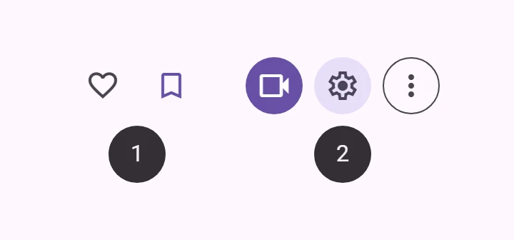
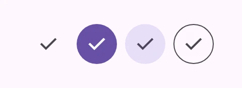
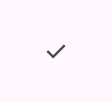
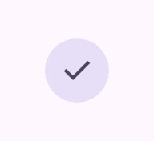
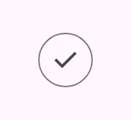
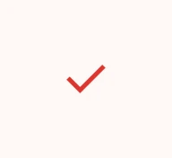
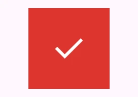
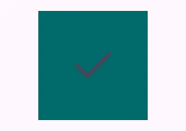
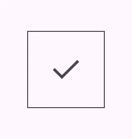

<!-- catalog-only-start --><!-- ---
name: Icon Buttons
dirname: iconbutton
-----><!-- catalog-only-end -->

<catalog-component-header>
<catalog-component-header-title slot="title">

# Icon Buttons

<!-- [TOC] -->

<!-- external-only-start -->
**This documentation is fully rendered on the
[petal-elements catalog](https://petal.anontokyo.vip/catalog/components/icon-button/).**
<!-- external-only-end -->

[Icon buttons](https://m3.material.io/components/icon-buttons)<!-- {.external} -->
start secondary actions with a single icon.

</catalog-component-header-title>


</catalog-component-header>

*   [Design article](https://m3.material.io/components/icon-buttons) <!-- {.external} -->
*   [API Documentation](#api)
*   [Source code](https://github.com/Saki340/petal-elements/tree/main/iconbutton)
    <!-- {.external} -->

<!-- catalog-only-start -->

<!--

## Interactive Demo



-->

<!-- catalog-only-end -->

## Types

<!-- no-catalog-start -->

")

<!-- no-catalog-end -->
<!-- catalog-include "figures/iconbutton/buttons.html" -->

1.  [Icon Button](#icon-button)
2.  [Filled Icon Button](#filled-icon-button)
3.  [Filled Tonal Icon Button](#filled-tonal-icon-button)
4.  [Outlined Icon Button](#outlined-icon-button)

## Usage

Use icon buttons to display actions in a compact layout. Icon buttons can
represent opening actions such as opening an overflow menu or search, or
represent binary actions that can be toggled on and off, such as favorite or
bookmark.

Icon buttons can be grouped together or they can stand alone.

To use icons by name, see the [Icon](icon.md#usage) documentation for loading
the icon font.

<!-- no-catalog-start -->



<!-- no-catalog-end -->
<!-- catalog-include "figures/iconbutton/usage.html" -->

```html
<petal-icon-button>
  <petal-icon>check</petal-icon>
</petal-icon-button>
<petal-filled-icon-button>
  <petal-icon>check</petal-icon>
</petal-filled-icon-button>
<petal-filled-tonal-icon-button>
  <petal-icon>check</petal-icon>
</petal-filled-tonal-icon-button>
<petal-outlined-icon-button>
  <petal-icon>check</petal-icon>
</petal-outlined-icon-button>
```

### Links

Add an
[`href`](https://developer.mozilla.org/en-US/docs/Web/HTML/Element/a#href)<!-- {.external} -->
and optionally a
[`target`](https://developer.mozilla.org/en-US/docs/Web/HTML/Element/a#target)<!-- {.external} -->
attribute to turn the icon button into a link.

```html
<petal-icon-button href="https://google.com">
  <petal-icon>check</petal-icon>
</petal-icon-button>
```

### Toggle

<!-- no-catalog-start -->


<!-- no-catalog-end -->
<!-- catalog-include "figures/iconbutton/usage-toggle.html" -->

Toggle icon buttons allow a single choice to be selected or deselected, such as
adding or removing something from favorites.

Add a second icon in the `slot="selected"` slot to change the icon when
selected. Toggle icon buttons can be pre-selected by adding the `selected`
attribute.

```html
<div>
  <petal-icon-button toggle>
    <petal-icon>close</petal-icon>
    <petal-icon slot="selected">check</petal-icon>
  </petal-icon-button>
  <petal-filled-icon-button toggle>
    <petal-icon>close</petal-icon>
    <petal-icon slot="selected">check</petal-icon>
  </petal-filled-icon-button>
  <petal-filled-tonal-icon-button toggle>
    <petal-icon>close</petal-icon>
    <petal-icon slot="selected">check</petal-icon>
  </petal-filled-tonal-icon-button>
  <petal-outlined-icon-button toggle>
    <petal-icon>close</petal-icon>
    <petal-icon slot="selected">check</petal-icon>
  </petal-outlined-icon-button>
</div>
<div>
  <petal-icon-button toggle selected>
    <petal-icon>close</petal-icon>
    <petal-icon slot="selected">check</petal-icon>
  </petal-icon-button>
  <petal-filled-icon-button toggle selected>
    <petal-icon>close</petal-icon>
    <petal-icon slot="selected">check</petal-icon>
  </petal-filled-icon-button>
  <petal-filled-tonal-icon-button toggle selected>
    <petal-icon>close</petal-icon>
    <petal-icon slot="selected">check</petal-icon>
  </petal-filled-tonal-icon-button>
  <petal-outlined-icon-button toggle selected>
    <petal-icon>close</petal-icon>
    <petal-icon slot="selected">check</petal-icon>
  </petal-outlined-icon-button>
</div>
```

### Sizes, widths and shapes

Material 3 Expressive icon buttons, after Jetpack Compose
(`IconButtonDefaults`, `XSmall…XLargeIconButtonTokens`):

-   `size`: `xsmall` (32px), `small` (40px), `medium` (56px), `large` (96px)
    or `xlarge` (136px) high, with a matching icon size. Without `size`, an
    icon button keeps its original 40px look.
-   `width`: `narrow`, `default` or `wide` (Compose's `IconButtonWidthOption`):
    the icon plus the size's leading and trailing space.
-   `shape`: `round` (default) or `square`.

Sized icon buttons morph their corners when pressed and when a toggle is
selected (pressed wins), on the default effects spring, so they do not bounce
(`IconButton.kt`: "DefaultEffects is intentional here to prevent any bounce").

<!-- no-catalog-start -->


<!-- no-catalog-end -->
<!-- catalog-include "figures/iconbutton/usage-sizes.html" -->

```html
<petal-filled-icon-button size="medium" aria-label="Edit">
  <petal-icon>edit</petal-icon>
</petal-filled-icon-button>
<petal-filled-tonal-icon-button size="medium" width="wide" aria-label="Edit">
  <petal-icon>edit</petal-icon>
</petal-filled-tonal-icon-button>
<petal-outlined-icon-button size="medium" shape="square" aria-label="Edit">
  <petal-icon>edit</petal-icon>
</petal-outlined-icon-button>
```

Colors follow Compose's `IconButtonDefaults`: an unselected filled toggle is
`surface-container` with an `on-surface-variant` icon; a filled tonal toggle
is `secondary-container`, and `secondary` with `on-secondary` when selected;
the outlined border takes the icon color.

## Accessibility

Add an
[`aria-label`](https://developer.mozilla.org/en-US/docs/Web/Accessibility/ARIA/Attributes/aria-label)<!-- {.external} -->
attribute to icon buttons whose labels need a more descriptive label.

```html
<petal-icon-button aria-label="Search for Contact">
  <petal-icon>search</petal-icon>
</petal-icon-button>
```

### Toggle

Add an `aria-label-selected` attribute to toggle buttons whose labels need a
more descriptive label when selected.

```html
<petal-icon-button toggle
  aria-label="Unselected"
  aria-label-selected="Selected">
  <petal-icon>close</petal-icon>
  <petal-icon slot="selected">check</petal-icon>
</petal-icon-button>
```

### Focusable and disabled

By default, disabled icon buttons are not focusable with the keyboard, while
"soft-disabled" icon buttons are. Some use cases encourage focusability of
disabled toolbar items to increase their discoverability.

See the
[ARIA guidelines on focusability of disabled controls](https://www.w3.org/WAI/ARIA/apg/practices/keyboard-interface/#kbd_disabled_controls)<!-- {.external} -->
for guidance on when this is recommended.

```html
<div role="toolbar">
  <petal-icon-button aria-label="Copy">
    <petal-icon>copy</petal-icon>
  </petal-icon-button>
  <petal-icon-button aria-label="Cut">
    <petal-icon>cut</petal-icon>
  </petal-icon-button>
  <!--
    This icon button is disabled but kept focusable to improve its
    discoverability in the toolbar.
  -->
  <petal-icon-button aria-label="Paste" soft-disabled>
    <petal-icon>paste</petal-icon>
  </petal-icon-button>
</div>
```

## Icon Button

Standard icon buttons do not have a background or outline, and have the lowest
emphasis of the icon buttons.

<!-- no-catalog-start -->



<!-- no-catalog-end -->
<!-- catalog-include "figures/iconbutton/usage-standard.html" -->

```html
<petal-icon-button>
  <petal-icon>check</petal-icon>
</petal-icon-button>
```

## Filled Icon Button

<!-- no-catalog-start -->


<!-- no-catalog-end -->
<!-- catalog-include "figures/iconbutton/usage-filled.html" -->

Filled icon buttons have higher visual impact and are best for high emphasis
actions.

```html
<petal-filled-icon-button>
  <petal-icon>check</petal-icon>
</petal-filled-icon-button>
```

## Filled Tonal Icon Button

<!-- no-catalog-start -->



<!-- no-catalog-end -->
<!-- catalog-include "figures/iconbutton/usage-filled-tonal.html" -->

Filled tonal icon buttons are a middle ground between filled and outlined icon
buttons. They're useful in contexts where the button requires slightly more
emphasis than an outline would give, such as a secondary action paired with a
high emphasis action.

```html
<petal-filled-tonal-icon-button>
  <petal-icon>check</petal-icon>
</petal-filled-tonal-icon-button>
```

## Outlined Icon Button

<!-- no-catalog-start -->



<!-- no-catalog-end -->
<!-- catalog-include "figures/iconbutton/usage-outlined.html" -->

Outlined icon buttons are medium-emphasis buttons. They're useful when an icon
button needs more emphasis than a standard icon button but less than a filled or
filled tonal icon button.

```html
<petal-outlined-icon-button>
  <petal-icon>check</petal-icon>
</petal-outlined-icon-button>
```

## Theming

Icon Button supports [Material theming](../theming/README.md) and can be
customized in terms of color, and shape.

### Icon Button tokens

Token                                | Default value
------------------------------------ | -----------------------------------
`--md-icon-button-icon-color`        | `--md-sys-color-on-surface-variant`
`--md-icon-button-state-layer-shape` | `--md-sys-shape-corner-full`
`--md-icon-button-icon-size`         | `24px`

*   [All tokens](https://github.com/Saki340/petal-elements/blob/main/tokens/_md-comp-icon-button.scss)
    <!-- {.external} -->

### Icon Button example

<!-- no-catalog-start -->



<!-- no-catalog-end -->
<!-- catalog-include "figures/iconbutton/theming-standard.html" -->

```html
<style>
:root {
  --md-icon-button-icon-size: 32px;
  --md-sys-color-on-surface-variant: #dc362e;
  background-color: #fff8f6;
}
</style>

<petal-icon-button>
  <petal-icon>check</petal-icon>
</petal-icon-button>
```

### Filled Icon Button tokens

Token                                              | Default value
-------------------------------------------------- | -------------
`--md-filled-icon-button-selected-container-color` | `--md-sys-color-primary`
`--md-filled-icon-button-container-shape`          | `--md-sys-shape-corner-full`
`--md-filled-icon-button-container-width`          | `40px`
`--md-filled-icon-button-container-height`         | `40px`
`--md-filled-icon-button-icon-size`                | `24px`

*   [All tokens](https://github.com/Saki340/petal-elements/blob/main/tokens/_md-comp-filled-icon-button.scss)
    <!-- {.external} -->

### Filled Icon Button example

<!-- no-catalog-start -->



<!-- no-catalog-end -->
<!-- catalog-include "figures/iconbutton/theming-filled.html" -->

```html
<style>
:root {
  --md-filled-icon-button-container-width: 80px;
  --md-filled-icon-button-container-height: 80px;
  --md-filled-icon-button-icon-size: 40px;
  --md-filled-icon-button-container-shape: 0px;
  --md-sys-color-primary: #dc362e;
  background-color: #fff8f6;
}
</style>
<petal-filled-icon-button>
  <petal-icon>check</petal-icon>
</petal-filled-icon-button>
```

### Filled Tonal Icon Button tokens

Token                                                    | Default value
-------------------------------------------------------- | -------------
`--md-filled-tonal-icon-button-selected-container-color` | `--md-sys-color-secondary-container`
`--md-filled-tonal-icon-button-container-shape`          | `--md-sys-shape-corner-full`
`--md-filled-tonal-icon-button-container-width`          | `40px`
`--md-filled-tonal-icon-button-container-height`         | `40px`
`--md-filled-tonal-icon-button-icon-size`                | `24px`

### Filled Tonal Icon Button example

<!-- no-catalog-start -->



<!-- no-catalog-end -->
<!-- catalog-include "figures/iconbutton/theming-filled-tonal.html" -->

```html
<style>
:root {
  --md-filled-tonal-icon-button-container-width: 80px;
  --md-filled-tonal-icon-button-container-height: 80px;
  --md-filled-tonal-icon-button-container-shape: 0px;
  --md-filled-tonal-icon-button-icon-size: 40px;
  --md-sys-color-secondary-container: #006A6A;
}
</style>
<petal-filled-tonal-icon-button>
  <petal-icon>check</petal-icon>
</petal-filled-tonal-icon-button>
```

### Outlined Icon Button tokens

Token                                        | Default value
-------------------------------------------- | ----------------------------
`--md-outlined-icon-button-outline-color`    | `--md-sys-color-outline`
`--md-outlined-icon-button-outline-width`    | `1px`
`--md-outlined-icon-button-container-shape`  | `--md-sys-shape-corner-full`
`--md-outlined-icon-button-container-width`  | `40px`
`--md-outlined-icon-button-container-height` | `40px`
`--md-outlined-icon-button-icon-size`        | `24px`

### Outlined Icon Button example

<!-- no-catalog-start -->



<!-- no-catalog-end -->
<!-- catalog-include "figures/iconbutton/theming-outlined.html" -->

```html
<style>
:root {
  --md-outlined-icon-button-container-width: 80px;
  --md-outlined-icon-button-container-height: 80px;
  --md-outlined-icon-button-container-shape: 0px;
  --md-outlined-icon-button-icon-size: 40px;
  --md-outlined-icon-button-outline-width: 4px;
  --md-sys-color-outline: #006A6A;
}
</style>
<petal-outlined-icon-button>
  <petal-icon>check</petal-icon>
</petal-outlined-icon-button>
```

<!-- auto-generated API docs start -->

## API


### PetalIconButton <code>&lt;petal-icon-button&gt;</code>

#### Properties

<!-- mdformat off(autogenerated might break rendering in catalog) -->

| Property | Attribute | Type | Default | Description |
| --- | --- | --- | --- | --- |
| `softDisabled` | `soft-disabled` | `boolean` | `false` | "Soft-disables" the icon button (disabled but still focusable).<br>Use this when an icon button needs increased visibility when disabled. See https://www.w3.org/WAI/ARIA/apg/practices/keyboard-interface/#kbd_disabled_controls for more guidance on when this is needed. |
| `flipIconInRtl` | `flip-icon-in-rtl` | `boolean` | `false` | Flips the icon if it is in an RTL context at startup. |
| `href` | `href` | `string` | `''` | Sets the underlying `HTMLAnchorElement`'s `href` resource attribute. |
| `download` | `download` | `string` | `''` | The filename to use when downloading the linked resource. If not specified, the browser will determine a filename. This is only applicable when the icon button is used as a link (`href` is set). |
| `target` | `target` | `"" \| LinkTarget` | `''` | Sets the underlying `HTMLAnchorElement`'s `target` attribute. |
| `rel` | `rel` | `string` | `''` | Sets the underlying `HTMLAnchorElement`'s `rel` attribute when `href` is set. |
| `referrerPolicy` | `referrerpolicy` | `string` | `''` | Sets the underlying `HTMLAnchorElement`'s `referrerpolicy` attribute when `href` is set. |
| `ariaLabelSelected` | `aria-label-selected` | `string` | `''` | The `aria-label` of the button when the button is toggleable and selected. |
| `toggle` | `toggle` | `boolean` | `false` | When true, the button will toggle between selected and unselected states |
| `selected` | `selected` | `boolean` | `false` | Sets the selected state. When false, displays the default icon. When true, displays the selected icon, or the default icon If no `slot="selected"` icon is provided. |
| `size` | `size` | `IconButtonSize` | `undefined` | Material 3 Expressive size (Compose's XSmall…XLargeIconButtonTokens): `xsmall` (32px), `small` (40px), `medium` (56px), `large` (96px) or `xlarge` (136px) high. Sized icon buttons morph their shape when pressed or selected. Without it, the button keeps its original 40px look. |
| `width` | `width` | `"narrow" \| "default" \| "wide"` | `undefined` | The width of a sized icon button (Compose's `IconButtonWidthOption`): `narrow`, `default` or `wide`. |
| `shape` | `shape` | `"round" \| "square"` | `undefined` | The shape of a sized icon button: `round` (default) or `square`. |
| `name` | `name` | `string` | `undefined` | The HTML name to use in form submission. |
| `disabled` | `disabled` | `boolean` | `undefined` | Whether or not the element is disabled. |
| `type` | `type` | `string` | `'submit'` | A string indicating the form submission behavior of the element.<br>- submit: The element submits the form. This is the default value if the attribute is not specified, or if it is dynamically changed to an empty or invalid value. - reset: The element resets the form. - button: The element does nothing. |
| `value` | `value` | `string` | `''` | The value of the button. When combined with a `name`, the submitting button's name/value will be added to the form. |
| `form` |  | `HTMLFormElement` | `undefined` | The associated form element with which this element's value will submit. |
| `labels` |  | `NodeList` | `undefined` | The labels this element is associated with. |

<!-- mdformat on(autogenerated might break rendering in catalog) -->

#### Events

<!-- mdformat off(autogenerated might break rendering in catalog) -->

| Event | Type | [Bubbles](https://developer.mozilla.org/en-US/docs/Web/API/Event/bubbles) | [Composed](https://developer.mozilla.org/en-US/docs/Web/API/Event/composed) | Description |
| --- | --- | --- | --- | --- |
| `input` | `InputEvent` | Yes | Yes | Dispatched when a toggle button toggles |
| `change` | `Event` | Yes | No | Dispatched when a toggle button toggles |

<!-- mdformat on(autogenerated might break rendering in catalog) -->

### PetalFilledIconButton <code>&lt;petal-filled-icon-button&gt;</code>

#### Properties

<!-- mdformat off(autogenerated might break rendering in catalog) -->

| Property | Attribute | Type | Default | Description |
| --- | --- | --- | --- | --- |
| `softDisabled` | `soft-disabled` | `boolean` | `false` | "Soft-disables" the icon button (disabled but still focusable).<br>Use this when an icon button needs increased visibility when disabled. See https://www.w3.org/WAI/ARIA/apg/practices/keyboard-interface/#kbd_disabled_controls for more guidance on when this is needed. |
| `flipIconInRtl` | `flip-icon-in-rtl` | `boolean` | `false` | Flips the icon if it is in an RTL context at startup. |
| `href` | `href` | `string` | `''` | Sets the underlying `HTMLAnchorElement`'s `href` resource attribute. |
| `download` | `download` | `string` | `''` | The filename to use when downloading the linked resource. If not specified, the browser will determine a filename. This is only applicable when the icon button is used as a link (`href` is set). |
| `target` | `target` | `"" \| LinkTarget` | `''` | Sets the underlying `HTMLAnchorElement`'s `target` attribute. |
| `rel` | `rel` | `string` | `''` | Sets the underlying `HTMLAnchorElement`'s `rel` attribute when `href` is set. |
| `referrerPolicy` | `referrerpolicy` | `string` | `''` | Sets the underlying `HTMLAnchorElement`'s `referrerpolicy` attribute when `href` is set. |
| `ariaLabelSelected` | `aria-label-selected` | `string` | `''` | The `aria-label` of the button when the button is toggleable and selected. |
| `toggle` | `toggle` | `boolean` | `false` | When true, the button will toggle between selected and unselected states |
| `selected` | `selected` | `boolean` | `false` | Sets the selected state. When false, displays the default icon. When true, displays the selected icon, or the default icon If no `slot="selected"` icon is provided. |
| `size` | `size` | `IconButtonSize` | `undefined` | Material 3 Expressive size (Compose's XSmall…XLargeIconButtonTokens): `xsmall` (32px), `small` (40px), `medium` (56px), `large` (96px) or `xlarge` (136px) high. Sized icon buttons morph their shape when pressed or selected. Without it, the button keeps its original 40px look. |
| `width` | `width` | `"narrow" \| "default" \| "wide"` | `undefined` | The width of a sized icon button (Compose's `IconButtonWidthOption`): `narrow`, `default` or `wide`. |
| `shape` | `shape` | `"round" \| "square"` | `undefined` | The shape of a sized icon button: `round` (default) or `square`. |
| `name` | `name` | `string` | `undefined` | The HTML name to use in form submission. |
| `disabled` | `disabled` | `boolean` | `undefined` | Whether or not the element is disabled. |
| `type` | `type` | `string` | `'submit'` | A string indicating the form submission behavior of the element.<br>- submit: The element submits the form. This is the default value if the attribute is not specified, or if it is dynamically changed to an empty or invalid value. - reset: The element resets the form. - button: The element does nothing. |
| `value` | `value` | `string` | `''` | The value of the button. When combined with a `name`, the submitting button's name/value will be added to the form. |
| `form` |  | `HTMLFormElement` | `undefined` | The associated form element with which this element's value will submit. |
| `labels` |  | `NodeList` | `undefined` | The labels this element is associated with. |

<!-- mdformat on(autogenerated might break rendering in catalog) -->

#### Events

<!-- mdformat off(autogenerated might break rendering in catalog) -->

| Event | Type | [Bubbles](https://developer.mozilla.org/en-US/docs/Web/API/Event/bubbles) | [Composed](https://developer.mozilla.org/en-US/docs/Web/API/Event/composed) | Description |
| --- | --- | --- | --- | --- |
| `input` | `InputEvent` | Yes | Yes | Dispatched when a toggle button toggles |
| `change` | `Event` | Yes | No | Dispatched when a toggle button toggles |

<!-- mdformat on(autogenerated might break rendering in catalog) -->

### PetalFilledTonalIconButton <code>&lt;petal-filled-tonal-icon-button&gt;</code>

#### Properties

<!-- mdformat off(autogenerated might break rendering in catalog) -->

| Property | Attribute | Type | Default | Description |
| --- | --- | --- | --- | --- |
| `softDisabled` | `soft-disabled` | `boolean` | `false` | "Soft-disables" the icon button (disabled but still focusable).<br>Use this when an icon button needs increased visibility when disabled. See https://www.w3.org/WAI/ARIA/apg/practices/keyboard-interface/#kbd_disabled_controls for more guidance on when this is needed. |
| `flipIconInRtl` | `flip-icon-in-rtl` | `boolean` | `false` | Flips the icon if it is in an RTL context at startup. |
| `href` | `href` | `string` | `''` | Sets the underlying `HTMLAnchorElement`'s `href` resource attribute. |
| `download` | `download` | `string` | `''` | The filename to use when downloading the linked resource. If not specified, the browser will determine a filename. This is only applicable when the icon button is used as a link (`href` is set). |
| `target` | `target` | `"" \| LinkTarget` | `''` | Sets the underlying `HTMLAnchorElement`'s `target` attribute. |
| `rel` | `rel` | `string` | `''` | Sets the underlying `HTMLAnchorElement`'s `rel` attribute when `href` is set. |
| `referrerPolicy` | `referrerpolicy` | `string` | `''` | Sets the underlying `HTMLAnchorElement`'s `referrerpolicy` attribute when `href` is set. |
| `ariaLabelSelected` | `aria-label-selected` | `string` | `''` | The `aria-label` of the button when the button is toggleable and selected. |
| `toggle` | `toggle` | `boolean` | `false` | When true, the button will toggle between selected and unselected states |
| `selected` | `selected` | `boolean` | `false` | Sets the selected state. When false, displays the default icon. When true, displays the selected icon, or the default icon If no `slot="selected"` icon is provided. |
| `size` | `size` | `IconButtonSize` | `undefined` | Material 3 Expressive size (Compose's XSmall…XLargeIconButtonTokens): `xsmall` (32px), `small` (40px), `medium` (56px), `large` (96px) or `xlarge` (136px) high. Sized icon buttons morph their shape when pressed or selected. Without it, the button keeps its original 40px look. |
| `width` | `width` | `"narrow" \| "default" \| "wide"` | `undefined` | The width of a sized icon button (Compose's `IconButtonWidthOption`): `narrow`, `default` or `wide`. |
| `shape` | `shape` | `"round" \| "square"` | `undefined` | The shape of a sized icon button: `round` (default) or `square`. |
| `name` | `name` | `string` | `undefined` | The HTML name to use in form submission. |
| `disabled` | `disabled` | `boolean` | `undefined` | Whether or not the element is disabled. |
| `type` | `type` | `string` | `'submit'` | A string indicating the form submission behavior of the element.<br>- submit: The element submits the form. This is the default value if the attribute is not specified, or if it is dynamically changed to an empty or invalid value. - reset: The element resets the form. - button: The element does nothing. |
| `value` | `value` | `string` | `''` | The value of the button. When combined with a `name`, the submitting button's name/value will be added to the form. |
| `form` |  | `HTMLFormElement` | `undefined` | The associated form element with which this element's value will submit. |
| `labels` |  | `NodeList` | `undefined` | The labels this element is associated with. |

<!-- mdformat on(autogenerated might break rendering in catalog) -->

#### Events

<!-- mdformat off(autogenerated might break rendering in catalog) -->

| Event | Type | [Bubbles](https://developer.mozilla.org/en-US/docs/Web/API/Event/bubbles) | [Composed](https://developer.mozilla.org/en-US/docs/Web/API/Event/composed) | Description |
| --- | --- | --- | --- | --- |
| `input` | `InputEvent` | Yes | Yes | Dispatched when a toggle button toggles |
| `change` | `Event` | Yes | No | Dispatched when a toggle button toggles |

<!-- mdformat on(autogenerated might break rendering in catalog) -->

### PetalOutlinedIconButton <code>&lt;petal-outlined-icon-button&gt;</code>

#### Properties

<!-- mdformat off(autogenerated might break rendering in catalog) -->

| Property | Attribute | Type | Default | Description |
| --- | --- | --- | --- | --- |
| `softDisabled` | `soft-disabled` | `boolean` | `false` | "Soft-disables" the icon button (disabled but still focusable).<br>Use this when an icon button needs increased visibility when disabled. See https://www.w3.org/WAI/ARIA/apg/practices/keyboard-interface/#kbd_disabled_controls for more guidance on when this is needed. |
| `flipIconInRtl` | `flip-icon-in-rtl` | `boolean` | `false` | Flips the icon if it is in an RTL context at startup. |
| `href` | `href` | `string` | `''` | Sets the underlying `HTMLAnchorElement`'s `href` resource attribute. |
| `download` | `download` | `string` | `''` | The filename to use when downloading the linked resource. If not specified, the browser will determine a filename. This is only applicable when the icon button is used as a link (`href` is set). |
| `target` | `target` | `"" \| LinkTarget` | `''` | Sets the underlying `HTMLAnchorElement`'s `target` attribute. |
| `rel` | `rel` | `string` | `''` | Sets the underlying `HTMLAnchorElement`'s `rel` attribute when `href` is set. |
| `referrerPolicy` | `referrerpolicy` | `string` | `''` | Sets the underlying `HTMLAnchorElement`'s `referrerpolicy` attribute when `href` is set. |
| `ariaLabelSelected` | `aria-label-selected` | `string` | `''` | The `aria-label` of the button when the button is toggleable and selected. |
| `toggle` | `toggle` | `boolean` | `false` | When true, the button will toggle between selected and unselected states |
| `selected` | `selected` | `boolean` | `false` | Sets the selected state. When false, displays the default icon. When true, displays the selected icon, or the default icon If no `slot="selected"` icon is provided. |
| `size` | `size` | `IconButtonSize` | `undefined` | Material 3 Expressive size (Compose's XSmall…XLargeIconButtonTokens): `xsmall` (32px), `small` (40px), `medium` (56px), `large` (96px) or `xlarge` (136px) high. Sized icon buttons morph their shape when pressed or selected. Without it, the button keeps its original 40px look. |
| `width` | `width` | `"narrow" \| "default" \| "wide"` | `undefined` | The width of a sized icon button (Compose's `IconButtonWidthOption`): `narrow`, `default` or `wide`. |
| `shape` | `shape` | `"round" \| "square"` | `undefined` | The shape of a sized icon button: `round` (default) or `square`. |
| `name` | `name` | `string` | `undefined` | The HTML name to use in form submission. |
| `disabled` | `disabled` | `boolean` | `undefined` | Whether or not the element is disabled. |
| `type` | `type` | `string` | `'submit'` | A string indicating the form submission behavior of the element.<br>- submit: The element submits the form. This is the default value if the attribute is not specified, or if it is dynamically changed to an empty or invalid value. - reset: The element resets the form. - button: The element does nothing. |
| `value` | `value` | `string` | `''` | The value of the button. When combined with a `name`, the submitting button's name/value will be added to the form. |
| `form` |  | `HTMLFormElement` | `undefined` | The associated form element with which this element's value will submit. |
| `labels` |  | `NodeList` | `undefined` | The labels this element is associated with. |

<!-- mdformat on(autogenerated might break rendering in catalog) -->

#### Events

<!-- mdformat off(autogenerated might break rendering in catalog) -->

| Event | Type | [Bubbles](https://developer.mozilla.org/en-US/docs/Web/API/Event/bubbles) | [Composed](https://developer.mozilla.org/en-US/docs/Web/API/Event/composed) | Description |
| --- | --- | --- | --- | --- |
| `input` | `InputEvent` | Yes | Yes | Dispatched when a toggle button toggles |
| `change` | `Event` | Yes | No | Dispatched when a toggle button toggles |

<!-- mdformat on(autogenerated might break rendering in catalog) -->

<!-- auto-generated API docs end -->
