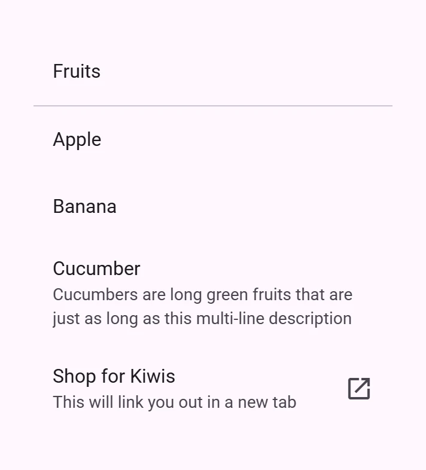
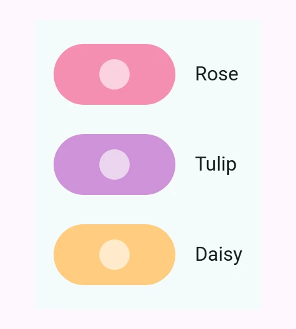

<!-- catalog-only-start --><!-- ---
name: Lists
dirname: list
-----><!-- catalog-only-end -->

<catalog-component-header image-align="start">
<catalog-component-header-title slot="title">

# Lists

<!-- no-catalog-start -->

<!-- [TOC] -->

<!-- external-only-start -->
**This documentation is fully rendered on the
[petal-elements catalog](https://petal.anontokyo.vip/catalog/components/list/)**
<!-- external-only-end -->

<!-- no-catalog-end -->

[Lists](https://m3.material.io/components/lists)<!-- {.external} -->
show items of text and images in a vertical column.

</catalog-component-header-title>



</catalog-component-header>

*   [Design article](https://m3.material.io/components/lists) <!-- {.external} -->
*   [API Documentation](#api)
*   [Source code](https://github.com/Saki340/petal-elements/tree/main/list)
    <!-- {.external} -->

<!-- catalog-only-start -->

<!--

## Interactive Demo



-->

<!-- catalog-only-end -->

## Usage

`<petal-list>` is a container composed of `<petal-list-item>`s of different types.

<!-- no-catalog-start -->


<!-- no-catalog-end -->
<!-- catalog-include "figures/list/usage.html" -->

```html
<petal-list style="max-width: 300px;">
  <petal-list-item>
    Fruits
  </petal-list-item>
  <petal-divider></petal-divider>
  <petal-list-item>
    Apple
</petal-list-item>
  <petal-list-item>
    Banana
  </petal-list-item>
  <petal-list-item>
    <div slot="headline">Cucumber</div>
    <div slot="supporting-text">Cucumbers are long green fruits that are just as long as this multi-line description</div>
  </petal-list-item>
  <petal-list-item
      type="link"
      href="https://google.com/search?q=buy+kiwis&tbm=shop"
      target="_blank">
    <div slot="headline">Shop for Kiwis</div>
    <div slot="supporting-text">This will link you out in a new tab</div>
    <petal-icon slot="end">open_in_new</petal-icon>
  </petal-list-item>
</petal-list>
```

## Icon Items

Icons can be slotted into list-items' `start` or `end` slot.

<!-- no-catalog-start -->


<!-- no-catalog-end -->
<!-- catalog-include "figures/list/usage-icon.html" -->

```html
<petal-list style="max-width: 300px">
  <petal-list-item>
    Rose
    <petal-icon slot="start">local_florist</petal-icon>
  </petal-list-item>
  <petal-divider></petal-divider>
  <petal-list-item>
    Tulip
    <petal-icon slot="start">filter_vintage</petal-icon>
  </petal-list-item>
  <petal-divider></petal-divider>
  <petal-list-item>
    Daisy
    <petal-icon slot="start">spa</petal-icon>
  </petal-list-item>
</petal-list>
```

## Segmented

`segmented` makes each item its own surface, 2px apart, as in Material 3
Expressive lists (Jetpack Compose `SegmentedListItem`). Items have 4px
corners and the ends of the list 16px. Hovered items round to 12px, pressed
and focused items to 16px. Place segmented lists on a container color, such
as `surface-container`, since the items use `surface`.

<!-- no-catalog-start -->


<!-- no-catalog-end -->
<!-- catalog-include "figures/list/usage-segmented.html" -->

```html
<petal-list segmented style="max-width: 300px">
  <petal-list-item type="button">
    Rose
    <petal-icon slot="start">local_florist</petal-icon>
  </petal-list-item>
  <petal-list-item type="button">
    Tulip
    <petal-icon slot="start">filter_vintage</petal-icon>
  </petal-list-item>
  <petal-list-item type="button">
    Daisy
    <petal-icon slot="start">spa</petal-icon>
  </petal-list-item>
</petal-list>
```

Segmented token                                   | Default value
------------------------------------------------- | -------------
`--md-list-segmented-item-container-color`        | `--md-sys-color-surface`
`--md-list-segmented-item-shape`                  | `--md-sys-shape-corner-extra-small`
`--md-list-segmented-container-shape`             | `--md-sys-shape-corner-large`

## Image Items

Images should be slotted into list-items' `start` slot.

<!-- no-catalog-start -->


<!-- no-catalog-end -->
<!-- catalog-include "figures/list/usage-image.html" -->

```html
<petal-list style="max-width: 300px;">
  <petal-list-item>
    Rose
    
  </petal-list-item>
  <petal-divider></petal-divider>
  <petal-list-item>
    Tulip
    
  </petal-list-item>
  <petal-divider></petal-divider>
  <petal-list-item>
    Daisy
    
  </petal-list-item>
</petal-list>
```

## Compose

List items follow Jetpack Compose Material 3 (`ListItem`, `ListItemDefaults`
and `ListTokens`):

*   Heights: 56px for one line, 72px for two lines (an overline or supporting
    text), 88px for three lines (overline and supporting text, or supporting
    text on two lines). One and two lines are centered; three lines are aligned
    to the top. The item sets `three-line` itself; add it to items rendered on
    the server to avoid a flash of the one line height.
*   Padding: 16px at the sides, 10px above and below (Compose uses 12px for a
    mouse pointer on desktop). The leading and trailing content are 12px from
    the text.
*   Texts: body large headline, body medium supporting text, label small
    overline and trailing text, all with their letter spacing. Slotted leading
    text, such as the initials of an avatar, is title medium. Compose does not
    size avatars, images or videos, and neither does the list item; set the
    size of what you slot.
*   Shape: 4px corners. An interactive item (`type="button"` or `"link"`)
    changes to 12px when hovered and 16px when focused or pressed; a `selected`
    item is 16px. The shape changes on the fast spatial spring.
*   `selected` draws the secondary container with `on-secondary-container`
    texts and icons. It is a visual state (set it from your selection logic).
    It sets `aria-selected`, but items have no selection behavior of their own.
*   Disabled: texts and icons are `on-surface` at 38%; the container does not
    fade. A disabled item shows no state layer.
*   State layers are drawn in the color of the text (`on-surface`, or
    `on-secondary-container` when selected): hover 8%, pressed 10%.
*   The item is transparent, so the `petal-list` container color shows;
    Compose draws `surface`, which is also the color of the list. In a
    [segmented](#segmented) list each item draws its own surface.
*   Compose's `SegmentedListItem` is the [segmented](#segmented) list; it
    shares these values.

Compose's dragged state (for reorderable lists) has no counterpart here, so
its tokens are not used.

## Accessibility

List can have its `role` and `tabindex` set via the `role` and `tabindex`
attributes, and list items can have their `role` and `tabindex` set via the
`type` and `tabindex` attributes respectively.

> NOTE: List item has a limited set of `type`s that can be set on it. This is to
> ensure that your list remains accessible with all other properties and options
> presented to it. See the `ListItemType` TypeScript type exported by list item
> for the current accepted values.

By default these values are set to
[`role="list"`](https://developer.mozilla.org/en-US/docs/Web/Accessibility/ARIA/Roles/list_role)<!-- {.external} -->
and `tabindex="-1"` for list, and
[`role="listitem"`](https://developer.mozilla.org/en-US/docs/Web/Accessibility/ARIA/Roles/listitem_role)<!-- {.external} -->
and `tabindex="0"` for list items.

## Theming

List and List Item supports
[Material theming](https://github.com/Saki340/petal-elements/blob/main/docs/theming/README.md)<!-- {.external} -->
and can be customized in terms of color, typography, and shape.

### List & List Item

Token                                           | Default value
----------------------------------------------- | -------------
`--md-list-container-color`                     | `--md-sys-color-surface`
`--md-list-item-container-shape`                | `--md-sys-shape-corner-extra-small`
`--md-list-item-hovered-container-shape`        | `--md-sys-shape-corner-medium`
`--md-list-item-focused-container-shape`        | `--md-sys-shape-corner-large`
`--md-list-item-pressed-container-shape`        | `--md-sys-shape-corner-large`
`--md-list-item-selected-container-shape`       | `--md-sys-shape-corner-large`
`--md-list-item-container-color`                | `transparent`
`--md-list-item-label-text-color`               | `--md-sys-color-on-surface`
`--md-list-item-overline-color`                 | `--md-sys-color-on-surface-variant`
`--md-list-item-supporting-text-color`          | `--md-sys-color-on-surface-variant`
`--md-list-item-trailing-supporting-text-color` | `--md-sys-color-on-surface-variant`
`--md-list-item-label-text-font`                | `--md-sys-typescale-body-large-font`
`--md-list-item-overline-font`                  | `--md-sys-typescale-label-small-font`
`--md-list-item-supporting-text-font`           | `--md-sys-typescale-body-medium-font`
`--md-list-item-trailing-supporting-text-font`  | `--md-sys-typescale-label-small-font`
`--md-list-item-one-line-container-height`      | `56px`
`--md-list-item-two-line-container-height`      | `72px`
`--md-list-item-three-line-container-height`    | `88px`
`--md-list-item-top-space`, `-bottom-space`     | `10px`
`--md-list-item-leading-space`, `-trailing-space` | `16px`
`--md-list-item-between-space`                  | `12px`
`--md-list-item-disabled-opacity`               | `0.38`
`--md-list-item-selected-container-color`       | `--md-sys-color-secondary-container`
`--md-list-item-selected-label-text-color`      | `--md-sys-color-on-secondary-container`
`--md-list-item-selected-leading-icon-color`    | `--md-sys-color-on-secondary-container`

*   [All List tokens](https://github.com/Saki340/petal-elements/blob/main/tokens/_md-comp-list.scss)
    <!-- {.external} -->
*   [All List Item tokens](https://github.com/Saki340/petal-elements/blob/main/tokens/_md-comp-list-item.scss)
    <!-- {.external} -->

### List & List Item Example

<!-- no-catalog-start -->


<!-- no-catalog-end -->
<!-- catalog-include "figures/list/theming-list.html" -->

```html
<style>
  :root {
    --md-list-container-color: #f4fbfa;
    --md-list-item-label-text-color: #161d1d;
    --md-list-item-supporting-text-color: #3f4948;
    --md-list-item-trailing-supporting-text-color: #3f4948;
    --md-list-item-label-text-font: system-ui;
    --md-list-item-supporting-text-font: system-ui;
    --md-list-item-trailing-supporting-text-font: system-ui;
  }
  [slot="trailing-supporting-text"] {
    width: 30px;
    text-align: end;
  }
</style>
<petal-list>
  <petal-list-item type="button">
    <div slot="headline">Apple</div>
    <div slot="supporting-text">In stock</div>
    <div slot="trailing-supporting-text">+100</div>
  </petal-list-item>
  <petal-list-item type="button">
    <div slot="headline">Banana</div>
    <div slot="supporting-text">In stock</div>
    <div slot="trailing-supporting-text">56</div>
  </petal-list-item>
  <petal-list-item type="button">
    <div slot="headline">Cucumber</div>
    <div slot="supporting-text">Low stock</div>
    <div slot="trailing-supporting-text">5</div>
  </petal-list-item>
</petal-list>
```

### Icon List Item

Token                                | Default value
------------------------------------ | -----------------------------------
`--md-list-item-leading-icon-color`  | `--md-sys-color-on-surface-variant`
`--md-list-item-trailing-icon-color` | `--md-sys-color-on-surface-variant`

Icons are as big as the icon you slot (24px for `petal-icon`); set
`--md-icon-size` on them to change it.

*   [All List Item tokens](https://github.com/Saki340/petal-elements/blob/main/tokens/_md-comp-list-item.scss)
    <!-- {.external} -->

### Icon List Item Example

<!-- no-catalog-start -->


<!-- no-catalog-end -->
<!-- catalog-include "figures/list/theming-icon.html" -->

```html
<style>
  :root {
    background-color: #f4fbfa;
    --md-list-container-color: #f4fbfa;
    --md-list-item-label-text-color: #161d1d;
    --md-list-item-leading-icon-color: #006a6a;
    --md-list-item-trailing-icon-color: #006a6a;
  }
  petal-list-item.unhealthy {
    --md-list-item-trailing-icon-color: #ba1a1a;
  }
</style>
<petal-list>
  <petal-list-item>
    <div slot="headline">Eggs</div>
    <petal-icon slot="start">egg</petal-icon>
    <petal-icon slot="end">recommend</petal-icon>
  </petal-list-item>
  <petal-list-item class="unhealthy">
    <div slot="headline">Ice Cream</div>
    <petal-icon slot="start">icecream</petal-icon>
    <petal-icon slot="end">dangerous</petal-icon>
  </petal-list-item>
  <petal-list-item>
    <div slot="headline">Orange</div>
    <petal-icon slot="start">nutrition</petal-icon>
    <petal-icon slot="end">recommend</petal-icon>
  </petal-list-item>
</petal-list>
```

### Avatar and Image List Items

Like Compose's `ListItem`, the list item does not size or shape what you put in
the `start` slot; style your avatar, image or video yourself (Compose's avatar
is 40px and round, its image 56px, its video 100px by 56px with 8px corners).
Text in the `start` slot is title medium, which can be changed with
`--md-list-item-leading-avatar-label-font`, `-size`, `-line-height`, `-weight`
and `-tracking`.

### Image List Item Example

<!-- no-catalog-start -->



<!-- no-catalog-end -->
<!-- catalog-include "figures/list/theming-image.html" -->

```html
<style>
  :root {
    background-color: #f4fbfa;
    --md-list-container-color: #f4fbfa;
    --md-list-item-label-text-color: #161d1d;
  }
  img {
    width: 40px;
  }
</style>
<petal-list>
  <petal-list-item headline="Rose">
    
  </petal-list-item>
  <petal-list-item headline="Tulip">
    
  </petal-list-item>
  <petal-list-item headline="Daisy">
    
  </petal-list-item>
</petal-list>
```

<!-- auto-generated API docs start -->

## API


### PetalList <code>&lt;petal-list&gt;</code>

#### Properties

<!-- mdformat off(autogenerated might break rendering in catalog) -->

| Property | Attribute | Type | Default | Description |
| --- | --- | --- | --- | --- |
| `segmented` | `segmented` | `boolean` | `false` | Segmented list (Material 3 Expressive): items are separate surfaces 2px apart, with rounder corners at the ends of the list. |
| `items` |  | `ListItem[]` | `undefined` |  |

<!-- mdformat on(autogenerated might break rendering in catalog) -->

#### Methods

<!-- mdformat off(autogenerated might break rendering in catalog) -->

| Method | Parameters | Returns | Description |
| --- | --- | --- | --- |
| `activateNextItem` | _None_ | `ListItem` | Activates the next item in the list. If at the end of the list, the first item will be activated. |
| `activatePreviousItem` | _None_ | `ListItem` | Activates the previous item in the list. If at the start of the list, the last item will be activated. |

<!-- mdformat on(autogenerated might break rendering in catalog) -->

### PetalListItem <code>&lt;petal-list-item&gt;</code>

#### Properties

<!-- mdformat off(autogenerated might break rendering in catalog) -->

| Property | Attribute | Type | Default | Description |
| --- | --- | --- | --- | --- |
| `disabled` | `disabled` | `boolean` | `false` | Disables the item and makes it non-selectable and non-interactive. |
| `type` | `type` | `ListItemType` | `'text'` | Sets the behavior of the list item, defaults to "text". Change to "link" or "button" for interactive items. |
| `selected` | `selected` | `boolean` | `false` | Shows the item as selected (Compose's `ListItem(selected = ...)`): the secondary container color, on-secondary-container texts and icons, and rounded corners. It does not change by itself; set it from your selection logic. |
| `threeLine` | `three-line` | `boolean` | `false` | Only needed for SSR.<br>Set automatically on items of three lines: with both overline and supporting text, or with supporting text on more than one line. Such an item is 88px high and its content is aligned to the top. Add this attribute to avoid a flash of unstyled content when rendering on the server. |
| `href` | `href` | `string` | `''` | Sets the underlying `HTMLAnchorElement`'s `href` resource attribute. |
| `target` | `target` | `"" \| "_blank" \| "_parent" \| "_self" \| "_top"` | `''` | Sets the underlying `HTMLAnchorElement`'s `target` attribute when `href` is set. |
| `rel` | `rel` | `string` | `''` | Sets the underlying `HTMLAnchorElement`'s `rel` attribute when `href` is set. |
| `referrerPolicy` | `referrerpolicy` | `string` | `''` | Sets the underlying `HTMLAnchorElement`'s `referrerpolicy` attribute when `href` is set. |

<!-- mdformat on(autogenerated might break rendering in catalog) -->

#### Methods

<!-- mdformat off(autogenerated might break rendering in catalog) -->

| Method | Parameters | Returns | Description |
| --- | --- | --- | --- |
| `click` | _None_ | `void` |  |

<!-- mdformat on(autogenerated might break rendering in catalog) -->

#### Events

<!-- mdformat off(autogenerated might break rendering in catalog) -->

| Event | Type | [Bubbles](https://developer.mozilla.org/en-US/docs/Web/API/Event/bubbles) | [Composed](https://developer.mozilla.org/en-US/docs/Web/API/Event/composed) | Description |
| --- | --- | --- | --- | --- |
| `request-activation` | `Event` | Yes | Yes | Requests the list to set `tabindex=0` on the item and focus it. Used internally for list keyboard navigation; most applications do not need to listen for this event. It is exposed for authors building their own list-item replacements or wrapping items in a custom controller. |

<!-- mdformat on(autogenerated might break rendering in catalog) -->

<!-- auto-generated API docs end -->
