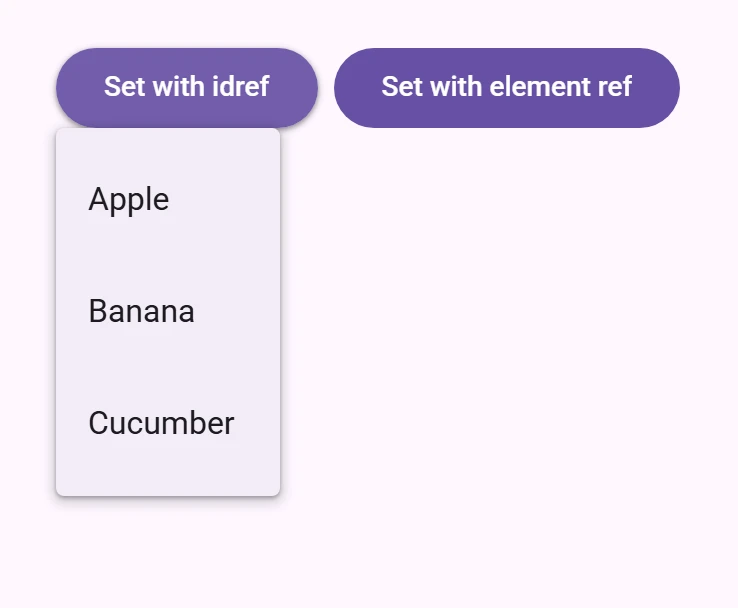

<!-- catalog-only-start --><!-- ---
name: Menus
dirname: menu
-----><!-- catalog-only-end -->

<catalog-component-header>
<catalog-component-header-title slot="title">

# Menus

<!-- no-catalog-start -->

<!-- [TOC] -->

<!-- external-only-start -->
**This documentation is fully rendered on the
[petal-elements catalog](https://petal.anontokyo.vip/catalog/components/menu/).**
<!-- external-only-end -->

<!-- no-catalog-end -->

[Menus](https://m3.material.io/components/menus)<!-- {.external} -->
show a list of choices on a temporary surface.

</catalog-component-header-title>



</catalog-component-header>

*   [Design article](https://m3.material.io/components/menus) <!-- {.external} -->
*   [API Documentation](#api)
*   [Source code](https://github.com/Saki340/petal-elements/tree/main/menu)
    <!-- {.external} -->

<!-- catalog-only-start -->

<!--

## Interactive Demo



-->

<!-- catalog-only-end -->

## Usage

When opened, menus position themselves to an anchor. Thus, either `anchor` or
`anchorElement` must be supplied to `petal-menu` before opening. Additionally, a
shared parent of `position:relative` should be present around the menu and it's
anchor, because the default menu is positioned relative to the anchor element.

Menus also render menu items such as `petal-menu-item` and handle keyboard
navigation between `petal-menu-item`s as well as typeahead functionality.
Additionally, `petal-menu` interacts with `petal-menu-item`s to help you determine how
a menu was closed. Listen for and inspect the `close-menu` custom event's
`details` to determine what action and items closed the menu.

<!-- no-catalog-start -->


<!-- no-catalog-end -->
<!-- catalog-include "figures/menu/usage.html" -->

```html
<!-- Note the position: relative style -->
<span style="position: relative">
  <petal-filled-button id="usage-anchor">Set with idref</petal-filled-button>
  <petal-menu id="usage-menu" anchor="usage-anchor">
    <petal-menu-item>
      <div slot="headline">Apple</div>
    </petal-menu-item>
    <petal-menu-item>
      <div slot="headline">Banana</div>
    </petal-menu-item>
    <petal-menu-item>
      <div slot="headline">Cucumber</div>
    </petal-menu-item>
  </petal-menu>
</span>

<script type="module">
  // This example uses anchor as an ID reference
  const anchorEl = document.body.querySelector('#usage-anchor');
  const menuEl = document.body.querySelector('#usage-menu');

  anchorEl.addEventListener('click', () => { menuEl.open = !menuEl.open; });
</script>

<span style="position: relative">
  <petal-filled-button id="usage-anchor-2">Set with element ref</petal-filled-button>
  <petal-menu id="usage-menu-2">
    <petal-menu-item>
      <div slot="headline">Apple</div>
    </petal-menu-item>
    <petal-menu-item>
      <div slot="headline">Banana</div>
    </petal-menu-item>
    <petal-menu-item>
      <div slot="headline">Cucumber</div>
    </petal-menu-item>
  </petal-menu>
</span>

<script type="module">
  // This example uses PetalMenu.prototype.anchorElement to set the anchor as an
  // HTMLElement reference.
  const anchorEl = document.body.querySelector('#usage-anchor-2');
  const menuEl = document.body.querySelector('#usage-menu-2');
  menuEl.anchorElement = anchorEl;

  anchorEl.addEventListener('click', () => { menuEl.open = !menuEl.open; });
</script>
```

### Submenus

You can compose `<petal-menu>`s inside of an `<petal-sub-menu>`'s `menu` slot, but
first the `has-overflow` attribute must be set on the root `<petal-menu>` to
disable overflow scrolling and display the nested submenus.

<!-- no-catalog-start -->


<!-- no-catalog-end -->
<!-- catalog-include "figures/menu/usage-submenu.html" -->

```html
<!-- Note the position: relative style -->
<span style="position: relative">
  <petal-filled-button id="usage-submenu-anchor">
    Menu with Submenus
  </petal-filled-button>
  <!-- Note the has-overflow attribute -->
  <petal-menu has-overflow id="usage-submenu" anchor="usage-submenu-anchor">
    <petal-sub-menu>
      <petal-menu-item slot="item">
      <div slot="headline">Fruits with A</div>
        <!-- Arrow icons are helpful affordances -->
        <petal-icon slot="end">arrow_right</petal-icon>
      </petal-menu-item>
      <!-- Submenu must be slotted into sub-menu's menu slot -->
      <petal-menu slot="menu">
        <petal-menu-item>
          <div slot="headline">Apricot</div>
        </petal-menu-item>
        <petal-menu-item>
          <div slot="headline">Avocado</div>
        </petal-menu-item>

        <!-- Nest as many as you want and control menu anchoring -->
        <petal-sub-menu
            menu-corner="start-end"
            anchor-corner="start-start">
          <petal-menu-item slot="item">
            <div slot="headline">Apples</div>
            <!-- Arrow icons are helpful affordances -->
            <petal-icon slot="start">
              arrow_left
            </petal-icon>
          </petal-menu-item>
          <petal-menu slot="menu">
            <petal-menu-item>
              <div slot="headline">Fuji</div>
            </petal-menu-item>
            <petal-menu-item>
              <div slot="headline" style="white-space: nowrap;">Granny Smith</div>
            </petal-menu-item>
            <petal-menu-item>
              <div slot="headline" style="white-space: nowrap;">Red Delicious</div>
            </petal-menu-item>
          </petal-menu>

        </petal-sub-menu>
      </petal-menu>
    </petal-sub-menu>

    <petal-menu-item>
      <div slot="headline">Banana</div>
    </petal-menu-item>
    <petal-menu-item>
      <div slot="headline">Cucumber</div>
    </petal-menu-item>
  </petal-menu>
</span>

<script type="module">
  const anchorEl = document.body.querySelector('#usage-submenu-anchor');
  const menuEl = document.body.querySelector('#usage-submenu');

  anchorEl.addEventListener('click', () => { menuEl.open = !menuEl.open; });
</script>
```

### Motion

Like Jetpack Compose's `DropdownMenu`, a menu opens by scaling from 80% and
fading in, from the corner next to its anchor, on the fast spatial and fast
effects springs (expressive by default). Closing reverses
it. `quick` skips the animation.

### Groups

`<petal-menu-group>` puts menu items on separate surfaces, as in Material 3
Expressive menus (Jetpack Compose `DropdownMenuGroup`). Groups are 2px apart,
the outer corners of the first and last groups are rounder, and items follow
the selectable menu items of Compose: 44px high.

Items follow their group's corners, a petal-elements choice: the group is
padded by 4px on all sides (Compose's `GroupPadding` token), the items next to
the menu's 16px outer corners have 12px corners there, the items next to the
8px corners where groups meet have 8px corners there, and the corners between
items are 4px. Compose's own code pads groups by 2px vertically and gives every
group's first and last items 12px corners, so its items do not follow the
group's corners.

Set `type="menuitemradio"` or `type="menuitemcheckbox"` on items that can be
checked, and `checked` on the checked ones. Choosing a radio item, by pointer or
with Enter or Space, checks it and unchecks the other radio items of its group
(or of the menu, outside groups); choosing a checkbox item toggles it. Both fire
`change`. Checked items are tertiary container colored with rounder corners.

Each `<petal-menu-group>` is its own set of radio items: choosing a radio item
does not uncheck radio items in other groups. If one choice spans groups, such
as "Follow the device" in one group and the languages in another, set
`single-radio` on the menu to make all of its radio items one set:

```html
<petal-menu single-radio>
  <petal-menu-group>
    <petal-menu-item type="menuitemradio" checked>
      <div slot="headline">Follow the device</div>
    </petal-menu-item>
  </petal-menu-group>
  <petal-menu-group>
    <petal-menu-item type="menuitemradio">
      <div slot="headline">English</div>
    </petal-menu-item>
    <petal-menu-item type="menuitemradio">
      <div slot="headline">日本語</div>
    </petal-menu-item>
  </petal-menu-group>
</petal-menu>
```

Like Compose's `DropdownMenuGroup`, a group that a mouse has hovered and left
takes the smaller inactive shape (`--md-menu-group-inactive-container-shape`,
8px on all four corners, the outer corners of the first and last groups too),
so the group under the pointer stands out. It lasts while the menu is open:
the menu opens again with every group in its own shape. To keep the shapes
fixed, set `no-inactive-shape` on the group or on the menu.

<!-- no-catalog-start -->


<!-- no-catalog-end -->
<!-- catalog-include "figures/menu/usage-groups.html" -->

```html
<span style="position: relative">
  <petal-filled-button id="usage-groups-anchor">Text size</petal-filled-button>
  <petal-menu id="usage-groups" anchor="usage-groups-anchor">
    <petal-menu-group>
      <petal-menu-item type="menuitemradio" keep-open>
        <div slot="headline">Small</div>
      </petal-menu-item>
      <petal-menu-item type="menuitemradio" keep-open checked>
        <div slot="headline">Medium</div>
      </petal-menu-item>
      <petal-menu-item type="menuitemradio" keep-open>
        <div slot="headline">Large</div>
      </petal-menu-item>
    </petal-menu-group>
    <petal-menu-group>
      <petal-menu-item>
        <petal-icon slot="start">settings</petal-icon>
        <div slot="headline">Settings</div>
      </petal-menu-item>
      <petal-menu-item>
        <petal-icon slot="start">help</petal-icon>
        <div slot="headline">Help</div>
      </petal-menu-item>
    </petal-menu-group>
  </petal-menu>
</span>

<script type="module">
  const menuEl = document.body.querySelector('#usage-groups');
  menuEl.addEventListener('change', (event) => {
    console.log(event.target.textContent.trim(), event.target.checked);
  });
</script>
```

Group tokens are `--md-menu-group-*` custom properties, from Compose's
`SegmentedMenuTokens` and `StandardMenuTokens`
([source](https://github.com/Saki340/petal-elements/blob/main/menu/internal/menugroup/_menu-group.scss)<!-- {.external} -->).
Checked items use `--md-menu-item-checked-container-color` and
`--md-menu-item-checked-label-text-color`.

### Popover-positioned menus

Internally menu uses `position: absolute` by default. Though there are cases
when the anchor and the node cannot share a common ancestor that is `position:
relative`, or sometimes, menu will render below another item due to limitations
with `position: absolute`.

Popover-positioned menus use the native
[Popover API](https://developer.mozilla.org/en-US/docs/Web/API/Popover_API)<!-- {.external} -->
to render above all other content. This may fix most issues where the default
menu positioning (`positioning="absolute"`) is not positioning as expected by
rendering into the
[top layer](https://developer.mozilla.org/en-US/docs/Glossary/Top_layer)<!-- {.external} -->.

> Warning: Popover API support was added in Chrome 114 and Safari 17. At the
> time of writing, Firefox does not support the Popover API
> ([see latest browser compatibility](https://developer.mozilla.org/en-US/docs/Web/API/Popover_API#browser_compatibility)<!-- {.external} -->).
>
> For browsers that do not support the Popover API, `petal-menu` will fall back to
> using [fixed-positioned menus](#fixed-positioned-menus).

<!-- no-catalog-start -->


<!-- no-catalog-end -->
<!-- catalog-include "figures/menu/usage-popover.html" -->

```html
<!-- Note the lack of position: relative parent. -->
<div style="margin: 16px;">
  <petal-filled-button id="usage-popover-anchor">Open popover menu</petal-filled-button>
</div>

<!-- popover menus do not require a common ancestor with the anchor. -->
<petal-menu positioning="popover" id="usage-popover" anchor="usage-popover-anchor">
  <petal-menu-item>
    <div slot="headline">Apple</div>
  </petal-menu-item>
  <petal-menu-item>
    <div slot="headline">Banana</div>
  </petal-menu-item>
  <petal-menu-item>
    <div slot="headline">Cucumber</div>
  </petal-menu-item>
</petal-menu>

<script type="module">
  const anchorEl = document.body.querySelector('#usage-popover-anchor');
  const menuEl = document.body.querySelector('#usage-popover');

  anchorEl.addEventListener('click', () => { menuEl.open = !menuEl.open; });
</script>
```

### Fixed-positioned menus

This is the fallback implementation of
[popover-positioned menus](#popover-positioned-menus) and uses `position: fixed`
rather than the default `position: absolute` which calculates its position
relative to the window rather than the element.

> Note: Fixed menu positions are positioned relative to the window and not the
> document. This means that the menu will not scroll with the anchor as the page
> is scrolled.

<!-- no-catalog-start -->


<!-- no-catalog-end -->
<!-- catalog-include "figures/menu/usage-fixed.html" -->

```html
<!-- Note the lack of position: relative parent. -->
<div style="margin: 16px;">
  <petal-filled-button id="usage-fixed-anchor">Open fixed menu</petal-filled-button>
</div>

<!-- Fixed menus do not require a common ancestor with the anchor. -->
<petal-menu positioning="fixed" id="usage-fixed" anchor="usage-fixed-anchor">
  <petal-menu-item>
    <div slot="headline">Apple</div>
  </petal-menu-item>
  <petal-menu-item>
    <div slot="headline">Banana</div>
  </petal-menu-item>
  <petal-menu-item>
    <div slot="headline">Cucumber</div>
  </petal-menu-item>
</petal-menu>

<script type="module">
  const anchorEl = document.body.querySelector('#usage-fixed-anchor');
  const menuEl = document.body.querySelector('#usage-fixed');

  anchorEl.addEventListener('click', () => { menuEl.open = !menuEl.open; });
</script>
```

### Document-positioned menus

When set to `positioning="document"`, `petal-menu` will position itself relative to
the document as opposed to the element or the window from `"absolute"` and
`"fixed"` values respectively.

Document level positioning is useful for the following cases:

-   There are no ancestor elements that produce a `relative` positioning
    context.
    -   `position: relative`
    -   `position: absolute`
    -   `position: fixed`
    -   `transform: translate(x, y)`
    -   etc.
-   The menu is hoisted to the top of the DOM
    -   The last child of `<body>`
    -   [Top layer](https://developer.mozilla.org/en-US/docs/Glossary/Top_layer)
        <!-- {.external} -->
-   The same `petal-menu` is being reused and the contents and anchors are being
    dynamically changed

<!-- no-catalog-start -->


<!-- no-catalog-end -->
<!-- catalog-include "figures/menu/usage-document.html" -->

```html
<!-- Note the lack of position: relative parent. -->
<div style="margin: 16px;">
  <petal-filled-button id="usage-document-anchor">Open document menu</petal-filled-button>
</div>

<!-- document menus do not require a common ancestor with the anchor. -->
<petal-menu positioning="document" id="usage-document" anchor="usage-document-anchor">
  <petal-menu-item>
    <div slot="headline">Apple</div>
  </petal-menu-item>
  <petal-menu-item>
    <div slot="headline">Banana</div>
  </petal-menu-item>
  <petal-menu-item>
    <div slot="headline">Cucumber</div>
  </petal-menu-item>
</petal-menu>

<script type="module">
  const anchorEl = document.body.querySelector('#usage-document-anchor');
  const menuEl = document.body.querySelector('#usage-document');

  anchorEl.addEventListener('click', () => { menuEl.open = !menuEl.open; });
</script>
```

## Accessibility

By default Menu is set up to function as a `role="menu"` with children as
`role="menuitem"`. A common use case for this is the menu button example, where
you would need to add keyboard interactions to the button to open the menu
([see W3C example](https://www.w3.org/WAI/ARIA/apg/patterns/menu-button/examples/menu-button-actions/)<!-- {.external} -->).

Menu can also be adapted for other use cases.

The role of the `petal-list` inside the menu can be set with the `type` attribute.
The role of each individual `petal-menu-item` can also be set with the `type`
attribute. Anything else slotted into the menu that is not a list item in most
cases should be set to `role="none"`, and `petal-divider` should have
`role="separator"` and `tabindex="-1"`.

```html
<!--
  A simplified example of an autocomplete component – missing javascript logic for interaction.
-->
<petal-filled-text-field
    id="textfield"
    type="combobox"
    aria-controls="menu"
    aria-autocomplete="list"
    aria-expanded="true"
    aria-activedescendant="1"
    value="Ala">
</petal-filled-text-field>
<petal-menu
    id="menu"
    anchor="textfield"
    role="listbox"
    aria-label="states"
    open>
  <petal-menu-item type="option" id="0">
    <div slot="headline">Alabama</div>
  </petal-menu-item>
  <petal-divider role="separator" tabindex="-1"></petal-divider>
  <petal-menu-item type="option" id="1" selected aria-selected="true">
    <div slot="headline">Alabama</div>
  </petal-menu-item>
</petal-menu>
```

## Theming

Menus support [Material theming](../theming/README.md) and can be customized in
terms of color. Additionally, `petal-menu` composes `petal-list`, and each menu item
extends `petal-list-item` ([see theming documentation](./list#theming)), so most
the tokens for those components can also be used for Menu.

### Menu Tokens

Token                                     | Default value
----------------------------------------- | ------------------------------------
`--md-menu-container-color`               | `--md-sys-color-surface-container`
`--md-menu-container-shape`               | `--md-sys-shape-corner-extra-small`
`--md-menu-item-container-color`          | `--md-sys-color-surface-container`
`--md-menu-item-selected-container-color` | `--md-sys-color-secondary-container`

*   [Menu tokens](https://github.com/Saki340/petal-elements/blob/main/tokens/_md-comp-menu.scss)
    <!-- {.external} -->
*   [Menu item tokens](https://github.com/Saki340/petal-elements/blob/main/tokens/_md-comp-menu-item.scss)
    <!-- {.external} -->
*   [List tokens](https://github.com/Saki340/petal-elements/blob/main/tokens/_md-comp-list.scss)
    <!-- {.external} -->
*   [List item tokens](https://github.com/Saki340/petal-elements/blob/main/tokens/_md-comp-list-item.scss)
    <!-- {.external} -->

### Example

<!-- no-catalog-start -->


<!-- no-catalog-end -->
<!-- catalog-include "figures/menu/theming.html" -->

```html
<style>
  :root {
    background-color: #f4fbfa;
    --md-menu-container-color: #f4fbfa;
    --md-menu-container-shape: 0px;
    --md-sys-color-on-surface: #161d1d;
    --md-sys-typescale-body-large-font: system-ui;
  }
  petal-menu-item {
    border-radius: 28px;
  }
  petal-menu-item::part(focus-ring) {
    border-radius: 28px;
  }
  /* Styles for button and not relevant to menu */
  petal-filled-button {
    --md-sys-color-primary: #006a6a;
    --md-sys-color-on-primary: #ffffff;
  }
</style>

<span style="position: relative">
  <petal-filled-button id="theming-anchor">Themed menu</petal-filled-button>
  <petal-menu id="theming-menu" anchor="theming-anchor">
    <petal-menu-item>
      <div slot="headline">Apple</div>
    </petal-menu-item>
    <petal-menu-item>
      <div slot="headline">Banana</div>
    </petal-menu-item>
    <petal-menu-item>
      <div slot="headline">Cucumber</div>
    </petal-menu-item>
  </petal-menu>
</span>

<script type="module">
  const anchorEl = document.body.querySelector("#theming-anchor");
  const menuEl = document.body.querySelector("#theming-menu");

  anchorEl.addEventListener("click", () => {
    menuEl.show();
  });
</script>
```

<!-- auto-generated API docs start -->

## API


### PetalMenu <code>&lt;petal-menu&gt;</code>

#### Properties

<!-- mdformat off(autogenerated might break rendering in catalog) -->

| Property | Attribute | Type | Default | Description |
| --- | --- | --- | --- | --- |
| `anchor` | `anchor` | `string` | `''` | The ID of the element in the same root node in which the menu should align to. Overrides setting `anchorElement = elementReference`.<br>__NOTE__: anchor or anchorElement must either be an HTMLElement or resolve to an HTMLElement in order for menu to open. |
| `positioning` | `positioning` | `"absolute" \| "fixed" \| "document" \| "popover"` | `'absolute'` | Whether the positioning algorithm should calculate relative to the parent of the anchor element (`absolute`), relative to the window (`fixed`), or relative to the document (`document`). `popover` will use the popover API to render the menu in the top-layer. If your browser does not support the popover API, it will fall back to `fixed`.<br>__Examples for `position = 'fixed'`:__<br>- If there is no `position:relative` in the given parent tree and the surface is `position:absolute` - If the surface is `position:fixed` - If the surface is in the "top layer" - The anchor and the surface do not share a common `position:relative` ancestor<br>When using `positioning=fixed`, in most cases, the menu should position itself above most other `position:absolute` or `position:fixed` elements when placed inside of them. e.g. using a menu inside of an `petal-dialog`.<br>__NOTE__: Fixed menus will not scroll with the page and will be fixed to the window instead.<br>__Examples for `position = 'document'`:__<br>- There is no parent that creates a relative positioning context e.g. `position: relative`, `position: absolute`, `transform: translate(x, y)`, etc. - You put the effort into hoisting the menu to the top of the DOM like the end of the `<body>` to render over everything or in a top-layer. - You are reusing a single `petal-menu` element that dynamically renders content.<br>__Examples for `position = 'popover'`:__<br>- Your browser supports `popover`. - Most cases. Once popover is in browsers, this will become the default. |
| `quick` | `quick` | `boolean` | `false` | Skips the opening and closing animations. |
| `hasOverflow` | `has-overflow` | `boolean` | `false` | Displays overflow content like a submenu. Not required in most cases when using `positioning="popover"`.<br>__NOTE__: This may cause adverse effects if you set `petal-menu {max-height:...}` and have items overflowing items in the "y" direction. |
| `open` | `open` | `boolean` | `false` | Opens the menu and makes it visible. Alternative to the `.show()` and `.close()` methods |
| `xOffset` | `x-offset` | `number` | `0` | Offsets the menu's inline alignment from the anchor by the given number in pixels. This value is direction aware and will follow the LTR / RTL direction.<br>e.g. LTR: positive -> right, negative -> left RTL: positive -> left, negative -> right |
| `yOffset` | `y-offset` | `number` | `0` | Offsets the menu's block alignment from the anchor by the given number in pixels.<br>e.g. positive -> down, negative -> up |
| `noHorizontalFlip` | `no-horizontal-flip` | `boolean` | `false` | Disable the `flip` behavior that usually happens on the horizontal axis when the surface would render outside the viewport. |
| `noVerticalFlip` | `no-vertical-flip` | `boolean` | `false` | Disable the `flip` behavior that usually happens on the vertical axis when the surface would render outside the viewport. |
| `typeaheadDelay` | `typeahead-delay` | `number` | `200` | The max time between the keystrokes of the typeahead menu behavior before it clears the typeahead buffer. |
| `anchorCorner` | `anchor-corner` | `Corner` | `Corner.END_START` | The corner of the anchor which to align the menu in the standard logical property style of <block>-<inline> e.g. `'end-start'`.<br>NOTE: This value may not be respected by the menu positioning algorithm if the menu would render outisde the viewport. Use `no-horizontal-flip` or `no-vertical-flip` to force the usage of the value |
| `menuCorner` | `menu-corner` | `Corner` | `Corner.START_START` | The corner of the menu which to align the anchor in the standard logical property style of <block>-<inline> e.g. `'start-start'`.<br>NOTE: This value may not be respected by the menu positioning algorithm if the menu would render outisde the viewport. Use `no-horizontal-flip` or `no-vertical-flip` to force the usage of the value |
| `stayOpenOnOutsideClick` | `stay-open-on-outside-click` | `boolean` | `false` | Keeps the user clicks outside the menu.<br>NOTE: clicking outside may still cause focusout to close the menu so see `stayOpenOnFocusout`. |
| `stayOpenOnFocusout` | `stay-open-on-focusout` | `boolean` | `false` | Keeps the menu open when focus leaves the menu's composed subtree.<br>NOTE: Focusout behavior will stop propagation of the focusout event. Set this property to true to opt-out of menu's focusout handling altogether. |
| `skipRestoreFocus` | `skip-restore-focus` | `boolean` | `false` | After closing, does not restore focus to the last focused element before the menu was opened. |
| `defaultFocus` | `default-focus` | `FocusState` | `FocusState.FIRST_ITEM` | The element that should be focused by default once opened.<br>NOTE: When setting default focus to 'LIST_ROOT', remember to change `tabindex` to `0` and change petal-menu's display to something other than `display: contents` when necessary. |
| `noNavigationWrap` | `no-navigation-wrap` | `boolean` | `false` | Turns off navigation wrapping. By default, navigating past the end of the menu items will wrap focus back to the beginning and vice versa. Use this for ARIA patterns that do not wrap focus, like combobox. |
| `singleRadio` | `single-radio` | `boolean` | `false` | Makes all of the menu's radio items one set, across its groups: choosing one unchecks the others. By default each group is its own set. |
| `isSubmenu` |  | `boolean` | `false` | Whether or not the current menu is a submenu and should not handle specific navigation keys. |
| `typeaheadController` |  | `TypeaheadController` | `function { ... }` | Handles typeahead navigation through the menu. |
| `anchorElement` |  | `HTMLElement & Partial<SurfacePositionTarget>` | `undefined` |  |
| `items` |  | `MenuItem[]` | `undefined` |  |

<!-- mdformat on(autogenerated might break rendering in catalog) -->

#### Methods

<!-- mdformat off(autogenerated might break rendering in catalog) -->

| Method | Parameters | Returns | Description |
| --- | --- | --- | --- |
| `getBoundingClientRect` | _None_ | `DOMRect` |  |
| `getClientRects` | _None_ | `DOMRectList` |  |
| `close` | _None_ | `void` |  |
| `show` | _None_ | `void` |  |
| `activateNextItem` | _None_ | `MenuItem` | Activates the next item in the menu. If at the end of the menu, the first item will be activated. |
| `activatePreviousItem` | _None_ | `MenuItem` | Activates the previous item in the menu. If at the start of the menu, the last item will be activated. |
| `reposition` | _None_ | `void` | Repositions the menu if it is open.<br>Useful for the case where document or window-positioned menus have their anchors moved while open. |

<!-- mdformat on(autogenerated might break rendering in catalog) -->

#### Events

<!-- mdformat off(autogenerated might break rendering in catalog) -->

| Event | Type | [Bubbles](https://developer.mozilla.org/en-US/docs/Web/API/Event/bubbles) | [Composed](https://developer.mozilla.org/en-US/docs/Web/API/Event/composed) | Description |
| --- | --- | --- | --- | --- |
| `opening` | `Event` | No | No | Fired before the opening animation begins |
| `opened` | `Event` | No | No | Fired once the menu is open, after any animations |
| `closing` | `Event` | No | No | Fired before the closing animation begins |
| `closed` | `Event` | No | No | Fired once the menu is closed, after any animations |

<!-- mdformat on(autogenerated might break rendering in catalog) -->

### PetalMenuGroup <code>&lt;petal-menu-group&gt;</code>

#### Properties

<!-- mdformat off(autogenerated might break rendering in catalog) -->

| Property | Attribute | Type | Default | Description |
| --- | --- | --- | --- | --- |
| `noInactiveShape` | `no-inactive-shape` | `boolean` | `false` | Keeps the group's shape when the pointer leaves it, instead of the smaller inactive shape. Also applies when set on the menu. |

<!-- mdformat on(autogenerated might break rendering in catalog) -->

#### Methods

<!-- mdformat off(autogenerated might break rendering in catalog) -->

| Method | Parameters | Returns | Description |
| --- | --- | --- | --- |
| `resetHover` | _None_ | `void` | Forgets the hover, back to the group's own shape at once. The menu calls this when it opens, as Compose starts a new DropdownMenuGroup each time. |

<!-- mdformat on(autogenerated might break rendering in catalog) -->

### PetalMenuItem <code>&lt;petal-menu-item&gt;</code>

#### Properties

<!-- mdformat off(autogenerated might break rendering in catalog) -->

| Property | Attribute | Type | Default | Description |
| --- | --- | --- | --- | --- |
| `disabled` | `disabled` | `boolean` | `false` | Disables the item and makes it non-selectable and non-interactive. |
| `type` | `type` | `MenuItemType` | `'menuitem'` | Sets the behavior and role of the menu item, defaults to "menuitem". |
| `href` | `href` | `string` | `''` | Sets the underlying `HTMLAnchorElement`'s `href` resource attribute. |
| `target` | `target` | `"" \| "_blank" \| "_parent" \| "_self" \| "_top"` | `''` | Sets the underlying `HTMLAnchorElement`'s `target` attribute when `href` is set. |
| `rel` | `rel` | `string` | `''` | Sets the underlying `HTMLAnchorElement`'s `rel` attribute when `href` is set. |
| `referrerPolicy` | `referrerpolicy` | `string` | `''` | Sets the underlying `HTMLAnchorElement`'s `referrerpolicy` attribute when `href` is set. |
| `keepOpen` | `keep-open` | `boolean` | `false` | Keeps the menu open if clicked or keyboard selected. |
| `selected` | `selected` | `boolean` | `false` | Sets the item in the selected visual state when a submenu is opened. |
| `checked` | `checked` | `boolean` | `false` | Checks the item. With `type="menuitemcheckbox"` or `"menuitemradio"` it sets `aria-checked`, and the item shows the selected colors and shape of Compose's selectable menu items. Choosing a checkbox item toggles it; choosing a radio item checks it and unchecks the other radio items of its group (or menu), and fires `change`. |
| `typeaheadText` |  | `string` | `undefined` |  |

<!-- mdformat on(autogenerated might break rendering in catalog) -->

#### Events

<!-- mdformat off(autogenerated might break rendering in catalog) -->

| Event | Type | [Bubbles](https://developer.mozilla.org/en-US/docs/Web/API/Event/bubbles) | [Composed](https://developer.mozilla.org/en-US/docs/Web/API/Event/composed) | Description |
| --- | --- | --- | --- | --- |
| `close-menu` | `CustomEvent<{initiator: SelectOption, reason: Reason, itemPath: SelectOption[]}>` | Yes | Yes | Closes the encapsulating menu on closable interaction. |
| `change` | `Event` | Yes | No | A checkbox or radio item was checked or unchecked by the user. |

<!-- mdformat on(autogenerated might break rendering in catalog) -->

### PetalSubMenu <code>&lt;petal-sub-menu&gt;</code>

#### Properties

<!-- mdformat off(autogenerated might break rendering in catalog) -->

| Property | Attribute | Type | Default | Description |
| --- | --- | --- | --- | --- |
| `anchorCorner` | `anchor-corner` | `Corner` | `Corner.START_END` | The anchorCorner to set on the submenu. |
| `menuCorner` | `menu-corner` | `Corner` | `Corner.START_START` | The menuCorner to set on the submenu. |
| `hoverOpenDelay` | `hover-open-delay` | `number` | `400` | The delay between mouseenter and submenu opening. |
| `hoverCloseDelay` | `hover-close-delay` | `number` | `400` | The delay between ponterleave and the submenu closing. |
| `isSubMenu` | `petal-sub-menu` | `boolean` | `true` | READONLY: self-identifies as a menu item and sets its identifying attribute |
| `item` |  | `MenuItem` | `undefined` |  |
| `menu` |  | `Menu` | `undefined` |  |

<!-- mdformat on(autogenerated might break rendering in catalog) -->

#### Methods

<!-- mdformat off(autogenerated might break rendering in catalog) -->

| Method | Parameters | Returns | Description |
| --- | --- | --- | --- |
| `show` | _None_ | `Promise<void>` | Shows the submenu. |
| `close` | _None_ | `Promise<void>` | Closes the submenu. |

<!-- mdformat on(autogenerated might break rendering in catalog) -->

#### Events

<!-- mdformat off(autogenerated might break rendering in catalog) -->

| Event | Type | [Bubbles](https://developer.mozilla.org/en-US/docs/Web/API/Event/bubbles) | [Composed](https://developer.mozilla.org/en-US/docs/Web/API/Event/composed) | Description |
| --- | --- | --- | --- | --- |
| `deactivate-items` | `Event` | Yes | Yes | Requests the parent menu to deselect other items when a submenu opens. |
| `request-activation` | `Event` | Yes | Yes | Requests the parent to make the slotted item focusable and focus the item. Used internally for menu keyboard navigation; most applications do not need to listen for this event. It is exposed for authors building their own menu-item replacements, or for advanced cases where you want to call `preventDefault`/`stopPropagation` on it to override default focus handling. |
| `deactivate-typeahead` | `Event` | Yes | Yes | Requests the parent menu to deactivate the typeahead functionality when a submenu opens. |
| `activate-typeahead` | `Event` | Yes | Yes | Requests the parent menu to activate the typeahead functionality when a submenu closes. |

<!-- mdformat on(autogenerated might break rendering in catalog) -->

<!-- auto-generated API docs end -->
