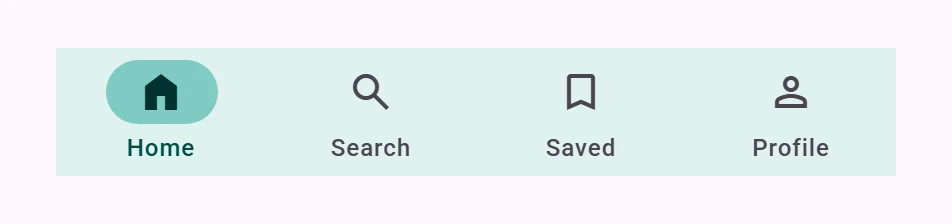

<!-- catalog-only-start --><!-- ---
name: Navigation bar
dirname: navigationbar
-----><!-- catalog-only-end -->

<catalog-component-header>
<catalog-component-header-title slot="title">

# Navigation bar

<!-- no-catalog-start -->

<!-- [TOC] -->

<!-- external-only-start -->
**This documentation is fully rendered on the
[petal-elements catalog](https://petal.anontokyo.vip/catalog/components/navigation-bar/).**
<!-- external-only-end -->

<!-- no-catalog-end -->

[Navigation bars](https://m3.material.io/components/navigation-bar)<!-- {.external} -->
let people switch between a few primary destinations, usually at the bottom of
the screen.

</catalog-component-header-title>


</catalog-component-header>

*   [Design article](https://m3.material.io/components/navigation-bar) <!-- {.external} -->
*   [API Documentation](#api)
*   [Source code](https://github.com/Saki340/petal-elements/tree/main/navigationbar)
    <!-- {.external} -->

This is the Material 3 Expressive "short" navigation bar. The values follow
Jetpack Compose Material 3 (`ShortNavigationBar`, `ShortNavigationBarItem`,
`NavigationBarTokens`).

## Usage

Put `petal-navigation-bar-item` elements in a `petal-navigation-bar`. The
icon goes in the `icon` slot and the label is the content. Mark the current
destination with `selected`.

<!-- no-catalog-start -->


<!-- no-catalog-end -->
<!-- catalog-include "figures/navigationbar/usage.html" -->

```html
<petal-navigation-bar>
  <petal-navigation-bar-item selected>
    <petal-icon slot="icon">home</petal-icon>
    Home
  </petal-navigation-bar-item>
  <petal-navigation-bar-item>
    <petal-icon slot="icon">search</petal-icon>
    Search
  </petal-navigation-bar-item>
  <petal-navigation-bar-item>
    <petal-icon slot="icon">bookmark</petal-icon>
    Saved
  </petal-navigation-bar-item>
</petal-navigation-bar>
```

The bar is 64px high and gives each item the same width. The selected item's
indicator grows from its center with the default spatial spring, as in Compose,
and its icon is filled: the item sets `--md-icon-fill` to 1, which
`petal-icon` uses for Material Symbols. For icons that are not variable fonts,
add a `selected-icon` slot, which replaces the `icon` slot when the item is
selected.

### Selection

The bar keeps one item selected. When the user picks another, it selects that
item and fires a `change` event. Read `selectedIndex` or `selectedItem` in
the handler, and cancel the event to keep the previous item selected.
Setting `selectedIndex` or an item's `selected` changes the selection without
an event.

```js
bar.addEventListener('change', () => {
  showPage(bar.selectedIndex);
});
```

### Links

An item with `href` is a link (add `target` for a new tab). The bar still
selects it when it is clicked; with a router, set `selected` from the current
URL.

```html
<petal-navigation-bar-item href="/search">
  <petal-icon slot="icon">search</petal-icon>
  Search
</petal-navigation-bar-item>
```

### Icon before the label

`icon-position="start"` puts the icon before the label inside a 40px high
indicator, for wide screens.

<!-- no-catalog-start -->


<!-- no-catalog-end -->
<!-- catalog-include "figures/navigationbar/usage-start.html" -->

```html
<petal-navigation-bar-item selected icon-position="start">
  <petal-icon slot="icon">home</petal-icon>
  Home
</petal-navigation-bar-item>
```

### Items without a label

An item without a label shows only the icon. Give it an `aria-label`.

### Arrangement

`arrangement="centered"` groups the items in the middle, with a padding on both
sides that depends on how many items there are (Compose's
`ShortNavigationBarArrangement.Centered`). The default is `equal-weight`.

### Badges

Put a [badge](./badge.md) in the `badge` slot of an item. It sits at the end
of the icon's top edge. Say what it means in the item's `aria-label`.

```html
<petal-navigation-bar-item aria-label="Inbox, 12 unread">
  <petal-icon slot="icon">inbox</petal-icon>
  <petal-badge slot="badge" value="12"></petal-badge>
  Inbox
</petal-navigation-bar-item>
```

## Accessibility

As in Compose, the bar is a `tablist` (`selectableGroup`) and its items are
`tab`s (`Role.Tab`) with `aria-selected`. Only the selected item is in the tab
order; the left and right arrow keys (reversed in right-to-left text) and Home
and End move the focus between items, skipping disabled ones, and Enter or
Space selects the focused item. Moving the focus does not select, so keyboard
users can browse the destinations first.

Labels are the accessible names; give icon-only items an `aria-label`. Put
the bar in a `<nav>` element to make it a navigation landmark.

## Theming

Navigation bars support [Material theming](../theming/README.md). Every token of
Compose's `NavigationBarTokens` is a `--md-navigation-bar-*` custom property;
the sizes of the items come from `NavigationBarVerticalItemTokens` and
`NavigationBarHorizontalItemTokens` as `--md-navigation-bar-vertical-item-*` and
`--md-navigation-bar-horizontal-item-*`.

### Tokens

Token                                                 | Default value
----------------------------------------------------- | -------------
`--md-navigation-bar-container-color`                 | `--md-sys-color-surface-container`
`--md-navigation-bar-container-height`                | `64px`
`--md-navigation-bar-item-active-indicator-color`     | `--md-sys-color-secondary-container`
`--md-navigation-bar-item-active-icon-color`          | `--md-sys-color-on-secondary-container`
`--md-navigation-bar-item-active-label-text-color`    | `--md-sys-color-secondary`
`--md-navigation-bar-item-inactive-icon-color`        | `--md-sys-color-on-surface-variant`
`--md-navigation-bar-item-inactive-label-text-color`  | `--md-sys-color-on-surface-variant`
`--md-navigation-bar-item-active-indicator-icon-label-space` | `4px`
`--md-navigation-bar-label-text-*`                    | `--md-sys-typescale-label-medium-*`
`--md-navigation-bar-vertical-item-active-indicator-width` | `56px`
`--md-navigation-bar-vertical-item-active-indicator-height` | `32px`

*   [All tokens](https://github.com/Saki340/petal-elements/blob/main/tokens/versions/compose/values/_md-comp-navigation-bar.scss)
    <!-- {.external} -->

### Example

<!-- no-catalog-start -->



<!-- no-catalog-end -->
<!-- catalog-include "figures/navigationbar/theming.html" -->

```html
<style>
  petal-navigation-bar {
    --md-navigation-bar-container-color: #e0f2f1;
    --md-navigation-bar-item-active-indicator-color: #80cbc4;
    --md-navigation-bar-item-active-icon-color: #00332f;
    --md-navigation-bar-item-active-label-text-color: #004d46;
  }
</style>
```

<!-- auto-generated API docs start -->

## API


### PetalNavigationBar <code>&lt;petal-navigation-bar&gt;</code>

#### Properties

<!-- mdformat off(autogenerated might break rendering in catalog) -->

| Property | Attribute | Type | Default | Description |
| --- | --- | --- | --- | --- |
| `arrangement` | `arrangement` | `NavigationBarArrangement` | `'equal-weight'` | `equal-weight` gives every item the same width. `centered` groups the items in the middle, with a side padding that depends on how many there are. |
| `selectedIndex` | `selected-index` | `number` | `undefined` |  |
| `items` |  | `NavigationItem[]` | `undefined` | The items, in the default slot. |
| `selectedItem` |  | `NavigationItem` | `undefined` |  |

<!-- mdformat on(autogenerated might break rendering in catalog) -->

#### Events

<!-- mdformat off(autogenerated might break rendering in catalog) -->

| Event | Type | [Bubbles](https://developer.mozilla.org/en-US/docs/Web/API/Event/bubbles) | [Composed](https://developer.mozilla.org/en-US/docs/Web/API/Event/composed) | Description |
| --- | --- | --- | --- | --- |
| `change` | `Event` | Yes | No | The user selected another item. The target's `selectedIndex` and `selectedItem` tell which. Cancel it to keep the previous item selected. |

<!-- mdformat on(autogenerated might break rendering in catalog) -->

### PetalNavigationBarItem <code>&lt;petal-navigation-bar-item&gt;</code>

#### Properties

<!-- mdformat off(autogenerated might break rendering in catalog) -->

| Property | Attribute | Type | Default | Description |
| --- | --- | --- | --- | --- |
| `selected` | `selected` | `boolean` | `false` | Whether the item is the current destination. |
| `disabled` | `disabled` | `boolean` | `false` | Disables the item. |
| `href` | `href` | `string` | `''` | Makes the item a link to this URL. |
| `target` | `target` | `string` | `''` | Where a link opens (`_blank`, ...). |
| `iconPosition` | `icon-position` | `NavigationIconPosition` | `undefined` | Where the icon sits. Defaults to `top` in a navigation bar; a rail picks it from whether it is expanded. |

<!-- mdformat on(autogenerated might break rendering in catalog) -->

<!-- auto-generated API docs end -->
