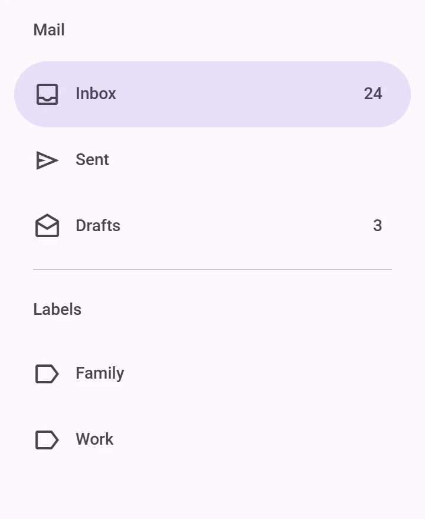
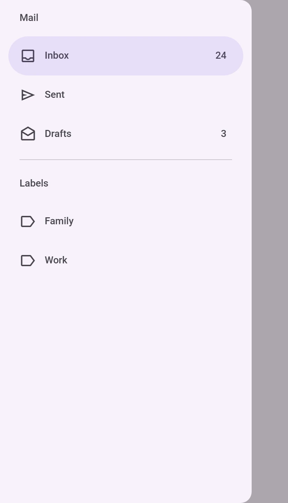
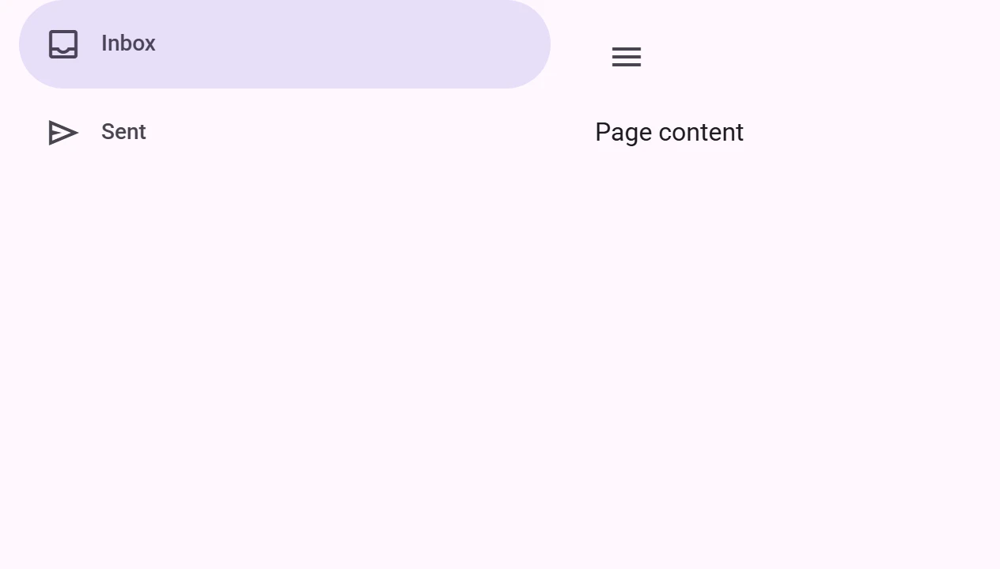

<!-- catalog-only-start --><!-- ---
name: Navigation drawer
dirname: navigationdrawer
-----><!-- catalog-only-end -->

<catalog-component-header>
<catalog-component-header-title slot="title">

# Navigation drawer

<!-- no-catalog-start -->

<!-- [TOC] -->

<!-- external-only-start -->
**This documentation is fully rendered on the
[petal-elements catalog](https://petal.anontokyo.vip/catalog/components/navigation-drawer/).**
<!-- external-only-end -->

<!-- no-catalog-end -->

[Navigation drawers](https://m3.material.io/components/navigation-drawer)<!-- {.external} -->
give access to destinations in a side panel: over the page, beside it, or
always shown.

</catalog-component-header-title>



</catalog-component-header>

*   [Design article](https://m3.material.io/components/navigation-drawer) <!-- {.external} -->
*   [API Documentation](#api)
*   [Source code](https://github.com/Saki340/petal-elements/tree/main/navigationdrawer)
    <!-- {.external} -->

The values and motion follow Jetpack Compose Material 3
(`ModalNavigationDrawer`, `DismissibleNavigationDrawer`,
`PermanentNavigationDrawer`, `NavigationDrawerItem`, `NavigationDrawerTokens`).

## Usage

Put `petal-navigation-drawer-item` elements in a `petal-navigation-drawer`.
The icon goes in the `icon` slot, the label is the content, and a badge such
as a count goes in the `badge` slot. Mark the current destination with
`selected`, and give links an `href`. Headings (`h1` to `h6`) in the drawer get
the headline style; use `petal-divider` between groups.

By default the drawer is modal: `show()`, `close()` or the `open` property
open it over the page with a scrim. Clicking the scrim, pressing Escape or
dragging the drawer toward its edge closes it. Keyboard focus moves into the
drawer while it is open and goes back when it closes.

<!-- no-catalog-start -->



<!-- no-catalog-end -->
<!-- catalog-include "figures/navigationdrawer/usage.html" -->

```html
<petal-filled-button id="opener">Open drawer</petal-filled-button>
<petal-navigation-drawer id="drawer" aria-label="Mail">
  <h2>Mail</h2>
  <petal-navigation-drawer-item selected>
    <petal-icon slot="icon">inbox</petal-icon>
    Inbox
    <span slot="badge">24</span>
  </petal-navigation-drawer-item>
  <petal-navigation-drawer-item>
    <petal-icon slot="icon">send</petal-icon>
    Sent
  </petal-navigation-drawer-item>
</petal-navigation-drawer>

<script type="module">
  const drawer = document.querySelector('#drawer');
  document.querySelector('#opener').addEventListener('click', () => drawer.show());
  // Close it once the user picks a destination.
  drawer.addEventListener('change', () => drawer.close());
</script>
```

### Dismissible and standard

With `type="dismissible"`, the drawer sits beside the page content and
pushes it aside as it opens; put both in a row (`display: flex`). With
`type="standard"`, the drawer is always shown, for wide screens. Both use the
surface color and square corners; the modal drawer is the surface container
low color with rounded end corners.

<!-- no-catalog-start -->



<!-- no-catalog-end -->
<!-- catalog-include "figures/navigationdrawer/usage-dismissible.html" -->

```html
<div style="display: flex; height: 100vh">
  <petal-navigation-drawer id="drawer" type="dismissible" open>
    <petal-navigation-drawer-item selected>
      <petal-icon slot="icon">inbox</petal-icon>
      Inbox
    </petal-navigation-drawer-item>
  </petal-navigation-drawer>
  <main style="flex: 1">
    <petal-icon-button id="toggle" aria-label="Menu">
      <petal-icon>menu</petal-icon>
    </petal-icon-button>
  </main>
</div>

<script type="module">
  const drawer = document.querySelector('#drawer');
  document.querySelector('#toggle').addEventListener('click', () => {
    drawer.open = !drawer.open;
  });
</script>
```

### Motion

As in Compose, the drawer opens on the default spatial spring and closes on
the fast effects spring of the page's motion scheme
(`--md-sys-motion-spring-*`). With the expressive scheme it overshoots a
little when it opens; the surface stretches so no gap shows at the edge. A
drag settles on the default spatial spring: past half of the way, or faster
than 400px/s, it goes the way it was dragged. With
`prefers-reduced-motion` or `quick`, it opens and closes at once.

### Selection

Clicking an item selects it, deselects the others and fires `change`, which
can be canceled. Setting `selected` on an item from a script deselects the
others without an event.

Items with `href` are links (`target` sets where they open). A modal drawer
stays open when an item is clicked; close it in the `change` handler if the
page does not navigate away. A `selected-icon` slot gives the selected item
another icon.

### Opening and closing

Open a modal or dismissible drawer with `show()` or `open = true`, and close
it with `close()` or `open = false`; both methods return a promise that
resolves after the animation. The drawer fires `open` and `close` (both
cancelable) before the animation, and `opened` and `closed` after it. A modal
or dismissible drawer closes on Escape; a modal one also on a click on the
scrim and when dragged toward its edge.

```js
const drawer = document.querySelector('petal-navigation-drawer');
menuButton.addEventListener('click', () => drawer.show());
drawer.addEventListener('closed', () => menuButton.focus());
```

## Accessibility

A modal drawer is a modal dialog, labeled by `aria-label` ("Navigation menu"
by default, Compose's pane title); the page behind it is inert. Dismissible and
standard drawers are a `nav` landmark with that label.

Items are links (with `href`) or buttons, all in the tab order, and the
selected one is the current page (`aria-current="page"`). Compose gives them
`Role.Tab`; on the web the drawer mixes items with headlines and dividers, so
it is not a tab list.

## Theming

Navigation drawers support [Material theming](../theming/README.md) with the
`--md-navigation-drawer-*` tokens, after Compose's `NavigationDrawerTokens`,
and the scrim with `--md-navigation-drawer-scrim-color` and
`--md-navigation-drawer-scrim-opacity` (`ScrimTokens`).

### Tokens

Token                                                 | Default value
----------------------------------------------------- | -------------
`--md-navigation-drawer-container-width`              | `360px`
`--md-navigation-drawer-container-shape`              | `--md-sys-shape-corner-large`
`--md-navigation-drawer-modal-container-color`        | `--md-sys-color-surface-container-low`
`--md-navigation-drawer-standard-container-color`     | `--md-sys-color-surface`
`--md-navigation-drawer-active-indicator-color`       | `--md-sys-color-secondary-container`
`--md-navigation-drawer-active-indicator-height`      | `56px`
`--md-navigation-drawer-active-icon-color`            | `--md-sys-color-on-secondary-container`
`--md-navigation-drawer-active-label-text-color`      | `--md-sys-color-on-secondary-container`
`--md-navigation-drawer-inactive-icon-color`          | `--md-sys-color-on-surface-variant`
`--md-navigation-drawer-inactive-label-text-color`    | `--md-sys-color-on-surface-variant`
`--md-navigation-drawer-headline-color`               | `--md-sys-color-on-surface-variant`
`--md-navigation-drawer-scrim-color`                  | `--md-sys-color-scrim`
`--md-navigation-drawer-scrim-opacity`                | `0.32`

*   [All tokens](https://github.com/Saki340/petal-elements/blob/main/tokens/versions/compose/values/_md-comp-navigation-drawer.scss)
    <!-- {.external} -->

<!-- auto-generated API docs start -->

## API


### PetalNavigationDrawer <code>&lt;petal-navigation-drawer&gt;</code>

#### Properties

<!-- mdformat off(autogenerated might break rendering in catalog) -->

| Property | Attribute | Type | Default | Description |
| --- | --- | --- | --- | --- |
| `type` | `type` | `NavigationDrawerType` | `'modal'` | How the drawer shows. |
| `quick` | `quick` | `boolean` | `false` | Opens and closes without animations. |
| `open` | `open` | `boolean` | `undefined` |  |
| `items` |  | `HTMLElement[]` | `undefined` | The items, in the default slot. |

<!-- mdformat on(autogenerated might break rendering in catalog) -->

#### Methods

<!-- mdformat off(autogenerated might break rendering in catalog) -->

| Method | Parameters | Returns | Description |
| --- | --- | --- | --- |
| `show` | _None_ | `Promise<void>` | Opens the drawer and fires a cancelable `open` event. After the animation, an `opened` event is fired. |
| `close` | `velocity` | `Promise<void>` | Closes the drawer and fires a cancelable `close` event. After the animation, a `closed` event is fired. |

<!-- mdformat on(autogenerated might break rendering in catalog) -->

#### Events

<!-- mdformat off(autogenerated might break rendering in catalog) -->

| Event | Type | [Bubbles](https://developer.mozilla.org/en-US/docs/Web/API/Event/bubbles) | [Composed](https://developer.mozilla.org/en-US/docs/Web/API/Event/composed) | Description |
| --- | --- | --- | --- | --- |
| `open` | `Event` | No | No | Dispatched when the drawer is opening, before any animations. Cancelable. |
| `opened` | `Event` | No | No | Dispatched when the drawer has opened, after any animations. |
| `close` | `Event` | No | No | Dispatched when the drawer is closing, before any animations. Cancelable. |
| `closed` | `Event` | No | No | Dispatched when the drawer has closed, after any animations. |
| `change` | `Event` | No | No | Dispatched when the user selects an item. Cancelable. |

<!-- mdformat on(autogenerated might break rendering in catalog) -->

#### Slots

<!-- mdformat off(autogenerated might break rendering in catalog) -->

| Slot | Description |
| --- | --- |
| _default_ | The drawer's content: `petal-navigation-drawer-item`s, headings and `petal-divider`s. |

<!-- mdformat on(autogenerated might break rendering in catalog) -->

### PetalNavigationDrawerItem <code>&lt;petal-navigation-drawer-item&gt;</code>

#### Properties

<!-- mdformat off(autogenerated might break rendering in catalog) -->

| Property | Attribute | Type | Default | Description |
| --- | --- | --- | --- | --- |
| `selected` | `selected` | `boolean` | `false` | Whether the item is the current destination. |
| `disabled` | `disabled` | `boolean` | `false` | Disables the item. |
| `href` | `href` | `string` | `''` | Makes the item a link to this URL. |
| `target` | `target` | `string` | `''` | Where a link opens (`_blank`, ...). |
| `iconPosition` | `icon-position` | `NavigationIconPosition` | `undefined` | Where the icon sits. Defaults to `top` in a navigation bar; a rail picks it from whether it is expanded. |

<!-- mdformat on(autogenerated might break rendering in catalog) -->

#### Slots

<!-- mdformat off(autogenerated might break rendering in catalog) -->

| Slot | Description |
| --- | --- |
| `badge` | Text at the end of the item, such as an unread count. |
| _default_ | The label text. |
| `icon` | The icon (`<petal-icon slot="icon">`). |
| `selected-icon` | The icon while selected, for example a filled one; the `icon` slot's icon when empty. |

<!-- mdformat on(autogenerated might break rendering in catalog) -->

<!-- auto-generated API docs end -->
