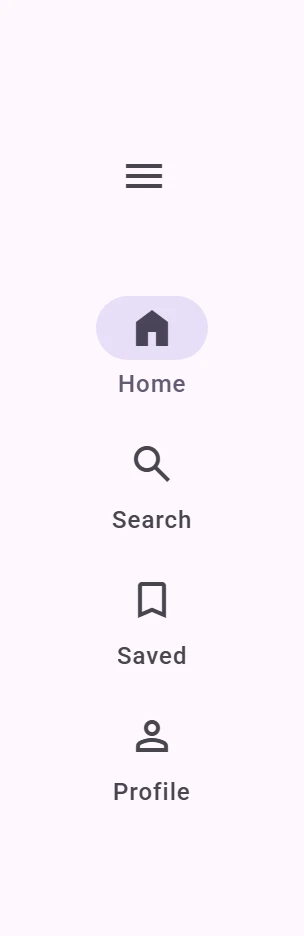
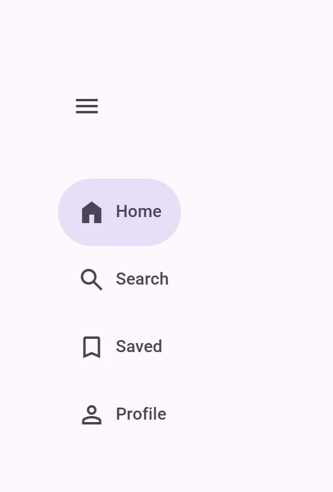
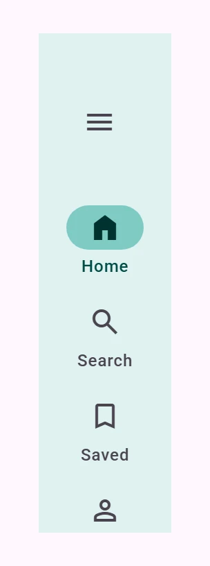

<!-- catalog-only-start --><!-- ---
name: Navigation rail
dirname: navigationrail
-----><!-- catalog-only-end -->

<catalog-component-header>
<catalog-component-header-title slot="title">

# Navigation rail

<!-- no-catalog-start -->

<!-- [TOC] -->

<!-- external-only-start -->
**This documentation is fully rendered on the
[petal-elements catalog](https://petal.anontokyo.vip/catalog/components/navigation-rail/).**
<!-- external-only-end -->

<!-- no-catalog-end -->

[Navigation rails](https://m3.material.io/components/navigation-rail)<!-- {.external} -->
let people switch between a few primary destinations at the side of the
screen, and expand to show labels beside the icons.

</catalog-component-header-title>



</catalog-component-header>

*   [Design article](https://m3.material.io/components/navigation-rail) <!-- {.external} -->
*   [API Documentation](#api)
*   [Source code](https://github.com/Saki340/petal-elements/tree/main/navigationrail)
    <!-- {.external} -->

This is the Material 3 Expressive wide navigation rail. The values follow
Jetpack Compose Material 3 (`WideNavigationRail`, `WideNavigationRailItem`,
`NavigationRailCollapsedTokens`, `NavigationRailExpandedTokens`).

## Usage

Put `petal-navigation-rail-item` elements in a `petal-navigation-rail`. The
icon goes in the `icon` slot and the label is the content. Mark the current
destination with `selected`. A collapsed rail is 96px wide with the icon above
each label.

<!-- no-catalog-start -->


<!-- no-catalog-end -->
<!-- catalog-include "figures/navigationrail/usage.html" -->

```html
<petal-navigation-rail>
  <petal-icon-button slot="header" aria-label="Menu" style="margin-inline-start: 24px">
    <petal-icon>menu</petal-icon>
  </petal-icon-button>
  <petal-navigation-rail-item selected>
    <petal-icon slot="icon">home</petal-icon>
    Home
  </petal-navigation-rail-item>
  <petal-navigation-rail-item>
    <petal-icon slot="icon">search</petal-icon>
    Search
  </petal-navigation-rail-item>
</petal-navigation-rail>
```

The `header` slot holds a menu button or a floating action button. As in
Compose, the header is not indented: give it the margin that centers it on the
icons (24px for a 48px icon button, which puts its center on the center of the
item icons).

The icon fills when the item is selected, as in the
[navigation bar](navigation-bar.md#usage).

### Expanded

Set `expanded` to widen the rail. It is as wide as its widest item plus 20px,
but at least 220px and at most 360px, and the items show the icon before a
larger label.

<!-- no-catalog-start -->



<!-- no-catalog-end -->
<!-- catalog-include "figures/navigationrail/usage-expanded.html" -->

```html
<petal-navigation-rail expanded>
  ...
</petal-navigation-rail>
```

Changing `expanded` animates, as in Compose, with the default spatial spring:
the width of the rail, the space between the items (4px to 0), the size of each
item, the movement of the icon, and the label, which fades out as the icon
moves and fades in at its new place. Items hug their content, so the indicator
of the selected item is as wide as its label rather than the whole rail.

Modal rails (`ModalWideNavigationRail`) are not implemented. Put the rail in
a dialog or a drawer of your own for that.

### Selection

The rail keeps one item selected. When the user picks another, it selects that
item and fires a `change` event. Read `selectedIndex` or `selectedItem` in the
handler, and cancel the event to keep the previous item selected. Items can be
links with `href`.

## Accessibility

As in Compose, the rail is a `tablist` (`selectableGroup`, vertical) and its
items are `tab`s (`Role.Tab`) with `aria-selected`. Only the selected item is in
the tab order; the up and down arrow keys, Home and End move the focus between
items, skipping disabled ones, and Enter or Space selects the focused item.
Moving the focus does not select.

Labels are the accessible names; give icon-only items an `aria-label`. Put the
rail in a `<nav>` element to make it a navigation landmark.

## Theming

Navigation rails support [Material theming](../theming/README.md). The
container is `--md-navigation-rail-collapsed-*` (color, shape, width, top
space, space between items) and `--md-navigation-rail-expanded-*` (widths).
Items use `--md-navigation-rail-color-*` for colors, and
`--md-navigation-rail-baseline-item-*`, `--md-navigation-rail-vertical-item-*`
and `--md-navigation-rail-horizontal-item-*` for sizes and type, after Compose's
token objects of the same names.

### Tokens

Token                                                  | Default value
------------------------------------------------------ | -------------
`--md-navigation-rail-collapsed-container-color`       | `--md-sys-color-surface`
`--md-navigation-rail-collapsed-container-width`       | `96px`
`--md-navigation-rail-collapsed-item-vertical-space`   | `4px`
`--md-navigation-rail-collapsed-top-space`             | `44px`
`--md-navigation-rail-expanded-container-width-minimum` | `220px`
`--md-navigation-rail-expanded-container-width-maximum` | `360px`
`--md-navigation-rail-color-item-active-indicator`     | `--md-sys-color-secondary-container`
`--md-navigation-rail-color-item-active-icon`          | `--md-sys-color-on-secondary-container`
`--md-navigation-rail-color-item-active-label-text`    | `--md-sys-color-secondary`
`--md-navigation-rail-color-item-inactive-icon`        | `--md-sys-color-on-surface-variant`
`--md-navigation-rail-color-item-inactive-label-text`  | `--md-sys-color-on-surface-variant`
`--md-navigation-rail-vertical-item-label-text-*`      | `--md-sys-typescale-label-medium-*`
`--md-navigation-rail-horizontal-item-label-text-*`    | `--md-sys-typescale-label-large-*`

*   [All tokens](https://github.com/Saki340/petal-elements/blob/main/tokens/versions/compose/values/_md-comp-navigation-rail-collapsed.scss)
    <!-- {.external} -->

### Example

<!-- no-catalog-start -->



<!-- no-catalog-end -->
<!-- catalog-include "figures/navigationrail/theming.html" -->

```html
<style>
  petal-navigation-rail {
    --md-navigation-rail-collapsed-container-color: #e0f2f1;
    --md-navigation-rail-color-item-active-indicator: #80cbc4;
    --md-navigation-rail-color-item-active-icon: #00332f;
    --md-navigation-rail-color-item-active-label-text: #004d46;
  }
</style>
```

<!-- auto-generated API docs start -->

## API


### PetalNavigationRail <code>&lt;petal-navigation-rail&gt;</code>

#### Properties

<!-- mdformat off(autogenerated might break rendering in catalog) -->

| Property | Attribute | Type | Default | Description |
| --- | --- | --- | --- | --- |
| `expanded` | `expanded` | `boolean` | `false` | Whether the rail is expanded: wider, with the icons before the labels. |
| `selectedIndex` | `selected-index` | `number` | `undefined` |  |
| `items` |  | `NavigationItem[]` | `undefined` | The items, in the default slot. |
| `selectedItem` |  | `NavigationItem` | `undefined` |  |

<!-- mdformat on(autogenerated might break rendering in catalog) -->

#### Events

<!-- mdformat off(autogenerated might break rendering in catalog) -->

| Event | Type | [Bubbles](https://developer.mozilla.org/en-US/docs/Web/API/Event/bubbles) | [Composed](https://developer.mozilla.org/en-US/docs/Web/API/Event/composed) | Description |
| --- | --- | --- | --- | --- |
| `change` | `Event` | Yes | No | The user selected another item. The target's `selectedIndex` and `selectedItem` tell which. Cancel it to keep the previous item selected. |

<!-- mdformat on(autogenerated might break rendering in catalog) -->

### PetalNavigationRailItem <code>&lt;petal-navigation-rail-item&gt;</code>

#### Properties

<!-- mdformat off(autogenerated might break rendering in catalog) -->

| Property | Attribute | Type | Default | Description |
| --- | --- | --- | --- | --- |
| `railExpanded` |  | `boolean` | `false` | Whether the rail is expanded; set by the rail. |
| `selected` | `selected` | `boolean` | `false` | Whether the item is the current destination. |
| `disabled` | `disabled` | `boolean` | `false` | Disables the item. |
| `href` | `href` | `string` | `''` | Makes the item a link to this URL. |
| `target` | `target` | `string` | `''` | Where a link opens (`_blank`, ...). |
| `iconPosition` | `icon-position` | `NavigationIconPosition` | `undefined` | Where the icon sits. Defaults to `top` in a navigation bar; a rail picks it from whether it is expanded. |
| `startWidth` |  | `number` | `undefined` |  |

<!-- mdformat on(autogenerated might break rendering in catalog) -->

<!-- auto-generated API docs end -->
