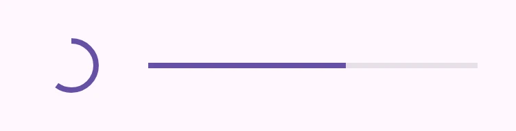
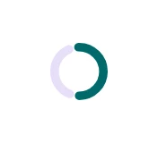
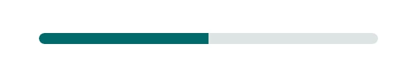

<!-- catalog-only-start --><!-- ---
name: Progress indicators
dirname: progress
-----><!-- catalog-only-end -->

<catalog-component-header image-align="end">
<catalog-component-header-title slot="title">

# Progress indicators

<!-- no-catalog-start -->

<!-- [TOC] -->

<!-- external-only-start -->
**This documentation is fully rendered on the
[petal-elements catalog](https://petal.anontokyo.vip/catalog/components/progress/).**
<!-- external-only-end -->

<!-- no-catalog-end -->

[Progress indicators](https://m3.material.io/components/progress-indicators)<!-- {.external} -->
show that something is loading or being processed, and how far it has got when
that is known.

There are two types of progress indicators: linear and circular.

</catalog-component-header-title>



</catalog-component-header>

*   [Design article](https://m3.material.io/components/progress-indicators)
    <!-- {.external} -->
*   [API Documentation](#api)
*   [Source code](https://github.com/Saki340/petal-elements/tree/main/progress)
    <!-- {.external} -->

## Types

1.  [Circular progress](#circular-progress)
1.  [Linear progress](#linear-progress)

<!-- catalog-only-start -->

<!--

## Interactive Demo



-->

<!-- catalog-only-end -->

## Usage

Progress indicators may be determinate to show progress, or indeterminate for an
unspecified amount of progress.

<!-- no-catalog-start -->
<!-- Need to add image -->
<!-- no-catalog-end -->
<!-- catalog-only-start -->

<!--

<div class="figure-wrapper">
  <figure
      style="justify-content:center; gap: 16px"
      title="Determinate and indeterminate progress indicators."
      aria-label="Two circular and linear progress indicator examples, one with three quarters of the track full
and the other
indeterminate.">
    <petal-circular-progress value="0.75"></petal-circular-progress>
    <petal-circular-progress indeterminate></petal-circular-progress>
    <div style="display: flex; flex-direction: column; align-self: stretch; justify-content: space-evenly;">
      <petal-linear-progress value="0.75"></petal-linear-progress>
      <petal-linear-progress indeterminate></petal-linear-progress>
    </div>
  </figure>
</div>

-->

<!-- catalog-only-end -->

```html
<petal-circular-progress value="0.75"></petal-circular-progress>
<petal-circular-progress indeterminate></petal-circular-progress>

<petal-linear-progress indeterminate></petal-linear-progress>
<petal-linear-progress value="0.5"></petal-linear-progress>
```

### Four colors

Indeterminate progress indicators may cycle between four colors (primary,
primary container, tertiary, and tertiary container by default).

<!-- no-catalog-start -->
<!-- Need to add image -->
<!-- no-catalog-end -->
<!-- catalog-only-start -->

<!--

<div class="figure-wrapper">
  <figure
      style="justify-content:center; gap: 16px;"
      title="A four-color indeterminate circular and linear progress indicator"
      aria-label="Indeterminate progress indicators that cycles between four colors.">
    <petal-circular-progress four-color indeterminate></petal-circular-progress>
    <petal-linear-progress four-color indeterminate></petal-linear-progress>
  </figure>
</div>

-->

<!-- catalog-only-end -->

```html
<petal-circular-progress four-color indeterminate></petal-circular-progress>
<petal-linear-progress four-color indeterminate></petal-linear-progress>
```

## Accessibility

Add an
[`aria-label`](https://developer.mozilla.org/en-US/docs/Web/Accessibility/ARIA/Attributes/aria-label)<!-- {.external} -->
attribute to progress indicators to give them a descriptive name.

```html
<petal-circular-progress value="0.5" aria-label="Page refresh progress"></petal-circular-progress>

<petal-linear-progress value="0.5" aria-label="Download progress"></petal-linear-progress>
```

## Circular progress

Circular progress indicators display progress by animating along an invisible
circular track in a clockwise direction.

<!-- no-catalog-start -->
<!-- Need to add image -->
<!-- no-catalog-end -->
<!-- catalog-only-start -->

<!--

<div class="figure-wrapper">
  <figure
      style="justify-content:center; gap: 16px;"
      title="Circular progress indicators"
      aria-label="An indeterminate and determinate circular progress indicator.">
    <petal-circular-progress indeterminate></petal-circular-progress>
    <petal-circular-progress value="0.6"></petal-circular-progress>
  </figure>
</div>

-->

<!-- catalog-only-end -->

```html
<petal-circular-progress indeterminate></petal-circular-progress>
<petal-circular-progress value="0.6"></petal-circular-progress>
```

Circular indicators follow Jetpack Compose Material 3
(`CircularProgressIndicator`): 40px with a 4px stroke and round caps. A
determinate indicator starts at 12 o'clock with its track
(`--md-sys-color-secondary-container`) after a 4px gap. The indeterminate
indicator has no track; it turns 1080 degrees in 6 seconds plus a quarter turn
every 1.5 seconds while its arc grows from 10% to 87% of the circle and back.

### Wavy circular

`wavy` draws the indicator as a wave around the circle
(`CircularWavyProgressIndicator`): 48px, waves of about 15px (as many as fit
around the circle) that move one wavelength per second, and the track after a
4px gap, also when indeterminate. Determinate waves flatten below 10% and from
95%. With `prefers-reduced-motion`, the wave does not move.

<!-- no-catalog-start -->


<!-- no-catalog-end -->
<!-- catalog-include "figures/progress/usage-circular-wavy.html" -->

```html
<petal-circular-progress wavy indeterminate></petal-circular-progress>
<petal-circular-progress wavy value="0.6"></petal-circular-progress>
```

## Linear progress

Linear progress indicators display progress by animating along the length of a
fixed, visible track.

<!-- no-catalog-start -->
<!-- Need to add image -->
<!-- no-catalog-end -->
<!-- catalog-only-start -->

<!--

<div class="figure-wrapper">
  <figure
      style="justify-content:center; gap: 16px;"
      title="Linear progress indicators"
      aria-label="An indeterminate and determinate linear progress indicator.">
    <petal-linear-progress indeterminate></petal-linear-progress>
    <petal-linear-progress value="0.6"></petal-linear-progress>
  </figure>
</div>

-->

<!-- catalog-only-end -->

```html
<petal-linear-progress indeterminate></petal-linear-progress>
<petal-linear-progress value="0.6"></petal-linear-progress>
```

Linear indicators follow Jetpack Compose Material 3 (`LinearProgressIndicator`):
4px lines with round caps, the track (`--md-sys-color-secondary-container`)
after a 4px gap, and a 4px stop indicator at the end of a determinate
indicator. The indeterminate indicator moves two lines along the track, with
the same gaps. For a thicker indicator (Material 3 Expressive's 8px), set
`--md-linear-progress-track-height`; the gap stays 4px and the stop indicator
4px.

```html
<petal-linear-progress value="0.6" style="--md-linear-progress-track-height: 8px"></petal-linear-progress>
```

### Buffer

Linear progress indicators may show a buffer to communicate both determinate and
indeterminate progress. The progress bar and track represent known progress
while the buffer dots represent unknown progress.

<!-- no-catalog-start -->
<!-- Need to add image -->
<!-- no-catalog-end -->
<!-- catalog-only-start -->

<!--

<div class="figure-wrapper">
  <figure
      style="justify-content:center;"
      title="Progress and buffer"
      aria-label="A linear progress indicator with partial progress and an indeterminate buffer.">
    <petal-linear-progress value="0.5" buffer="0.8"></petal-linear-progress>
  </figure>
</div>

-->

<!-- catalog-only-end -->

```html
<petal-linear-progress value="0.5" buffer="0.8"></petal-linear-progress>
```

### Wavy

`wavy` draws the indicator as a wave, as in Material 3 Expressive (Jetpack
Compose `LinearWavyProgressIndicator`): 10px high, 4px strokes with round caps,
a 4px gap before the track and a stop dot at its end. Indeterminate waves are
20px long; determinate waves are 40px long and flatten below 10% and from 95%.
The wave moves one wavelength per second. `buffer` and `four-color` do not
apply.

<!-- no-catalog-start -->


<!-- no-catalog-end -->
<!-- catalog-include "figures/progress/usage-wavy.html" -->

```html
<petal-linear-progress wavy indeterminate></petal-linear-progress>
<petal-linear-progress wavy value="0.6"></petal-linear-progress>
```

Wavy indicators use `--md-linear-progress-wavy-active-indicator-color`
(`--md-sys-color-primary`) and `--md-linear-progress-wavy-track-color`
(`--md-sys-color-secondary-container`), from Compose's
`ProgressIndicatorTokens`. With `prefers-reduced-motion`, the wave does not
move.

## Theming

Progress indicators supports [Material theming](../theming/README.md) and can be
customized in terms of color.

### Circular progress tokens

Token                                           | Default value
----------------------------------------------- | ------------------------------------
`--md-circular-progress-active-indicator-color` | `--md-sys-color-primary`
`--md-circular-progress-track-color`            | `--md-sys-color-secondary-container`
`--md-circular-progress-size`                   | `40px`
`--md-circular-progress-wavy-size`              | `48px`
`--md-circular-progress-active-indicator-width` | `4px`

> Note: the active indicator width is drawn in a 40px box that scales with
> `--md-circular-progress-size`.

*   [All tokens](https://github.com/Saki340/petal-elements/blob/main/progress/internal/_circular-progress.scss)
    <!-- {.external} -->

### Circular progress example

<!-- no-catalog-start -->



<!-- no-catalog-end -->
<!-- catalog-only-start -->

<!--

<div class="figure-wrapper">
  <figure
      style="justify-content:center;align-items:center;"
      class="styled-example"
      title="Circular progress indicator theming example."
      aria-label="Image of a circular progress indicator with a different theme applied">
    <style>
      .styled-example {
        background-color: white;
        --md-circular-progress-size: 32px;
        --md-circular-progress-active-indicator-width: 6px;
        --md-sys-color-primary: #006A6A;
      }
    </style>

    <petal-circular-progress value="0.5"></petal-circular-progress>
  </figure>
</div>

-->

<!-- catalog-only-end -->

```html
<style>
:root {
  --md-circular-progress-size: 32px;
  --md-circular-progress-active-indicator-width: 6px;
  --md-sys-color-primary: #006A6A;
}
</style>

<petal-circular-progress value="0.5"></petal-circular-progress>
```

### Linear progress tokens

Token                                          | Default value
---------------------------------------------- | -------------
`--md-linear-progress-track-color`             | `--md-sys-color-secondary-container`
`--md-linear-progress-track-height`            | `4px`
`--md-linear-progress-track-shape`             | `--md-sys-shape-corner-full`
`--md-linear-progress-active-indicator-color`  | `--md-sys-color-primary`
`--md-linear-progress-active-indicator-height` | `--md-linear-progress-track-height`

*   [All tokens](https://github.com/Saki340/petal-elements/blob/main/tokens/_md-comp-linear-progress.scss)
    <!-- {.external} -->

### Linear progress example

<!-- no-catalog-start -->



<!-- no-catalog-end -->
<!-- catalog-only-start -->

<!--

<div class="figure-wrapper">
  <figure
      style="min-width:300px;"
      class="styled-example"
      aria-label="Image of a linear progress indicator with a different theme applied"
      title="Linear progress theming example.">
  <style>
    .styled-example {
      background-color: white;
      --md-linear-progress-track-height: 8px;
      --md-linear-progress-track-shape: 8px;
      --md-linear-progress-active-indicator-height: 8px;
      --md-sys-color-primary: #006A6A;
      --md-sys-color-surface-container-highest: #DDE4E3;
    }
    .styled-example petal-linear-progress {
      flex-grow: 1;
    }
  </style>
  <petal-linear-progress value="0.5"></petal-linear-progress>
  </figure>
</div>

-->

<!-- catalog-only-end -->

```html
<style>
:root {
  --md-linear-progress-track-height: 8px;
  --md-linear-progress-track-shape: 8px;
  --md-linear-progress-active-indicator-height: 8px;
  --md-sys-color-primary: #006A6A;
  --md-sys-color-surface-container-highest: #DDE4E3;
}
</style>

<petal-linear-progress value="0.5"></petal-linear-progress>
```

<!-- auto-generated API docs start -->

## API


### PetalLinearProgress <code>&lt;petal-linear-progress&gt;</code>

#### Properties

<!-- mdformat off(autogenerated might break rendering in catalog) -->

| Property | Attribute | Type | Default | Description |
| --- | --- | --- | --- | --- |
| `buffer` | `buffer` | `number` | `0` | Buffer amount to display, a fraction between 0 and `max`. If the value is 0 or negative, the buffer is not displayed. |
| `wavy` | `wavy` | `boolean` | `false` | Draws the indicator as a wave (Material 3 Expressive, Jetpack Compose `LinearWavyProgressIndicator`). Determinate waves flatten below 10% and from 95%. `buffer` and `four-color` do not apply. |
| `value` | `value` | `number` | `0` | Progress to display, a fraction between 0 and `max`. |
| `max` | `max` | `number` | `1` | Maximum progress to display, defaults to 1. |
| `indeterminate` | `indeterminate` | `boolean` | `false` | Whether or not to display indeterminate progress, which gives no indication to how long an activity will take. |
| `fourColor` | `four-color` | `boolean` | `false` | Whether or not to render indeterminate mode using 4 colors instead of one. |

<!-- mdformat on(autogenerated might break rendering in catalog) -->

### PetalCircularProgress <code>&lt;petal-circular-progress&gt;</code>

#### Properties

<!-- mdformat off(autogenerated might break rendering in catalog) -->

| Property | Attribute | Type | Default | Description |
| --- | --- | --- | --- | --- |
| `wavy` | `wavy` | `boolean` | `false` | Whether the indicator is wavy (`CircularWavyProgressIndicator`): 48px, the active indicator a wave that moves around the circle. |
| `value` | `value` | `number` | `0` | Progress to display, a fraction between 0 and `max`. |
| `max` | `max` | `number` | `1` | Maximum progress to display, defaults to 1. |
| `indeterminate` | `indeterminate` | `boolean` | `false` | Whether or not to display indeterminate progress, which gives no indication to how long an activity will take. |
| `fourColor` | `four-color` | `boolean` | `false` | Whether or not to render indeterminate mode using 4 colors instead of one. |

<!-- mdformat on(autogenerated might break rendering in catalog) -->

<!-- auto-generated API docs end -->
