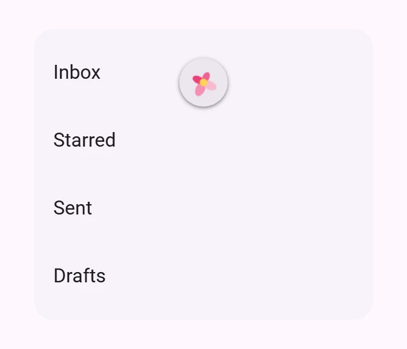

<!-- catalog-only-start --><!-- ---
name: Pull to refresh
dirname: pull-to-refresh
-----><!-- catalog-only-end -->

<catalog-component-header>
<catalog-component-header-title slot="title">

# Pull to refresh

<!-- no-catalog-start -->

<!-- [TOC] -->

<!-- external-only-start -->
**This documentation is fully rendered on the
[petal-elements catalog](https://petal.anontokyo.vip/catalog/components/pull-to-refresh/).**
<!-- external-only-end -->

<!-- no-catalog-end -->

Pull to refresh lets people reload content by pulling it down from the top.
The indicator is the petal-elements flower: it blooms as you pull and spins
while refreshing.

</catalog-component-header-title>



</catalog-component-header>

*   [API Documentation](#api)
*   [Source code](https://github.com/Saki340/petal-elements/tree/main/pulltorefresh)
    <!-- {.external} -->

This component is petal-elements' own and is not part of Material 3.

## Usage

`<petal-pull-to-refresh>` is the scroll container for its content, so give it a
height. Pulling down at the top shows the indicator:

1.  While pulling, the four petals grow out of the center one after another,
    then the center appears and the flower turns. It blooms once the pull is
    far enough.
2.  Releasing past that point sets `refreshing` and fires `refresh`. The flower
    spins and its petals breathe.
3.  Set `refreshing` back to `false` when the content is loaded. The petals fold
    into the center and the indicator slides away.

<!-- no-catalog-start -->


<!-- no-catalog-end -->
<!-- catalog-include "figures/pulltorefresh/usage.html" -->

```html
<petal-pull-to-refresh id="feed" style="height: 400px">
  <petal-list>
    <petal-list-item>Inbox</petal-list-item>
    <petal-list-item>Starred</petal-list-item>
  </petal-list>
</petal-pull-to-refresh>

<script type="module">
  const feed = document.querySelector('#feed');
  feed.addEventListener('refresh', async () => {
    await loadNewItems();
    feed.refreshing = false;
  });
</script>
```

Setting `refreshing` yourself shows the spinning flower without a pull, for
example while the first page loads.

### Page scroll

By default the element is its own scroll container. To keep the page
scrolling as usual (so mobile browsers still hide their address bar, and
`window.scrollY` keeps working), set `scroll-target="page"` and wrap the page
content without giving it a height. Under a sticky top app bar, set
`--md-pull-to-refresh-top-offset` to the bar's height, so the indicator comes
out below it.

```html
<petal-pull-to-refresh scroll-target="page"
    style="--md-pull-to-refresh-top-offset: 64px">
  <petal-top-app-bar headline="Rates"></petal-top-app-bar>
  <main>...</main>
</petal-pull-to-refresh>
```

## Accessibility

Pulling needs touch, so mouse and keyboard users cannot refresh this way. Also
offer another way to refresh, such as a button.

While refreshing, the indicator is a `progressbar` named by `label`
(`"Refreshing"` by default). Otherwise it is hidden from assistive technology.

With `prefers-reduced-motion`, the flower does not turn, spin or breathe; it
fades gently while refreshing.

## Theming

Token                                   | Default value
--------------------------------------- | -------------
`--md-pull-to-refresh-container-color`  | `--md-sys-color-surface-container-high`
`--md-pull-to-refresh-petal-1-color`    | `#f48fb1`
`--md-pull-to-refresh-petal-2-color`    | `#ec407a`
`--md-pull-to-refresh-petal-3-color`    | `#f06292`
`--md-pull-to-refresh-petal-4-color`    | `#f8bbd0`
`--md-pull-to-refresh-center-color`     | `#ffd54f`
`--md-pull-to-refresh-top-offset`       | `0px`

<!-- auto-generated API docs start -->

## API


### PetalPullToRefresh <code>&lt;petal-pull-to-refresh&gt;</code>

#### Properties

<!-- mdformat off(autogenerated might break rendering in catalog) -->

| Property | Attribute | Type | Default | Description |
| --- | --- | --- | --- | --- |
| `refreshing` | `refreshing` | `boolean` | `false` | Whether a refresh is in progress. Set it to false when it is done. |
| `disabled` | `disabled` | `boolean` | `false` | Ignores pulls. |
| `label` | `label` | `string` | `'Refreshing'` | Accessible name of the indicator while refreshing. |
| `scrollTarget` | `scroll-target` | `"" \| "page"` | `''` | What scrolls: empty (the default) for the element itself, which then needs a height, or `page` to follow the page scroll, so the whole page does not need to be wrapped in a scroll container. |

<!-- mdformat on(autogenerated might break rendering in catalog) -->

#### Events

<!-- mdformat off(autogenerated might break rendering in catalog) -->

| Event | Type | [Bubbles](https://developer.mozilla.org/en-US/docs/Web/API/Event/bubbles) | [Composed](https://developer.mozilla.org/en-US/docs/Web/API/Event/composed) | Description |
| --- | --- | --- | --- | --- |
| `refresh` | `Event` | Yes | Yes | The user pulled past the threshold and released. `refreshing` is already true. |

<!-- mdformat on(autogenerated might break rendering in catalog) -->

#### Slots

<!-- mdformat off(autogenerated might break rendering in catalog) -->

| Slot | Description |
| --- | --- |
| _default_ | The content that scrolls and is pulled down. |

<!-- mdformat on(autogenerated might break rendering in catalog) -->

<!-- auto-generated API docs end -->
