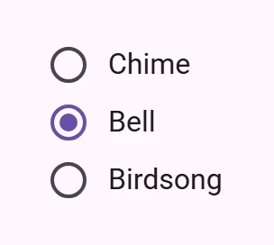

<!-- catalog-only-start --><!-- ---
name: Radio
dirname: radio
ssrOnly: true
-----><!-- catalog-only-end -->

<catalog-component-header image-align="start">
<catalog-component-header-title slot="title">

# Radio button

<!-- github-only-start -->

<!-- [TOC] -->

<!-- github-only-end -->

[Radio buttons](https://m3.material.io/components/radio-button)<!-- {.external} -->
select exactly one option from a set.

</catalog-component-header-title>



</catalog-component-header>

*   [Design article](https://m3.material.io/components/radio-button) <!-- {.external} -->
*   [API Documentation](#api)
*   [Source code](https://github.com/Saki340/petal-elements/tree/main/radio)
    <!-- {.external} -->

<!-- catalog-only-start -->

<!--

## Interactive Demo



-->

<!-- catalog-only-end -->

## Usage

Radios behave like
[`<input type="radio">`](https://developer.mozilla.org/en-US/docs/Web/HTML/Element/input/radio)<!-- {.external} -->
elements and form a group with the same `name` attribute. Only one radio can be
selected in a group.

Radios can be pre-selected by adding a `checked` attribute.

Add a `value` to identify which radio is selected in a form.

<!-- no-catalog-start -->
<!-- Need to add image -->
<!-- no-catalog-end -->
<!-- Need to add catalog-include "figures/<component>/usage.html" -->

```html
<form>
  <petal-radio name="animals" value="cats"></petal-radio>
  <petal-radio name="animals" value="dogs"></petal-radio>
  <petal-radio name="animals" value="birds" checked></petal-radio>
</form>
```

### Label

Associate a label with a radio using the `<label>` element.

<!-- no-catalog-start -->
<!-- Need to add image -->
<!-- no-catalog-end -->
<!-- Need to add catalog-include "figures/<component>/usage.html" -->

```html
<petal-radio id="cats-radio" name="animals" value="cats"></petal-radio>
<label for="cats-radio">Cats</label>

<petal-radio id="dogs-radio" name="animals" value="dogs"></petal-radio>
<label for="dogs-radio">Dogs</label>
```

> Note: do not wrap radios inside of a `<label>`, which stops screen readers
> from correctly announcing the number of radios in a group.

## Accessibility

Add an
[`aria-label`](https://developer.mozilla.org/en-US/docs/Web/Accessibility/ARIA/Attributes/aria-label)<!-- {.external} -->
attribute to radios without labels or radios whose labels need to be more
descriptive.

Place radios inside a
[`role="radiogroup"`](https://developer.mozilla.org/en-US/docs/Web/Accessibility/ARIA/Roles/radiogroup_role)<!-- {.external} -->.
Radio groups must display a label, either with `aria-label` or
`aria-labelledby`.

```html
<div role="radiogroup" aria-labelledby="group-title">
  <h3 id="group-title">Starting position</h3>
  <div>
    <petal-radio id="first-radio" name="group" value="1"
        aria-label="First"></petal-radio>
    <label for="first-radio">1st</label>
  </div>
  <div>
    <petal-radio id="second-radio" name="group" value="2"
        aria-label="Second"></petal-radio>
    <label for="second-radio">2nd</label>
  </div>
</div>
```

> Note: radios are not automatically labelled by `<label>` elements and always
> need an `aria-label`. See b/294081528.

## Compose behavior

The radio button follows Jetpack Compose Material 3: a 20dp ring with a 2dp stroke and a dot that grows with the fast spatial spring. The ring and dot are one color that animates with the default effects spring and does not change on hover, focus or press (only the ripple does).

## Theming

Radios support [Material theming](../theming/README.md) and can be customized in
terms of color.

### Tokens

Token                            | Default value
-------------------------------- | -----------------------------------
`--md-radio-icon-color`          | `--md-sys-color-on-surface-variant`
`--md-radio-selected-icon-color` | `--md-sys-color-primary`
`--md-radio-icon-size`           | `20px`

*   [All tokens](https://github.com/Saki340/petal-elements/blob/main/tokens/_md-comp-radio.scss)
    <!-- {.external} -->

### Example

<!-- no-catalog-start -->
<!-- Need to add image -->
<!-- no-catalog-end -->
<!-- Need to add catalog-include "figures/<component>/usage.html" -->

```html
<style>
:root {
  --md-sys-color-primary: #006A6A;
  --md-radio-icon-size: 16px;
}
</style>

<petal-radio name="group"></petal-radio>
<petal-radio name="group" checked></petal-radio>
<petal-radio name="group"></petal-radio>
```

<!-- auto-generated API docs start -->

## API


### PetalRadio <code>&lt;petal-radio&gt;</code>

#### Properties

<!-- mdformat off(autogenerated might break rendering in catalog) -->

| Property | Attribute | Type | Default | Description |
| --- | --- | --- | --- | --- |
| `required` | `required` | `boolean` | `false` | Whether or not the radio is required. If any radio is required in a group, all radios are implicitly required. |
| `value` | `value` | `string` | `'on'` | The element value to use in form submission when checked. |
| `checked` | `checked` | `boolean` | `undefined` |  |
| `name` | `name` | `string` | `undefined` | The HTML name to use in form submission. |
| `disabled` | `disabled` | `boolean` | `undefined` | Whether or not the element is disabled. |
| `form` |  | `HTMLFormElement` | `undefined` | The associated form element with which this element's value will submit. |
| `labels` |  | `NodeList` | `undefined` | The labels this element is associated with. |
| `validity` |  | `ValidityState` | `undefined` | Returns a ValidityState object that represents the validity states of the element.<br>https://developer.mozilla.org/en-US/docs/Web/API/ValidityState |
| `validationMessage` |  | `string` | `undefined` | Returns a validation error message or an empty string if the element is valid.<br>https://developer.mozilla.org/en-US/docs/Web/API/ElementInternals/validationMessage |
| `willValidate` |  | `boolean` | `undefined` | Returns whether an element will successfully validate based on forms validation rules and constraints.<br>Disabled and readonly elements will not validate.<br>https://developer.mozilla.org/en-US/docs/Web/API/ElementInternals/willValidate |

<!-- mdformat on(autogenerated might break rendering in catalog) -->

#### Methods

<!-- mdformat off(autogenerated might break rendering in catalog) -->

| Method | Parameters | Returns | Description |
| --- | --- | --- | --- |
| `formResetCallback` | _None_ | `void` |  |
| `formStateRestoreCallback` | `state` | `void` |  |
| `checkValidity` | _None_ | `boolean` | Checks the element's constraint validation and returns true if the element is valid or false if not.<br>If invalid, this method will dispatch an `invalid` event.<br>https://developer.mozilla.org/en-US/docs/Web/API/ElementInternals/checkValidity |
| `reportValidity` | _None_ | `boolean` | Checks the element's constraint validation and returns true if the element is valid or false if not.<br>If invalid, this method will dispatch a cancelable `invalid` event. If not canceled, a the current `validationMessage` will be reported to the user.<br>https://developer.mozilla.org/en-US/docs/Web/API/ElementInternals/reportValidity |
| `setCustomValidity` | `error` | `void` | Sets the element's constraint validation error message. When set to a non-empty string, `validity.customError` will be true and `validationMessage` will display the provided error.<br>Use this method to customize error messages reported.<br>https://developer.mozilla.org/en-US/docs/Web/API/HTMLInputElement/setCustomValidity |

<!-- mdformat on(autogenerated might break rendering in catalog) -->

#### Events

<!-- mdformat off(autogenerated might break rendering in catalog) -->

| Event | Type | [Bubbles](https://developer.mozilla.org/en-US/docs/Web/API/Event/bubbles) | [Composed](https://developer.mozilla.org/en-US/docs/Web/API/Event/composed) | Description |
| --- | --- | --- | --- | --- |
| `input` | `InputEvent` | Yes | No | Dispatched when the value changes from user interaction. |
| `change` | `Event` | Yes | Yes | Dispatched when the value changes from user interaction. |

<!-- mdformat on(autogenerated might break rendering in catalog) -->

<!-- auto-generated API docs end -->
