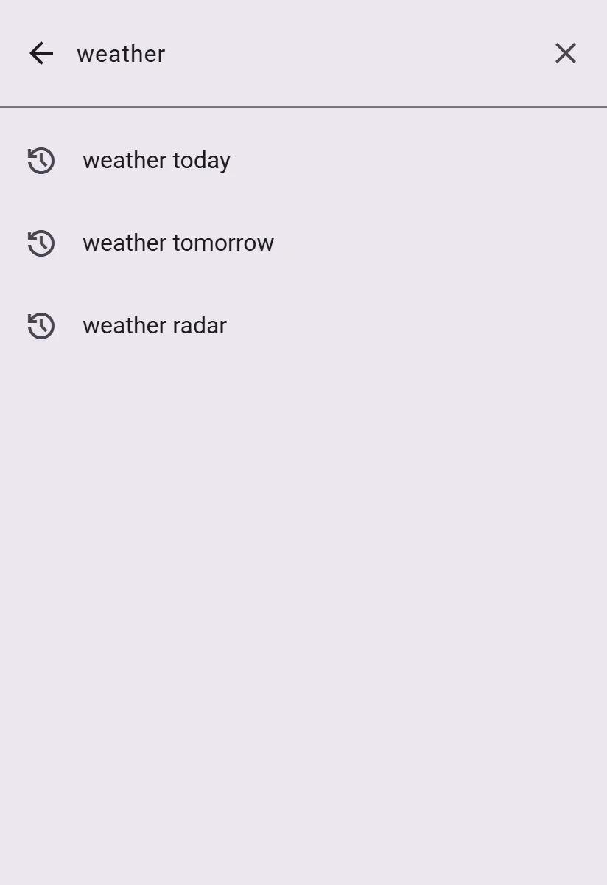
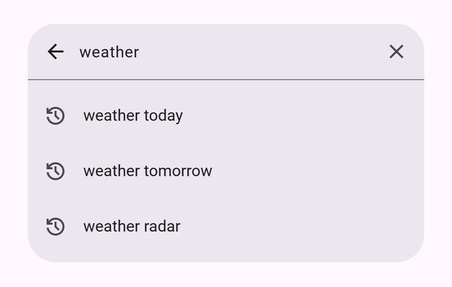

<!-- catalog-only-start --><!-- ---
name: Search
dirname: search
-----><!-- catalog-only-end -->

<catalog-component-header>
<catalog-component-header-title slot="title">

# Search

<!-- no-catalog-start -->

<!-- [TOC] -->

<!-- external-only-start -->
**This documentation is fully rendered on the
[petal-elements catalog](https://petal.anontokyo.vip/catalog/components/search/).**
<!-- external-only-end -->

<!-- no-catalog-end -->

[Search](https://m3.material.io/components/search)<!-- {.external} -->
lets people enter a keyword or phrase and get relevant suggestions or results.
A search bar expands into a search view that shows them.

</catalog-component-header-title>


</catalog-component-header>

*   [Design article](https://m3.material.io/components/search) <!-- {.external} -->
*   [API Documentation](#api)
*   [Source code](https://github.com/Saki340/petal-elements/tree/main/search)
    <!-- {.external} -->

The values and the motion follow Jetpack Compose Material 3 (`SearchBar`,
`ExpandedFullScreenSearchBar`, `ExpandedDockedSearchBar`, `SearchBarDefaults`,
`SearchBarTokens`, `SearchViewTokens`).

## Usage

`<petal-search-bar>` is the collapsed bar: a search icon, an input and an
optional trailing element. The suggestions or results go inside it. It opens
when it is clicked, when someone types in it or presses the down arrow, and
when `expand()` is called.

<!-- no-catalog-start -->


<!-- no-catalog-end -->
<!-- catalog-include "figures/search/usage.html" -->

```html
<petal-search-bar placeholder="Search apps">
  <petal-list>
    <petal-list-item type="button">Calendar</petal-list-item>
    <petal-list-item type="button">Camera</petal-list-item>
  </petal-list>
</petal-search-bar>
<script type="module">
  import 'petal-elements/search/search-bar.js';
  import 'petal-elements/list/list.js';
  import 'petal-elements/list/list-item.js';
</script>
```

The bar is 56px high and as wide as its container, between 360px and 720px,
like Compose's `SearchBarDefaults.InputField`. It keeps its space in the page
while the view is open.

### Layout

`layout` chooses how the view opens, like the two Compose composables:

*   `full-screen` (the default, for phones) is
    `ExpandedFullScreenSearchBar`. The bar grows to cover the window, its
    corners straighten, and the input moves to the top with 8px above and
    below it.
*   `docked` (for tablets and desktops) is `ExpandedDockedSearchBar`. The
    view grows under the bar, with its width, up to two thirds of the window
    height and at least 240px, and a press outside closes it.

<!-- no-catalog-start -->



<!-- no-catalog-end -->

The full screen view is `position: fixed` with a `z-index` of 1000
(`--md-search-bar-z-index`). It is not in the browser's top layer, and an
ancestor with a `transform`, `filter` or `contain` makes it fixed to that
ancestor instead of to the window.

### Suggestions

Any elements can be the results. For suggestions, use `petal-list` with
`petal-list-item type="button"`, and make them transparent so the view's color
shows. The down arrow moves focus from the input to the first item, and the
list handles the arrow keys from there. Put the chosen text in `value` and
close the view.

<!-- no-catalog-start -->



<!-- no-catalog-end -->
<!-- catalog-include "figures/search/usage-docked.html" -->

```html
<style>
  petal-list {
    --md-list-container-color: transparent;
    --md-list-item-container-color: transparent;
  }
</style>
<petal-search-bar id="search" layout="docked" placeholder="Search apps">
  <petal-list>
    <petal-list-item type="button">
      weather today
      <petal-icon slot="start">history</petal-icon>
    </petal-list-item>
    <petal-list-item type="button">
      weather tomorrow
      <petal-icon slot="start">history</petal-icon>
    </petal-list-item>
  </petal-list>
</petal-search-bar>
<script type="module">
  const search = document.querySelector('#search');
  search.addEventListener('click', (event) => {
    const item = event.target.closest('petal-list-item');
    if (!item) return;
    search.value = item.textContent.trim();
    search.collapse();
  });
  search.addEventListener('search', () => {
    // Run the search for search.value.
    search.collapse();
  });
  search.addEventListener('input', () => {
    // Update the suggestions for search.value.
  });
</script>
```

### Leading and trailing elements

The `leading` slot replaces the search icon of the collapsed bar, for a menu
button for example. The `trailing` slot sits at the end, for an avatar: an
`img` there is 30px and round, as `SearchBarTokens.AvatarSize` and
`AvatarShape`. Clicks on slotted elements do not open the view.

While the view is open, the leading element is a back button and, when there
is text, a clear button comes before the trailing element, as in Compose's
samples.

<!-- no-catalog-start -->


<!-- no-catalog-end -->
<!-- catalog-include "figures/search/usage-slots.html" -->

```html
<petal-search-bar placeholder="Search apps">
  <petal-icon-button slot="leading" aria-label="Menu">
    <petal-icon>menu</petal-icon>
  </petal-icon-button>
  
</petal-search-bar>
```

### Opening and closing

`expanded` reflects whether the view is open. `expand()` and `collapse()` set
it and resolve when the animation has finished. The view closes with the back
button, Escape, a press outside when docked, and `collapse()`. `open` and
`close` fire when it starts to open or close.

Focus moves to the input when the view opens, and back to the input when it
closes (if it was in the bar). Typing in the closed bar, or the down arrow,
opens it. Focusing the bar does not, so keyboard users can tab through the
page, unlike Compose, which also opens it on focus from touch.

### Forms

The search bar is form associated: `name` is the input's name and `value` is
submitted. `autocomplete` defaults to `off` so the browser's suggestions do not
cover yours, and the input has `enterkeyhint="search"`. Enter fires `search`;
it does not submit the form.

## Accessibility

The input is a `combobox`: `aria-expanded` follows the view and
`aria-controls` points to the results. Set an accessible name with
`aria-label`; the placeholder is the fallback.

The results are a labelled `region` (`results-label`), not a `listbox`,
because the search bar does not manage an active descendant: focus moves into
the results with the down arrow and the results handle their own keys. A
custom results element can use `role="listbox"` itself when it does manage
focus that way.

`back-label` and `clear-label` name the two buttons that appear in the open
view. The full screen view is not modal: Tab can leave it, which does not
change what is visible but is worth handling if your page needs it to.

## Motion

The view animates like Compose's `SearchBarState`: it opens on the slow
spatial spring and closes on the default spatial spring of the page's
[motion scheme](../theming/README.md) (`--md-sys-motion-spring-*`, expressive
by default, `motion-standard.css` for the standard one). The full screen
surface moves from the bar's bounds to the window's and its corners straighten
with it, and the results fade in with the same spring. A transition that is
interrupted continues from where it is. With reduced motion the view just
opens.

## Theming

Search bars support [Material theming](../theming/README.md). The
`--md-search-bar-*` custom properties are Compose's `SearchBarTokens` (the
collapsed bar), the `--md-search-view-*` ones `SearchViewTokens` (the view),
and `--md-search-view-divider-thickness` is the divider's
`DividerTokens.Thickness`.

### Tokens

Token                                          | Default value
---------------------------------------------- | -------------
`--md-search-bar-container-color`              | `--md-sys-color-surface-container-high`
`--md-search-bar-container-height`             | `56px`
`--md-search-bar-container-shape`              | `--md-sys-shape-corner-full`
`--md-search-bar-input-text-color`             | `--md-sys-color-on-surface`
`--md-search-bar-supporting-text-color`        | `--md-sys-color-on-surface-variant`
`--md-search-bar-leading-icon-color`           | `--md-sys-color-on-surface`
`--md-search-bar-trailing-icon-color`          | `--md-sys-color-on-surface-variant`
`--md-search-bar-avatar-size`                  | `30px`
`--md-search-bar-caret-color`                  | `--md-sys-color-primary`
`--md-search-view-container-color`             | `--md-sys-color-surface-container-high`
`--md-search-view-docked-container-shape`      | `--md-sys-shape-corner-extra-large`
`--md-search-view-full-screen-container-shape` | `--md-sys-shape-corner-none`
`--md-search-view-divider-color`               | `--md-sys-color-outline`
`--md-search-view-divider-thickness`           | `1px`

*   [Search bar tokens](https://github.com/Saki340/petal-elements/blob/main/tokens/versions/compose/values/_md-comp-search-bar.scss)
    <!-- {.external} -->
*   [Search view tokens](https://github.com/Saki340/petal-elements/blob/main/tokens/versions/compose/values/_md-comp-search-view.scss)
    <!-- {.external} -->

### Example

<!-- no-catalog-start -->


<!-- no-catalog-end -->
<!-- catalog-include "figures/search/theming.html" -->

```html
<style>
  petal-search-bar {
    --md-search-bar-container-color: #c8ebe6;
    --md-search-bar-container-shape: 8px;
  }
</style>
<petal-search-bar placeholder="Search apps"></petal-search-bar>
```

<!-- auto-generated API docs start -->

## API


### PetalSearchBar <code>&lt;petal-search-bar&gt;</code>

#### Properties

<!-- mdformat off(autogenerated might break rendering in catalog) -->

| Property | Attribute | Type | Default | Description |
| --- | --- | --- | --- | --- |
| `value` | `value` | `string` | `''` | The text in the input. |
| `placeholder` | `placeholder` | `string` | `''` | The placeholder of the input, which is also its accessible name. |
| `expanded` | `expanded` | `boolean` | `false` | Whether the search view is open. Use `expand()` and `collapse()` to wait for the animation. |
| `layout` | `layout` | `SearchBarLayout` | `'full-screen'` | `full-screen` (the default, for phones) or `docked` (a dropdown under the bar, for tablets and desktops). |
| `autocomplete` | `autocomplete` | `string` | `'off'` | The input's `autocomplete`. `off` by default, so the browser's own suggestions do not cover yours. |
| `resultsLabel` | `results-label` | `string` | `'Search suggestions'` | Accessible name of the region that holds the results. |
| `backLabel` | `back-label` | `string` | `'Back'` | Accessible label of the button that closes the view. |
| `clearLabel` | `clear-label` | `string` | `'Clear'` | Accessible label of the button that clears the input. |
| `name` | `name` | `string` | `undefined` | The HTML name to use in form submission. |
| `disabled` | `disabled` | `boolean` | `undefined` | Whether or not the element is disabled. |
| `form` |  | `HTMLFormElement` | `undefined` | The associated form element with which this element's value will submit. |
| `labels` |  | `NodeList` | `undefined` | The labels this element is associated with. |

<!-- mdformat on(autogenerated might break rendering in catalog) -->

#### Methods

<!-- mdformat off(autogenerated might break rendering in catalog) -->

| Method | Parameters | Returns | Description |
| --- | --- | --- | --- |
| `expand` | _None_ | `Promise<void>` | Opens the search view. Resolves when the animation has finished. Does nothing when disabled. |
| `collapse` | _None_ | `Promise<void>` | Closes the search view. Resolves when the animation has finished. |
| `formResetCallback` | _None_ | `void` |  |
| `formStateRestoreCallback` | `state` | `void` |  |

<!-- mdformat on(autogenerated might break rendering in catalog) -->

#### Events

<!-- mdformat off(autogenerated might break rendering in catalog) -->

| Event | Type | [Bubbles](https://developer.mozilla.org/en-US/docs/Web/API/Event/bubbles) | [Composed](https://developer.mozilla.org/en-US/docs/Web/API/Event/composed) | Description |
| --- | --- | --- | --- | --- |
| `input` | `InputEvent` | Yes | Yes | The native `input` event on the input |
| `change` | `Event` | Yes | No | The native `change` event on the input |
| `search` | `Event` | Yes | Yes | The Enter key was pressed in the input. Read `value`. |
| `open` | `Event` | No | No | The view started to open. |
| `close` | `Event` | No | No | The view started to close. |

<!-- mdformat on(autogenerated might break rendering in catalog) -->

<!-- auto-generated API docs end -->
