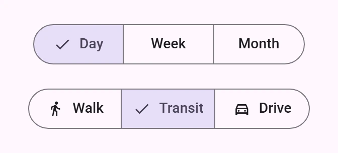
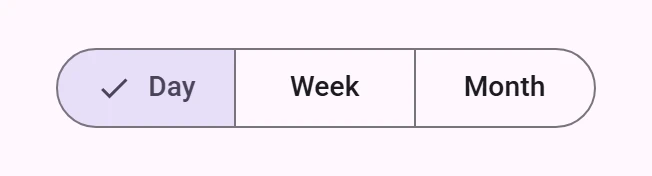
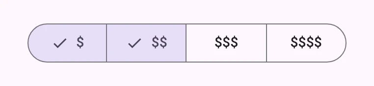
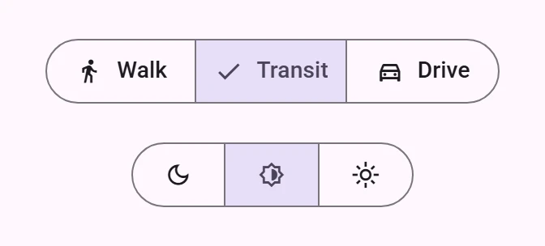

<!-- catalog-only-start --><!-- ---
name: Segmented button
dirname: segmentedbutton
-----><!-- catalog-only-end -->

<catalog-component-header>
<catalog-component-header-title slot="title">

# Segmented button

<!-- no-catalog-start -->

<!-- [TOC] -->

<!-- external-only-start -->
**This documentation is fully rendered on the
[petal-elements catalog](https://petal.anontokyo.vip/catalog/components/segmented-button/).**
<!-- external-only-end -->

<!-- no-catalog-end -->

[Segmented buttons](https://m3.material.io/components/segmented-buttons)<!-- {.external} -->
help people select options, switch views, or sort elements.

</catalog-component-header-title>



</catalog-component-header>

*   [Design article](https://m3.material.io/components/segmented-buttons) <!-- {.external} -->
*   [API Documentation](#api)
*   [Source code](https://github.com/Saki340/petal-elements/tree/main/segmentedbutton)
    <!-- {.external} -->

This follows Jetpack Compose Material 3 (`SegmentedButton`,
`SingleChoiceSegmentedButtonRow`, `MultiChoiceSegmentedButtonRow`,
`OutlinedSegmentedButtonTokens`).

For a row of separate buttons that change shape when pressed, the Expressive
alternative, use a connected [button group](button-group.md).

## Usage

Put two to five `petal-segmented-button`s in a `petal-segmented-button-set`.
By default one button is selected at a time, and a selected button shows a
checkmark before its label.

<!-- no-catalog-start -->



<!-- no-catalog-end -->
<!-- catalog-include "figures/segmentedbutton/usage.html" -->

```html
<petal-segmented-button-set aria-label="Range">
  <petal-segmented-button label="Day" selected></petal-segmented-button>
  <petal-segmented-button label="Week"></petal-segmented-button>
  <petal-segmented-button label="Month"></petal-segmented-button>
</petal-segmented-button-set>
```

Listen for `segmented-button-set-selection`; its `detail` has the `button`,
whether it is `selected`, and its `index`.

```js
set.addEventListener('segmented-button-set-selection', (event) => {
  console.log(event.detail.index, event.detail.selected);
});
```

### Multiselect

With `multiselect`, each button turns on and off by itself.

<!-- no-catalog-start -->



<!-- no-catalog-end -->
<!-- catalog-include "figures/segmentedbutton/usage-multiselect.html" -->

```html
<petal-segmented-button-set multiselect aria-label="Price">
  <petal-segmented-button label="$" selected></petal-segmented-button>
  <petal-segmented-button label="$$" selected></petal-segmented-button>
  <petal-segmented-button label="$$$"></petal-segmented-button>
  <petal-segmented-button label="$$$$"></petal-segmented-button>
</petal-segmented-button-set>
```

### Icons

An icon in the `icon` slot shows while the button is not selected; when it is
selected, the checkmark takes its place. Use `no-checkmark` to keep the icon,
for example on icon-only buttons.

<!-- no-catalog-start -->



<!-- no-catalog-end -->
<!-- catalog-include "figures/segmentedbutton/usage-icons.html" -->

```html
<petal-segmented-button-set aria-label="Travel mode">
  <petal-segmented-button label="Walk">
    <petal-icon slot="icon">directions_walk</petal-icon>
  </petal-segmented-button>
  <petal-segmented-button label="Transit" selected>
    <petal-icon slot="icon">train</petal-icon>
  </petal-segmented-button>
</petal-segmented-button-set>

<petal-segmented-button-set aria-label="Theme">
  <petal-segmented-button no-checkmark aria-label="Dark">
    <petal-icon slot="icon">dark_mode</petal-icon>
  </petal-segmented-button>
  <petal-segmented-button no-checkmark aria-label="Light" selected>
    <petal-icon slot="icon">light_mode</petal-icon>
  </petal-segmented-button>
</petal-segmented-button-set>
```

### Width

A set is as wide as its content, with every button as wide as the widest one.
Give the set a width, such as `width: 100%`, to stretch the buttons equally.

## Accessibility

Give the set an `aria-label` that names the choice. A single-select set is a
radio group: only the selected button is in the tab order, and the arrow keys
select the next or previous button. In a multiselect set, every button is a
toggle button in the tab order. Icon-only buttons need an `aria-label`.

## Compose behavior

*   Buttons are at least 58dp wide and 40dp high, with 12dp of padding at the
    sides, the LabelLarge type and an 18dp icon 8dp before the label.
*   The outlines (1dp, outline color) overlap; only the ends of the row are
    rounded, with the full shape. The selected button is drawn over its
    neighbours.
*   Selected: secondary-container with on-secondary-container content.
*   The checkmark grows from its bottom start corner on the fast spatial
    spring and fades in on the default effects spring, and goes at once. The
    space for it is always there; without it, the label moves back to the
    center, sliding on the fast spatial spring. With an icon, the icon and the
    checkmark cross-fade.

## Theming

Segmented buttons support [Material theming](../theming/README.md) and can be
customized in terms of color, typography and shape.

### Tokens

Token                                               | Default value
--------------------------------------------------- | -------------------------------------
`--md-segmented-button-selected-container-color`    | `--md-sys-color-secondary-container`
`--md-segmented-button-selected-label-text-color`   | `--md-sys-color-on-secondary-container`
`--md-segmented-button-selected-icon-color`         | `--md-sys-color-on-secondary-container`
`--md-segmented-button-unselected-label-text-color` | `--md-sys-color-on-surface`
`--md-segmented-button-unselected-icon-color`       | `--md-sys-color-on-surface`
`--md-segmented-button-outline-color`               | `--md-sys-color-outline`
`--md-segmented-button-outline-width`               | `1px`
`--md-segmented-button-shape`                       | `--md-sys-shape-corner-full`
`--md-segmented-button-container-height`            | `40px`
`--md-segmented-button-icon-size`                   | `18px`
`--md-segmented-button-label-text-font`             | `--md-sys-typescale-label-large-font`

### Example

```html
<style>
  :root {
    --md-segmented-button-selected-container-color: var(--md-sys-color-tertiary-container);
    --md-segmented-button-selected-label-text-color: var(--md-sys-color-on-tertiary-container);
    --md-segmented-button-selected-icon-color: var(--md-sys-color-on-tertiary-container);
  }
</style>
```

### Moved from labs

The segmented buttons used to be `petal-outlined-segmented-button` and
`petal-outlined-segmented-button-set` in `petal-elements/labs/`. Those modules
still define the old tags, as the new elements, until 1.0.

<!-- auto-generated API docs start -->

## API


### PetalSegmentedButtonSet <code>&lt;petal-segmented-button-set&gt;</code>

#### Properties

<!-- mdformat off(autogenerated might break rendering in catalog) -->

| Property | Attribute | Type | Default | Description |
| --- | --- | --- | --- | --- |
| `multiselect` | `multiselect` | `boolean` | `false` | Allows several buttons to be selected. |
| `buttons` |  | `SegmentedButton[]` | `undefined` |  |

<!-- mdformat on(autogenerated might break rendering in catalog) -->

#### Methods

<!-- mdformat off(autogenerated might break rendering in catalog) -->

| Method | Parameters | Returns | Description |
| --- | --- | --- | --- |
| `getButtonDisabled` | `index` | `boolean` |  |
| `setButtonDisabled` | `index`, `disabled` | `void` |  |
| `getButtonSelected` | `index` | `boolean` |  |
| `setButtonSelected` | `index`, `selected` | `void` |  |

<!-- mdformat on(autogenerated might break rendering in catalog) -->

#### Events

<!-- mdformat off(autogenerated might break rendering in catalog) -->

| Event | Type | [Bubbles](https://developer.mozilla.org/en-US/docs/Web/API/Event/bubbles) | [Composed](https://developer.mozilla.org/en-US/docs/Web/API/Event/composed) | Description |
| --- | --- | --- | --- | --- |
| `segmented-button-set-selection` | `CustomEvent<{button: SegmentedButton, selected: boolean, index: number}>` | Yes | Yes | Dispatched when a button is selected programmatically with the `setButtonSelected` method as well as on user interaction. |

<!-- mdformat on(autogenerated might break rendering in catalog) -->

#### Slots

<!-- mdformat off(autogenerated might break rendering in catalog) -->

| Slot | Description |
| --- | --- |
| _default_ | The `petal-segmented-button`s. |

<!-- mdformat on(autogenerated might break rendering in catalog) -->

### PetalSegmentedButton <code>&lt;petal-segmented-button&gt;</code>

#### Properties

<!-- mdformat off(autogenerated might break rendering in catalog) -->

| Property | Attribute | Type | Default | Description |
| --- | --- | --- | --- | --- |
| `disabled` | `disabled` | `boolean` | `false` | Whether the button is disabled. |
| `selected` | `selected` | `boolean` | `false` | Whether the button is selected. |
| `label` | `label` | `string` | `''` | The label text. |
| `noCheckmark` | `no-checkmark` | `boolean` | `false` | Hides the checkmark that a selected button shows in front of its label. |
| `selectionRole` |  | `"radio" \| "toggle"` | `'toggle'` | Set by the segmented button set: `radio` in a single-select set, `toggle` in a multiselect set. |
| `tabbable` |  | `boolean` | `true` | Set by the segmented button set: whether the button is in the tab order. |

<!-- mdformat on(autogenerated might break rendering in catalog) -->

#### Events

<!-- mdformat off(autogenerated might break rendering in catalog) -->

| Event | Type | [Bubbles](https://developer.mozilla.org/en-US/docs/Web/API/Event/bubbles) | [Composed](https://developer.mozilla.org/en-US/docs/Web/API/Event/composed) | Description |
| --- | --- | --- | --- | --- |
| `segmented-button-interaction` | `Event` | Yes | Yes | Dispatched when the button is clicked. |
| `segmented-button-selected-change` | `Event` | Yes | Yes | Dispatched when `selected` changes, so the set can update which button is in the tab order. |

<!-- mdformat on(autogenerated might break rendering in catalog) -->

#### Slots

<!-- mdformat off(autogenerated might break rendering in catalog) -->

| Slot | Description |
| --- | --- |
| `icon` | An icon before the label. |

<!-- mdformat on(autogenerated might break rendering in catalog) -->

<!-- auto-generated API docs end -->
