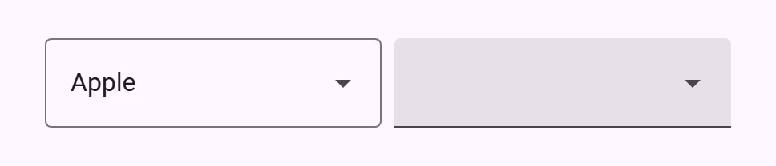
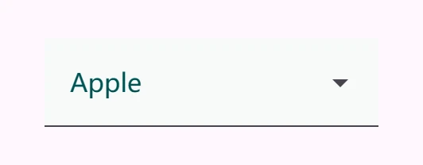
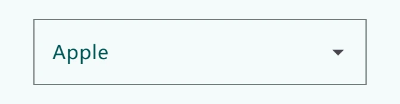

<!-- catalog-only-start --><!-- ---
name: Select
dirname: select
-----><!-- catalog-only-end -->

<catalog-component-header image-align="start">
<catalog-component-header-title slot="title">

# Select

<!-- no-catalog-start -->

<!-- [TOC] -->

<!-- external-only-start -->
**This documentation is fully rendered on the
[petal-elements catalog](https://petal.anontokyo.vip/catalog/components/select/)**
<!-- external-only-end -->

<!-- no-catalog-end -->

[Select menus](https://m3.material.io/components/menus/overview#b1704de4-94b7-4177-9e96-b677ae767cb4)<!-- {.external} -->
open a list of options and show the selected option in a field.

</catalog-component-header-title>


</catalog-component-header>

*   Design article (*coming soon*)
*   [API Documentation](#api)
*   [Source code](https://github.com/Saki340/petal-elements/tree/main/select)
    <!-- {.external} -->

## Usage

Select (also referred to as a dropdown menu) allows choosing a value from a
fixed list of available options. It is analogous to the native HTML
[`<select>` element](https://developer.mozilla.org/en-US/docs/Web/HTML/Element/select)<!-- {.external} -->.

<!-- no-catalog-start -->



<!-- no-catalog-end -->
<!-- catalog-include "figures/select/usage.html" -->

```html
<petal-outlined-select>
  <petal-select-option aria-label="blank"></petal-select-option>
  <petal-select-option selected value="apple">
    <div slot="headline">Apple</div>
  </petal-select-option>
  <petal-select-option value="apricot">
    <div slot="headline">Apricot</div>
  </petal-select-option>
</petal-outlined-select>

<petal-filled-select>
  <petal-select-option aria-label="blank"></petal-select-option>
  <petal-select-option value="apple">
    <div slot="headline">Apple</div>
  </petal-select-option>
  <petal-select-option value="apricot">
    <div slot="headline">Apricot</div>
  </petal-select-option>
</petal-filled-select>
```

### Required select

Indicate that a selection is mandatory by adding the `required` attribute.

```html
<petal-filled-select required>
  <petal-select-option value="one">
    <div slot="headline">One</div>
  </petal-select-option>
  <petal-select-option value="two">
    <div slot="headline">Two</div>
  </petal-select-option>
</petal-filled-select>
```

### Label, supporting text and errors

`label` is the floating label. `supporting-text` shows under the field.
`error` with `error-text` shows an error in its place, as for text fields; a
required select also shows the browser's message after `reportValidity()`.
`no-asterisk` hides the asterisk of a required select's label.

```html
<petal-outlined-select label="Country" supporting-text="Where you live" required>
  <petal-select-option value="jp"><div slot="headline">Japan</div></petal-select-option>
  <petal-select-option value="cn"><div slot="headline">China</div></petal-select-option>
</petal-outlined-select>

<petal-outlined-select label="Plan" error error-text="Choose a plan">
  ...
</petal-outlined-select>
```

### Value and events

The select is form-associated: with a `name`, its `value` (the selected
option's `value`) is submitted with its form, like a native `<select>`. Read
or set `value`, `selectedIndex`, or call `select(value)` or
`selectIndex(index)`. `selectedOptions` holds the selected
`petal-select-option`, and `displayText` its text.

The select fires `input` and `change` when the user picks an option (not when
`value` is set by script), and `opening`, `opened`, `closing` and `closed`
around its menu.

```js
const select = document.querySelector('petal-outlined-select');
select.addEventListener('change', () => console.log(select.value));
select.value = 'cn';
```

An option's text comes from its `headline` slot (or its text); set the
option's `displayText` property to show other text in the field. Options take
the `supporting-text`, `start` and `end` slots of list items, and `disabled`.

### Icons

Put an icon in the `leading-icon` slot. The `trailing-icon` slot replaces the
dropdown arrow.

```html
<petal-filled-select label="Language">
  <petal-icon slot="leading-icon">translate</petal-icon>
  ...
</petal-filled-select>
```

### Menu position

The menu opens in the top layer (`menu-positioning="popover"`, the default),
so it is not cut off by scrolling containers or dialogs. `menu-align="end"`
aligns it with the end of the field. `quick` opens it without the animation.

## Accessibility

Give the select a `label`, or an `aria-label` when there is no visible label.
Keyboard: Space, Enter and the arrow keys open the menu; typing a letter moves
to the next option that starts with it (`typeahead-delay` sets how long typed
letters are kept).

## Compose

Select follows Jetpack Compose Material 3's exposed dropdown menu
(`ExposedDropdownMenuBox`, `ExposedDropdownMenu` and
`ExposedDropdownMenuDefaults`):

*   The field is a text field with the values of `petal-filled-text-field` and
    `petal-outlined-text-field`: at least 280px wide, 56px high, a 2px focused
    indicator or outline, letter spacing on text, and no hover state.
*   The trailing icon is the arrow drop down icon, turned by 180 degrees while
    the menu is open. Compose does not animate the turn, and neither does the
    select. A `trailing-icon` slot replaces the arrow.
*   The menu is exactly as wide as the select (`matchAnchorWidth`) and starts
    at the bottom of the field, with no gap; above the field if there is no
    room below. It is at most as high as the larger of the spaces above and
    below the field, less 48px (`MenuVerticalMargin`), and scrolls. Set
    `no-clamp-menu-width` to let the menu be wider than the select.
*   Options are the items of a `DropdownMenu`: at least 48px high, with 16px of
    padding at the sides (`ExposedDropdownMenuDefaults.ItemContentPadding`;
    12px in a plain menu), and the label large text style. The menu itself is
    `petal-menu`, which opens by scaling from 80% like `DropdownMenu`.

Compose's exposed dropdown has no selected option state; `petal-select-option`
keeps showing the selected option with the secondary container, as a native
`<select>` does.

## Theming

Select supports
[Material theming](https://github.com/Saki340/petal-elements/blob/main/docs/theming/README.md)<!-- {.external} -->
and can be customized in terms of color, typography, and shape.

### Filled Select tokens

Token                                            | Default value
------------------------------------------------ | -------------
`--md-filled-select-text-field-container-color`  | `--md-sys-color-surface-container-highest`
`--md-filled-select-text-field-container-shape`  | `--md-sys-shape-corner-extra-small`
`--md-filled-select-text-field-input-text-color` | `--md-sys-color-on-surface`
`--md-filled-select-text-field-input-text-font`  | `--md-sys-typescale-body-large-font`

*   [Filled Select tokens](https://github.com/Saki340/petal-elements/blob/main/tokens/_md-comp-filled-select.scss)
    <!-- {.external} -->

To theme the select's dropdown menu, use the `petal-menu` component tokens on the
`::part(menu)` selector.

### Filled Select example

<!-- no-catalog-start -->



<!-- no-catalog-end -->
<!-- catalog-include "figures/select/theming-filled.html" -->

```html
<style>
:root {
  --md-filled-select-text-field-container-shape: 0px;
  --md-filled-select-text-field-container-color: #f7faf9;
  --md-filled-select-text-field-input-text-color: #005353;
  --md-filled-select-text-field-input-text-font: system-ui;
}

petal-filled-select::part(menu) {
  --md-menu-container-color: #f4fbfa;
  --md-menu-container-shape: 0px;
}
</style>

<petal-filled-select>
  <petal-select-option selected value="apple">
    <div slot="headline">Apple</div>
  </petal-select-option>
  <petal-select-option value="tomato">
    <div slot="headline">Tomato</div>
  </petal-select-option>
</petal-filled-select>
```

### Outlined Select tokens

Token                                              | Default value
-------------------------------------------------- | -------------
`--md-outlined-select-text-field-outline-color`    | `--md-sys-color-outline`
`--md-outlined-select-text-field-container-shape`  | `--md-sys-shape-corner-extra-small`
`--md-outlined-select-text-field-input-text-color` | `--md-sys-color-on-surface`
`--md-outlined-select-text-field-input-text-font`  | `--md-sys-typescale-body-large-font`

*   [Outlined Select tokens](https://github.com/Saki340/petal-elements/blob/main/tokens/_md-comp-outlined-select.scss)
    <!-- {.external} -->

### Outlined Select example

<!-- no-catalog-start -->



<!-- no-catalog-end -->
<!-- catalog-include "figures/select/theming-outlined.html" -->

```html
<style>
:root {
  --md-outlined-select-text-field-outline-color: #6e7979;
  --md-outlined-select-text-field-container-shape: 0px;
  --md-outlined-select-text-field-input-text-color: #005353;
  --md-outlined-select-text-field-input-text-font: system-ui;
}

petal-outlined-select::part(menu) {
  --md-menu-container-color: #f4fbfa;
  --md-menu-container-shape: 0px;
}
</style>

<petal-outlined-select>
  <petal-select-option selected value="apple">
    <div slot="headline">Apple</div>
  </petal-select-option>
  <petal-select-option value="tomato">
    <div slot="headline">Tomato</div>
  </petal-select-option>
</petal-outlined-select>
```

<!-- auto-generated API docs start -->

## API


### PetalFilledSelect <code>&lt;petal-filled-select&gt;</code>

#### Properties

<!-- mdformat off(autogenerated might break rendering in catalog) -->

| Property | Attribute | Type | Default | Description |
| --- | --- | --- | --- | --- |
| `quick` | `quick` | `boolean` | `false` | Opens the menu synchronously with no animation. |
| `required` | `required` | `boolean` | `false` | Whether or not the select is required. |
| `errorText` | `error-text` | `string` | `''` | The error message that replaces supporting text when `error` is true. If `errorText` is an empty string, then the supporting text will continue to show.<br>This error message overrides the error message displayed by `reportValidity()`. |
| `label` | `label` | `string` | `''` | The floating label for the field. |
| `noAsterisk` | `no-asterisk` | `boolean` | `false` | Disables the asterisk on the floating label, when the select is required. |
| `supportingText` | `supporting-text` | `string` | `''` | Conveys additional information below the select, such as how it should be used. |
| `error` | `error` | `boolean` | `false` | Gets or sets whether or not the select is in a visually invalid state.<br>This error state overrides the error state controlled by `reportValidity()`. |
| `menuPositioning` | `menu-positioning` | `"absolute" \| "fixed" \| "popover"` | `'popover'` | Whether or not the underlying petal-menu should be position: fixed to display in a top-level manner, or position: absolute.<br>position:fixed is useful for cases where select is inside of another element with stacking context and hidden overflows such as `petal-dialog`. |
| `clampMenuWidth` | `clamp-menu-width` | `boolean` | `true` | Deprecated: the menu is as wide as the select by default, as Compose's `ExposedDropdownMenu` (`matchAnchorWidth`). Setting this changes nothing; use `noClampMenuWidth` to let the menu be wider than the select. |
| `noClampMenuWidth` | `no-clamp-menu-width` | `boolean` | `false` | Lets the menu be wider than the select when its options are. By default the menu is exactly as wide as the select (Compose's `ExposedDropdownMenu`, `matchAnchorWidth`). |
| `typeaheadDelay` | `typeahead-delay` | `number` | `DEFAULT_TYPEAHEAD_BUFFER_TIME` | The max time between the keystrokes of the typeahead select / menu behavior before it clears the typeahead buffer. |
| `hasLeadingIcon` | `has-leading-icon` | `boolean` | `false` | Whether or not the text field has a leading icon. Used for SSR. |
| `displayText` | `display-text` | `string` | `''` | Text to display in the field. Only set for SSR. |
| `menuAlign` | `menu-align` | `"start" \| "end"` | `'start'` | Whether the menu should be aligned to the start or the end of the select's textbox. |
| `value` | `value` | `string` | `undefined` |  |
| `selectedIndex` | `selected-index` | `number` | `undefined` |  |
| `name` | `name` | `string` | `undefined` | The HTML name to use in form submission. |
| `disabled` | `disabled` | `boolean` | `undefined` | Whether or not the element is disabled. |
| `options` |  | `SelectOption[]` | `undefined` |  |
| `selectedOptions` |  | `SelectOption[]` | `undefined` |  |
| `form` |  | `HTMLFormElement` | `undefined` | The associated form element with which this element's value will submit. |
| `labels` |  | `NodeList` | `undefined` | The labels this element is associated with. |
| `validity` |  | `ValidityState` | `undefined` | Returns a ValidityState object that represents the validity states of the element.<br>https://developer.mozilla.org/en-US/docs/Web/API/ValidityState |
| `validationMessage` |  | `string` | `undefined` | Returns a validation error message or an empty string if the element is valid.<br>https://developer.mozilla.org/en-US/docs/Web/API/ElementInternals/validationMessage |
| `willValidate` |  | `boolean` | `undefined` | Returns whether an element will successfully validate based on forms validation rules and constraints.<br>Disabled and readonly elements will not validate.<br>https://developer.mozilla.org/en-US/docs/Web/API/ElementInternals/willValidate |

<!-- mdformat on(autogenerated might break rendering in catalog) -->

#### Methods

<!-- mdformat off(autogenerated might break rendering in catalog) -->

| Method | Parameters | Returns | Description |
| --- | --- | --- | --- |
| `select` | `value` | `void` | Selects an option given the value of the option, and updates MdSelect's value. |
| `selectIndex` | `index` | `void` | Selects an option given the index of the option, and updates MdSelect's value. |
| `reset` | _None_ | `void` | Reset the select to its default value. |
| `showPicker` | _None_ | `void` | Shows the picker. If it's already open, this is a no-op. |
| `getUpdateComplete` | _None_ | `Promise<boolean>` |  |
| `formResetCallback` | _None_ | `void` |  |
| `formStateRestoreCallback` | `state` | `void` |  |
| `click` | _None_ | `void` |  |
| `checkValidity` | _None_ | `boolean` | Checks the element's constraint validation and returns true if the element is valid or false if not.<br>If invalid, this method will dispatch an `invalid` event.<br>https://developer.mozilla.org/en-US/docs/Web/API/ElementInternals/checkValidity |
| `reportValidity` | _None_ | `boolean` | Checks the element's constraint validation and returns true if the element is valid or false if not.<br>If invalid, this method will dispatch a cancelable `invalid` event. If not canceled, a the current `validationMessage` will be reported to the user.<br>https://developer.mozilla.org/en-US/docs/Web/API/ElementInternals/reportValidity |
| `setCustomValidity` | `error` | `void` | Sets the element's constraint validation error message. When set to a non-empty string, `validity.customError` will be true and `validationMessage` will display the provided error.<br>Use this method to customize error messages reported.<br>https://developer.mozilla.org/en-US/docs/Web/API/HTMLInputElement/setCustomValidity |

<!-- mdformat on(autogenerated might break rendering in catalog) -->

#### Events

<!-- mdformat off(autogenerated might break rendering in catalog) -->

| Event | Type | [Bubbles](https://developer.mozilla.org/en-US/docs/Web/API/Event/bubbles) | [Composed](https://developer.mozilla.org/en-US/docs/Web/API/Event/composed) | Description |
| --- | --- | --- | --- | --- |
| `change` | `Event` | Yes | No | The native `change` event on [`<input>`](https://developer.mozilla.org/en-US/docs/Web/API/HTMLElement/change_event) |
| `input` | `InputEvent` | Yes | Yes | The native `input` event on [`<input>`](https://developer.mozilla.org/en-US/docs/Web/API/HTMLElement/input_event) |
| `opening` | `Event` | No | No | Fired when the select's menu is about to open. |
| `opened` | `Event` | No | No | Fired when the select's menu has finished animations and opened. |
| `closing` | `Event` | No | No | Fired when the select's menu is about to close. |
| `closed` | `Event` | No | No | Fired when the select's menu has finished animations and closed. |

<!-- mdformat on(autogenerated might break rendering in catalog) -->

#### Slots

<!-- mdformat off(autogenerated might break rendering in catalog) -->

| Slot | Description |
| --- | --- |
| _default_ | The `petal-select-option`s. |
| `leading-icon` | An icon at the start of the field. |
| `trailing-icon` | Replaces the dropdown arrow at the end. |

<!-- mdformat on(autogenerated might break rendering in catalog) -->

### PetalOutlinedSelect <code>&lt;petal-outlined-select&gt;</code>

#### Properties

<!-- mdformat off(autogenerated might break rendering in catalog) -->

| Property | Attribute | Type | Default | Description |
| --- | --- | --- | --- | --- |
| `quick` | `quick` | `boolean` | `false` | Opens the menu synchronously with no animation. |
| `required` | `required` | `boolean` | `false` | Whether or not the select is required. |
| `errorText` | `error-text` | `string` | `''` | The error message that replaces supporting text when `error` is true. If `errorText` is an empty string, then the supporting text will continue to show.<br>This error message overrides the error message displayed by `reportValidity()`. |
| `label` | `label` | `string` | `''` | The floating label for the field. |
| `noAsterisk` | `no-asterisk` | `boolean` | `false` | Disables the asterisk on the floating label, when the select is required. |
| `supportingText` | `supporting-text` | `string` | `''` | Conveys additional information below the select, such as how it should be used. |
| `error` | `error` | `boolean` | `false` | Gets or sets whether or not the select is in a visually invalid state.<br>This error state overrides the error state controlled by `reportValidity()`. |
| `menuPositioning` | `menu-positioning` | `"absolute" \| "fixed" \| "popover"` | `'popover'` | Whether or not the underlying petal-menu should be position: fixed to display in a top-level manner, or position: absolute.<br>position:fixed is useful for cases where select is inside of another element with stacking context and hidden overflows such as `petal-dialog`. |
| `clampMenuWidth` | `clamp-menu-width` | `boolean` | `true` | Deprecated: the menu is as wide as the select by default, as Compose's `ExposedDropdownMenu` (`matchAnchorWidth`). Setting this changes nothing; use `noClampMenuWidth` to let the menu be wider than the select. |
| `noClampMenuWidth` | `no-clamp-menu-width` | `boolean` | `false` | Lets the menu be wider than the select when its options are. By default the menu is exactly as wide as the select (Compose's `ExposedDropdownMenu`, `matchAnchorWidth`). |
| `typeaheadDelay` | `typeahead-delay` | `number` | `DEFAULT_TYPEAHEAD_BUFFER_TIME` | The max time between the keystrokes of the typeahead select / menu behavior before it clears the typeahead buffer. |
| `hasLeadingIcon` | `has-leading-icon` | `boolean` | `false` | Whether or not the text field has a leading icon. Used for SSR. |
| `displayText` | `display-text` | `string` | `''` | Text to display in the field. Only set for SSR. |
| `menuAlign` | `menu-align` | `"start" \| "end"` | `'start'` | Whether the menu should be aligned to the start or the end of the select's textbox. |
| `value` | `value` | `string` | `undefined` |  |
| `selectedIndex` | `selected-index` | `number` | `undefined` |  |
| `name` | `name` | `string` | `undefined` | The HTML name to use in form submission. |
| `disabled` | `disabled` | `boolean` | `undefined` | Whether or not the element is disabled. |
| `options` |  | `SelectOption[]` | `undefined` |  |
| `selectedOptions` |  | `SelectOption[]` | `undefined` |  |
| `form` |  | `HTMLFormElement` | `undefined` | The associated form element with which this element's value will submit. |
| `labels` |  | `NodeList` | `undefined` | The labels this element is associated with. |
| `validity` |  | `ValidityState` | `undefined` | Returns a ValidityState object that represents the validity states of the element.<br>https://developer.mozilla.org/en-US/docs/Web/API/ValidityState |
| `validationMessage` |  | `string` | `undefined` | Returns a validation error message or an empty string if the element is valid.<br>https://developer.mozilla.org/en-US/docs/Web/API/ElementInternals/validationMessage |
| `willValidate` |  | `boolean` | `undefined` | Returns whether an element will successfully validate based on forms validation rules and constraints.<br>Disabled and readonly elements will not validate.<br>https://developer.mozilla.org/en-US/docs/Web/API/ElementInternals/willValidate |

<!-- mdformat on(autogenerated might break rendering in catalog) -->

#### Methods

<!-- mdformat off(autogenerated might break rendering in catalog) -->

| Method | Parameters | Returns | Description |
| --- | --- | --- | --- |
| `select` | `value` | `void` | Selects an option given the value of the option, and updates MdSelect's value. |
| `selectIndex` | `index` | `void` | Selects an option given the index of the option, and updates MdSelect's value. |
| `reset` | _None_ | `void` | Reset the select to its default value. |
| `showPicker` | _None_ | `void` | Shows the picker. If it's already open, this is a no-op. |
| `getUpdateComplete` | _None_ | `Promise<boolean>` |  |
| `formResetCallback` | _None_ | `void` |  |
| `formStateRestoreCallback` | `state` | `void` |  |
| `click` | _None_ | `void` |  |
| `checkValidity` | _None_ | `boolean` | Checks the element's constraint validation and returns true if the element is valid or false if not.<br>If invalid, this method will dispatch an `invalid` event.<br>https://developer.mozilla.org/en-US/docs/Web/API/ElementInternals/checkValidity |
| `reportValidity` | _None_ | `boolean` | Checks the element's constraint validation and returns true if the element is valid or false if not.<br>If invalid, this method will dispatch a cancelable `invalid` event. If not canceled, a the current `validationMessage` will be reported to the user.<br>https://developer.mozilla.org/en-US/docs/Web/API/ElementInternals/reportValidity |
| `setCustomValidity` | `error` | `void` | Sets the element's constraint validation error message. When set to a non-empty string, `validity.customError` will be true and `validationMessage` will display the provided error.<br>Use this method to customize error messages reported.<br>https://developer.mozilla.org/en-US/docs/Web/API/HTMLInputElement/setCustomValidity |

<!-- mdformat on(autogenerated might break rendering in catalog) -->

#### Events

<!-- mdformat off(autogenerated might break rendering in catalog) -->

| Event | Type | [Bubbles](https://developer.mozilla.org/en-US/docs/Web/API/Event/bubbles) | [Composed](https://developer.mozilla.org/en-US/docs/Web/API/Event/composed) | Description |
| --- | --- | --- | --- | --- |
| `change` | `Event` | Yes | No | The native `change` event on [`<input>`](https://developer.mozilla.org/en-US/docs/Web/API/HTMLElement/change_event) |
| `input` | `InputEvent` | Yes | Yes | The native `input` event on [`<input>`](https://developer.mozilla.org/en-US/docs/Web/API/HTMLElement/input_event) |
| `opening` | `Event` | No | No | Fired when the select's menu is about to open. |
| `opened` | `Event` | No | No | Fired when the select's menu has finished animations and opened. |
| `closing` | `Event` | No | No | Fired when the select's menu is about to close. |
| `closed` | `Event` | No | No | Fired when the select's menu has finished animations and closed. |

<!-- mdformat on(autogenerated might break rendering in catalog) -->

#### Slots

<!-- mdformat off(autogenerated might break rendering in catalog) -->

| Slot | Description |
| --- | --- |
| _default_ | The `petal-select-option`s. |
| `leading-icon` | An icon at the start of the field. |
| `trailing-icon` | Replaces the dropdown arrow at the end. |

<!-- mdformat on(autogenerated might break rendering in catalog) -->

### PetalSelectOption <code>&lt;petal-select-option&gt;</code>

#### Properties

<!-- mdformat off(autogenerated might break rendering in catalog) -->

| Property | Attribute | Type | Default | Description |
| --- | --- | --- | --- | --- |
| `disabled` | `disabled` | `boolean` | `false` | Disables the item and makes it non-selectable and non-interactive. |
| `selected` | `selected` | `boolean` | `false` | Sets the item in the selected visual state when a submenu is opened. |
| `value` | `value` | `string` | `''` | Form value of the option. |
| `type` |  | `string` | `'option' as const` |  |
| `typeaheadText` |  | `string` | `undefined` |  |
| `displayText` |  | `string` | `undefined` |  |

<!-- mdformat on(autogenerated might break rendering in catalog) -->

#### Events

<!-- mdformat off(autogenerated might break rendering in catalog) -->

| Event | Type | [Bubbles](https://developer.mozilla.org/en-US/docs/Web/API/Event/bubbles) | [Composed](https://developer.mozilla.org/en-US/docs/Web/API/Event/composed) | Description |
| --- | --- | --- | --- | --- |
| `close-menu` | `CustomEvent<{initiator: SelectOption, reason: Reason, itemPath: SelectOption[]}>` | Yes | Yes | Closes the encapsulating menu on closable interaction. |
| `request-selection` | `Event` | Yes | Yes | Requests the parent md-select to select this element (and deselect others if single-selection) when `selected` changed to `true`. |
| `request-deselection` | `Event` | Yes | Yes | Requests the parent md-select to deselect this element when `selected` changed to `false`. |

<!-- mdformat on(autogenerated might break rendering in catalog) -->

#### Slots

<!-- mdformat off(autogenerated might break rendering in catalog) -->

| Slot | Description |
| --- | --- |
| _default_ | The headline, as text (the same as the `headline` slot). |
| `headline` | The main line of text. |
| `overline` | A short line above the headline. |
| `supporting-text` | Lines below the headline. |
| `trailing-supporting-text` | Short text at the end, such as a count or a time. |
| `start` | Content at the start: an icon, an avatar, an image or a control. |
| `end` | Content at the end: an icon or a control. |

<!-- mdformat on(autogenerated might break rendering in catalog) -->

<!-- auto-generated API docs end -->
