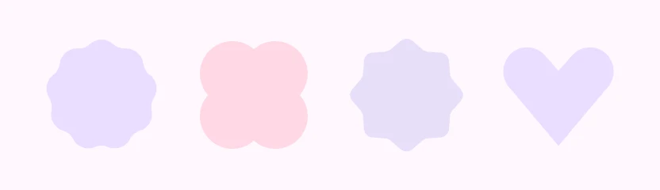
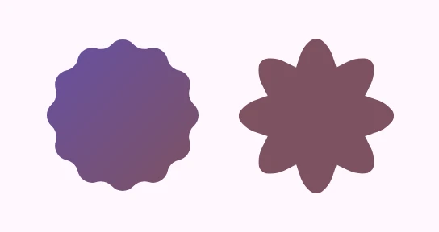
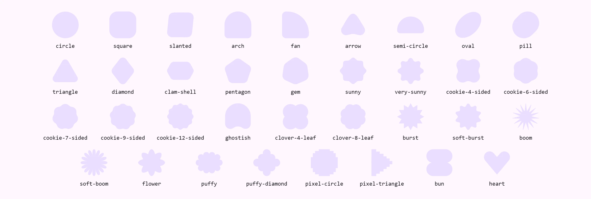

<!-- catalog-only-start --><!-- ---
name: Shape
dirname: shape
-----><!-- catalog-only-end -->

<catalog-component-header>
<catalog-component-header-title slot="title">

# Shape

<!-- no-catalog-start -->

<!-- [TOC] -->

<!-- external-only-start -->
**This documentation is fully rendered on the
[petal-elements catalog](https://petal.anontokyo.vip/catalog/components/shape/).**
<!-- external-only-end -->

<!-- no-catalog-end -->

[Shapes](https://m3.material.io/styles/shape)<!-- {.external} --> give
Material 3 Expressive its character: 35 shapes, from cookies and clovers to a
heart, that morph into each other. `<petal-shape>` clips its content to one of
them and morphs on a spring; the `petal-elements/shapes/shapes.js` module
gives the shapes to your own SVG, CSS or canvas.

</catalog-component-header-title>



</catalog-component-header>

*   [Design article](https://m3.material.io/styles/shape) <!-- {.external} -->
*   [API Documentation](#api)
*   [Source code](https://github.com/Saki340/petal-elements/tree/main/shapes)
    <!-- {.external} -->

This follows Jetpack Compose Material 3 (`MaterialShapes`,
`RoundedPolygon.toShape()`). The shapes and the morphing are a TypeScript port
of Android's graphics-shapes library (`RoundedPolygon`, `Morph`) with the
values of Compose's `MaterialShapes`, the same code the
[loading indicator](loading-indicator.md) morphs with.

## Usage

`<petal-shape>` is a 48px box clipped to its `shape`, a circle by default. Its
content is clipped with it; `--md-shape-color` fills it. The shape stretches
to the element's size, so size it with `width` and `height`.

<!-- no-catalog-start -->



<!-- no-catalog-end -->
<!-- catalog-include "figures/shape/usage.html" -->

```html
<petal-shape shape="cookie-12-sided" style="width: 96px; height: 96px">
  
</petal-shape>
<petal-shape
    shape="flower"
    style="width: 96px; height: 96px; --md-shape-color: var(--md-sys-color-tertiary)">
</petal-shape>
```

An `` or `<video>` inside covers the shape (`object-fit: cover`).

### The 35 shapes

The names are Compose's `MaterialShapes` in kebab case: `Cookie9Sided` is
`cookie-9-sided`.

<!-- no-catalog-start -->



<!-- no-catalog-end -->
<!-- catalog-include "figures/shape/all.html" -->

### Morphing

Changing `shape` morphs to the new shape on the default spatial spring.
`hover-shape` is the shape while a mouse hovers the element and
`pressed-shape` the shape while it is pressed (by mouse, touch or pen).
Entering hover or press morphs on the fast spatial spring and returning on the
default one, the springs of the page's [motion scheme](../motion.md).

<!-- no-catalog-start -->


<!-- no-catalog-end -->
<!-- catalog-include "figures/shape/usage-interactive.html" -->

```html
<petal-shape
    shape="circle"
    hover-shape="cookie-9-sided"
    pressed-shape="sunny"
    style="width: 72px; height: 72px; --md-shape-color: var(--md-sys-color-primary)">
  <petal-icon style="color: var(--md-sys-color-on-primary)">favorite</petal-icon>
</petal-shape>
```

A morph interrupted on its way back to where it started turns back along the
same path; one interrupted toward a third shape morphs on from the shape on
screen, so the outline never jumps.

`<petal-shape>` is a container, not a control: to make a shaped button, put
the button inside, or the shape inside the button, and give the button its
role and label.

### In script

`petal-elements/shapes/shapes.js` has the shapes as `RoundedPolygon`s and
writes them, and morphs between them, as SVG path data:

```js
import {materialShape, Morph, morphPath, shapePath} from 'petal-elements/shapes/shapes.js';

// A shape as path data for a 48 by 48 box: for <path d>, clip-path: path() or Path2D.
const d = shapePath(materialShape('cookie-9-sided'), 48);
element.style.clipPath = `path('${d}')`;

// A morph at 30% of the way from a circle to a heart.
const morph = new Morph(materialShape('circle'), materialShape('heart'));
svgPath.setAttribute('d', morphPath(morph, 0.3, 48));
```

Export | What it is
--- | ---
`materialShape(name)` | The shape of that name, normalized to the 0..1 square. Shapes are made once and shared.
`shapeNames` | The 35 names, in Compose's order.
`isShapeName(name)` | Whether a string is one of the names.
`shapePath(polygon, width, height?)` | The shape as path data, scaled to the size and centered as Compose's `toShape()` does.
`morphPath(morph, progress, width, height?)` | A morph at `progress` (0 start, 1 end; a spring may go past) as path data.
`Morph` | A morph between two polygons (`new Morph(start, end)`).
`RoundedPolygon`, `CornerRounding` | Polygons with rounded corners, for shapes of your own.
`circle()`, `rectangle()`, `star()`, `polygon()` | Compose's `RoundedPolygon.circle`, `.rectangle`, `.star` and `RoundedPolygon(numVertices)`, centered on 0, 0. Call `.normalized()` before drawing.

Drive `morphPath` with a [spring](../motion.md#in-script) to morph in your own
animations:

```js
import {Spring, springFromCss} from 'petal-elements/motion/spring.js';

const spring = new Spring(springFromCss(svg, 'default-spatial'));
spring.target = 1;
let last = performance.now();
requestAnimationFrame(function frame(now) {
  spring.step(now - last);
  last = now;
  svgPath.setAttribute('d', morphPath(morph, spring.value, 48));
  if (!spring.atRest) requestAnimationFrame(frame);
});
```

## Accessibility

`<petal-shape>` adds no role; it is presentation. Give content inside it its
own text alternative (an ``, or a label on a control).

With `prefers-reduced-motion`, shapes change at once, without morphing.

## Theming

Custom property | Default | What it sets
--- | --- | ---
`--md-shape-color` | none | The fill behind the content.

The element's `width` and `height` set the size (48px by default). The
`shape` part is the clipped box that holds the content.

<!-- auto-generated API docs start -->

## API


### PetalShape <code>&lt;petal-shape&gt;</code>

#### Properties

<!-- mdformat off(autogenerated might break rendering in catalog) -->

| Property | Attribute | Type | Default | Description |
| --- | --- | --- | --- | --- |
| `shape` | `shape` | `ShapeName` | `'circle'` | The shape at rest: one of the 35 shape names. |
| `hoverShape` | `hover-shape` | `ShapeName` | `undefined` | The shape while a mouse hovers the element. |
| `pressedShape` | `pressed-shape` | `ShapeName` | `undefined` | The shape while the element is pressed. |

<!-- mdformat on(autogenerated might break rendering in catalog) -->

<!-- auto-generated API docs end -->
