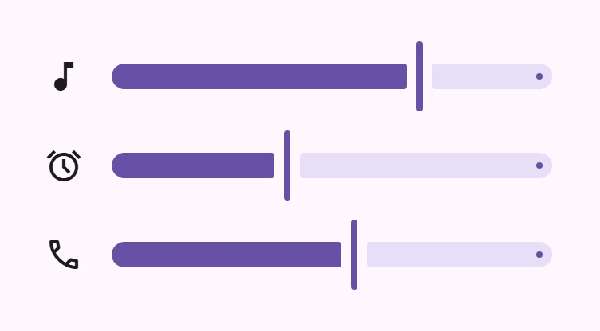

<!-- catalog-only-start --><!-- ---
name: Sliders
dirname: slider
-----><!-- catalog-only-end -->

<catalog-component-header image-align="start">
<catalog-component-header-title slot="title">

# Sliders

<!-- no-catalog-start -->

<!-- [TOC] -->

<!-- external-only-start -->
**This documentation is fully rendered on the
[petal-elements catalog](https://petal.anontokyo.vip/catalog/components/slider/)**
<!-- external-only-end -->

<!-- no-catalog-end -->

[Sliders](https://m3.material.io/components/sliders)<!-- {.external} -->
pick a value, or a range of values, along a track. Volume and brightness
controls are typical uses.

Sliders can use icons or labels to represent a numeric or relative scale.

</catalog-component-header-title>



</catalog-component-header>

*   [Design article](https://m3.material.io/components/sliders) <!-- {.external} -->
*   [API Documentation](#api)
*   [Source code](https://github.com/Saki340/petal-elements/tree/main/slider)
    <!-- {.external} -->

<!-- catalog-only-start -->

<!--

## Interactive Demo



-->

<!-- catalog-only-end -->

## Usage

Sliders may be continuous or discrete, and may also represent a range.

```html
<petal-slider></petal-slider>
<petal-slider ticks value="50"></petal-slider>
<petal-slider range value-start="25" value-end="75"></petal-slider>
```

### Continuous

Allows users to select a value along a subjective range.

```html
<petal-slider min="0" max="100" value="50"></petal-slider>
```

### Discrete

Allows users to select a specific value from a predetermined range. Tick marks
may be used to indicate available values.

```html
<petal-slider step="5" ticks min="0" max="20"></petal-slider>
```

### Range

A range slider has two handles, and indicates a minimum and maximum value in a
range.

```html
<petal-slider range value-start="25" value-end="50"></petal-slider>
```

### Value label

A value label displays the specific value that corresponds with the handle's
placement.

The label appears while the handle is hovered, pressed or dragged, and while it
has keyboard focus. For range sliders, each handle has its own label.

```html
<petal-slider labeled></petal-slider>
```

<!-- TODO(b/318567101): ## Accessibility -->

## Compose behavior

Sliders follow Jetpack Compose Material 3 Expressive (`Slider`, `RangeSlider`,
`SliderTokens`):

*   The handle is a 4dp x 44dp bar, half as wide while it is pressed, dragged or
    focused. There is no ripple or state layer.
*   The track is 16dp high with fully rounded ends, and stops 6dp before the
    handle on each side; the ends next to the handle have 2dp corners. A part
    of the track narrower than its corner is not drawn.
*   A 4dp stop indicator in the active track color marks the end of the
    inactive track (both ends of a range slider). Ticks are 4dp dots, with
    values between the first and the last tick inset by the track's corner
    radius, as in Compose.
*   The value label is a plain tooltip (inverse surface, 4dp corners) 4dp above
    the handle, as in Compose's slider samples. Compose shows it on hover,
    press and drag; petal-elements also shows it on keyboard focus.

## Theming

Slider supports [Material theming](../theming/README.md) and can be customized
in terms of color and shape.

### Tokens

Token                                      | Default value
------------------------------------------ | ------------------------------------
`--md-slider-active-track-color`           | `--md-sys-color-primary`
`--md-slider-active-track-height`          | `16px`
`--md-slider-inactive-track-color`         | `--md-sys-color-secondary-container`
`--md-slider-handle-color`                 | `--md-sys-color-primary`
`--md-slider-handle-width`                 | `4px`
`--md-slider-pressed-handle-width`         | `2px`
`--md-slider-handle-height`                | `44px`
`--md-slider-handle-shape`                 | `--md-sys-shape-corner-full`
`--md-slider-with-tick-marks-container-size` | `4px`
`--md-slider-label-container-color`        | `--md-sys-color-inverse-surface`
`--md-slider-label-text-color`             | `--md-sys-color-inverse-on-surface`

*   [All tokens](https://github.com/Saki340/petal-elements/blob/main/slider/internal/_slider.scss)
    <!-- {.external} -->

### Example

<!-- no-catalog-start -->


<!-- no-catalog-end -->

```html
<style>
:root {
  /* System tokens */
  --md-sys-color-primary: #006A6A;

  /* Component tokens */
  --md-slider-handle-shape: 0px;
}
</style>

<petal-slider
  range
  value-start="25"
  value-end="75"
  ticks
  step="5"
></petal-slider>
```

<!-- auto-generated API docs start -->

## API


### PetalSlider <code>&lt;petal-slider&gt;</code>

#### Properties

<!-- mdformat off(autogenerated might break rendering in catalog) -->

| Property | Attribute | Type | Default | Description |
| --- | --- | --- | --- | --- |
| `min` | `min` | `number` | `0` | The slider minimum value |
| `max` | `max` | `number` | `100` | The slider maximum value |
| `value` | `value` | `number` | `undefined` | The slider value displayed when range is false. |
| `valueStart` | `value-start` | `number` | `undefined` | The slider start value displayed when range is true. |
| `valueEnd` | `value-end` | `number` | `undefined` | The slider end value displayed when range is true. |
| `valueLabel` | `value-label` | `string` | `''` | An optional label for the slider's value displayed when range is false; if not set, the label is the value itself. |
| `valueLabelStart` | `value-label-start` | `string` | `''` | An optional label for the slider's start value displayed when range is true; if not set, the label is the valueStart itself. |
| `valueLabelEnd` | `value-label-end` | `string` | `''` | An optional label for the slider's end value displayed when range is true; if not set, the label is the valueEnd itself. |
| `ariaLabelStart` | `aria-label-start` | `string` | `''` | Aria label for the slider's start handle displayed when range is true. |
| `ariaValueTextStart` | `aria-valuetext-start` | `string` | `''` | Aria value text for the slider's start value displayed when range is true. |
| `ariaLabelEnd` | `aria-label-end` | `string` | `''` | Aria label for the slider's end handle displayed when range is true. |
| `ariaValueTextEnd` | `aria-valuetext-end` | `string` | `''` | Aria value text for the slider's end value displayed when range is true. |
| `step` | `step` | `number` | `1` | The step between values. |
| `ticks` | `ticks` | `boolean` | `false` | Whether or not to show tick marks. |
| `labeled` | `labeled` | `boolean` | `false` | Whether or not to show a value label when activated. |
| `range` | `range` | `boolean` | `false` | Whether or not to show a value range. When false, the slider displays a slideable handle for the value property; when true, it displays slideable handles for the valueStart and valueEnd properties. |
| `name` | `name` | `string` | `undefined` | The HTML name to use in form submission. |
| `disabled` | `disabled` | `boolean` | `undefined` | Whether or not the element is disabled. |
| `nameStart` |  | `string` | `undefined` |  |
| `nameEnd` |  | `string` | `undefined` |  |
| `form` |  | `HTMLFormElement` | `undefined` | The associated form element with which this element's value will submit. |
| `labels` |  | `NodeList` | `undefined` | The labels this element is associated with. |

<!-- mdformat on(autogenerated might break rendering in catalog) -->

#### Methods

<!-- mdformat off(autogenerated might break rendering in catalog) -->

| Method | Parameters | Returns | Description |
| --- | --- | --- | --- |
| `formResetCallback` | _None_ | `void` |  |
| `formStateRestoreCallback` | `state` | `void` |  |

<!-- mdformat on(autogenerated might break rendering in catalog) -->

#### Events

<!-- mdformat off(autogenerated might break rendering in catalog) -->

| Event | Type | [Bubbles](https://developer.mozilla.org/en-US/docs/Web/API/Event/bubbles) | [Composed](https://developer.mozilla.org/en-US/docs/Web/API/Event/composed) | Description |
| --- | --- | --- | --- | --- |
| `change` | `Event` | Yes | No | The native `change` event on [`<input>`](https://developer.mozilla.org/en-US/docs/Web/API/HTMLElement/change_event) |
| `input` | `InputEvent` | Yes | Yes | The native `input` event on [`<input>`](https://developer.mozilla.org/en-US/docs/Web/API/HTMLElement/input_event) |

<!-- mdformat on(autogenerated might break rendering in catalog) -->

<!-- auto-generated API docs end -->
