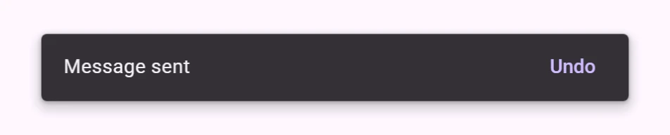
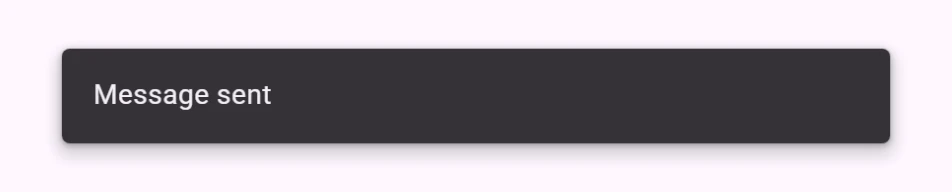
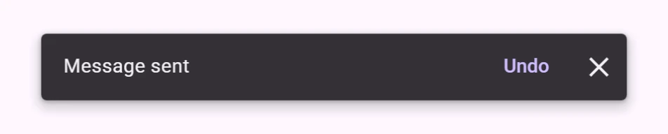
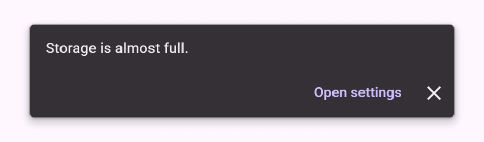
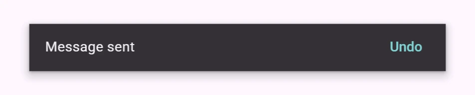

<!-- catalog-only-start --><!-- ---
name: Snackbar
dirname: snackbar
-----><!-- catalog-only-end -->

<catalog-component-header>
<catalog-component-header-title slot="title">

# Snackbar

<!-- no-catalog-start -->

<!-- [TOC] -->

<!-- external-only-start -->
**This documentation is fully rendered on the
[petal-elements catalog](https://petal.anontokyo.vip/catalog/components/snackbar/).**
<!-- external-only-end -->

<!-- no-catalog-end -->

[Snackbars](https://m3.material.io/components/snackbar)<!-- {.external} -->
show a short message about a process at the bottom of the screen, with an
optional action.

</catalog-component-header-title>



</catalog-component-header>

*   [Design article](https://m3.material.io/components/snackbar) <!-- {.external} -->
*   [API Documentation](#api)
*   [Source code](https://github.com/Saki340/petal-elements/tree/main/snackbar)
    <!-- {.external} -->

The values follow Jetpack Compose Material 3 (`SnackbarTokens`, `Snackbar`,
`SnackbarHost`).

## Usage

Put the message in the snackbar and call `show()`. It is fixed to the bottom
of the page, up to 600px wide, and closes after 4 seconds.

<!-- no-catalog-start -->



<!-- no-catalog-end -->
<!-- catalog-include "figures/snackbar/usage.html" -->

```html
<petal-snackbar id="sent">Message sent</petal-snackbar>
<script type="module">
  import 'petal-elements/snackbar/snackbar.js';
  document.querySelector('#sent').show();
</script>
```

`show()` returns a promise with the reason the snackbar closed: `timeout`,
`action`, `dismiss` or `close`. Calling `show()` again while the snackbar is
open (to show a new message in it) restarts its timer and resolves the earlier
promise with `replace`, so each call gets its own result.

### Action

`action` adds a text button. A snackbar with an action stays open until it is
closed, like Compose's `SnackbarHostState.showSnackbar()`; set `duration` to
close it anyway.

<!-- no-catalog-start -->


<!-- no-catalog-end -->
<!-- catalog-include "figures/snackbar/usage-action.html" -->

```html
<petal-snackbar action="Undo" duration="long">Message sent</petal-snackbar>
<script type="module">
  const snackbar = document.querySelector('petal-snackbar');
  if (await snackbar.show() === 'action') {
    // Undo.
  }
</script>
```

### Duration

`duration` is `short` (4 s), `long` (10 s) or `indefinite`, the same as
Compose's `SnackbarDuration`. Without it, the snackbar is `short`, or
`indefinite` with an action.

### Close button

`dismissible` adds a close button. Set its accessible label with
`dismiss-label`.

<!-- no-catalog-start -->



<!-- no-catalog-end -->
<!-- catalog-include "figures/snackbar/usage-dismiss.html" -->

```html
<petal-snackbar action="Undo" dismissible>Message sent</petal-snackbar>
```

### Action on a new line

For a long action label, `action-on-new-line` places the buttons below the
message.

<!-- no-catalog-start -->



<!-- no-catalog-end -->
<!-- catalog-include "figures/snackbar/usage-new-line.html" -->

```html
<petal-snackbar action="Open settings" action-on-new-line dismissible>
  Storage is almost full.
</petal-snackbar>
```

## Accessibility

The snackbar is a polite live region (`role="status"`), so screen readers
announce the message without moving focus. Its buttons can be reached with the
keyboard. Keep messages short, and do not put the only way to do something in
a snackbar: it closes by itself.

## Theming

Snackbars support [Material theming](../theming/README.md). Every token of
Compose's `SnackbarTokens` is a `--md-snackbar-*` custom property.

### Tokens

Token                                   | Default value
--------------------------------------- | -------------
`--md-snackbar-container-color`         | `--md-sys-color-inverse-surface`
`--md-snackbar-container-shape`         | `--md-sys-shape-corner-extra-small`
`--md-snackbar-supporting-text-color`   | `--md-sys-color-inverse-on-surface`
`--md-snackbar-action-label-text-color` | `--md-sys-color-inverse-primary`
`--md-snackbar-icon-color`              | `--md-sys-color-inverse-on-surface`
`--md-snackbar-single-line-container-height` | `48px`

*   [All tokens](https://github.com/Saki340/petal-elements/blob/main/tokens/versions/compose/values/_md-comp-snackbar.scss)
    <!-- {.external} -->

### Example

<!-- no-catalog-start -->



<!-- no-catalog-end -->
<!-- catalog-include "figures/snackbar/theming.html" -->

```html
<style>
  petal-snackbar {
    --md-snackbar-container-shape: 0px;
    --md-snackbar-action-label-text-color: #80d5d4;
  }
</style>
<petal-snackbar action="Undo">Message sent</petal-snackbar>
```

<!-- auto-generated API docs start -->

## API


### PetalSnackbar <code>&lt;petal-snackbar&gt;</code>

#### Properties

<!-- mdformat off(autogenerated might break rendering in catalog) -->

| Property | Attribute | Type | Default | Description |
| --- | --- | --- | --- | --- |
| `open` | `open` | `boolean` | `false` | Whether the snackbar is shown. |
| `action` | `action` | `string` | `''` | Label of the action button; no button when empty. |
| `dismissible` | `dismissible` | `boolean` | `false` | Shows a close button. |
| `dismissLabel` | `dismiss-label` | `string` | `'Dismiss'` | Accessible label of the close button. |
| `duration` | `duration` | `SnackbarDuration` | `undefined` | How long the snackbar stays open. Defaults to `short`, or `indefinite` with an action, like Compose's `SnackbarHostState.showSnackbar`. |
| `actionOnNewLine` | `action-on-new-line` | `boolean` | `false` | Places the action below the message, for long action labels. |

<!-- mdformat on(autogenerated might break rendering in catalog) -->

#### Methods

<!-- mdformat off(autogenerated might break rendering in catalog) -->

| Method | Parameters | Returns | Description |
| --- | --- | --- | --- |
| `show` | _None_ | `Promise<SnackbarCloseReason>` | Shows the snackbar. Resolves with the close reason when it closes. If it is already open (with new content, for example), its timer starts again and the promise of the previous `show()` resolves with `replace`. |
| `close` | `reason` | `void` | Closes the snackbar. |

<!-- mdformat on(autogenerated might break rendering in catalog) -->

#### Events

<!-- mdformat off(autogenerated might break rendering in catalog) -->

| Event | Type | [Bubbles](https://developer.mozilla.org/en-US/docs/Web/API/Event/bubbles) | [Composed](https://developer.mozilla.org/en-US/docs/Web/API/Event/composed) | Description |
| --- | --- | --- | --- | --- |
| `open` | `Event` | No | No | The snackbar opened. |
| `close` | `CustomEvent<{reason: SnackbarCloseReason}>` | No | No | The snackbar is closing: `timeout`, `action` (the action button was clicked), `dismiss` (the close button) or `close` (`close()` was called). |
| `action` | `Event` | No | No | The action button was clicked. Cancel it to keep the snackbar open. |

<!-- mdformat on(autogenerated might break rendering in catalog) -->

#### Slots

<!-- mdformat off(autogenerated might break rendering in catalog) -->

| Slot | Description |
| --- | --- |
| _default_ | The message text. |

<!-- mdformat on(autogenerated might break rendering in catalog) -->

<!-- auto-generated API docs end -->
