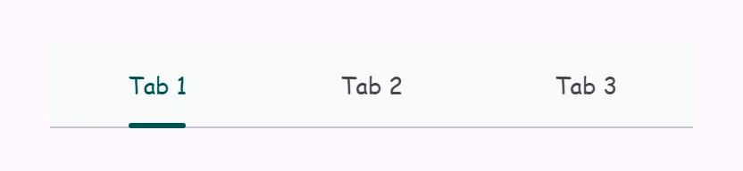

<!-- catalog-only-start --><!-- ---
name: Tabs
dirname: tabs
-----><!-- catalog-only-end -->

<catalog-component-header image-align="start">
<catalog-component-header-title slot="title">

# Tabs

<!-- no-catalog-start -->

<!-- [TOC] -->

<!-- external-only-start -->
**This documentation is fully rendered on the
[petal-elements catalog](https://petal.anontokyo.vip/catalog/components/tabs/)**
<!-- external-only-end -->

<!-- no-catalog-end -->

[Tabs](https://m3.material.io/components/tabs)<!-- {.external} -->
switch between related views at the same level of a page.

</catalog-component-header-title>


</catalog-component-header>

*   [Design article](https://m3.material.io/components/tabs) <!-- {.external} -->
*   [API Documentation](#api)
*   [Source code](https://github.com/Saki340/petal-elements/tree/main/tabs)
    <!-- {.external} -->

## Types

1.  [Primary tabs](#primary-tabs)
1.  [Secondary tabs](#secondary-tabs)

<!-- catalog-only-start -->

<!--

## Interactive Demo



-->

<!-- catalog-only-end -->

## Usage

Tabs contain multiple primary or secondary tab children. Use the same type of
tab in a tab bar.

<!-- no-catalog-start -->
<!-- Need to add image -->
<!-- no-catalog-end -->
<!-- Need to add catalog-include "figures/<component>/usage.html" -->

```html
<petal-tabs>
  <petal-primary-tab>Video</petal-primary-tab>
  <petal-primary-tab>Photos</petal-primary-tab>
  <petal-primary-tab>Audio</petal-primary-tab>
</petal-tabs>

<petal-tabs>
  <petal-secondary-tab>Birds</petal-secondary-tab>
  <petal-secondary-tab>Cats</petal-secondary-tab>
  <petal-secondary-tab>Dogs</petal-secondary-tab>
</petal-tabs>
```

### Selection

Add an `active` attribute to change which tab is selected.

```html
<petal-tabs>
  <petal-primary-tab>Video</petal-primary-tab>
  <petal-primary-tab active>Photos</petal-primary-tab>
  <petal-primary-tab>Audio</petal-primary-tab>
</petal-tabs>
```

To observe changes to tab selections, add an event listener to `<petal-tabs>`,
listening for the `change` event.

```ts
tabs.addEventListener('change', (event: Event) => {
  if (event.target.activeTabIndex === 2) {
    // ... perform logic only if index of selected item is 2.
  }
});
```

### Icons

Tabs may optionally show an icon.

Icons communicate the type of content within a tab. Icons should be simple and
recognizable.

<!-- no-catalog-start -->
<!-- Need to add image -->
<!-- no-catalog-end -->
<!-- Need to add catalog-include "figures/<component>/usage.html" -->

```html
<petal-tabs>
  <petal-primary-tab>
    <petal-icon slot="icon">piano</petal-icon>
    Keyboard
  </petal-primary-tab>
  <petal-primary-tab>
    <petal-icon slot="icon">tune</petal-icon>
    Guitar
  </petal-primary-tab>
</petal-tabs>
```

Tabs may optionally show icons without a label.

<!-- no-catalog-start -->
<!-- Need to add image -->
<!-- no-catalog-end -->
<!-- Need to add catalog-include "figures/<component>/usage.html" -->

```html
<petal-tabs>
  <petal-primary-tab>
    <petal-icon slot="icon">piano</petal-icon>
  </petal-primary-tab>
  <petal-primary-tab>
    <petal-icon slot="icon">tune</petal-icon>
  </petal-primary-tab>
</petal-tabs>
```

## Primary tabs

Primary tabs are placed at the top of the content pane under a top app bar. They
display the main content destinations.

<!-- no-catalog-start -->
<!-- Need to add image -->
<!-- no-catalog-end -->
<!-- Need to add catalog-include "figures/<component>/usage.html" -->

```html
<petal-tabs>
  <petal-primary-tab>
    <petal-icon slot="icon">piano</petal-icon>
    Keyboard
  </petal-primary-tab>
  <petal-primary-tab>
    <petal-icon slot="icon">tune</petal-icon>
    Guitar
  </petal-primary-tab>
</petal-tabs>
```

### Inline icons

Primary tabs can show their icons inline, like secondary tabs.

<!-- no-catalog-start -->
<!-- Need to add image -->
<!-- no-catalog-end -->
<!-- Need to add catalog-include "figures/<component>/usage.html" -->

```html
<petal-tabs>
  <petal-primary-tab inline-icon>
    <petal-icon slot="icon">piano</petal-icon>
    Keyboard
  </petal-primary-tab>
  <petal-primary-tab inline-icon>
    <petal-icon slot="icon">tune</petal-icon>
    Guitar
  </petal-primary-tab>
</petal-tabs>
```

## Secondary tabs

Secondary tabs are used within a content area to further separate related
content and establish hierarchy.

<!-- no-catalog-start -->
<!-- Need to add image -->
<!-- no-catalog-end -->
<!-- Need to add catalog-include "figures/<component>/usage.html" -->

```html
<petal-tabs>
  <petal-secondary-tab>
    <petal-icon slot="icon">flight</petal-icon>
    Travel
  </petal-secondary-tab>
  <petal-secondary-tab>
    <petal-icon slot="icon">hotel</petal-icon>
    Hotel
  </petal-secondary-tab>
  <petal-secondary-tab>
    <petal-icon slot="icon">hiking</petal-icon>
    Activities
  </petal-secondary-tab>
</petal-tabs>
```

## Compose behavior

Tabs follow Jetpack Compose Material 3 Expressive (`PrimaryTabRow`,
`SecondaryTabRow`, `Tab`, `LeadingIconTab`):

*   Tabs share the width of the row equally and are 48dp high, 72dp with an
    icon above the label (the label and icon are 16dp from the sides). The
    divider is drawn over the bottom of the row, under the indicator.
*   The primary indicator is 3dp high, rounded, as wide as the label (24dp at
    least) and centered; the secondary indicator is as wide as the tab. Both
    move to the selected tab on the default spatial spring, offset and width
    together.
*   The selected tab has the color of the row (primary for primary tabs,
    on-surface for secondary tabs) and the others are on-surface-variant, as
    in the Material 3 specification (Compose's code gives unselected tabs the
    selected color; set `--md-primary-tab-label-text-color` and
    `--md-primary-tab-icon-color` to the selected color for that). The color
    does not change on hover, focus or press, only the ripple does, and it
    fades on the effects springs when the selection changes.
*   A scrollable row has the row's container color in its edge space too
    (`--md-tabs-container-color`, surface).
*   `scrollable` makes the row like Compose's scrollable tab rows: tabs as
    wide as their content (90dp at least) with 52dp of space at the start and
    the end. Change them with `--md-tabs-scrollable-min-tab-width` and
    `--md-tabs-scrollable-edge-padding`. The selected tab scrolls to the center
    of the row on the default spatial spring.

```html
<petal-tabs scrollable>
  <petal-primary-tab>Video</petal-primary-tab>
  <petal-primary-tab>Photos</petal-primary-tab>
  <petal-primary-tab>Audio</petal-primary-tab>
  <!-- ... -->
</petal-tabs>
```

## Accessibility

Add an
[`aria-label`](https://developer.mozilla.org/en-US/docs/Web/Accessibility/ARIA/Attributes/aria-label)<!-- {.external} -->
attribute to `<petal-tabs>` and any individual tab whose label needs to be more
descriptive, such as icon-only tabs.

```html
<petal-tabs aria-label="Content to view">
  <petal-primary-tab aria-label="Photos">
    <petal-icon slot="icon">photo</petal-icon>
  </petal-primary-tab>
  <petal-primary-tab aria-label="Videos">
    <petal-icon slot="icon">videocam</petal-icon>
  </petal-primary-tab>
  <petal-primary-tab aria-label="Music">
    <petal-icon slot="icon">audiotrack</petal-icon>
  </petal-primary-tab>
</petal-tabs>
```

### Tab panels

Every tab must reference a
[`role="tabpanel"`](https://developer.mozilla.org/en-US/docs/Web/Accessibility/ARIA/Roles/tabpanel_role)<!-- {.external} -->
element with `aria-controls`. Tab panels must be labelled with `aria-label` or
`aria-labelledby`.

It's common to reference the panel's tab with `aria-labelledby`.

```html
<petal-tabs aria-label="Content to view">
  <petal-primary-tab id="photos-tab" aria-controls="photos-panel">
    Photos
  </petal-primary-tab>
  <petal-primary-tab id="videos-tab" aria-controls="videos-panel">
    Videos
  </petal-primary-tab>
  <petal-primary-tab id="music-tab" aria-controls="music-panel">
    Music
  </petal-primary-tab>
</petal-tabs>

<div id="photos-panel" role="tabpanel" aria-labelledby="photos-tab">
  ...
</div>
<div id="videos-panel" role="tabpanel" aria-labelledby="videos-tab" hidden>
  ...
</div>
<div id="music-panel" role="tabpanel" aria-labelledby="music-tab" hidden>
  ...
</div>
```

## Theming

Tabs supports [Material theming](../theming/README.md) and can be customized in
terms of color, typography, and shape.

### Primary tab tokens

Token                                     | Default value
----------------------------------------- | -------------
`--md-primary-tab-container-color`        | `--md-sys-color-surface`
`--md-primary-tab-label-text-font`        | `--md-sys-typescale-title-small-font`
`--md-primary-tab-active-indicator-color` | `--md-sys-color-primary`
`--md-primary-tab-label-text-color`       | `--md-primary-tab-active-label-text-color` (`--md-sys-color-primary`)
`--md-primary-tab-icon-color`             | `--md-primary-tab-active-icon-color` (`--md-sys-color-primary`)
`--md-primary-tab-container-shape`        | `--md-sys-shape-corner-none`

*   [All tokens](https://github.com/Saki340/petal-elements/blob/main/tokens/_md-comp-primary-tab.scss)
    <!-- {.external} -->

### Primary tab example

<!-- no-catalog-start -->



<!-- no-catalog-end -->

```html
<style>
:root {
  /* System tokens */
  --md-sys-color-surface: #f7faf9;
  --md-sys-color-primary: #005353;

  /* Component tokens */
  --md-primary-tab-label-text-font: cursive, system-ui;
  --md-primary-tab-label-text-size: 0.8em;
}
</style>

<petal-tabs>
  <petal-primary-tab>Tab 1</petal-primary-tab>
  <petal-primary-tab>Tab 2</petal-primary-tab>
  <petal-primary-tab>Tab 3</petal-primary-tab>
</petal-tabs>
```

### Secondary tab tokens

Token                                       | Default value
------------------------------------------- | -------------
`--md-secondary-tab-container-color`        | `--md-sys-color-surface`
`--md-secondary-tab-label-text-font`        | `--md-sys-typescale-title-small-font`
`--md-secondary-tab-active-indicator-color` | `--md-sys-color-primary`
`--md-secondary-tab-label-text-color`       | `--md-secondary-tab-active-label-text-color` (`--md-sys-color-on-surface`)
`--md-secondary-tab-icon-color`             | `--md-secondary-tab-active-icon-color` (`--md-sys-color-on-surface`)
`--md-secondary-tab-container-shape`        | `--md-sys-shape-corner-none`

*   [All tokens](https://github.com/Saki340/petal-elements/blob/main/tokens/_md-comp-secondary-tab.scss)
    <!-- {.external} -->

### Secondary tab example

<!-- no-catalog-start -->
<!-- Need to add image -->
<!-- no-catalog-end -->

```html
<style>
:root {
  /* System tokens */
  --md-sys-color-surface: #f7faf9;
  --md-sys-color-primary: #005353;

  /* Component tokens */
  --md-secondary-tab-label-text-font: cursive, system-ui;
  --md-secondary-tab-label-text-size: 0.8em;
}
</style>

<petal-tabs>
  <petal-secondary-tab>Tab 1</petal-secondary-tab>
  <petal-secondary-tab>Tab 2</petal-secondary-tab>
  <petal-secondary-tab>Tab 3</petal-secondary-tab>
</petal-tabs>
```

<!-- auto-generated API docs start -->

## API


### PetalTabs <code>&lt;petal-tabs&gt;</code>

#### Properties

<!-- mdformat off(autogenerated might break rendering in catalog) -->

| Property | Attribute | Type | Default | Description |
| --- | --- | --- | --- | --- |
| `autoActivate` | `auto-activate` | `boolean` | `false` | Whether or not to automatically select a tab when it is focused. |
| `scrollable` | `scrollable` | `boolean` | `false` | Whether the tabs are as wide as their content (90px at least) with 52px of space at the start and the end, and the row scrolls, like Compose's scrollable tab rows. Otherwise the tabs share the width equally. The selected tab scrolls to the center of the row either way, if the row overflows. |
| `activeTabIndex` | `active-tab-index` | `number` | `undefined` |  |
| `tabs` |  | `Tab[]` | `undefined` | The tabs of this tab bar. |
| `activeTab` |  | `Tab` | `undefined` |  |

<!-- mdformat on(autogenerated might break rendering in catalog) -->

#### Methods

<!-- mdformat off(autogenerated might break rendering in catalog) -->

| Method | Parameters | Returns | Description |
| --- | --- | --- | --- |
| `scrollToTab` | `tabToScrollTo` | `Promise<void>` | Scrolls the toolbar, if overflowing, to the active tab, or the provided tab. |

<!-- mdformat on(autogenerated might break rendering in catalog) -->

#### Events

<!-- mdformat off(autogenerated might break rendering in catalog) -->

| Event | Type | [Bubbles](https://developer.mozilla.org/en-US/docs/Web/API/Event/bubbles) | [Composed](https://developer.mozilla.org/en-US/docs/Web/API/Event/composed) | Description |
| --- | --- | --- | --- | --- |
| `change` | `Event` | Yes | No | Fired when the selected tab changes. The target's `activeTabIndex` or `activeTab` provide information about the selection change. The change event is fired when a user interaction like a space/enter key or click cause a selection change. The tab selection based on these actions can be cancelled by calling preventDefault on the triggering `keydown` or `click` event. |

<!-- mdformat on(autogenerated might break rendering in catalog) -->

### PetalPrimaryTab <code>&lt;petal-primary-tab&gt;</code>

#### Properties

<!-- mdformat off(autogenerated might break rendering in catalog) -->

| Property | Attribute | Type | Default | Description |
| --- | --- | --- | --- | --- |
| `inlineIcon` | `inline-icon` | `boolean` | `false` | Whether or not the icon renders inline with label or stacked vertically. |
| `isTab` | `md-tab` | `boolean` | `true` | The attribute `md-tab` indicates that the element is a tab for the parent element, `<petal-tabs>`. Make sure if you're implementing your own `md-tab` component that you have an `md-tab` attribute set. |
| `active` | `active` | `boolean` | `false` | Whether or not the tab is selected. |
| `hasIcon` | `has-icon` | `boolean` | `false` | In SSR, set this to true when an icon is present. |
| `iconOnly` | `icon-only` | `boolean` | `false` | In SSR, set this to true when there is no label and only an icon. |
| `selected` | `selected` | `boolean` | `undefined` |  |

<!-- mdformat on(autogenerated might break rendering in catalog) -->

### PetalSecondaryTab <code>&lt;petal-secondary-tab&gt;</code>

#### Properties

<!-- mdformat off(autogenerated might break rendering in catalog) -->

| Property | Attribute | Type | Default | Description |
| --- | --- | --- | --- | --- |
| `isTab` | `md-tab` | `boolean` | `true` | The attribute `md-tab` indicates that the element is a tab for the parent element, `<petal-tabs>`. Make sure if you're implementing your own `md-tab` component that you have an `md-tab` attribute set. |
| `active` | `active` | `boolean` | `false` | Whether or not the tab is selected. |
| `hasIcon` | `has-icon` | `boolean` | `false` | In SSR, set this to true when an icon is present. |
| `iconOnly` | `icon-only` | `boolean` | `false` | In SSR, set this to true when there is no label and only an icon. |
| `selected` | `selected` | `boolean` | `undefined` |  |

<!-- mdformat on(autogenerated might break rendering in catalog) -->

<!-- auto-generated API docs end -->
