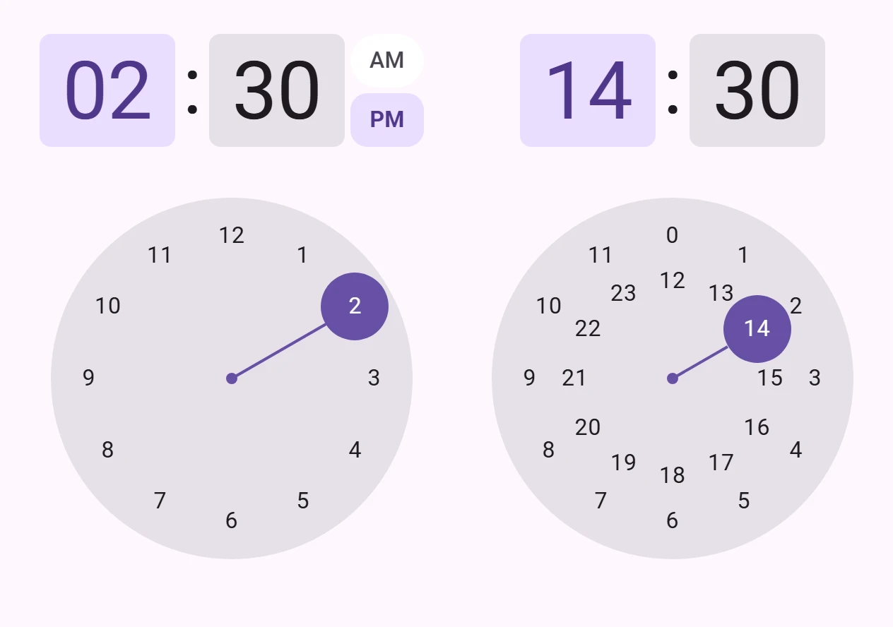
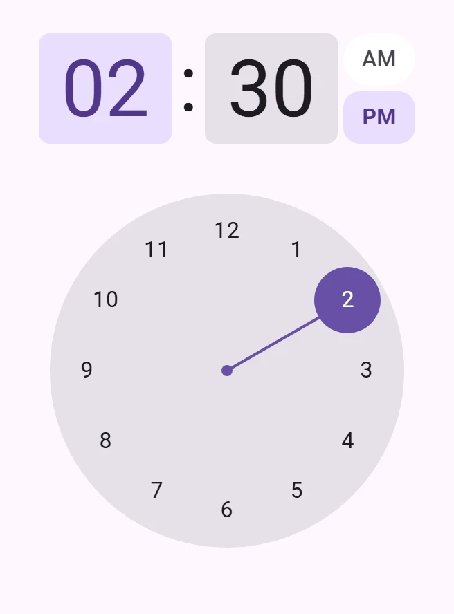
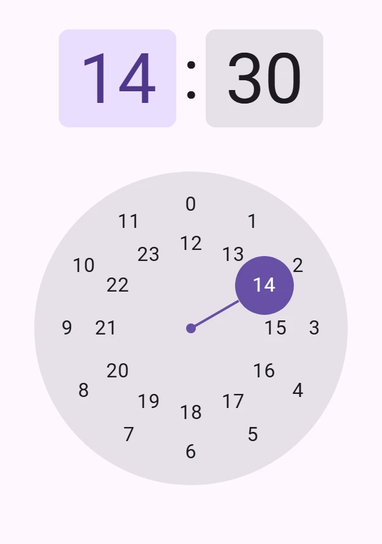
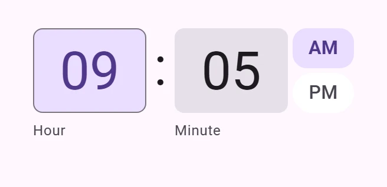
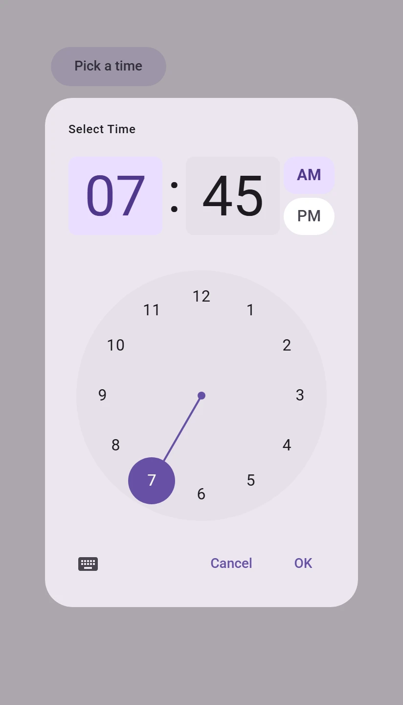

<!-- catalog-only-start --><!-- ---
name: Time picker
dirname: timepicker
-----><!-- catalog-only-end -->

<catalog-component-header>
<catalog-component-header-title slot="title">

# Time picker

<!-- no-catalog-start -->

<!-- [TOC] -->

<!-- external-only-start -->
**This documentation is fully rendered on the
[petal-elements catalog](https://petal.anontokyo.vip/catalog/components/time-picker/).**
<!-- external-only-end -->

<!-- no-catalog-end -->

[Time pickers](https://m3.material.io/components/time-pickers)<!-- {.external} -->
let people select a time.

</catalog-component-header-title>



</catalog-component-header>

*   [Design article](https://m3.material.io/components/time-pickers) <!-- {.external} -->
*   [API Documentation](#api)
*   [Source code](https://github.com/Saki340/petal-elements/tree/main/timepicker)
    <!-- {.external} -->

This follows Jetpack Compose Material 3 (`TimePicker`, `TimeInput`,
`TimePickerDialog`, `TimePickerTokens`, `TimeInputTokens`). The Expressive
styles (the vibrant colors and shapes, and the scroll wheel `TimeScroll`) are
not available yet.

## Usage

`petal-time-picker` shows the hour and minute, an AM and PM toggle in 12-hour
time, and a clock dial. Its `value` is a 24-hour time (`14:30`), like
`<input type="time">`; it is `''` until a time is set, while the picker shows
00:00. Changing the time fires `input` and `change`.

<!-- no-catalog-start -->



<!-- no-catalog-end -->
<!-- catalog-include "figures/timepicker/usage.html" -->

```html
<petal-time-picker value="14:30"></petal-time-picker>
```

Tap or drag on the dial to set the hour; the dial then shows the minutes. Tap
the hour or minute above it to choose which the dial sets (`selection`). A
tap sets the closest hour or five minutes; a drag sets any minute.

### 12 and 24 hours

The hour cycle follows the locale (from `locale`, the closest `lang`
attribute, or the browser's language): 12 hours for `en-US`, 24 for `de`,
`zh` or `ja`. Set `hour-cycle="12"` or `"24"` to choose. In 24 hours the
hours from 12 sit on an inner circle of the dial.

<!-- no-catalog-start -->



<!-- no-catalog-end -->
<!-- catalog-include "figures/timepicker/usage-24h.html" -->

```html
<petal-time-picker hour-cycle="24" value="14:30"></petal-time-picker>
```

### Layout

`layout="vertical"` puts the dial below the time, `layout="horizontal"`
beside it. The default, `auto`, is horizontal in a landscape viewport less than
600px high (a phone on its side), as Compose picks by orientation; there the
dial is 256px, or 238px and 200px in viewports less than 384px and 330px high.

### Text input

`display-mode="input"` shows two text fields instead of the dial, as Compose's
`TimeInput`. They take digits only, move from the hour to the minute as soon
as the hour is clear, and show Compose's errors for a number out of range.

<!-- no-catalog-start -->



<!-- no-catalog-end -->
<!-- catalog-include "figures/timepicker/usage-input.html" -->

```html
<petal-time-picker display-mode="input" value="09:05"></petal-time-picker>
```

### Dialog

`petal-time-picker-dialog` shows the picker in a modal dialog with a title, a
button that switches between the dial and the text fields, and Cancel and OK.
The time is kept only when OK is pressed: then `value` changes and `change`
fires. Open it with `show()` or `open`.

<!-- no-catalog-start -->



<!-- no-catalog-end -->
<!-- catalog-include "figures/timepicker/usage-dialog.html" -->

```html
<petal-filled-tonal-button id="pick-time">Pick a time</petal-filled-tonal-button>
<petal-time-picker-dialog id="time-dialog" value="07:45"></petal-time-picker-dialog>

<script type="module">
  const dialog = document.querySelector('#time-dialog');
  document.querySelector('#pick-time').addEventListener('click', () => dialog.show());
  dialog.addEventListener('change', () => console.log(dialog.value));
</script>
```

### Forms

With a `name`, the picker submits its value with its form.

### Language

Numbers and the AM and PM labels come from `Intl` for the locale; set
`am-label` and `pm-label` to change them. The other texts are English, as
Compose's defaults: replace the dialog's with `picker-title`, `input-title`,
`confirm-label`, `dismiss-label`, `input-mode-label` and `picker-mode-label`,
and the picker's read-out, label and error texts with `messages`:

```html
<petal-time-picker-dialog
    lang="zh-CN"
    picker-title="选择时间"
    input-title="输入时间"
    confirm-label="确定"
    dismiss-label="取消"></petal-time-picker-dialog>

<script type="module">
  document.querySelector('petal-time-picker-dialog').messages = {
    hour: '时',
    minute: '分',
    hour24Error: '小时应为 0–23',
    minuteError: '分钟应为 0–59',
    selectHour: '选择小时',
    selectMinute: '选择分钟',
    hour24Suffix: '%1 时',
    minuteSuffix: '%1 分',
  };
</script>
```

## Accessibility

The hour and minute are radio buttons that choose what the dial sets; AM and
PM are a radio group. On the dial, one number is in the tab order: the arrow
keys move around the dial, and Enter or Space picks the focused number. The
text fields are named "Hour" and "Minute" and announce their errors.

## Compose behavior

*   The hour and minute are 96 by 80dp in DisplayLarge, primary-container
    when selected, with a 24dp colon. The AM and PM toggle is 52 by 80dp
    (216 by 38dp below the time when horizontal): two buttons 4dp apart that
    turn from round to 12dp corners when checked, on the fast spatial spring.
*   The dial is 256dp on surface-container-highest, 36dp below the time,
    with numbers on circles 101 and 69/256 across. The 48dp primary handle
    sits on a 2dp track from an 8dp center, and the number under it shows in
    on-primary.
*   A tap moves the handle to the closest hour or five minutes on the default
    spatial spring; a drag follows the pointer and settles on the minute. After
    an hour is tapped, the dial shows minutes 100ms later; the two faces
    cross-fade on the default effects spring.
*   In text input, the fields are 96 by 72dp in DisplayMedium, outlined while
    selected, with BodySmall supporting text 7dp below.
*   The dialog's title is LabelMedium, 24dp from the top and start with 20dp
    below it, and the actions are 8dp apart with 24dp below.

## Theming

Time pickers support [Material theming](../theming/README.md).

### Tokens

Token                                                    | Default value
-------------------------------------------------------- | ----------------------------------------
`--md-time-picker-clock-dial-color`                      | `--md-sys-color-surface-container-highest`
`--md-time-picker-clock-dial-selector-handle-container-color` | `--md-sys-color-primary`
`--md-time-picker-clock-dial-selected-label-text-color`  | `--md-sys-color-on-primary`
`--md-time-picker-clock-dial-unselected-label-text-color` | `--md-sys-color-on-surface`
`--md-time-picker-time-selector-selected-container-color` | `--md-sys-color-primary-container`
`--md-time-picker-time-selector-selected-label-text-color` | `--md-sys-color-on-primary-container`
`--md-time-picker-time-selector-unselected-container-color` | `--md-sys-color-surface-container-highest`
`--md-time-picker-period-selector-selected-container-color` | `--md-sys-color-primary-container`
`--md-time-picker-period-selector-unselected-container-color` | `--md-sys-color-surface-container-lowest`
`--md-time-picker-clock-dial-container-size`             | `256px`

<!-- auto-generated API docs start -->

## API


### PetalTimePicker <code>&lt;petal-time-picker&gt;</code>

#### Properties

<!-- mdformat off(autogenerated might break rendering in catalog) -->

| Property | Attribute | Type | Default | Description |
| --- | --- | --- | --- | --- |
| `value` | `value` | `string` | `''` | The time, as `HH:MM` in 24 hours (`14:30`), or `''` for none yet. |
| `displayMode` | `display-mode` | `TimePickerDisplayMode` | `'picker'` | `picker` shows the clock dial, `input` text fields. |
| `hourCycle` | `hour-cycle` | `"" \| "12" \| "24"` | `''` | `12` or `24` hours. Defaults to the locale's: 24 hours for `de` or `zh`, 12 for `en-US`. |
| `locale` | `locale` | `string` | `''` | The locale for numbers, AM and PM and the hour cycle. Defaults to the closest `lang` attribute or the browser's language. |
| `layout` | `layout` | `TimePickerLayout` | `'auto'` | `vertical` (the dial below the time), `horizontal` (beside it), or `auto`: horizontal in a landscape viewport less than 600px high. |
| `amLabel` | `am-label` | `string` | `''` | The AM label. Defaults to the locale's. |
| `pmLabel` | `pm-label` | `string` | `''` | The PM label. Defaults to the locale's. |
| `messages` |  | `TimePickerMessages` | `{}` | Replaces some of the read-out and shown texts. |
| `selection` | `selection` | `TimePickerSelection` | `'hour'` | Which number the dial sets. |
| `name` | `name` | `string` | `undefined` | The HTML name to use in form submission. |
| `disabled` | `disabled` | `boolean` | `undefined` | Whether or not the element is disabled. |
| `is24Hour` |  | `boolean` | `undefined` |  |
| `form` |  | `HTMLFormElement` | `undefined` | The associated form element with which this element's value will submit. |
| `labels` |  | `NodeList` | `undefined` | The labels this element is associated with. |

<!-- mdformat on(autogenerated might break rendering in catalog) -->

#### Methods

<!-- mdformat off(autogenerated might break rendering in catalog) -->

| Method | Parameters | Returns | Description |
| --- | --- | --- | --- |
| `formResetCallback` | _None_ | `void` |  |
| `formStateRestoreCallback` | `state` | `void` |  |

<!-- mdformat on(autogenerated might break rendering in catalog) -->

#### Events

<!-- mdformat off(autogenerated might break rendering in catalog) -->

| Event | Type | [Bubbles](https://developer.mozilla.org/en-US/docs/Web/API/Event/bubbles) | [Composed](https://developer.mozilla.org/en-US/docs/Web/API/Event/composed) | Description |
| --- | --- | --- | --- | --- |
| `input` | `Event` | Yes | Yes | The time changed. |
| `change` | `Event` | Yes | No | The time changed. |

<!-- mdformat on(autogenerated might break rendering in catalog) -->

### PetalTimePickerDialog <code>&lt;petal-time-picker-dialog&gt;</code>

#### Properties

<!-- mdformat off(autogenerated might break rendering in catalog) -->

| Property | Attribute | Type | Default | Description |
| --- | --- | --- | --- | --- |
| `open` | `open` | `boolean` | `false` | Opens the dialog when `true`, closes it when `false`. |
| `value` | `value` | `string` | `''` | The confirmed time, as `HH:MM`, or `''`. |
| `displayMode` | `display-mode` | `TimePickerDisplayMode` | `'picker'` | `picker` shows the clock dial, `input` text fields. |
| `hourCycle` | `hour-cycle` | `"" \| "12" \| "24"` | `''` | `12` or `24` hours; defaults to the locale's. |
| `locale` | `locale` | `string` | `''` | The locale; see `petal-time-picker`. |
| `layout` | `layout` | `TimePickerLayout` | `'auto'` | The picker's layout; see `petal-time-picker`. |
| `hideModeToggle` | `hide-mode-toggle` | `boolean` | `false` | Hides the button that switches between the dial and the text fields. |
| `pickerTitle` | `picker-title` | `string` | `'Select Time'` | The title with the dial. |
| `inputTitle` | `input-title` | `string` | `'Enter Time'` | The title with the text fields. |
| `confirmLabel` | `confirm-label` | `string` | `'OK'` | The confirm button's label. |
| `dismissLabel` | `dismiss-label` | `string` | `'Cancel'` | The dismiss button's label. |
| `inputModeLabel` | `input-mode-label` | `string` | `'Switch to text input mode'` | The mode button's name with the dial. |
| `pickerModeLabel` | `picker-mode-label` | `string` | `'Switch to clock mode'` | The mode button's name with the text fields. |
| `amLabel` | `am-label` | `string` | `''` | The AM label; see `petal-time-picker`. |
| `pmLabel` | `pm-label` | `string` | `''` | The PM label; see `petal-time-picker`. |
| `quick` | `quick` | `boolean` | `false` | Skips the opening and closing animations. |
| `messages` |  | `TimePickerMessages` | `{}` | Replaces some of the picker's texts. |
| `returnValue` |  | `string` | `undefined` |  |

<!-- mdformat on(autogenerated might break rendering in catalog) -->

#### Methods

<!-- mdformat off(autogenerated might break rendering in catalog) -->

| Method | Parameters | Returns | Description |
| --- | --- | --- | --- |
| `show` | _None_ | `Promise<void>` | Opens the dialog. Resolves once it has opened. |
| `close` | `returnValue` | `Promise<void>` | Closes the dialog. Resolves once it has closed. |

<!-- mdformat on(autogenerated might break rendering in catalog) -->

#### Events

<!-- mdformat off(autogenerated might break rendering in catalog) -->

| Event | Type | [Bubbles](https://developer.mozilla.org/en-US/docs/Web/API/Event/bubbles) | [Composed](https://developer.mozilla.org/en-US/docs/Web/API/Event/composed) | Description |
| --- | --- | --- | --- | --- |
| `open` | `Event` | No | No | The dialog is opening, before any animations. --cancelable |
| `opened` | `Event` | No | No | The dialog has opened, after any animations. |
| `close` | `Event` | No | No | The dialog is closing, before any animations. --cancelable |
| `closed` | `Event` | No | No | The dialog has closed, after any animations. |
| `cancel` | `Event` | No | No | The dialog was canceled with Escape or by clicking outside it. --cancelable |
| `change` | `Event` | Yes | No | A time was confirmed with OK. |

<!-- mdformat on(autogenerated might break rendering in catalog) -->

<!-- auto-generated API docs end -->
