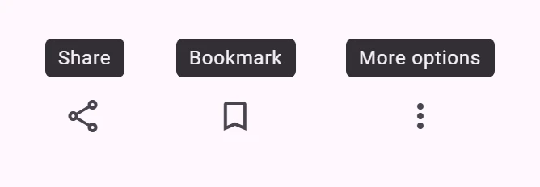
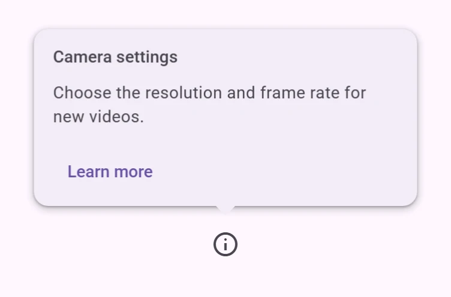

<!-- catalog-only-start --><!-- ---
name: Tooltip
dirname: tooltip
-----><!-- catalog-only-end -->

<catalog-component-header>
<catalog-component-header-title slot="title">

# Tooltip

<!-- no-catalog-start -->

<!-- [TOC] -->

<!-- external-only-start -->
**This documentation is fully rendered on the
[petal-elements catalog](https://petal.anontokyo.vip/catalog/components/tooltip/).**
<!-- external-only-end -->

<!-- no-catalog-end -->

[Tooltips](https://m3.material.io/components/tooltips)<!-- {.external} -->
briefly describe an element, such as the action of an icon button.

</catalog-component-header-title>



</catalog-component-header>

*   [Design article](https://m3.material.io/components/tooltips) <!-- {.external} -->
*   [API Documentation](#api)
*   [Source code](https://github.com/Saki340/petal-elements/tree/main/tooltip)
    <!-- {.external} -->

The values follow Jetpack Compose Material 3 (`PlainTooltipTokens`,
`PlainTooltip`).

## Usage

Give the anchor an id and point the tooltip at it with `for`. The tooltip shows
while the anchor is hovered or has keyboard focus, and for 1.5 seconds after a
touch long press. It sits 4px above the anchor, or below it when there is no
room above.

<!-- no-catalog-start -->


<!-- no-catalog-end -->
<!-- catalog-include "figures/tooltip/usage.html" -->

```html
<petal-icon-button id="bookmark" aria-label="Bookmark">
  <petal-icon>bookmark</petal-icon>
</petal-icon-button>
<petal-tooltip for="bookmark">Bookmark</petal-tooltip>
```

The anchor can also be set from script with the `anchor` property, for an
element in another shadow root.

### Long text

Text wraps at 200px. Keep tooltips to a few words; use a dialog or the page for
longer content.

<!-- no-catalog-start -->


<!-- no-catalog-end -->
<!-- catalog-include "figures/tooltip/usage-long.html" -->

## Rich tooltip

`petal-rich-tooltip` follows Compose's `RichTooltip`: a card with a title (the
`title` slot), supporting text (the default slot) and an action (the `action`
slot), for more context than a few words.

<!-- no-catalog-start -->



<!-- no-catalog-end -->
<!-- catalog-include "figures/tooltip/usage-rich.html" -->

```html
<petal-icon-button id="camera-info" aria-label="About camera settings">
  <petal-icon>info</petal-icon>
</petal-icon-button>
<petal-rich-tooltip for="camera-info" persistent caret>
  <span slot="title">Camera settings</span>
  Choose the resolution and frame rate for new videos.
  <petal-text-button slot="action">Learn more</petal-text-button>
</petal-rich-tooltip>
```

*   It shows like a plain tooltip, or with `show()`. Without `persistent` it
    hides when the pointer leaves the anchor and the tooltip, or focus leaves
    them.
*   With `persistent` (Compose's `isPersistent`) it stays until something
    outside it is pressed, Escape is pressed, an action is clicked, or `hide()`
    is called. Use it when the tooltip has an action. Compose dismisses even a
    persistent tooltip when the mouse leaves the anchor; here it stays, so the
    action can be reached with a mouse.
*   It is 320px wide at most, on surface-container with the medium shape and
    a level 2 shadow. The title's first baseline is 28px from the top, the
    text's 24px below the title, with 16px under the text; the action row is
    at least 36px with 8px under it.
*   It sits centered above the anchor, aligned with the anchor's start or end
    at the viewport's edges, and below the anchor when there is no room above.
    `caret` draws a 16 by 8px caret pointing at the anchor.
*   A persistent rich tooltip has `role="dialog"`, since a tooltip cannot hold
    controls; otherwise `role="tooltip"`.

Rich tooltip tokens are `--md-rich-tooltip-*`: `container-color`,
`container-shape`, `subhead-color`, `supporting-text-color`,
`action-label-text-color` and the type tokens of `RichTooltipTokens`.

## Accessibility

The tooltip has `role="tooltip"` and is added to the anchor's
`aria-describedby`. Escape hides it, and it stays while the anchor is hovered
or focused, so it can be read (WCAG 1.4.13).

A tooltip only describes its anchor; it is not its name. Icon buttons still
need an `aria-label`.

### Differences from Compose

Compose hides a plain tooltip 1.5 seconds after it appears, also on hover. On
the web that would hide it while the pointer is still on the anchor, so here
only a touch long press uses the 1.5-second timeout. Compose also does not show
tooltips on keyboard focus; here they do.

## Theming

Tooltips support [Material theming](../theming/README.md). Every token of
Compose's `PlainTooltipTokens` is a `--md-tooltip-*` custom property.

### Tokens

Token                                 | Default value
------------------------------------- | -------------
`--md-tooltip-container-color`        | `--md-sys-color-inverse-surface`
`--md-tooltip-container-shape`        | `--md-sys-shape-corner-extra-small`
`--md-tooltip-supporting-text-color`  | `--md-sys-color-inverse-on-surface`
`--md-tooltip-supporting-text-font`   | `--md-sys-typescale-body-small-font`

*   [All tokens](https://github.com/Saki340/petal-elements/blob/main/tokens/versions/compose/values/_md-comp-plain-tooltip.scss)
    <!-- {.external} -->

### Example

<!-- no-catalog-start -->


<!-- no-catalog-end -->
<!-- catalog-include "figures/tooltip/theming.html" -->

```html
<style>
  petal-tooltip {
    --md-tooltip-container-shape: 0px;
    --md-tooltip-container-color: #006a6a;
    --md-tooltip-supporting-text-color: #ffffff;
  }
</style>
```

<!-- auto-generated API docs start -->

## API


### PetalTooltip <code>&lt;petal-tooltip&gt;</code>

#### Properties

<!-- mdformat off(autogenerated might break rendering in catalog) -->

| Property | Attribute | Type | Default | Description |
| --- | --- | --- | --- | --- |
| `for` | `for` | `string` | `''` | The id of the anchor element, in the same document or shadow root. |
| `anchor` |  | `HTMLElement` | `undefined` |  |

<!-- mdformat on(autogenerated might break rendering in catalog) -->

#### Methods

<!-- mdformat off(autogenerated might break rendering in catalog) -->

| Method | Parameters | Returns | Description |
| --- | --- | --- | --- |
| `show` | _None_ | `void` | Shows the tooltip next to its anchor. |
| `hide` | _None_ | `void` | Hides the tooltip. |

<!-- mdformat on(autogenerated might break rendering in catalog) -->

#### Events

<!-- mdformat off(autogenerated might break rendering in catalog) -->

| Event | Type | [Bubbles](https://developer.mozilla.org/en-US/docs/Web/API/Event/bubbles) | [Composed](https://developer.mozilla.org/en-US/docs/Web/API/Event/composed) | Description |
| --- | --- | --- | --- | --- |
| `open` | `Event` | No | No | The tooltip was shown. |
| `close` | `Event` | No | No | The tooltip was hidden. |

<!-- mdformat on(autogenerated might break rendering in catalog) -->

### PetalRichTooltip <code>&lt;petal-rich-tooltip&gt;</code>

#### Properties

<!-- mdformat off(autogenerated might break rendering in catalog) -->

| Property | Attribute | Type | Default | Description |
| --- | --- | --- | --- | --- |
| `persistent` | `persistent` | `boolean` | `false` | Keeps the tooltip shown until it is dismissed (Compose's `isPersistent`). |
| `caret` | `caret` | `boolean` | `false` | Draws a caret pointing at the anchor (TooltipDefaults.caretShape()). |
| `for` | `for` | `string` | `''` | The id of the anchor element, in the same document or shadow root. |
| `anchor` |  | `HTMLElement` | `undefined` |  |

<!-- mdformat on(autogenerated might break rendering in catalog) -->

#### Methods

<!-- mdformat off(autogenerated might break rendering in catalog) -->

| Method | Parameters | Returns | Description |
| --- | --- | --- | --- |
| `show` | _None_ | `void` | Shows the tooltip next to its anchor. |
| `hide` | _None_ | `void` | Hides the tooltip. |

<!-- mdformat on(autogenerated might break rendering in catalog) -->

#### Events

<!-- mdformat off(autogenerated might break rendering in catalog) -->

| Event | Type | [Bubbles](https://developer.mozilla.org/en-US/docs/Web/API/Event/bubbles) | [Composed](https://developer.mozilla.org/en-US/docs/Web/API/Event/composed) | Description |
| --- | --- | --- | --- | --- |
| `open` | `Event` | No | No | The tooltip was shown. |
| `close` | `Event` | No | No | The tooltip was hidden. |

<!-- mdformat on(autogenerated might break rendering in catalog) -->

<!-- auto-generated API docs end -->
