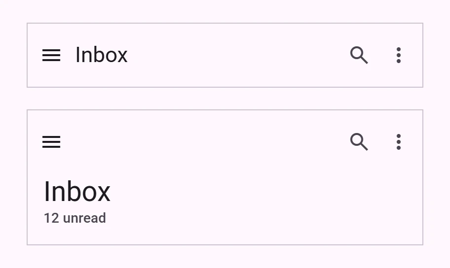
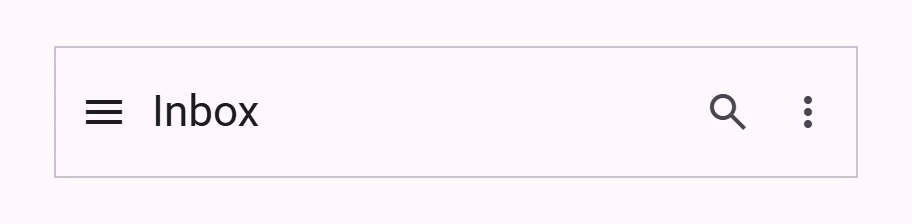
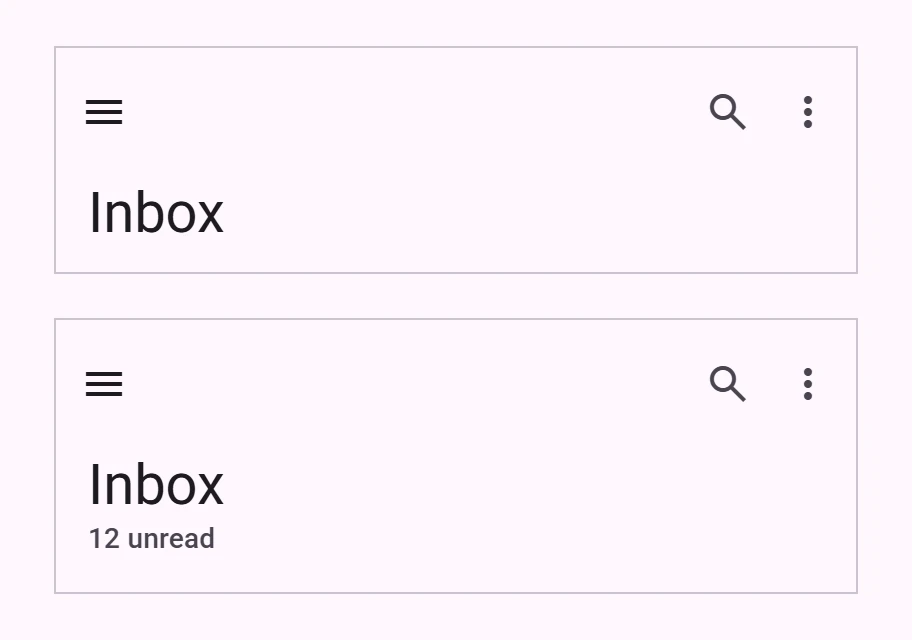
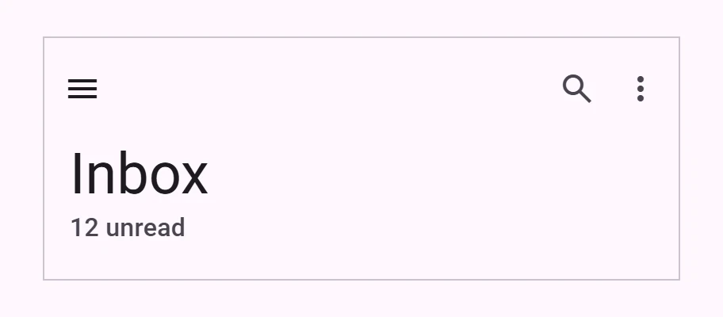
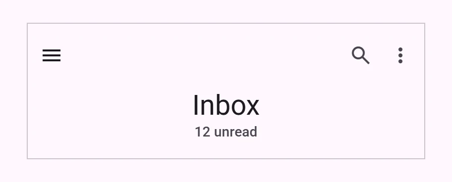
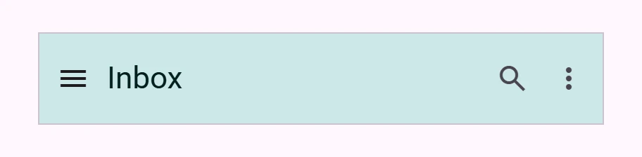

<!-- catalog-only-start --><!-- ---
name: Top app bar
dirname: top-app-bar
-----><!-- catalog-only-end -->

<catalog-component-header>
<catalog-component-header-title slot="title">

# Top app bar

<!-- no-catalog-start -->

<!-- [TOC] -->

<!-- external-only-start -->
**This documentation is fully rendered on the
[petal-elements catalog](https://petal.anontokyo.vip/catalog/components/top-app-bar/).**
<!-- external-only-end -->

<!-- no-catalog-end -->

[Top app bars](https://m3.material.io/components/app-bars)<!-- {.external} -->
show the title of a screen with navigation and actions at the top of the page.

</catalog-component-header-title>



</catalog-component-header>

*   [Design article](https://m3.material.io/components/app-bars) <!-- {.external} -->
*   [API Documentation](#api)
*   [Source code](https://github.com/Saki340/petal-elements/tree/main/appbar)
    <!-- {.external} -->

The values follow Jetpack Compose Material 3 (`AppBarTokens`,
`AppBarSmallTokens`, `AppBarMediumFlexibleTokens`,
`AppBarLargeFlexibleTokens`, and the layout in `AppBar.kt`).

## Usage

Set the title with `headline`, and put icon buttons in the `navigation` and
`actions` slots. The bar sticks to the top of the page. When content scrolls
under it, a small bar takes the scrolled container color.

<!-- no-catalog-start -->



<!-- no-catalog-end -->
<!-- catalog-include "figures/appbar/usage.html" -->

```html
<petal-top-app-bar headline="Inbox">
  <petal-icon-button slot="navigation" aria-label="Menu">
    <petal-icon>menu</petal-icon>
  </petal-icon-button>
  <petal-icon-button slot="actions" aria-label="Search">
    <petal-icon>search</petal-icon>
  </petal-icon-button>
</petal-top-app-bar>
```

`subtitle` adds a line below the title.

### Medium and large

`size="medium"` and `size="large"` are Compose's `MediumFlexibleTopAppBar`
and `LargeFlexibleTopAppBar`: a large title below the bar, 112px and 120px tall
(136px and 152px with a subtitle). As the page scrolls, the large title scrolls
away and fades out, the small title fades in, and the container takes the
scrolled color, like Compose's `exitUntilCollapsed` scroll behavior.

<!-- no-catalog-start -->



<!-- no-catalog-end -->
<!-- catalog-include "figures/appbar/usage-medium.html" -->

```html
<petal-top-app-bar size="medium" headline="Inbox" subtitle="12 unread">
  ...
</petal-top-app-bar>
```

<!-- no-catalog-start -->



<!-- no-catalog-end -->
<!-- catalog-include "figures/appbar/usage-large.html" -->

### Centered title

`centered` centers the title, as Compose's `titleHorizontalAlignment`.

<!-- no-catalog-start -->



<!-- no-catalog-end -->
<!-- catalog-include "figures/appbar/usage-centered.html" -->

### Title content

For a title with more than text, such as an icon, use the `headline` and
`subtitle` slots instead of the properties. A slotted title can only appear
once, so medium and large bars also take `collapsed-headline` and
`collapsed-subtitle` slots for the collapsed row:

```html
<petal-top-app-bar size="medium">
  <span slot="headline">JPY <petal-icon>sync_alt</petal-icon> CNY</span>
  <span slot="collapsed-headline">JPY <petal-icon>sync_alt</petal-icon> CNY</span>
</petal-top-app-bar>
```

### Collapsed title

Like Compose, the collapsed row of a medium or large bar shows the same title
and subtitle as the expanded one. Set `collapsed-headline` or
`collapsed-subtitle` to show something else there (Compose's `smallTitle` and
`smallSubtitle`); `collapsed-subtitle=""` shows no subtitle when collapsed.

```html
<petal-top-app-bar
    size="medium"
    headline="Inbox"
    subtitle="12 unread"
    collapsed-subtitle="">
</petal-top-app-bar>
```

### Scrolling container

By default the bar follows the page scroll. When the content scrolls in an
element instead, give that element an id and set `scroll-target`:

```html
<div id="list" style="overflow: auto; height: 100vh">
  <petal-top-app-bar size="medium" headline="Inbox" scroll-target="list">
  </petal-top-app-bar>
  ...
</div>
```

The bar updates during the scroll event, so `collapsedFraction` is current
in scroll listeners that run after the bar's. Listen to `collapse-change` to
react to every change of the collapsed fraction.

## Accessibility

Only one title is exposed to assistive technology at a time: the large title
while the bar is mostly expanded, the small one when it is mostly collapsed,
like Compose. Give icon buttons an `aria-label`.

The title is plain text by default. When it is the page's main heading, set
`heading-level="1"` (or another level) to make it a heading.

## Theming

Top app bars support [Material theming](../theming/README.md). Every token of
Compose's `AppBarTokens` is a `--md-top-app-bar-*` custom property.

### Tokens

Token                                         | Default value
--------------------------------------------- | -------------
`--md-top-app-bar-container-color`            | `--md-sys-color-surface`
`--md-top-app-bar-on-scroll-container-color`  | `--md-sys-color-surface-container`
`--md-top-app-bar-title-color`                | `--md-sys-color-on-surface`
`--md-top-app-bar-subtitle-color`             | `--md-sys-color-on-surface-variant`
`--md-top-app-bar-leading-icon-color`         | `--md-sys-color-on-surface`
`--md-top-app-bar-trailing-icon-color`        | `--md-sys-color-on-surface-variant`

*   [All tokens](https://github.com/Saki340/petal-elements/blob/main/tokens/versions/compose/values/_md-comp-app-bar.scss)
    <!-- {.external} -->

### Example

<!-- no-catalog-start -->



<!-- no-catalog-end -->
<!-- catalog-include "figures/appbar/theming.html" -->

```html
<style>
  petal-top-app-bar {
    --md-top-app-bar-container-color: #cce8e7;
    --md-top-app-bar-title-color: #002020;
  }
</style>
```

<!-- auto-generated API docs start -->

## API


### PetalTopAppBar <code>&lt;petal-top-app-bar&gt;</code>

#### Properties

<!-- mdformat off(autogenerated might break rendering in catalog) -->

| Property | Attribute | Type | Default | Description |
| --- | --- | --- | --- | --- |
| `size` | `size` | `TopAppBarSize` | `'small'` | `small`, `medium` or `large`. |
| `headline` | `headline` | `string` | `''` | The title. |
| `subtitle` | `subtitle` | `string` | `''` | An optional subtitle below the title. |
| `collapsedHeadline` | `collapsed-headline` | `string` | `undefined` | The title in the collapsed row of medium and large bars (Compose's `smallTitle`). When not set, the collapsed row shows `headline`. |
| `collapsedSubtitle` | `collapsed-subtitle` | `string` | `undefined` | The subtitle in the collapsed row of medium and large bars (Compose's `smallSubtitle`). When not set, the collapsed row shows `subtitle`; set it to an empty string to show no subtitle there. |
| `headingLevel` | `heading-level` | `number` | `0` | Makes the title a heading of this level (`role="heading"`), for example 1 when it is the page title. 0, the default, leaves it plain text. |
| `centered` | `centered` | `boolean` | `false` | Centers the title (`titleHorizontalAlignment`). |
| `scrollTarget` | `scroll-target` | `string` | `''` | The id of the scrolling element under the bar. Without it, the page scrolls. |
| `collapsedFraction` |  | `number` | `undefined` |  |

<!-- mdformat on(autogenerated might break rendering in catalog) -->

#### Events

<!-- mdformat off(autogenerated might break rendering in catalog) -->

| Event | Type | [Bubbles](https://developer.mozilla.org/en-US/docs/Web/API/Event/bubbles) | [Composed](https://developer.mozilla.org/en-US/docs/Web/API/Event/composed) | Description |
| --- | --- | --- | --- | --- |
| `collapse-change` | `Event` | No | No | The collapsed fraction changed (on scroll, resize or a size change). Read it from `collapsedFraction`. |

<!-- mdformat on(autogenerated might break rendering in catalog) -->

#### Slots

<!-- mdformat off(autogenerated might break rendering in catalog) -->

| Slot | Description |
| --- | --- |
| `navigation` | A navigation icon button, at the start. |
| `actions` | Action icon buttons, at the end. |
| `headline` | The title, instead of `headline`, for content other than text (an icon, for example). |
| `subtitle` | The subtitle, instead of `subtitle`. |
| `collapsed-headline` | The title in the collapsed row of medium and large bars. Defaults to `collapsed-headline` or `headline` (text only: a slotted title cannot be shown twice). |
| `collapsed-subtitle` | The subtitle in the collapsed row. |

<!-- mdformat on(autogenerated might break rendering in catalog) -->

<!-- auto-generated API docs end -->
